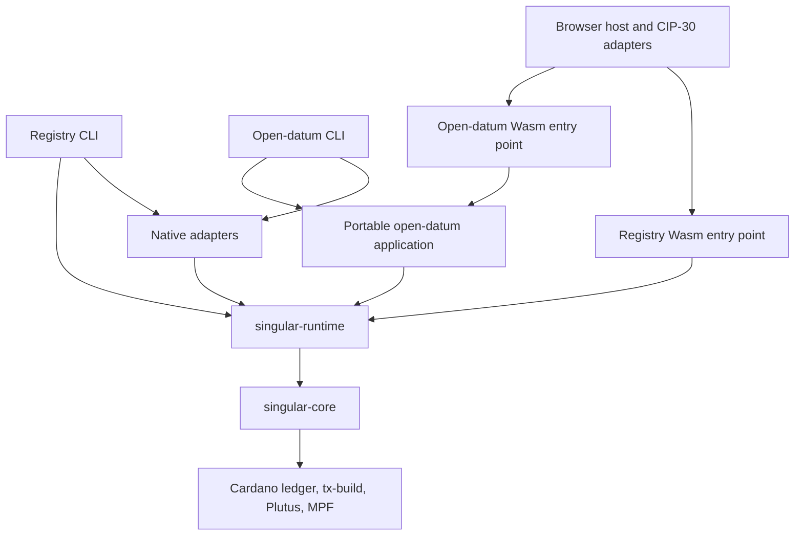

# Native/browser compatibility: interchangeable backends

Status: implementation design and planned milestone, 12 October 2026. No runtime change or acceptance is claimed by this document. The milestone delivers implemented interfaces, separated build targets and a minimal browser integration over the existing two-edge contract; a polished browser product is later work.

## Operator mandate and scheduling

The operator requested: “define the interfaces so that we can swap the providers”; “the wallet has to be CIP30”; “the provider in the sense of ledger provider, is fine”; and a separate milestone before introducing new edges, with “the WASM compilable packages ... separated”. Compilation infrastructure already exists in the organization's Cardano projects and is a reuse input, not a feasibility research project.

This milestone gates **M2: Registry extensions**, GitHub milestone 5. It does not renumber existing milestones. M1.5 (GitHub milestone 6, shareable script family) remains a separate workstream before extensions. The operator clarified: browser compatibility can run in parallel with script sharing, becomes a priority as soon as the operator can switch to Cardano KERI, and the KERI work need not wait for script sharing. There is no M1.5-to-compatibility dependency. Implementation intake binds the delivered M1 library and applicable effect-ownership work; readiness of those interfaces is distinct from a claim that all M1 acceptance is complete. This planning action starts no implementation workers and releases no unrelated paused lane.

## User stories

1. As an application author, I use Singular's registry operations with a supplied wallet and ledger provider without depending on CLI flags, signing-key files or a particular browser wallet.
2. As a browser user, I connect a CIP-30 wallet, prepare an existing registry/application operation, review and sign its exact transaction, and receive an accurate submission outcome.
3. As a CLI user, I retain existing commands, refusal behavior, transaction effects and recoverable evidence while the native backend implements the same contracts.
4. As a user returning after interruption, I reconcile the recorded transaction through the selected ledger provider without an automatic second submission.
5. As a maintainer, I build the portable components for native and Wasm from one implementation, with a mechanical gate preventing native-only dependencies from entering their build closure.

## Evidence and baseline

Source inspection only. The starting checkout was older than main; this design is rebound to fetched main `1d9f8b0da3aee5a4743b718b22abea99ef1501ff`. Lean last-change revision: `20b35407c8a8e955dea396e59ae926b7c9e13d03`; Lean tree: `d9161edd0274b67151f331949521f34bbf18612f`; constitution 1.15.0. Rebind these to the actual accepted integration head at implementation intake. This is not a reason to restore the older seven-edge implementation or older deployment-recognition policy.

| Current boundary | Source at the surveyed main | Consequence |
|---|---|---|
| Wallet stores an enterprise address and private Ed25519 key; loader reads a file | [Wallet.hs](https://github.com/lambdasistemi/singular/blob/1d9f8b0da3aee5a4743b718b22abea99ef1501ff/offchain/local-services/Singular/Registry/Wallet.hs) | Public identity, funding and signing capability must separate. A connected wallet may use several base addresses. |
| Only a local private-key function constructs SignedTx | [Signing.hs](https://github.com/lambdasistemi/singular/blob/1d9f8b0da3aee5a4743b718b22abea99ef1501ff/offchain/local-services/Singular/Registry/Signing.hs) | Add a checked external-witness path; do not expose the constructor as a shortcut. |
| Session loads a wallet; journalledSubmit signs directly; WriteContext includes a directory | [Session.hs](https://github.com/lambdasistemi/singular/blob/1d9f8b0da3aee5a4743b718b22abea99ef1501ff/offchain/cli/src/Singular/CLI/Session.hs) | Move operation orchestration behind host-independent services; keep file handling in the native host. |
| Generic acquired sessions already expose ledger facts and signed submission | [LedgerProvider.hs](https://github.com/lambdasistemi/singular/blob/1d9f8b0da3aee5a4743b718b22abea99ef1501ff/offchain/local-services/Singular/Registry/LedgerProvider.hs) | Preserve the contract, witness parameter, session scope, network and evidence strength. |
| Main library and local-services link native services together with computations | [Cabal components](https://github.com/lambdasistemi/singular/blob/1d9f8b0da3aee5a4743b718b22abea99ef1501ff/offchain/singular-registry.cabal) | Separate actual component dependency closures, not just module names. |

Reuse inventory, inspected local revisions:

- `cardano-tx-tools` `1b623b133989d1b1c0d4e52164d26ef76f0d0510`: `tx-build`, ledger construction/balancing, witness/signing facilities. Singular already depends on `cardano-tx-tools:tx-build`. Inspect the selected release's library closure before reusing other components; native vault/CLI code is not a portable dependency merely because it belongs to this repository.
- `cardano-swiss-knife` `02516df9cb5ea0d072d28cafac8fc827048232fa`: shared transaction entry, witness, provider and engine wrappers, with thin browser/CLI/Node hosts. Reuse compatible modules or upstream a reusable extraction; do not copy ledger or crypto semantics into Singular's host. Its provider is precedent, not a replacement for Singular's existing session/evidence contract.
- `cardano-mpfs-offchain` `0f82465f5f828c2ab987a166e9e24c2368228d01`: portable builders and witness assembly behind a small Wasm entry point; native/Wasm comparison tests; shared `cardano-ledger-wasm.lib.wasm.mkCardanoLedgerWasm` build.
- `cardano-ledger-wasm` `845877fde0907b58b150a2c8302033b4e73e9061`: shared Wasm dependency/build machinery. Consume pinned infrastructure; no ledger porting campaign.
- `haskell-mts` `13264a52b47e3a1f43a6ebeebd424a10f9e4466a`: portable MPF write/prove/verify and browser persistence precedent.

Local source inspection does not certify those revisions' release status. Select mutually compatible dependency pins in the package ticket and record their provenance.

## Package and dependency design

Names below are proposed component names. The first delivery freezes their exact Cabal names and source ownership; their responsibility and dependency direction are the contract.



| Component | Owns | Excluded from its dependency closure |
|---|---|---|
| `singular-core` | Wire/domain types, registry rules and selection computations, replay/proofs, builders, local ledger evaluation, decoded release data, witness decoding/validation/assembly, operation/result types | CLI/parser, filesystem/process access, POSIX, native HTTP/TLS setup, private-key loading, browser globals |
| `singular-runtime` | Existing LedgerProvider/Session interfaces, wallet and store ports, explicit command state, shared orchestration, confirmation/reconciliation policy, receipt values | Concrete native/browser adapters; paths or global environment reads as domain configuration; unowned mutation |
| `singular-native` | Local-key signer and optional existing vault integration, native transport composition, file journal/locks, release loading, native clocks/deadlines and trace sinks | Browser dependency |
| `registry-cli` and application CLI components | Parser/flags, environment resolution, presentation and native composition | Implementation of domain, signing-validation or recovery rules |
| `singular-wasm` | Versioned codec/entry points and browser effect bridge around the same core/runtime | Native component dependency or independent copies of transaction/recovery logic |
| Browser host | Wallet discovery/enable, CIP-30 calls, Fetch, IndexedDB, UI rendering and lifecycle | Cardano CBOR/ledger/crypto semantics or a second implementation of Singular operations |

Split pure values from effectful loading within mixed modules. In particular: Wallet address codecs versus key loading; Signing witness assembly versus local signing; Blueprint/Deployment decoding versus files; Confirmation policy versus native clock implementation; ReceiptBody values versus Receipt/ManagedState/Root persistence; Koios wire interpretation versus transport/recorder setup. Move CLI workflow logic only after consuming #541/#543's ownership APIs. Preserve #528's application separation: open-datum remains an application consumer, not a dependency of the registry core.

Use separately buildable Cabal packages or public sublibraries with an isolated Wasm project selecting only the portable graph. A flag that merely omits the CLI executable is insufficient if the portable library still drags in its dependencies. The native compatibility facade may retain existing module imports during migration; portable consumers must not need that facade. Do not add a new effect framework or depend on #430's proposed GADT parser redesign.

## Open-datum is the first application consumer

The registry library supplies registry operations and reusable execution services. Open-datum supplies its own envelope, application policy/approval construction, payload operations and application-specific checks. The dependency points from open-datum to Singular; Singular does not import open-datum.

The surveyed [open-datum package](https://github.com/lambdasistemi/singular/blob/1d9f8b0da3aee5a4743b718b22abea99ef1501ff/applications/open-datum/offchain/open-datum.cabal) already lives outside the registry, but its single library mixes Envelope/Build/Book/Update with Command/Entry/Root and depends on singular-registry:registry-cli. Thus #528's application separation is a foundation, not yet the complete portable application boundary.

Split it into a portable open-datum application component (domain/builders and application workflows over Singular's runtime ports), a native CLI adapter retaining the common Singular flag group, and a thin browser/Wasm entry point. Component names are frozen in #580. The application browser entry point may share the static integration host and adapter code with the registry entry point; separate logical modules do not mandate separate websites or duplicated Wasm runtimes. The registry-only portable component must build without linking open-datum.

| User action | Open-datum responsibility | Singular responsibility |
|---|---|---|
| Register | Construct the application envelope and approval, choose its destination/data and book through the library | Build the generic request and fold insertActive |
| Update payload | Spend/recreate the controlled application output, preserving its active token, control fields and protected deposit | Supply shared wallet, ledger, evaluation, submission, evidence and recovery services; no registry edge |
| Terminate | Authorize/build the application request and supply the required application inputs | Fold updateTerminal and enforce the model-bound registry effects |

Each application operation receives the same supplied wallet/ledger/store/runtime services as a registry operation. Open-datum has no private-key-bearing wallet API or separate CIP-30 implementation. It can expose an explicit fold option by calling Singular's fold API; wallet consent, witness assembly and recovery use the shared machinery. The browser host renders application-specific actions while the domain logic remains in Haskell.

Acceptance in #580 requires both portable registry and application builds, with a negative dependency control for application-to-CLI leakage and registry-to-application leakage. #581 exercises open-datum preparation/signing through CIP-30. #582 proves the connected browser and native register → payload update → terminate journey through both libraries. Application behavior binds its own Lean model as well as the registry model: surveyed application Lean last-change revision 0d6e5736fa1351ad652c356506114508ca476442, tree 46a05f18210401e565ade28230baf80f5f832c67, including bookInsertStep, bookTerminateStep and updateStep. Rebind both models at implementation intake; conflicts require the constitution's escalation path.

This makes open-datum the first executable consumer proving that a later Cardano KERI application can supply its own policy and commands without depending on either the open-datum implementation or Singular's CLI parser. It does not deliver or certify Cardano KERI integration.

## Wallet contract

The runtime sees public data and the ability to request witnesses; private keys and JS wallet objects stay within their adapters. Native local-key signing implements this same port. Read-only inspection requires no wallet connection.

Illustrative Haskell signatures, not shipped or compile-tested declarations:

```haskell
data WalletBackend m = WalletBackend
  { openWallet :: WalletSelection
               -> m (Either WalletError (WalletSession m))
  }

data WalletSession m = WalletSession
  { walletBinding :: WalletBinding
  , readWalletView :: m (Either WalletError WalletView)
  , requestWitnesses :: SigningRequest
                     -> m (Either WalletError WitnessResponse)
  , releaseWallet :: m ()
  }

data WalletView = WalletView
  { binding :: WalletBinding
  , addressNetwork :: AddressNetwork
  , usedAddresses :: [Addr]
  , unusedAddresses :: [Addr]
  , changeAddress :: Addr
  , availableOutputs :: Outputs
  }

data SigningRequest = SigningRequest
  { operationId :: OperationId
  , expectedWallet :: WalletBinding
  , prepared :: PreparedTransaction
  , signingMode :: SigningMode
  }

validateAndAssemble :: PreparedTransaction -> WitnessResponse
                    -> Either SigningFailure SignedTx

runOperation :: Monad m => Services w m -> Operation -> m OperationResult
```

`WalletBinding` is an opaque adapter/session generation plus the public selection context. It is not a private key and is not claimed to be a globally stable account identifier. `WitnessResponse` carries the operation binding and untrusted witness bytes. `SigningMode` makes partial collection explicit. `WalletError` distinguishes access denied, user-declined signing, account change, unsupported capability, malformed response, network mismatch, insufficient wallet information, cancellation and transport/internal failure. Preserve the backend's diagnostic within its class; none is a Lean or ledger refusal.

The composition boundary brackets every opened wallet session, including exceptions, refusal and cancellation; callers do not obtain an unowned connection. Release invalidates that adapter session and its pending operation generations. It does not claim to disconnect the user's wallet globally or revoke permissions that the wallet API cannot revoke. Public views are values; the adapter alone holds mutable connection handles. A typed witness-collection value can retain checked partial responses before final assembly; its type is distinct from submission-ready SignedTx.

`PreparedTransaction` freezes the exact transaction body, body identity, immutable existing script/data witnesses, selected network, registry/application identity, operation identity, resolved input/evaluation context, funding/change choice and wallet generation. Constructors are private and are produced by the shared builder path. A change to these inputs means a newly prepared transaction and new signing request.

Actor authorization, payment address, destination/refund address, funding inputs and change address are distinct values. Do not infer ownership of every funding key from one enterprise address or substitute the change address for a model-required owner. Preserve M1 key-credential authorization; an unsupported address/credential role receives an explicit capability error. Multiple ordinary wallet addresses and multi-key funding are covered without expanding the registry law.

Wallet output data is candidate funding data, not proof of a ledger snapshot. Resolve selected inputs through the acquired LedgerProvider session and retain its actual evidence strength. Reject missing, changed or conflicting selected outputs before signing. Funding selection uses the wallet's spendable set, preserves protocol/ledger constraints, and keeps required collateral and its return under the existing builder/evaluator contract. #491 owns broader funding preparation ergonomics; do not reproduce it here.

### Browser mapping

Use the [CIP-30 specification](https://cips.cardano.org/cip/CIP-0030), checked 12 October 2026: connection uses `enable`; public data comes from address/UTxO methods; `signTx` returns witnesses and supports partial signing. `AccountChange` requires reconnection. `getNetworkId` distinguishes mainnet/testnet, not individual testnet magics. `getCollateral` is deprecated and cannot be a mandatory capability. These standard facts guide the adapter; the following safeguards are Singular's design.

- Configure the actual network magic/provider explicitly, compare wallet address-network information, and preserve ledger time/network checks. Do not claim CIP-30 proves preprod versus preview. If chain identity cannot be established by the chosen sources, report that limit rather than inventing a wallet guarantee.
- Invalidate prepared work on an observed account/network change or session replacement. Re-read public selection before signing and before submission; fail closed on an observed mismatch. CIP-30 supplies no universal stable account ID or atomic multi-call snapshot: record the observation limit and validate selected inputs/witnesses rather than claiming invisible switches are detectable.
- Decode and verify returned vkey witnesses against the frozen body hash using shared ledger/crypto code. Reject invalid signatures, conflicting witnesses and body/context mismatches. Preserve existing scripts, datums, redeemers, auxiliary data and script-integrity commitments. Accept only supported witness forms; return a typed unsupported result for the rest.
- Compute completeness from resolved spending/collateral inputs and ledger witness requirements, as well as explicit required signers. A model-level signer-free fold still needs funding witnesses. A partial response may be retained for explicit further collection; it cannot become submission-ready until the supported transaction's witness obligations are met. Completeness is not a claim of full ledger acceptance.
- Keep `SignedTx` opaque. Integrate checked assembly into the existing signed-submission boundary without creating a public unchecked CBOR constructor. The final bytes/body hash and transaction ID remain tied to the prepared operation.
- Use LedgerProvider submission/confirmation by default. The wallet port does not implicitly call CIP-30 submission. An alternative submit transport must be an explicit adapter satisfying the existing submission/evidence contract, not a silent retry path.

No embedded browser seed vault is required by this milestone. Native vault creation remains #490; Swiss Knife's native/browser signing infrastructure is a reuse source, not a reason to put key custody in Singular's portable API.

## Other replaceable services

| Port | Contract | Native adapter | Browser adapter |
|---|---|---|---|
| LedgerProvider / Session | Existing acquired raw facts, explicit network, evidence types, submission outcomes | Existing Koios/private-node compositions | Fetch-backed transport behind the same semantics; pure local evaluation retained |
| WalletBackend | Public wallet view and scoped witness request | Existing local-key signer; vault supplied by #490 when available | CIP-30 |
| OperationStore | Prepare durable signed bytes and metadata, append outcomes, enumerate/read recovery records, acquire one operation owner | Existing managed journal/body storage | IndexedDB transaction-backed adapter |
| RuntimeClock / cancellation | Explicit time, deadline, interruptible waiting and poll delays | Current calling-thread timeout machinery | Abortable transport/timers and invalidatable operation awaits |
| ReleaseSource | Load bytes at composition boundary; core verifies recognized release identity | Packaged files | Pinned bundled/fetched assets validated by the same core |
| EvidenceSink | Preserve ordered scoped facts, diagnostics and receipts, including failures | Native files/output | Store/export/UI presentation of the same receipt values |

The corresponding proposed service surface is below. All named record/payload types are explicit domain values defined in the portable runtime; these are design signatures, not claims of implemented symbols. The acquired provider remains the existing interface, rather than a new generic HTTP API.

```haskell
data Services w m = Services
  { ledger :: (Network, LedgerProvider w m)
  , wallet :: WalletBackend m
  , operationStore :: OperationStore m
  , clock :: RuntimeClock m
  , releases :: ReleaseSource m
  , evidence :: EvidenceSink m
  }

data OperationStore m = OperationStore
  { claim :: OperationKey -> m (Either StoreError OperationLease)
  , prepare :: OperationLease -> PreparedRecord
            -> m (Either StoreError StoreRevision)
  , appendOutcome :: OperationLease -> StoreRevision -> RecordedOutcome
                  -> m (Either StoreError StoreRevision)
  , load :: OperationKey -> m (Either StoreError (Maybe StoredOperation))
  , listRecoverable :: RecoveryScope -> m (Either StoreError [OperationKey])
  , release :: OperationLease -> m (Either StoreError ())
  }

data RuntimeClock m = RuntimeClock
  { now :: m TimeObservation
  , await :: forall a. OperationScope -> Deadline -> m a
          -> m (Either AwaitFailure a)
  , delay :: OperationScope -> Duration -> m (Either AwaitFailure ())
  }

newtype ReleaseSource m = ReleaseSource
  { fetchReleaseBytes :: ReleaseLocator -> m (Either ReleaseError ReleaseBytes) }

newtype EvidenceSink m = EvidenceSink
  { emitEvidence :: ScopedEvidence -> m (Either EvidenceError ()) }
```

`OperationLease` is a store-specific opaque ownership token and generation; it is not merely an unverified timestamp. Revision checks reject stale transitions. Lease-loss/crash takeover must preserve an uncertain possibly-sent state and prohibit a second automatic send; expiry alone cannot confer permission to send. A new session brackets the lease and retains release errors. `PreparedRecord` includes signed bytes, their digest and the operation/chain/wallet binding, not a path or a builder expectation presented as observation. `RecordedOutcome` preserves existing phase semantics. `EvidenceSink` failures retain the best available partial evidence and cannot rewrite a successful/uncertain submission as a ledger refusal.

`TimeObservation` distinguishes wall time used for reporting from monotonic deadlines within one runtime; chain validity comes from the ledger session's network-time material. Host wall time is not a chain clock. A reload starts fresh runtime deadlines and reconciles persisted operation state; it does not reuse process-local monotonic timestamps. `ReleaseSource` obtains bytes only: identity verification stays in the shared core.

The storage API takes a logical key `(network, registry identity, actor context, operation id)` and records values, not a host path. Each backend must acknowledge the declared durability operation before a send is possible. Atomically retain signed bytes plus the prepared record, with a digest and format version; reject incomplete/corrupt records on recovery. Failed writes, quota/storage denial, unsupported format, stale ownership and concurrent ownership are distinct failures. Serial execution per host is not cross-tab exclusion: use a transactionally checked ownership/version mechanism for the same operation; do not rely solely on an in-memory flag. Do not claim exclusion across different devices/stores.

Browser persistence has explicit limits: origin data deletion, eviction and private browsing are not equivalent to a POSIX journal's guarantees. Document/test the promised reload/interruption boundary and provide receipt/body export. Do not describe an IndexedDB acknowledgement as universal power-loss durability. If a required storage capability is unavailable, refuse the write before sending; read-only operations remain usable. Any change to an existing durability promise needs the constitution's story/ruling process rather than silent weakening.

Storage records keep the existing semantic phases: prepared before send; actual send answer; confirmation; independent readback. An interruption after possible transmission remains uncertain. A new store adapter may change representation but must preserve these observations, raw evidence and recoverability. Reconciliation queries the selected ledger provider; neither absence in a query nor a lost response authorizes automatic resubmission. Browser migration does not repair or waive #543's missing hosted raw retention.

Cancellation follows constitution VII. Application waits must be interruptible; invalidate an operation generation so a late wallet result cannot submit, mutate a later operation or appear successful. CIP-30 does not promise cancellation of a wallet-owned approval prompt. Report the cancelled application operation without claiming the external prompt was terminated. Prove late completion is inert and no application worker outlives its operation. If the selected bridge cannot meet that boundary, its acceptance stays open; do not introduce unbounded detached workers. A browser Web Worker is not a default requirement and needs an explicit compelling reason and owned lifetime if used.

## Migration sequence and existing ownership

1. **Wallet contract through the native CLI.** Introduce the public view/signing port and checked witness assembly; migrate direct key access in Session/Lifecycle and discovered consumers. Existing commands run through a native adapter, with a no-key test signer demonstrating substitutability.
2. **Portable components and shared runtime.** Split the dependency graph and extract host-independent operation execution; build a versioned Wasm entry point using existing tooling, while the packaged CLI calls the same operations. Exercise inspection/preparation over captured, explicitly labelled facts on both targets.
3. **CIP-30 browser preparation and signing.** A minimal static host connects a real wallet, obtains funding/change context, runs an existing operation through the Wasm engine and displays/export its transaction and collected witnesses. This slice alone does not claim browser submission/recovery.
4. **Browser durable submission and recovery.** Implement the store/effect adapters, submit through the existing provider and reconcile through the same runtime. Cover reload, lost response, ownership conflicts and cancellation. Complete a connected two-edge/application journey using the separated registry and open-datum consumers.
5. **Integrated compatibility gate and release packaging.** Execute the substitution matrix, negative controls and source-discovered dependency checks, package reproducible native/Wasm/static-host artifacts, and publish honest public conformance. Gate closure on actual evidence; a type diagram or successful compile alone cannot release M2.

| Existing owner | Relationship |
|---|---|
| #528 | Consume the registry/application CLI split already integrated into surveyed main; preserve its application-author API and CLI flag adapters. |
| #545, #541, #543, #544 | Consume named effect/selected-state/evidence ownership APIs. Serialize overlapping Session, Receipt, Cabal and runtime edits. Existing scoped work and raw-retention debts remain with these owners. |
| #430 / #432 | Coordinate parser/module changes; this milestone does not require the GADT redesign or recreate the module-size programme. |
| #490 | Native vault creation/signing remains this ticket's outcome and milestone placement. Its backend must implement the new wallet port; it is not required to build the CIP-30 adapter. |
| #491 | Wallet output preparation ergonomics remain its outcome; shared funding contracts must support multiple wallet inputs/addresses without duplicating this feature. |
| #322 / #266 / #389 | Reuse existing provider/session split and Koios work; no second ledger-provider abstraction or new backend trust promise. |

Default delivery is serial. The native wallet path owns signing adapters and direct callers; package work owns Cabal/Nix and module moves; browser work owns the browser adapter/host; recovery consumes #543's store/evidence boundary. Overlap requires sequencing and fresh integration evidence. This plan allocates no agent roster.

## Acceptance matrix

All rows are requirements, not passing receipts. Each child binds the actual repository command and hosted carrier at intake; proposed checks do not yet exist merely because they are named here.

| Requirement | Executable evidence required | Defect the control must detect |
|---|---|---|
| Core/runtime builds have no native adapter dependency | Native and Wasm builds plus discovered Cabal/Nix closure and import graph | Inject a native key-loader/POSIX/process dependency into portable code |
| Wallet substitution preserves operation meaning | Same captured context and operation through native signer, external-witness fake and CIP-30 adapter | Direct private-key access; wrong funding/change/owner routing |
| Exact transaction survives signing | Before/after body bytes and ID plus signature verification and complete witness plan | Changed body, wrong-key signature, malformed/conflicting witness, incomplete multi-input witness set |
| Wallet/provider remain independent | Two wallets against the same provider; same wallet against existing provider implementations under equivalent captured facts | Hidden provider selection by wallet; foreign-network/context acceptance |
| Native and Wasm share domain behavior | Same deterministic inputs yield identical unsigned CBOR/proof bytes and model outcomes | Divergent encoding, proof, refusal or change-output choice |
| Browser consent and lifecycle are accurate | Real-browser CIP-30 harness, permission/refusal/account-change cases, two explicitly recorded real-wallet compatibility runs | Auto-sign, account-switch reuse, late callback causing submission |
| Browser recovery preserves evidence | Store failure/corruption, reload, post-send lost response and concurrent-tab controls; raw receipt/body readback | Send before durable prepare, automatic resubmit, missing evidence treated as success |
| Existing M1 behavior survives | Packaged native and browser connected registration, application update, termination and applicable request-exit/refusal journeys | Hidden new edge, altered authorization/refund/datum/timing or script identity |
| Public claims have evidence | Description-language stories interpreted on both targets; receipt-derived rows and explicit uncovered cases | Browser claim expressed only in prose or harness assertions |
| Deliverable is reproducible | Fresh-checkout pinned native/Wasm/static bundle build, checksums and actual artifact smoke | Host uses stale/unpinned engine, wasm shim silently falls back |

Use the same immutable inputs to compare targets; independently acquired live sessions need not produce byte-identical transactions. Wallet witness ordering is canonicalized/validated under the shared ledger implementation rather than assumed byte-identical across wallet vendors. Ledger observations remain independent of builder expectations. Harness controls belong in a marked appendix.

## Lean correspondence and acceptance limits

The model remains the active two-edge `Singular.Model`: `step`, `foldBatch`, `retractAdmission`, `admittedExitStep`, `admittedTxOfExit`, and applicable settlement/public-input/datum statements. The adapters change technical representation and effects, not authorization, token/custody effects, refunds, time windows or edge admission. Bind relevant exact definitions/statements per operation at implementation intake. The model does not claim concrete Cardano trie-hash or fee/minimum-ADA equality; cross-target byte checks are additional implementation evidence, not a new Lean theorem.

This design applies constitution VII to wallet/storage/browser effects. It does not claim Lean models browser consent, storage durability or external wallet prompt cancellation. A discovered model/consumer conflict or unsatisfied effect contract is a concrete user-story escalation and holds affected acceptance. No new semantic ruling is invented to make an adapter pass.

Release path: extend the existing Singular build/CI/release pipeline with pinned Wasm and static integration-host artifacts alongside the native binaries. Verify the current release workflow's artifact conventions in the final ticket. Filing this plan publishes no runtime release and performs no public-network transaction.

Non-goals: new registry edges or validators; changes to M1.5 script sharing; a replacement ledger provider; new ledger/crypto implementations; full browser product design; browser key custody or seed generation; universal third-party-wallet compatibility; storage sync between devices; automatic resubmission; a forced GADT/effect-framework rewrite; moving or accepting existing debts by metadata.


## Delivery tracking

[Milestone 7](https://github.com/lambdasistemi/singular/milestone/7) · [Delivery epic #584](https://github.com/lambdasistemi/singular/issues/584)

1. [#579: Introduce a swappable wallet and checked witness boundary through the native CLI](https://github.com/lambdasistemi/singular/issues/579)
2. [#580: Separate portable registry/runtime components and expose the shared Wasm entry point](https://github.com/lambdasistemi/singular/issues/580)
3. [#581: Connect CIP-30 wallets to the shared Singular Wasm preparation and signing flow](https://github.com/lambdasistemi/singular/issues/581)
4. [#582: Preserve durable submission, cancellation and recovery across native and browser backends](https://github.com/lambdasistemi/singular/issues/582)
5. [#583: Gate the native/browser compatibility milestone with substitution evidence and packaged artifacts](https://github.com/lambdasistemi/singular/issues/583)

The native-wallet slice waits for #541's touching state API; browser recovery consumes #543. Existing M2 extension epic #154 and edge tickets #158/#178/#179/#211 are blocked by #584; future deletion slices inherit this milestone prerequisite. M1.5 is parallel, not an incoming dependency.
