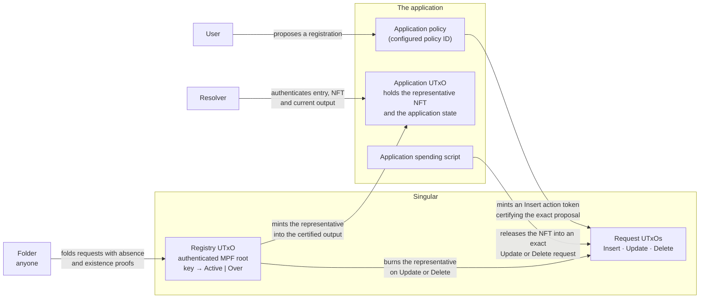

Not for mainnet. Do not deploy Singular or open datum on mainnet until on-chain verification and an independent audit are complete.

# Singular

A permissionless registry on Cardano for unique identities and independent application state.

## Start here: play Demo 1

As a Cardano developer who knows `cardano-cli`, wallets, faucets and Koios but not Singular, you can play Demo 1, a registry from creation to termination in sixteen steps, and watch every step either succeed or be refused where the page says it will. The [Demo 1 page](docs/demo1.md) says what the play shows and where to play it: the step-by-step page of [singular-demo](https://github.com/lambdasistemi/singular-demo), with a copy button on every block; its Nix shell, which holds `singular`, `open-datum` and a private development chain; and its Ubuntu kit for a machine without Nix. To play it in a browser with nothing installed, open the [Killercoda scenario](https://killercoda.com/paolino/course/killercoda/demo1-steps); to watch it without running anything, open the [recorded run](https://lambdasistemi.github.io/singular-demo/demo1/run/).

## Install

From the release after 0.13.1, without Nix. On a Mac with Apple Silicon:

```sh
brew install lambdasistemi/tap/singular
```

On Linux on x86_64, download `singular-X.Y.Z-x86_64-linux.deb` or `singular-X.Y.Z-x86_64-linux.rpm` from the [releases page](https://github.com/lambdasistemi/singular/releases) and install it with your package manager, or run the AppImage of a command. Each of them gives `singular`, `open-datum` and `devnet`, the private development node Demo 1 starts, and, except the AppImages, the deployment blueprint the commands take as `--blueprint`. The [install page](docs/install.md) has the commands, the checksums and the tarballs that hold all three in one folder.

## Who this is for

**An application developer** wants keys that are unique across everyone using the application — names, identifiers, handles — without running a registrar. They supply one parameter, their application policy ID, and get a registry in which every active key is represented by exactly one NFT sitting in one of their own application outputs. Singular mints that NFT when a certified registration is folded in, burns it when the key is retired or released, and lets a released key be registered again.

**A user of that application** asks it to register a key. The application approves the exact proposal — including the refund address stored in the request — and the request waits, holding no NFT, until someone folds it into the registry. Before folding, a separately authorized cancellation copies that stored refund address and leaves the name free; redirecting the refund, relying only on Insert certification, cancelling after fold, or replaying cancellation is refused. The registry fixes where a deposit returns, never its amount: no fee, price or bond rule is part of it.

**A folder** — anyone at all — collects pending requests and applies them to the registry in one transaction. There is no owner to sign, no privileged actor, and no way to fold a request that does not satisfy the protocol.

**A resolver** wants to know whether a key is active and where its application state currently lives. It authenticates the registry entry, finds the NFT, and reads the application's own output. A key that is retired or in a pending terminal request yields no live state.

**A Cardano developer who wants to try it** plays the whole thing on a private test chain from a page of steps to copy, signing with a vault wallet whose key stays sealed in a file on their machine, or signing on another machine. The [Demo 1 page](docs/demo1.md) says what the play shows and links the steps.

## How the parts fit

The diagram and table below record the original three-operation design. The current commands support registration and permanent termination; the five other historical edge encodings are refused. Application payload updates remain local to the application output. The original design is retained here as historical context.



The application keeps its state in the UTxO holding the NFT and controls its own local transitions; the registry never sees that state. Singular records only whether a key has an outstanding representative or has been permanently retired, and enforces the coupling between registry transitions and NFT supply.

| Registry request | Before | After | Representative NFT |
| --- | --- | --- | --- |
| Insert | Absent | `Active` | Mint into the certified application output |
| Update | `Active` | `Over` | Burn; permanently reserve the key |
| Delete | `Active` | Absent | Burn; make the key available again |

`Active` and `Over` contain no application payload. Registry **Update** means retirement, not an application-state update. `Over` is terminal.

The configured application policy ID is the authorization anchor. It mints action tokens whose asset names hash the action and its necessary parameters. Insert approval binds the registry/key, initial application datum and destination. Withdraw approval separately binds the exact pending Insert and its refund requirements; Insert approval alone cannot authorize cancellation.

Insert carries no representative NFT, can fail at folding if its key is occupied, and can be withdrawn with the required authorization. Update/Delete carry the existing representative after the application authorizes its exact release, and retain it until completion. The concrete request-token arrangement for Update/Delete remains open.

Read the [original responsibilities](docs/overview.md), [request lifecycle](docs/lifecycle.md) and [certification rules](docs/certification.md) as historical design context. To run the current commands, start with [Demo 1](docs/demo1.md), then read the [registry command guide](docs/registry-commands.md) and [consumer conformance record](docs/consumer-conformance.md).

## Design status

The current command journeys and their observed evidence are described in the [conformance record](docs/conformance-evidence.md). The seven comparison requirements remain published as uncovered: command execution alone does not establish model correspondence. The aligned models and their retained reference definitions build with the pinned Lean compiler; their proofs establish their stated model propositions.

The old executable corpora and playable simulator have been retired. The documentation archive carries the retained model source and its checksums. The economics paper keeps its historical model revision and proof references; those references do not describe the current library's theorem inventory.

[Build and serve the documentation](docs/building.md) with the pinned Nix toolchain.
