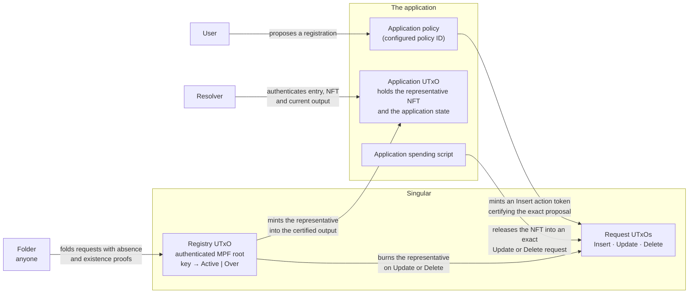

# Singular

A permissionless registry on Cardano for unique identities and independent application state.

## Start here: play Demo 1

As a Cardano developer who knows `cardano-cli`, wallets, faucets and Koios but not Singular, you can play Demo 1, a registry from creation to termination in sixteen steps, and watch every step either succeed or be refused where the page says it will. The [Demo 1 page](docs/demo1.md) says what the play shows and where to play it: the step-by-step page of [singular-demo](https://github.com/lambdasistemi/singular-demo), with a copy button on every block; its Nix shell, which holds `singular`, `open-datum` and a private development chain; and its Ubuntu kit for a machine without Nix. To play it in a browser with nothing installed, open the [Killercoda scenario](https://killercoda.com/paolino/course/killercoda/demo1-steps); to watch it without running anything, open the [recorded run](https://lambdasistemi.github.io/singular-demo/demo1/run/).

<a href="https://lambdasistemi.github.io/singular/simulator/"><strong>Try the simulation</strong></a> — register a name, terminate it permanently, and inspect refusals for the five historical edge encodings. Switch the profile picker to the naming instance for the Over witness and the lifecycle replay. The [simulation guide](docs/simulation.md) says what the page establishes and what it does not.

## Install

From the release after 0.13.1, without Nix. On a Mac with Apple Silicon:

```sh
brew install lambdasistemi/tap/singular
```

On Linux on x86_64, download `singular-X.Y.Z-x86_64-linux.deb` or `singular-X.Y.Z-x86_64-linux.rpm` from the [releases page](https://github.com/lambdasistemi/singular/releases) and install it with your package manager, or run the AppImage of a command. Each of them gives `singular`, `open-datum` and `devnet`, the private development node Demo 1 starts, and, except the AppImages, the deployment blueprint the commands take as `--blueprint`. The [install page](docs/install.md) has the commands, the checksums and the tarballs that hold all three in one folder.

## Who this is for

**An application developer** wants keys that are unique across everyone using the application — names, identifiers, handles — without running a registrar. They supply one parameter, their application policy ID, and get a registry in which every active key is represented by exactly one NFT sitting in one of their own application outputs. Singular mints that NFT when a certified registration is folded in, burns it when the key is retired or released, and lets a released key be registered again.

**A user of that application** asks it to register a key. The application approves the exact proposal — including the refund address stored in the request — and the request waits, holding no NFT, until someone folds it into the registry. Before folding, a separately authorized cancellation copies that stored refund address and leaves the name free; redirecting the refund, relying only on Insert certification, cancelling after fold, or replaying cancellation is refused. The registry fixes where a deposit returns, never its amount: no fee, price or bond rule is part of it.

**A holder of an active name** wants to keep payment routing current, recover through a committed next controller, or retire the name permanently. The [naming lifecycle](docs/naming-lifecycle.md) covers destination maintenance, recovery through the committed key, and retirement by that key or by a distinct-member quorum — never by the current control key alone. Twenty-one lifecycle rows are replayed in the simulator against the Lean that computed them. It remains an unaccepted design candidate, not an observed ledger execution.

**A folder** — anyone at all — collects pending requests and applies them to the registry in one transaction. There is no owner to sign, no privileged actor, and no way to fold a request that does not satisfy the protocol.

**A resolver** wants to know whether a key is active and where its application state currently lives. It authenticates the registry entry, finds the NFT, and reads the application's own output. A key that is retired or in a pending terminal request yields no live state.

**A Cardano developer who wants to try it** plays the whole thing on a private test chain from a page of steps to copy, signing with a vault wallet whose key stays sealed in a file on their machine, or signing on another machine. The [Demo 1 page](docs/demo1.md) says what the play shows and links the steps.

## How the parts fit

The diagram and table in this section record the original three-operation design: Insert, Update and Delete requests, an application-minted Withdraw, and the states Absent, `Active` and `Over`. The registry-mode model that the Lean proves, the simulator replays and the conformance suite compares against the deployed validators supports registration and permanent termination, and calls the terminal state `Terminal`. The original design below is historical; the active permanent contract contract rejects the other five edge encodings: [how a name moves in the registry](docs/naming-demo.md#how-a-name-moves-in-the-registry) shows the encoded edges and permanent contract admission, and the [model ledger](docs/model-ledger.md#the-retirement-map) records what replaced each part of the original design.



The application keeps its state in the UTxO holding the NFT and controls its own local transitions; the registry never sees that state. Singular records only whether a key has an outstanding representative or has been permanently retired, and enforces the coupling between registry transitions and NFT supply.

| Registry request | Before | After | Representative NFT |
| --- | --- | --- | --- |
| Insert | Absent | `Active` | Mint into the certified application output |
| Update | `Active` | `Over` | Burn; permanently reserve the key |
| Delete | `Active` | Absent | Burn; make the key available again |

`Active` and `Over` contain no application payload. Registry **Update** means retirement, not an application-state update. `Over` is terminal.

The configured application policy ID is the authorization anchor. It mints action tokens whose asset names hash the action and its necessary parameters. Insert approval binds the registry/key, initial application datum and destination. Withdraw approval separately binds the exact pending Insert and its refund requirements; Insert approval alone cannot authorize cancellation.

Insert carries no representative NFT, can fail at folding if its key is occupied, and can be withdrawn with the required authorization. Update/Delete carry the existing representative after the application authorizes its exact release, and retain it until completion. The concrete request-token arrangement for Update/Delete remains open.

Read the design in order. The first three pages and the protocol specification record the original design; the naming pages and the simulation describe the registry-mode model that supersedes it where they differ.

1. [Responsibilities and terminology](docs/overview.md)
2. [Requests, folding and NFT custody](docs/lifecycle.md)
3. [Certification and identity binding](docs/certification.md)
4. [Naming: book a name, retire it, attest it](docs/naming-demo.md)
5. [Naming lifecycle: maintain, recover, retire](docs/naming-lifecycle.md)
6. [Ending a name](docs/retirement.md) and [recovering control on a real ledger](docs/recovery-retirement.md)
7. [Play and reproduce the simulation](docs/simulation.md)
8. [Prior art and reuse candidates](docs/prior-art.md)
9. [Draft protocol specification and acceptance scenarios](specs/protocol/spec.md)
10. [Demo 1: play a registry from creation to termination](docs/demo1.md) and [the preprod record](docs/preprod.md)

## Design status

These documents record the adopted design and name the decisions still needed for a concrete protocol. The [executable design candidate](docs/design.md) has **105** proved declarations — 84 for the registry, 7 for the naming instance, 9 for its lifecycle and 5 for its wire encoding, counts that the model check derives from the theorem manifests — plus a [playable simulation](docs/simulation.md) transcribed from them. The focused checks replay 29 registry rows, 15 naming rows and 21 lifecycle rows; they test correspondence on those finite inputs rather than proving browser behaviour generally. No independent audit acceptance is claimed. The compiled validators and a registry deployed on the public preprod network are recorded in [the preprod record](docs/preprod.md), and the [conformance evidence](docs/conformance-evidence.md) states which consumer requirements a named code revision demonstrated against them. The [coverage ledger](docs/model-ledger.md) distinguishes finite executable evidence from conditions, abstractions and omissions, and the [clarity record](docs/LEAN-CLARITY.md) states plainly how much independence that evidence has.

The Nix-built documentation archive is a review bundle, not a released protocol artifact. It contains the rendered site and a runnable, locked workspace with raw model and corpus files, the naming contract, scenarios, simulator and replay sources, checkers, and exact identities. Reproduction starts from a fresh extraction, verifies `artifacts/SHA256SUMS`, and runs the archive's own flake; a checkout pass does not substitute. [Build and release details](docs/building.md) give the exact commands and describe the release pipeline that publishes the archive from a tag on main.

Singular uses MPF as its authenticated registry data structure. The product it was imported from is a separate application with potentially reusable mechanics. The implementation stack and shared-library boundaries remain unselected; extracting a shared library is future work.

[Build and serve the documentation](docs/building.md) with the pinned Nix toolchain.
