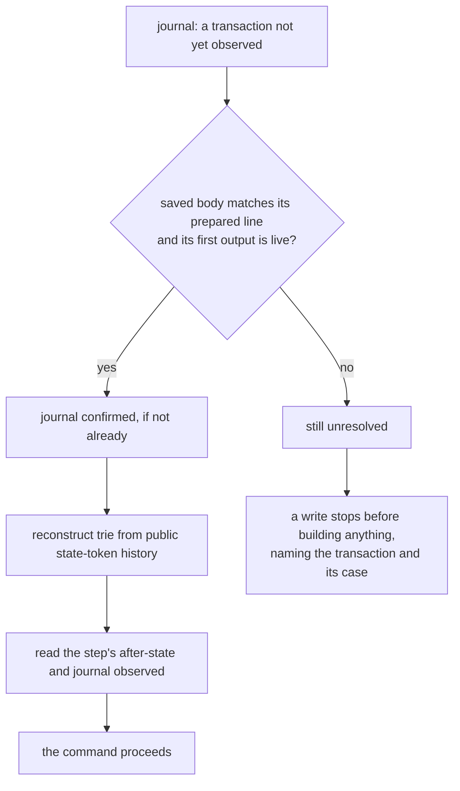
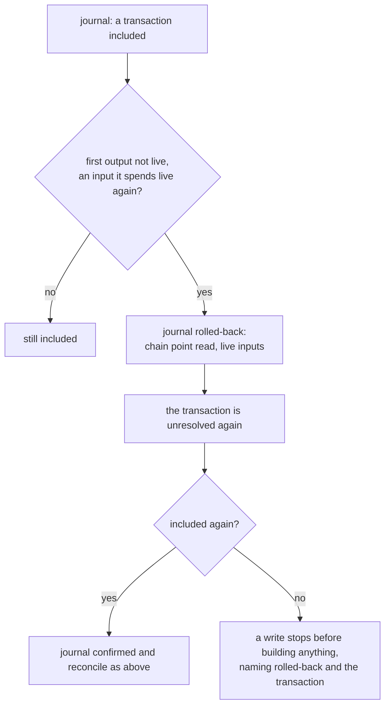
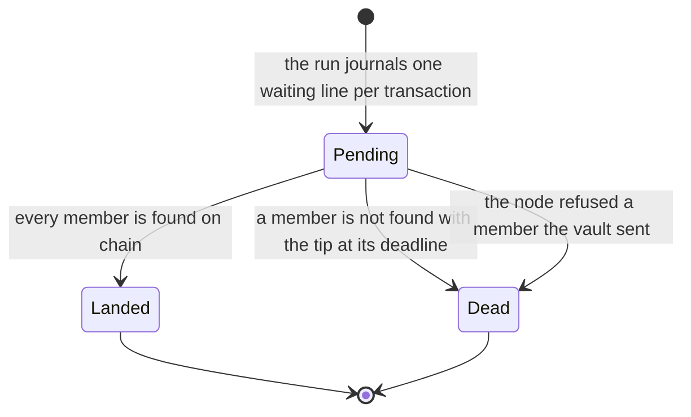

# Recovering a registry command

You run `singular registry create`, `open-datum insert`, `open-datum update`, `open-datum terminate` or
`inspect` (`singular registry inspect` or `open-datum inspect`), and something goes wrong between your machine and the chain:
the node's answer to a submission never arrives, the process is killed,
the machine stops halfway through saving its files, or a transaction the
chain had included is rolled back. You want to know which of those
happened, you want the next command to pick up from where the last one
stopped without sending anything twice, and you want to be told plainly
when it cannot.

This page describes what the ordinary commands do in each case and what
you do next. Every write records each transaction it submits in the
registry's journal, `journal.jsonl`, phase by phase, before taking the
next step: `prepared` (the signed body saved beside the journal,
before it is sent), the node's answer, the confirmation, and
`observed` (what the transaction made, read back from the chain). A fold's
`prepared` line lists every request it folds, one transition per request,
chained from the root before to the root after. The
journal is only ever appended to; saved bodies are never rewritten.

## The request keeps its registry's windows

As a requester recovering after an interruption, you read `processTime` and
`retractTime` from `registry inspect` to see the windows stored in the live
state datum. They were chosen once at `registry create` with `--process-time`
and `--retract-time`, or defaulted to 600 000 and 300 000 milliseconds (ten
and five minutes). Both are fixed for the life of the registry; restarting a
command or reconciling its journal does not restart or extend a request's
windows. A booking's fold deadline remains its submission time plus the
registry's processing window, followed by the owner's retract window.

## The case each submission met

Every write's receipt lists the transactions it prepared under
`submissions`, each with its step, its id, its case and whether its
after-state was observed. The case is read from the latest phase the
journal holds for the transaction:

| case | journal phase | what it means | what you do next |
|---|---|---|---|
| `acknowledged` | `submitted` | the node accepted the transaction; it was not yet seen on chain | run your next command; it reconciles the transaction once it is on chain |
| `unknown` | `submit-unknown`, or nothing after `prepared` | no answer arrived: the node may or may not have the transaction | run your next command; if the transaction landed it is reconciled, otherwise the command stops and names it |
| `rejected` | `rejected` | the node refused it; it changed nothing on chain | correct the cause the receipt names and run the command again — unless it was the fold of an `insert` or `terminate`, whose booking is on chain: that leaves the [same pending request as an excluded fold](#when-a-transaction-can-never-land) |
| `included` | `confirmed` or `observed` | the transaction is on chain | nothing; a later command finishes the local commit if this one could not |
| `timeout` | `unconfirmed` | accepted, but not seen on chain before the confirmation deadline | run your next command; it reconciles the transaction once it is on chain |
| `rolled-back` | `rolled-back` | the chain had included the transaction and no longer does | run your next command; if the transaction is included again it is reconciled, otherwise the command stops and names it |
| `excluded` | `excluded` | the transaction is not on chain and its validity window has closed: it can never be included | for an `update`, run it again; for the fold of an `insert` or `terminate`, see [what an excluded fold leaves on chain](#when-a-transaction-can-never-land) |

A command that stops after a submission exits `partial` (status 15), or
`timeout` (13) when the confirmation deadline passed, and its receipt
names the case. Nothing is ever sent a second time: a transaction is
prepared once, and the journal shows exactly one `prepared` line for it.

## The next command reconciles

After an inclusion, the command selects its proof state from public state-token
history and reads back the step's after-state before appending `observed`. For a
fold of several requests, it reads back every key the fold touches and the
registry's state output carrying the last transition's root after.
The next ordinary write or `inspect` reconciles unfinished observations from
public chain evidence before proceeding, without submitting anything. Proof
state is reconstructed afresh; no mirror or saved-root file is read or written.



The journal tracks this actor's submissions. It never supplies a replay edge,
proof or root. Missing history and a root that does not chain are named
refusals; an empty trie cannot substitute for unavailable history. The
observation concerns every key the interrupted step touched, even when the current command
targets another key: for a fold, every key its transitions name and the registry's
state output.

A write reports reconciliation under `reconciled`: `rolledBack`, `recovery`,
`excluded` and `observed`. Inspect reports the same fields at the receipt's top
level. Inspect reconciles only while no other process holds this directory's
write lock; otherwise it reads without reconciling and says so.

## When the chain rolls back

A transaction journalled `confirmed` or `observed` can leave the chain
again. The next command checks every such transaction against the chain
it reads: when its first output is not live and an input it spends is
live again, it is no longer on the chain, since a transaction on the
chain has consumed every input it spends. The command appends a
`rolled-back` line naming the chain point it read and the inputs it
found live; for a fold, the line names that its requests are pending again and
the public state returns to its root before. The `observed` line it supersedes stays where it was.



Proof state follows the public history selected by the current command,
including rollbacks. The journal does not rebuild a private trie. The
rolled-back transaction is never sent again. If the chain includes it again,
the next command journals it confirmed and reconciles its observation;
otherwise writes stop on it, naming the case `rolled-back`.

## When a transaction can never land

A transaction carries a validity window. Once the chain's tip has
reached the end of that window and an input the transaction spends is
still live — so it is not on the chain — it can never be included. The
next command appends an `excluded` line naming the chain point it read
and the live inputs. The transaction is settled in the journal: no
later command stops on it, and its edge was never applied. A write that
excluded a transaction then proceeds, building from the root selected by fresh public replay.

What the excluded transaction leaves on chain depends on the command.
An excluded `update` leaves nothing: run it again. The fold of an
`insert` or a `terminate` is the second of two transactions, and the
first, its booking, is on chain: its request stays pending, holding its
deposit. Use `registry fold` while its processing window allows it, `registry reclaim`
with the owner's wallet in its retract window, or `registry reject` after both
windows expire. An insertion's request carries its envelope on chain. A folder
reads it publicly and reconstructs proofs from history; neither an insertion
fold nor a termination fold needs the booker's files.

A fold carries an upper bound on its validity window. A booking, and the
publications `create` makes, carry none: a booking that never landed,
or one rolled back and not included again, stays unresolved however far
the chain moves on, and every write stops on it. That is a known limit
of these commands, not a judgement about the transaction.

## When a bundle waits for signatures

As Bob, I ran a write naming my address and a bundle file, or Alice ran one from her vault, and I want to know where its bundle stands: still waiting for signatures, landed, or dead. The next write in the same state directory tells me, before it builds anything. The bundle's transactions are judged by one thing only: whether the chain holds their identities. Their outputs, their inputs and the after-state of the registry do not count. A transaction of a bundle is its member for its whole life.



- **Pending.** Some member is not on chain yet, and the tip has not reached any member's deadline. The next write stops before it builds anything, with status 19, `waiting-for-signatures`, naming the bundle's hash, its saved path, and the members awaited with their deadlines.
- **Landed.** Every member is found on chain. Each gets a `landed` line with its chain point and confirmations. The next write builds normally, and its receipt reports the bundle under `reconciled`.
- **Dead.** A member can never land. Every member not landed gets a `dead` line, and the report names the members that went through. The next write builds normally.

A bundle dies one of these ways, and the dead line says which:

| the dead line reads | what happened | what you do |
|---|---|---|
| `expired, rebuild` | a member was not found on chain once the tip reached its deadline | run the command again: it builds a new bundle from what is on chain now |
| `refused by the node: <its answer>` | the node refused a member that your vault run sent | read the answer, fix its cause, and run the command again |
| `its bundle died` | this member was not landed when another member died | nothing on its own: the next run of the command rebuilds it with the rest |

A pending bundle never needs the journal edited. Sign the bundle and send it with `singular submit`, giving the blueprint of the release the registry was created under with `--blueprint` because the bundle names a registry (a create bundle needs none), or let a member's deadline pass and run the command again. A vault run whose answer from the node was lost ends partial, and the next write settles its bundle by identity in the same way. A write that sent its transactions and then could not journal the outcome keeps the submission's outcome and its sends in the receipt, and names what failed on its own.

A bundle sent elsewhere and refused by the node is not seen by your journal, since `singular submit` keeps no state: it dies when a member's deadline passes. A create bundle has no deadline, so it stays pending. As Alice, if my co-signer never signs the create bundle I staged, or it is refused when sent elsewhere, I correct the cause and send it again. A create from the same wallet without `--seed` picks the same output again while that output is unspent, so it is stopped at 19 too. The way out is a create that names another output with `--seed`: a different registry, in a different state directory, which nothing blocks. The pending create's journal stays as a record and blocks nothing else.

## When the next command stops

A write that finds a transaction it cannot reconcile stops before it
builds or submits anything. Its outcome is `partial` (status 15), and
its receipt names the transaction under `unresolved` with its step, its
last journalled phase and its case; the journal does not move.

- `acknowledged`, `unknown` or `timeout`: the chain does not yet show
  the transaction. Wait for the network and run the command again; when
  the transaction lands, the next command reconciles it, and when its
  validity window closes without it, the next command excludes it —
  for the fold of an insert or a terminate, with the
  [pending request it leaves](#when-a-transaction-can-never-land).
- `rolled-back`: the chain no longer shows a transaction it had
  included. Wait and run the command again; it reconciles the
  transaction if the chain includes it again, and excludes it once its
  validity window closes without it, with the same pending request when
  it is a fold. A booking has no window and stays rolled back.
- `included`: the transaction is on chain, but public history is incomplete
  or its reconstructed root does not chain. The named trie refusal preserves
  its existing outcome and exit status; the journal cannot repair public facts.

`inspect` names the same unresolved transaction and its case, with the
outcome `partial`, alongside the root and chain point it read.

## The commands that create a registry and register keys

As Carol, Alice or Bob running one of the commands of
[create a registry and register keys on the proved design](registry-commands.md),
you are interrupted in the same ways as above and promised the same thing: the
transaction keeps its identity, the next write settles it, and nothing is sent a
second time.

Each transaction is journalled as `prepared` before it is sent, under the step
that names it: `publish-scripts` and `create` for a creation, then `book`,
`fold`, `reclaim` and `cleanup`. The journal also records what the first output of
the transaction must hold once it is on the chain: a reference script for a
publication, the state token for a creation and for a fold, the approval token for
a booking, a payment to the refund address for a reclaim and a cleanup. A creation
is journalled under the application and the wallet, because the name of the
registry it makes is known only once its seed is chosen. The other commands are
journalled under the registry and the wallet.

Before it builds anything, the next write of the same wallet reads its journal
against the chain. The table shows what it does with an earlier transaction in each
case.

| what happened to the earlier transaction | what the next write does |
| --- | --- |
| the node took it and the answer was lost | finds the first output on the chain, records the transaction as observed once, names it under `reconciled` and goes on |
| the process was killed after the send | the same |
| it never reached the node | stops with status 15, names the transaction under `unresolved` with the case `unknown`, builds nothing, sends nothing, and leaves the journal as it was |

A transaction the chain does not show cannot be told from one the network has not
yet delivered, and these commands never declare it excluded: the next write keeps
naming it and stops. Wait for the network and run the command again; a transaction
that lands is reconciled. When it can never land, the way out is `--state-dir`
naming another state directory, which starts a fresh journal for that registry and
wallet, or for a creation, for that application and wallet; the old journal stays
as a record.

## What the checks show

The recovery controls run each hosted partition as separate `singular`
processes against its own generated development node, and judge every
clause from the receipts the processes printed, the registry's journal,
its saved bodies and its files, and — for exclusion and rollback — from
the node's own answers, read with `devnet probe` and its block adoption
trace, never through the command under test. The partitions are listed in
one place in the root flake; the discovery command prints them for the
workflow matrix, and each partition runs by key:

```sh
nix run --quiet .#cli-recovery-partitions
nix run --quiet .#cli-recovery-partition -- history
nix run --quiet .#cli-recovery-partition -- two-requests
nix run --quiet .#cli-recovery-partition -- rollback
nix run --quiet .#cli-recovery-partition -- state-line
nix run --quiet .#cli-recovery-partition -- 'cross-wallet:SINGULAR_HARNESS_HOLD_AFTER_SEND'
```

The combined `.#cli-recovery-controls` command is retired: it serialised
every part on one node and exceeded the receipt cap of 52428800 bytes
before reaching never-sent and rollback. The per-partition commands above
are generated from the same partition list the workflow matrix uses.

| control | what happens | what the next command does |
|---|---|---|
| accepting | an insert and fold complete | both submissions are named included and observed once; inspect reconstructs the fold's root from public history |
| lost answer | the node accepts a fold but its answer is lost | the prepared line and saved body predate the send; the next command reconstructs public state, observes the fold once and proceeds |
| killed before the commit | a fold confirms, then its process is killed before fresh replay | the next command reconstructs public state, observes the fold once and proceeds |
| killed before the observation | a fold's replay is checked, then its process is killed before observed | the next command reconstructs public state, observes the fold once and proceeds |
| two requests | two bookings, a fold of both interrupted by a lost answer and by a kill before the observation | each time the next ordinary command recovers the fold, both keys reconciled once, nothing sent twice |
| never sent, past its upper bound | a fold never reaches the node, and the tip passes its upper bound | the next write journals excluded with the chain point and live inputs, then proceeds from fresh public replay |
| never sent, without an upper bound | a booking never reaches the node | the next write stops naming the booking and unknown; it neither resubmits nor invents its inclusion |
| rolled back | the generated node restores a database copy from before an observed booking and fold | public reads show their inputs live again; the journal appends rolled-back, writes stop naming the booking and no transaction is resent |
| the commands of the proved design | a creation, a booking, a reclaim, a fold and a cleanup, each with its answer lost after the node took it, with its process killed after the send, and with the send never made | the next write of the wallet observes an included transaction once, an unsent one stops it naming the transaction, nothing is built or sent past it, and no transaction is sent twice |


The rolled-back control is a mechanism of the generated development
node — its database restored to an earlier copy — and not a fork of a
public chain: it shows what the commands do when the chain they read no
longer holds a transaction, not how often or how deeply a public network
rolls back. Across every control, each journalled transaction has
exactly one `prepared` line, the journal is only ever appended to, and
no saved body changes. These controls do not establish durability
across a power loss, only across a killed process.
