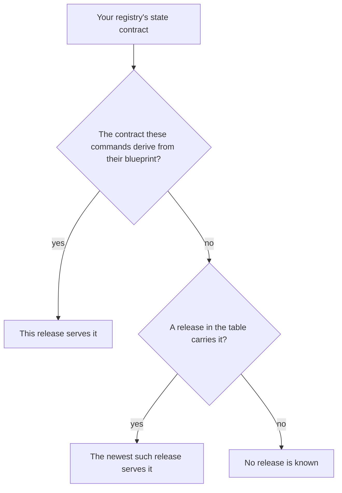

# Which release serves my registry

As a person with a registry made by some earlier release, you find on this page which release serves it: this release, an earlier one, or none that is known.

The diagram shows the question the rows below answer. A registry is made by one version of the on-chain code, and its state contract is the hash of that version's state validator. The commands of this release change the registries of one state contract, the one they derive from the blueprint they carry. Given a registry of another contract, a command of this release that changes it refuses before anything is built and names the release that serves it, or says that no release is known.

## How the answer is found

The commands of this release derive their state contract from the blueprint they carry. The request validator of that blueprint has an application policy, and the release table holds the applied state policy for it. That applied state policy is the contract these commands derive, and it is the state contract of every row marked as this release.

Every row is computed from the release table, which the releases after v0.15.0 carry, and from the blueprint this release carries. The releases up to v0.15.0 carry no table, so their commands cannot name a serving release. Registries made by a release whose contract is recorded are served by the newest release in the table that carries that contract, unless the contract is the one these commands derive, which this release serves. A contract that the table holds with no release has no release that serves it. The record names no version of its own, so it needs no edit when the version changes.

| Where the rows come from | Value |
|---|---|
| The release table, `offchain/data/contracts/state-contracts.json`, SHA-256 | `5d3b98bc63267913772bf902751e47402f3cd673f97b8a47900a6e9fb34d4636` |
| Application policy of the request validator in the blueprint this release carries | `67bb50e5aab678b9955e1d8981050a14e0f93da912b3a8b4a7161ca7` |
| State contract these commands derive | `499291dbc77fb84b590e4f2d728788aa06191627a2c5c95b6bc4d679` |

The commands of this release print the same answer. The off-chain test suite compares each row that has a contract with the answer of the library function these commands call, and the documentation check refuses a page that differs from the table.

## Release by release

The table names 23 releases and 8 state contracts. Each release has one row, oldest first. A release the table leaves out is listed with its reason: its contract is not recorded, so no release is known to serve its registries.

| Release | State contract | Registries made by it are served by |
|---|---|---|
| v0.2.0 | not recorded: the release has no on-chain archive (singular-onchain-0.2.0.tar.gz) | no release is known |
| v0.3.0 | `64d1afbfe585b496a325ecacf2600210ff773368010bbab96e5cf1ce` | the release [v0.3.0](https://github.com/lambdasistemi/singular/releases/tag/v0.3.0) |
| v0.4.0 | `3f62792585903776fc69059588783c7ca67ee9d24886c8722ebf8b2a` | the release [v0.4.0](https://github.com/lambdasistemi/singular/releases/tag/v0.4.0) |
| v0.4.1 | `8ac9562f5fb6be9b9b913ae2ad2cc1d9e038f7f7039256f1ac9f7a62` | the release [v0.6.1](https://github.com/lambdasistemi/singular/releases/tag/v0.6.1) |
| v0.5.0 | `8ac9562f5fb6be9b9b913ae2ad2cc1d9e038f7f7039256f1ac9f7a62` | the release [v0.6.1](https://github.com/lambdasistemi/singular/releases/tag/v0.6.1) |
| v0.6.0 | `8ac9562f5fb6be9b9b913ae2ad2cc1d9e038f7f7039256f1ac9f7a62` | the release [v0.6.1](https://github.com/lambdasistemi/singular/releases/tag/v0.6.1) |
| v0.6.1 | `8ac9562f5fb6be9b9b913ae2ad2cc1d9e038f7f7039256f1ac9f7a62` | the release [v0.6.1](https://github.com/lambdasistemi/singular/releases/tag/v0.6.1) |
| v0.7.0 | `492c5595b83b5deba587db17ea819cf769a930f379cd3ecbde56d2a5` | the release [v0.7.0](https://github.com/lambdasistemi/singular/releases/tag/v0.7.0) |
| v0.8.0 | `7c58a200ab88798562d98e3223dff44d27e2be29b18387c1b1bd450c` | the release [v0.9.0](https://github.com/lambdasistemi/singular/releases/tag/v0.9.0) |
| v0.9.0 | `7c58a200ab88798562d98e3223dff44d27e2be29b18387c1b1bd450c` | the release [v0.9.0](https://github.com/lambdasistemi/singular/releases/tag/v0.9.0) |
| v0.10.0 | `68df9c42ebd4468be130e9cd5538a7af39cc31c146cda45f274cccc5` | the release [v0.16.0](https://github.com/lambdasistemi/singular/releases/tag/v0.16.0) |
| v0.10.1 | `68df9c42ebd4468be130e9cd5538a7af39cc31c146cda45f274cccc5` | the release [v0.16.0](https://github.com/lambdasistemi/singular/releases/tag/v0.16.0) |
| v0.11.0 | `68df9c42ebd4468be130e9cd5538a7af39cc31c146cda45f274cccc5` | the release [v0.16.0](https://github.com/lambdasistemi/singular/releases/tag/v0.16.0) |
| v0.12.0 | `68df9c42ebd4468be130e9cd5538a7af39cc31c146cda45f274cccc5` | the release [v0.16.0](https://github.com/lambdasistemi/singular/releases/tag/v0.16.0) |
| v0.13.0 | `68df9c42ebd4468be130e9cd5538a7af39cc31c146cda45f274cccc5` | the release [v0.16.0](https://github.com/lambdasistemi/singular/releases/tag/v0.16.0) |
| v0.13.1 | `68df9c42ebd4468be130e9cd5538a7af39cc31c146cda45f274cccc5` | the release [v0.16.0](https://github.com/lambdasistemi/singular/releases/tag/v0.16.0) |
| v0.14.0 | `68df9c42ebd4468be130e9cd5538a7af39cc31c146cda45f274cccc5` | the release [v0.16.0](https://github.com/lambdasistemi/singular/releases/tag/v0.16.0) |
| v0.15.0 | `68df9c42ebd4468be130e9cd5538a7af39cc31c146cda45f274cccc5` | the release [v0.16.0](https://github.com/lambdasistemi/singular/releases/tag/v0.16.0) |
| v0.16.0 | `68df9c42ebd4468be130e9cd5538a7af39cc31c146cda45f274cccc5` | the release [v0.16.0](https://github.com/lambdasistemi/singular/releases/tag/v0.16.0) |
| v0.17.0 | `499291dbc77fb84b590e4f2d728788aa06191627a2c5c95b6bc4d679` | this release |
| v0.18.0 | `499291dbc77fb84b590e4f2d728788aa06191627a2c5c95b6bc4d679` | this release |
| v0.19.0 | `499291dbc77fb84b590e4f2d728788aa06191627a2c5c95b6bc4d679` | this release |
| v1.0.0 | `499291dbc77fb84b590e4f2d728788aa06191627a2c5c95b6bc4d679` | this release |

This release serves the registries of 4 releases listed above.

## Contracts with no release

The table also holds state contracts that no release carries. A registry of one of them was made by code that no release in the table carries, and no release is known to serve it.

| State contract | Registries made by it are served by |
|---|---|
| `9a84eabb747716a3092996049b5003a97954fa272902f0bf8f744a98` | no release is known |

## Applications

A registry made for an application has a state policy that applies the state program to the application's policy. The table holds one row for each, with the Singular releases and the application releases that carry it.

| Applied state policy | Application policy | Singular releases | Application releases | Registries made by it are served by |
|---|---|---|---|---|
| `499291dbc77fb84b590e4f2d728788aa06191627a2c5c95b6bc4d679` | `67bb50e5aab678b9955e1d8981050a14e0f93da912b3a8b4a7161ca7` | v0.17.0, v0.18.0, v0.19.0, v1.0.0 | v0.17.0, v0.18.0, v0.19.0, v1.0.0 | this release |

## Regenerate this page

Build the packaged blueprint with `nix build ./applications/open-datum/onchain#open-datum-blueprint -o blueprint`, run `python3 tools/compatibility_record.py --write --blueprint blueprint` to regenerate the page and its rows, then regenerate its speech and changed narration. The documentation check runs `python3 tools/compatibility_record.py --check` with the packaged blueprint.
