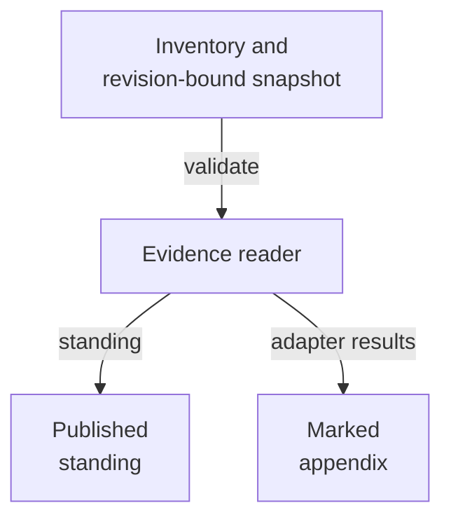

# Reading conformance evidence

As an integrator, I want every published comparison requirement to stay visible
when its evidence is missing, and every reported result to name the revision
it checked. The reader separates the inventory's coverage plan from the
receipts that can change a requirement's standing.

## Inputs and responsibilities

The receipt loader checks report identities, outcomes, measurements, refusal
attribution, replay provenance, duplicate requirements and the size bound.
The overlay matches a report to its requirement and code revision. Without
such a report the reader publishes the coverage plan. The page refuses a
snapshot whose reports or contract results name another revision or a dirty
tree, and refuses inconsistent contract-case lists across adapters.

## Ownership and limits

The caller supplies the receipt directory. Each command reads its inventory
and inputs for its own invocation; the reader starts no node or background
worker. Tests own their temporary report directories for one example and
remove them when the example finishes.

The seven application-held comparisons remain uncovered. Their development-
network journeys are separate observations and supply no model-comparison
credit. The backend-contract snapshot retains its own revision and source
provenance in the appendix. Neither reader tests nor a green coverage ratchet
establish the missing comparisons.

## Design choices

| Choice | Alternative | Reason |
| --- | --- | --- |
| Compute standing from validated reports | Write execution state into the inventory | A coverage plan cannot establish execution. |
| Publish requirements without reports | Hide uncovered requirements | Integrators need the missing evidence to stay visible. |
| Retain dated contract results in an appendix | Count them as comparison evidence | Adapter observations do not compare the application-held models. |

Read [the consumer record](consumer-conformance.md) for commands and
[the generated evidence page](conformance-evidence.md) for the complete
requirements and their computed standings.
