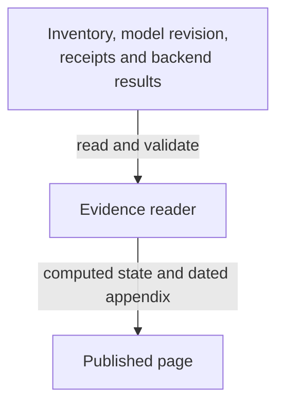

# Conformance evidence

As an integrator deciding whether to build on Singular, I read which of the consumer requirements a run of one named code revision demonstrated, which it did not, and how every backend adapter answered the shared contract — and I can check that nothing on this page was typed by hand.

This page is generated by `conformance evidence-page` from the requirement inventory `conformance/rows.json`, the application model revision in `conformance/model-revision`, and the receipts and contract results the CI runs named in the appendix produced for the code revision below. The documentation check regenerates it from those committed files and fails on any difference.

## What this evidence is bound to

| | |
| --- | --- |
| Code revision the runs checked out | `c17309ee607368615b96f23ea4f96401467195f5` |
| Application model revision | `de34300540223ccedf1ca85216b131fd09a148b4` |
| Requirements in the inventory | 11 (0 out of scope) |
| Demonstrated by a run | 0 |
| Partly demonstrated by a run | 0 |
| Run, result not a pass | 0 |
| Bound to evidence elsewhere | 0 |
| Uncovered | 11 |
| Backend adapters in the contract runs | 6 |

## Requirements a run demonstrated

None.

## Requirements a run did not pass

None.

## Requirements not demonstrated

Every requirement without a receipt for this code revision is listed with the plan the inventory declares for it.

### Uncovered

| Name | Requirement | Expected outcome | State |
| --- | --- | --- | --- |
| holding-update-outcome | The controller signs an update of a live holding. Its payload may change, while the protected control and all tokens remain the same and the holding keeps at least its protected deposit at the application address. No registry fold takes part and no treasury is paid. Under the previous design an accepted controller-signed payload update preserved the same control, assets and deposit floor without changing the registry. | The controller-signed update is accepted and preserves the holding as stated. Uncovered: no executable comparison with the application-held model exists yet | uncovered |
| reading-application-holding | The open-datum reader refines Singular's active answer to a live holding with its protected control, deposit and payload, or to pending termination when the token is held by the exact datumless termination request. After the connected termination fold it answers terminal; an unused key is never registered. Every neutral unavailable answer and refusal retains its meaning. | The reader answers as stated. Uncovered: no executable comparison with the application-held model exists yet | uncovered |
| reading-key-status | A reader supplies a registry address and a key, without a signer, blueprint or local registry state. Singular identifies the application from the packaged state-policy release table and answers active only for genuine unit-token custody at the application's script. With no active token, the authenticated state and its trie distinguish a permanently terminal key from a key that was never registered; a missing token alone establishes neither. | The reader answers as stated. Uncovered: no executable comparison with the application-held model exists yet | uncovered |
| reading-query-work | A known live key is read with one asset query, without scanning the application's address or the registry's history. On a development network with another registry's live holdings at the same application address, the receipt publishes provider-measured calls, rows and bytes for each read and in total, and identifies the other holdings that coexisted with the lookup. | The reader answers as stated. Uncovered: no executable comparison with the application-held model exists yet | uncovered |
| reading-refusals | A registry whose network differs from the provider is refused with both networks named. An unknown state policy is refused by name. A failed provider read is unavailable with the failed read and its reason, never terminal or never registered. A token outside application custody, including the state address, and conflicting token evidence are refused. Development-network network, policy and provider-failure cases each have a passing control; custody and conflict refusals are checked separately at the reader boundary. | The reader answers as stated. Uncovered: no executable comparison with the application-held model exists yet | uncovered |
| registration-cleanup-outcome | After the reclaim window of a booked registration has closed, any wallet may clean it up. The deposit returns to the refund address and the cleaner receives the booked value above the deposit. Under the previous design a folder rejected such a request after its retraction window, refunded the owner everything but the tip and kept the tip. | The cleanup is accepted and pays out as stated. Uncovered: no executable comparison with the application-held model exists yet | uncovered |
| registration-fold-outcome | A booked registration is folded, before its processing deadline, by any wallet that holds only public chain data. The key's token reaches a new holding at the committed address that carries the registration's payload and exactly its deposit, and the folder receives the booked value above the deposit; no treasury is paid. Under the previous design the same fold gave the folder only the booking's tip and paid the registration cost to the treasury. | The fold is accepted and pays out as stated. Uncovered: no executable comparison with the application-held model exists yet | uncovered |
| registration-reclaim-outcome | A booked registration is reclaimed by its controller, signing alone, between its processing deadline and the end of its reclaim window. Everything the booking held returns to the refund address and no folder is paid. Under the previous design the owner's retraction returned the same whole value; the window is now the one the booking itself records, from its processing deadline to its reclaim end. | The reclaim is accepted and pays out as stated. Uncovered: no executable comparison with the application-held model exists yet | uncovered |
| termination-booking-outcome | The controller signs a termination booking that moves the holding's active token into a datumless request at the application address with exactly one termination approval. The holding's protected deposit goes to the treasury at booking; no registry fold takes part. Under the previous design termination booking paid nothing to the treasury, and the request's carrier value went to the treasury later, at the termination fold. | The controller-signed booking is accepted and pays the deposit to the treasury at booking. Uncovered: no executable comparison with the application-held model exists yet | uncovered |
| termination-fold-outcome | Any folder, using public chain data alone with no controller file, key or record, folds the booked termination. Its active token and matching approval are consumed and burned, the key becomes permanently terminal and cannot register again, and the folder receives the request's whole value before its separately funded ledger fee; the fold pays no treasury. Under the previous design the folder received only the declared tip and the request's carrier value went to the treasury at the fold. | The public-data fold is accepted, burns both tokens and pays the whole value to the folder; a new registration of the terminal key is refused. Uncovered: no executable comparison with the application-held model exists yet | uncovered |
| unfoldable-registration-waits-for-reclaim | A booked registration that can never be folded, because its key is already registered or for any other reason, is not rejected early. It stays pending until its refund address reclaims it inside the reclaim window, or until anyone cleans it up after that window and the deposit returns to the refund address. Under the previous design a folder could reject such a request at once, with evidence of the mismatch, while it could still be folded or retracted. | No early rejection exists: the registration waits for its reclaim window. Uncovered: no executable comparison with the application-held model exists yet | uncovered |

### Bound to evidence elsewhere

None.

### Out of scope

None.

## Appendix: backend contract across adapters

One case list runs against every adapter. A case an adapter cannot exercise is reported for it as not supported, with the reason; it is never counted as passed.

| Adapter | Evidence class | Passed | Failed | Not supported |
| --- | --- | --- | --- | --- |
| node (external devnet) | devnet | 5 | 0 | 6 |
| indexer (external devnet) | devnet | 5 | 0 | 6 |
| in-memory | test-adapter | 7 | 0 | 4 |
| indexer (in-memory node) | test-adapter | 11 | 0 | 0 |
| node (generated devnet) | devnet | 7 | 0 | 4 |
| indexer (generated devnet) | devnet | 6 | 0 | 5 |

### node (external devnet) adapter

Evidence class: devnet.

| Contract case | Kind | Result |
| --- | --- | --- |
| a view names the network, era, slot and block hash it was acquired at | success | passed |
| a view answers its reads: outputs at an address, script registration, time to slot | success | passed |
| every read inside one view is answered at the view's chain point (slot and block hash) while the chain moves on | consistency | passed |
| a chain change between two reads is not observed inside the view; a fresh view sees it | consistency | passed |
| a view used after its scope fails as ViewOutOfScope | refusal | passed |
| a connection lost inside a view fails its next read and the next acquisition as ViewConnectionLost | refusal | not supported: the node was started outside the suite, which does not stop it |
| acquiring at the chain origin fails as AcquiredAtOrigin | refusal | not supported: the node was handed over past its origin |
| an index behind the node's point refuses the view as lag | refusal | not supported: the node adapter reads the node's own state; it has no index |
| an index holding another block at the node's slot refuses the view as fork | refusal | not supported: the node adapter reads the node's own state; it has no index |
| an index still restoring refuses the view as restoring | refusal | not supported: the node adapter reads the node's own state; it has no index |
| an index whose upstream is disconnected refuses the view as disconnected | refusal | not supported: the node adapter reads the node's own state; it has no index |

### indexer (external devnet) adapter

Evidence class: devnet.

| Contract case | Kind | Result |
| --- | --- | --- |
| a view names the network, era, slot and block hash it was acquired at | success | passed |
| a view answers its reads: outputs at an address, script registration, time to slot | success | passed |
| every read inside one view is answered at the view's chain point (slot and block hash) while the chain moves on | consistency | passed |
| a chain change between two reads is not observed inside the view; a fresh view sees it | consistency | passed |
| a view used after its scope fails as ViewOutOfScope | refusal | passed |
| a connection lost inside a view fails its next read and the next acquisition as ViewConnectionLost | refusal | not supported: the node was started outside the suite, which does not stop it |
| acquiring at the chain origin fails as AcquiredAtOrigin | refusal | not supported: the node was handed over past its origin |
| an index behind the node's point refuses the view as lag | refusal | not supported: a live follower cannot be held behind, forked, restoring or disconnected from outside its session; provoked on the indexer adapter over the in-memory node |
| an index holding another block at the node's slot refuses the view as fork | refusal | not supported: a live follower cannot be held behind, forked, restoring or disconnected from outside its session; provoked on the indexer adapter over the in-memory node |
| an index still restoring refuses the view as restoring | refusal | not supported: a live follower cannot be held behind, forked, restoring or disconnected from outside its session; provoked on the indexer adapter over the in-memory node |
| an index whose upstream is disconnected refuses the view as disconnected | refusal | not supported: a live follower cannot be held behind, forked, restoring or disconnected from outside its session; provoked on the indexer adapter over the in-memory node |

### in-memory adapter

Evidence class: test-adapter.

| Contract case | Kind | Result |
| --- | --- | --- |
| a view names the network, era, slot and block hash it was acquired at | success | passed |
| a view answers its reads: outputs at an address, script registration, time to slot | success | passed |
| every read inside one view is answered at the view's chain point (slot and block hash) while the chain moves on | consistency | passed |
| a chain change between two reads is not observed inside the view; a fresh view sees it | consistency | passed |
| a view used after its scope fails as ViewOutOfScope | refusal | passed |
| a connection lost inside a view fails its next read and the next acquisition as ViewConnectionLost | refusal | passed |
| acquiring at the chain origin fails as AcquiredAtOrigin | refusal | passed |
| an index behind the node's point refuses the view as lag | refusal | not supported: it reads a chain value, not an index |
| an index holding another block at the node's slot refuses the view as fork | refusal | not supported: it reads a chain value, not an index |
| an index still restoring refuses the view as restoring | refusal | not supported: it reads a chain value, not an index |
| an index whose upstream is disconnected refuses the view as disconnected | refusal | not supported: it reads a chain value, not an index |

### indexer (in-memory node) adapter

Evidence class: test-adapter.

| Contract case | Kind | Result |
| --- | --- | --- |
| a view names the network, era, slot and block hash it was acquired at | success | passed |
| a view answers its reads: outputs at an address, script registration, time to slot | success | passed |
| every read inside one view is answered at the view's chain point (slot and block hash) while the chain moves on | consistency | passed |
| a chain change between two reads is not observed inside the view; a fresh view sees it | consistency | passed |
| a view used after its scope fails as ViewOutOfScope | refusal | passed |
| a connection lost inside a view fails its next read and the next acquisition as ViewConnectionLost | refusal | passed |
| acquiring at the chain origin fails as AcquiredAtOrigin | refusal | passed |
| an index behind the node's point refuses the view as lag | refusal | passed |
| an index holding another block at the node's slot refuses the view as fork | refusal | passed |
| an index still restoring refuses the view as restoring | refusal | passed |
| an index whose upstream is disconnected refuses the view as disconnected | refusal | passed |

### node (generated devnet) adapter

Evidence class: devnet.

| Contract case | Kind | Result |
| --- | --- | --- |
| a view names the network, era, slot and block hash it was acquired at | success | passed |
| a view answers its reads: outputs at an address, script registration, time to slot | success | passed |
| every read inside one view is answered at the view's chain point (slot and block hash) while the chain moves on | consistency | passed |
| a chain change between two reads is not observed inside the view; a fresh view sees it | consistency | passed |
| a view used after its scope fails as ViewOutOfScope | refusal | passed |
| a connection lost inside a view fails its next read and the next acquisition as ViewConnectionLost | refusal | passed |
| acquiring at the chain origin fails as AcquiredAtOrigin | refusal | passed |
| an index behind the node's point refuses the view as lag | refusal | not supported: the node adapter reads the node's own state; it has no index |
| an index holding another block at the node's slot refuses the view as fork | refusal | not supported: the node adapter reads the node's own state; it has no index |
| an index still restoring refuses the view as restoring | refusal | not supported: the node adapter reads the node's own state; it has no index |
| an index whose upstream is disconnected refuses the view as disconnected | refusal | not supported: the node adapter reads the node's own state; it has no index |

### indexer (generated devnet) adapter

Evidence class: devnet.

| Contract case | Kind | Result |
| --- | --- | --- |
| a view names the network, era, slot and block hash it was acquired at | success | passed |
| a view answers its reads: outputs at an address, script registration, time to slot | success | passed |
| every read inside one view is answered at the view's chain point (slot and block hash) while the chain moves on | consistency | passed |
| a chain change between two reads is not observed inside the view; a fresh view sees it | consistency | passed |
| a view used after its scope fails as ViewOutOfScope | refusal | passed |
| a connection lost inside a view fails its next read and the next acquisition as ViewConnectionLost | refusal | passed |
| acquiring at the chain origin fails as AcquiredAtOrigin | refusal | not supported: the indexer session waits a chain out of its origin before its first view; the node adapter's origin refusal is the one the index rests on |
| an index behind the node's point refuses the view as lag | refusal | not supported: a live follower cannot be held behind, forked, restoring or disconnected from outside its session; provoked on the indexer adapter over the in-memory node |
| an index holding another block at the node's slot refuses the view as fork | refusal | not supported: a live follower cannot be held behind, forked, restoring or disconnected from outside its session; provoked on the indexer adapter over the in-memory node |
| an index still restoring refuses the view as restoring | refusal | not supported: a live follower cannot be held behind, forked, restoring or disconnected from outside its session; provoked on the indexer adapter over the in-memory node |
| an index whose upstream is disconnected refuses the view as disconnected | refusal | not supported: a live follower cannot be held behind, forked, restoring or disconnected from outside its session; provoked on the indexer adapter over the in-memory node |

## Appendix: how this page was produced

This appendix is harness evidence: where the files behind this page came from. It says nothing more about the product.

| Workflow | Run | Artifact |
| --- | --- | --- |
| Registry | https://github.com/lambdasistemi/singular/actions/runs/36943937231 | contract-results |

The committed snapshot is `conformance/evidence/page/`: 0 files of the receipt artifacts under `receipts/`, of which 0 are receipts, and 2 contract results files under `contract/` holding 66 results.

Regenerate the page with `nix run ./conformance#conformance -- evidence-page --write`; check it with the same command without `--write`.

