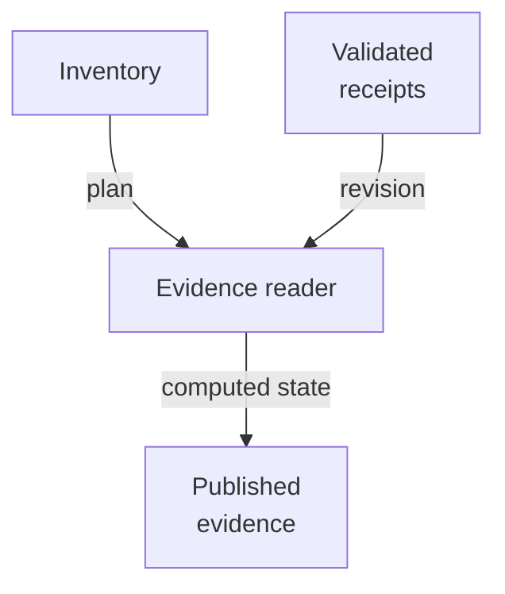

# Consumer conformance record

As an integrator, I can read the registration, holding update, termination,
reading, shared-publication and batch-fold requirements and see which
comparisons have evidence. The [generated evidence page](conformance-evidence.md)
publishes every requirement, including the ones no run has demonstrated.

<!-- consumer-summary:start -->

This summary is computed from the same inventory and validated receipts as the [evidence page](conformance-evidence.md), for code revision `c17309ee607368615b96f23ea4f96401467195f5`. Separate command journeys and measurements do not grant model-comparison credit.

| Standing | Requirements |
|---|---:|
| Total requirements | 23 |
| Demonstrated by a run | 0 |
| Partly demonstrated by a run | 0 |
| Run, result not a pass | 0 |
| Bound to evidence elsewhere | 0 |
| Uncovered | 23 |
| Out of scope | 0 |

| Requirement family | Requirements |
|---|---:|
| Batch Folding | 7 |
| Holding Journeys | 3 |
| Registration Journeys | 4 |
| Registry Reading | 4 |
| Shared Publications | 5 |

<!-- consumer-summary:end -->

The registration and holding requirements compare the previous and application-held designs. Their old
side is computed from the retained Lean model. The development-network journey
and refusal jobs are separate observations; they establish the transactions
they run and do not establish agreement with the model.

## Reading from a registry address

As a reader, I give a registry address and key without a signer, blueprint or
local registry state. The reading requirements describe the neutral key status, open
datum's live holding and pending termination, measured provider calls, rows and
bytes with another registry's holdings at the same address, and named refusals.
Their standings are computed in the summary above. The command observations
below supply no executable comparison with the application-held model.

The registration journey runs both packaged readers at connected live, pending
and terminal checkpoints and reads an unused key. Its artifact includes the
answers and a known-key query measurement. The registration refusals job runs
wrong-network, unknown-policy and failed-provider reads beside passing controls.
These are separate command observations, with controls that reject altered
answers; they establish nothing about agreement with the model. See
[reading a key](registry-commands.md#read-a-key) for the commands and settings,
and the [generated evidence page](conformance-evidence.md) for receipt-derived
standings.

## Creating on shared publications

The shared-publication requirements describe a later creation reusing both scripts, an independent
creator reusing them from the chain, separation between application releases,
registration in a registry created on shared copies and measured creation costs.
Their standings are computed from matching receipts, alongside the preceding
requirements. Publication measurements supply no model-comparison credit. The comparison and reading requirements
keep their previous contents and receipt-derived standings.

The registration journey, recovery partitions and checked measurement receipts
are separate evidence boundaries. They show the packaged commands and measured
transactions they run and nothing about agreement with the model. An executable
conformance language for creation claims is outside this change. The
[reuse guide](shared-publications.md) shows the commands and discovery receipt
fields; the [cost comparison](creation-cost.md) reads its figures from receipts.

## Folding a batch from public data

As a folder, I find and fold registrations and terminations of a registry
without any file from their booker. The batch requirements describe public
discovery, named skips, the folder's surplus, the largest fitting prefix and
what remains, explicit batches and state-policy refusals, and measured limits.
The summary computes their standings from model-comparison receipts.
Selection order and capacity are operational
facts; the model states no network-size rule.

The packaged registration journey, batch refusals and batch measurement are
separate evidence boundaries. They show the commands and transactions they
execute, and evaluation of kept transactions under recorded parameters, with
development-node corroboration. They establish nothing about agreement with
the model. The [folder guide](folding-requests.md) describes the commands,
receipt and limits; its figures are generated from the committed measurement.

## Read the evidence

```sh
nix run ./conformance#conformance -- list
nix run ./conformance#conformance -- list --receipts ./receipts
```

The inventory carries a coverage plan. Only validated receipts for the stated
revision can establish execution. The generated page leaves requirements
without those receipts visible as uncovered. Its marked appendix preserves
the generic backend-contract snapshot with its original code revision and
source provenance; those results do not cover the comparison requirements.



## Check the reader

```sh
nix run ./conformance#conformance-appendix-tests
nix run ./conformance#coverage-gate -- --root . ratchet
```

The appendix tests check the evidence reader. The coverage ratchet reports
regressions against its protected base. Neither command supplies the missing
model comparisons. The aligned models remain at
[the application-held model](https://github.com/lambdasistemi/singular/tree/bd354da787908694f6695f6f6035878c72e22be0/models/singular-application-held) and
[the open-datum model](https://github.com/lambdasistemi/singular/tree/bd354da787908694f6695f6f6035878c72e22be0/models/open-datum-application-held).
