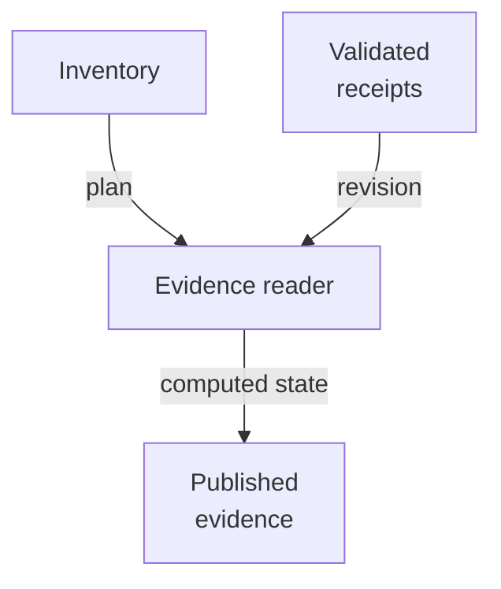

# Consumer conformance record

As an integrator, I can read the registration, holding update, termination, reading and shared-publication
requirements and see which comparisons have evidence. The sixteen requirements
are published in [the generated evidence page](conformance-evidence.md).
Every requirement is uncovered: no executable comparison with the
application-held model exists yet.

Seven requirements compare the previous and application-held designs. Their old
side is computed from the retained Lean model. The development-network journey
and refusal jobs are separate observations; they establish the transactions
they run and do not establish agreement with the model.

## Reading from a registry address

As a reader, I give a registry address and key without a signer, blueprint or
local registry state. Four requirements describe the neutral key status, open
datum's live holding and pending termination, measured provider calls, rows and
bytes with another registry's holdings at the same address, and named refusals.
They are published uncovered: no executable comparison with the application-held
model backs these reading requirements yet.

The registration journey runs both packaged readers at connected live, pending
and terminal checkpoints and reads an unused key. Its artifact includes the
answers and a known-key query measurement. The registration refusals job runs
wrong-network, unknown-policy and failed-provider reads beside passing controls.
These are separate command observations, with controls that reject altered
answers; they establish nothing about agreement with the model. See
[reading a key](registry-commands.md#read-a-key) for the commands and settings,
and the [generated evidence page](conformance-evidence.md) for receipt-derived
standings.

## Creating on shared publications

Five requirements describe a later creation reusing both scripts, an independent
creator reusing them from the chain, separation between application releases,
registration in a registry created on shared copies and measured creation costs.
They use the existing inventory convention and remain uncovered for the same
reason as the preceding requirements: no executable comparison with the
application-held model exists yet. The seven comparison rows and four reading
rows keep their previous contents and standings.

The registration journey, recovery partitions and checked measurement receipts
are separate evidence boundaries. They show the packaged commands and measured
transactions they run and nothing about agreement with the model. An executable
conformance language for creation claims is outside this change. The
[reuse guide](shared-publications.md) shows the commands and discovery receipt
fields; the [cost comparison](creation-cost.md) reads its figures from receipts.

## Read the evidence

```sh
nix run ./conformance#conformance -- list
nix run ./conformance#conformance -- list --receipts ./receipts
```

The inventory carries a coverage plan. Only validated receipts for the stated
revision can establish execution. The generated page leaves requirements
without those receipts visible as uncovered. Its marked appendix preserves
the generic backend-contract snapshot with its original code revision and
source provenance; those results do not cover the comparison requirements.



## Check the reader

```sh
nix run ./conformance#conformance-appendix-tests
nix run ./conformance#coverage-gate -- --root . ratchet
```

The appendix tests check the evidence reader. The coverage ratchet reports
regressions against its protected base. Neither command supplies the missing
model comparisons. The aligned models remain at
[the application-held model](https://github.com/lambdasistemi/singular/tree/70388417ed8968d93baf8b0c886c3df6d7dcaa40/models/singular-application-held) and
[the open-datum model](https://github.com/lambdasistemi/singular/tree/70388417ed8968d93baf8b0c886c3df6d7dcaa40/models/open-datum-application-held).
