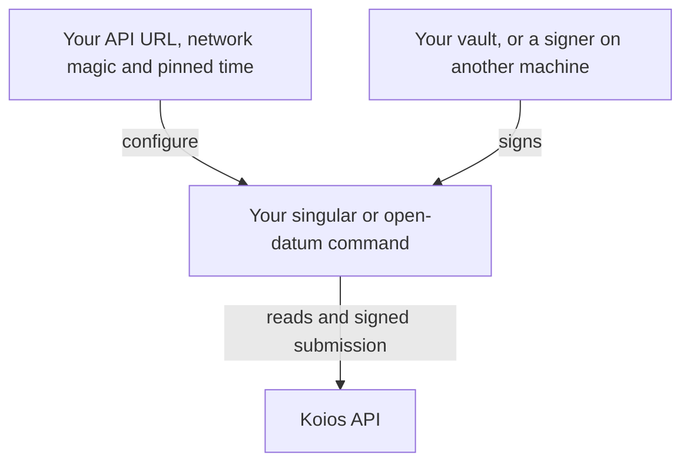
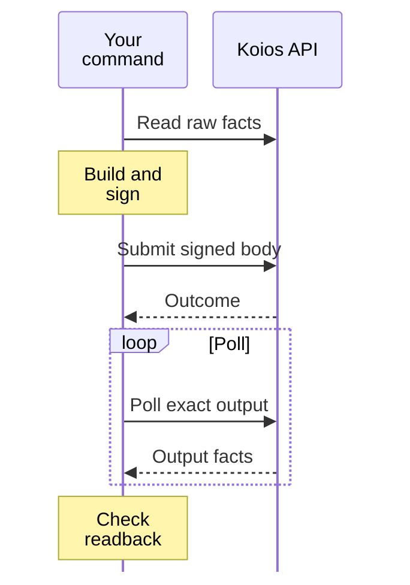

# Use the registry with your own provider and wallet

As a Cardano KERI integrator, you want to run registry and open-datum writes on
a test network using an API you choose and a wallet whose signing key stays
sealed in your vault or on the machine that signs. The current ordinary path
uses Koios for raw reads and signed submission, pinned genesis/history for time,
and local construction and evaluation. It does not require an ordinary node
socket.

This page describes the current source's configuration. A candidate's local
checks, hosted gates, release archive and public-network results are separate
receipts; these instructions do not claim that a new release or connected
preprod run has been accepted.

The bounded registry journey and the `deployment` tool are run by the project
for now. They will take a vault with
[issue 672](https://github.com/lambdasistemi/singular/issues/672), and this page
does not teach them until then.

## Choose the network and API

Your commands read the chain and send signed transactions through the API you
choose. The project's own private development chain sits behind an HTTP facade;
your commands name your API instead.



| You supply | Flag |
| --- | --- |
| API base URL | `--koios-url URL` |
| Network magic | `--network-magic N` |
| Pinned time directory, when needed | `--network-time DIR` |
| Optional API token file | `--koios-token-file FILE` |

Preprod magic is `1`, and the reviewed packaged preprod recording is the default
time source there. The generated network's magic is `42`, and its launcher
supplies its exact published time directory. A supplied directory contains
`time-manifest.json`, `shelley-genesis.json` and `era-history.cbor`; their raw
identities, network, system start and protocol-major pin are validated.
Unsupported time networks refuse rather than borrowing another recording.
Writes refuse mainnet.

The old `--backend` and `--node-socket` settings are refused on every command. A
socket accepted by a separate private probe is a test-harness setting, not an
ordinary provider route.

## Check the archive and build its commands

For an existing published archive, verify the bytes and validator identities
before using it:

```sh
tar xzf singular-onchain-release-<tag>.tar.gz
cd singular-onchain-release-<tag>
sha256sum --check SHA256SUMS
bash verify-identities.sh
```

The archive's command interface depends on its revision. An older node-backed
archive does not acquire this interface from reading this page. The
[archive guide](https://github.com/lambdasistemi/singular/blob/main/onchain-release/README.md)
records its runnable components and unverified legacy surfaces. Build the
registry and naming blueprints from that tree and export `REGISTRY_BLUEPRINT`
and `NAMING_BLUEPRINT` as the guide specifies. The extracted archive's own
`singular` reads the registry page from its blueprint and the adjacent
version file; the Demo 1 run page reads the page right after create with
the command the create receipt printed.

## Make a wallet and fund it

Make a wallet with `singular wallet create`, giving `--network-magic 1` for
preprod. It seals a fresh signing key in an encrypted vault and prints the
wallet's address; the passphrase is typed once, or read from `--passphrase-fd FD`
in a script. `singular wallet address` prints the same address again from the
vault.

Fund that address from the preprod faucet so that it holds ordinary outputs,
including an ada-only collateral output. A funded balance alone is insufficient
when the transaction needs distinct seed, funding and collateral outputs. The
Demo 1 run page in the release archive (`DEMO1.md`) shows the shape the first
publication needs and the refusal that names a missing output. A key's bytes do
not belong in command output or receipts.

## Sign each write

Each write takes exactly one signer. Your own `open-datum` and `singular
registry` commands sign in one of two ways.

- From your vault: add `--vault FILE`, and `--passphrase-fd FD` in a script. The
  command opens the vault once, builds the run, signs it in memory and sends it.
- Elsewhere: name the wallet's address with `--wallet-address ADDR` and a new
  bundle file with `--bundle FILE`. The command writes its transactions there
  and exits with status 19, `waiting-for-signatures`. Sign the bundle with
  `singular wallet sign --vault FILE` and send it with `singular submit`.

The settings table in the [command reference](singular-node.md) lists the flags
of each way, and the Demo 1 run page in the release archive (`DEMO1.md`) shows
both ways from the first command to the last.

## How a write is confirmed



A successful submission answer alone is not confirmation. Confirmation requires
the exact output. With a validity upper bound the provider deadline is that
slot's POSIX start plus 120 seconds; without one it is now plus 300 seconds.
Latest-block observation can establish expiry. A refusal, unavailable answer,
timeout or mismatching proof stops the run; it is never counted as its intended
accepting step.

## Understand the provider boundary

The logical session is `Unbound`. Its multiple reads may observe different
chain states. Facts are `Unverified` with no configured witness. Raw-source
receipts identify what was consumed, but they do not prove the API answered
honestly or that all reads were a coherent snapshot. Ledger acceptance remains
an independent boundary.

Before construction, the builder selects an interval with at least ten seconds
of usable slots at its observed tip. The moving ledger horizon can shorten the
upper bound. An empty interval refuses `WindowPastLedgerHorizon`; a nonempty
registry-limited short interval refuses `WindowTooShort`. Only a horizon-limited
otherwise longer window permits one wait for a later horizon, bounded by slots
and 20 seconds of wall time. A stalled wait refuses `HorizonWaitTimedOut` before
signing. Build duration can consume the selected interval; this rule is not a
guarantee of eventual ledger acceptance.

## Deployment and naming availability

No required hosted workflow currently exercises the legacy deployment-attach
script. A compiler or scoped deployment pass does not establish that attached
naming is runnable. The retained `register-rows`, `recovery-rows` and
`retirement-rows` commands remain unverified under
[#172](https://github.com/lambdasistemi/singular/issues/172) and
[#283](https://github.com/lambdasistemi/singular/issues/283). The
[recovery and retirement guide](recovery-retirement.md) documents that design,
and the [preprod record](preprod.md) preserves its historical executed values.
This page does not present those naming commands as a current accepted runbook.

Demo 1 has two users, Alice and Bob, starting with empty homes. Neither creates the registry or receives its creation files. Joining by state token is delivered: each joins with the state token, its own wallet and a Koios URL, with no shared directory — every command carries `--state-token` and no directory option, and neither actor opens the other's files. Joining by reading the registry page generated from the chain is delivered: each reads which registry this is, which release it runs, what its rules are and what it holds, from the token and the packaged release alone, as the [registry page](registry-page.md) describes. Joining by a copied identity file is superseded. Not delivered: a block anchor for the last fold, documentation links checked against a published asset, and the independently derived action identity in the public report. Public replay reconstructs the trie; missing history or a root that does not chain remains a named refusal. Historical deployment and naming
receipts remain evidence of their recorded revision and public chain, not a
pass for this provider candidate.
