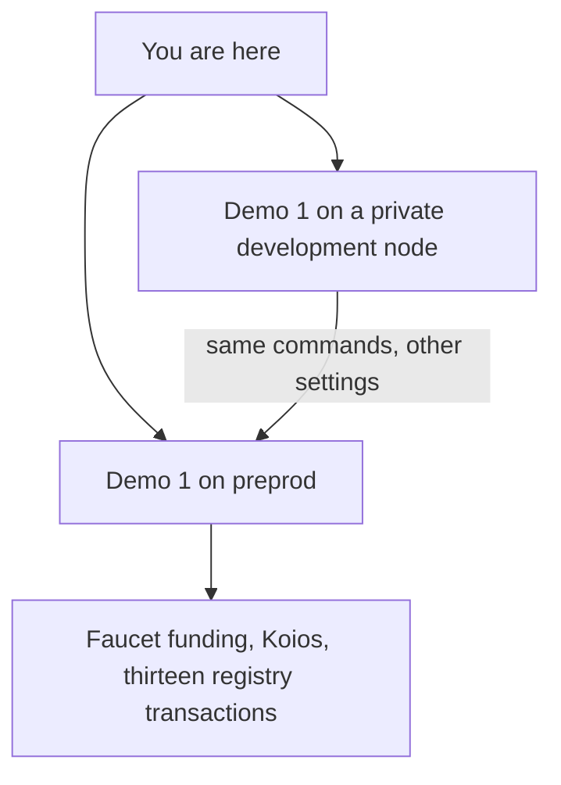
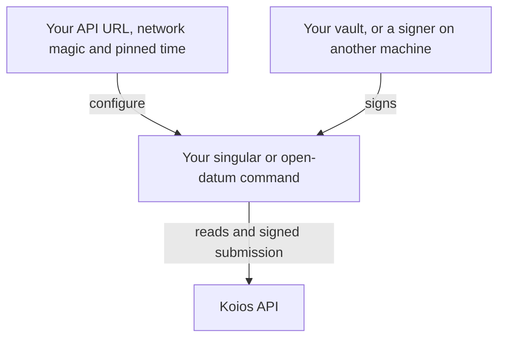
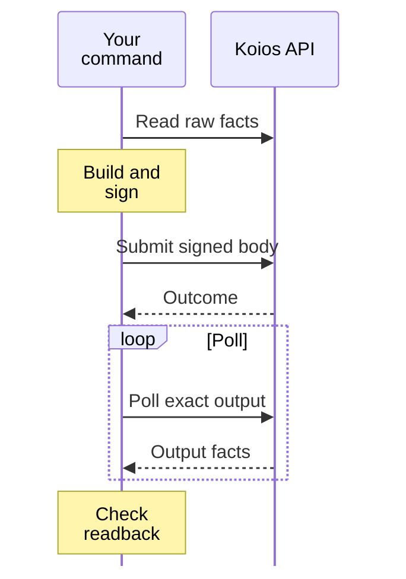

# Start here: Demo 1 with your own wallet and Koios

As a Cardano developer who knows `cardano-cli`, wallets, faucets and Koios but
has never used Singular, you want to run Demo 1 yourself: create a registry, put
keys in it, change them, end them, and see every refusal appear where the
documentation says it will. You use a Koios API you choose and a wallet whose
signing key stays sealed in a vault on your machine, or on the machine that
signs. Commands read and submit through Koios, take their time from a pinned
recording, and build and evaluate everything locally. They do not need a node
socket.

Two pages carry you from the first command to the last, and both can be copied
as they stand:

| You want to | Read | What it costs you |
| --- | --- | --- |
| see all of Demo 1 run first, with nothing at stake | [Demo 1 on a development node](demo1-devnet.md), the run page of the release archive | no test ada, no faucet, a few minutes |
| play Demo 1 on the public preprod network | [Play Demo 1 on preprod](demo1-on-preprod.md) | test ada from the faucet and about an hour |
| check that a release is what it says it is | [Download and verify a release](verify-release.md) | one command and the downloads |

The rest of this page explains the settings, the signing choices and the limits
of what a command's answers prove.

## Download and check the release

Releases are listed at https://github.com/lambdasistemi/singular/releases, and
the newest is at https://github.com/lambdasistemi/singular/releases/latest. A
release carries three files: the on-chain archive `singular-onchain-X.Y.Z.tar.gz`
(the compiled validators, the sources of both commands and the run page), the
documentation archive `singular-docs-X.Y.Z.tar.gz` (220 MB, not needed to play
Demo 1) and `SHA256SUMS` for both. The file names carry the version without a
`v`, and the archive extracts into the current directory, so extract it into a
directory of its own. The exact commands, with the checks, are on
[Play Demo 1 on preprod](demo1-on-preprod.md#download-and-check-the-release).

The quickest way to the programs is the Nix shell of
[singular-demo](https://github.com/lambdasistemi/singular-demo). `nix develop github:lambdasistemi/singular-demo --accept-flake-config`
opens a shell with `singular`, `open-datum`, the development node `devnet` and
`jq` already built by the project's CI, and fetches about 190 MiB from the public
caches instead of compiling anything. Its limits: it is pinned to release v0.12.0,
it is built for x86_64 Linux only, it needs Nix, and it keeps the development
node's files in one directory per user, so run one node at a time. On a multi-user
Nix install a user who is not in `trusted-users` cannot take the caches from a flake; that
repository's README says what to change. You still need the archive, for the run
page, the blueprint and the readback script. The shell's own `$blueprint` holds the
same bytes as the archive's `onchain/plutus.json`, but it sits in the Nix store with
no `version.txt` beside it, which `singular registry describe` refuses without, so
name the archive's file as the blueprint.

The second route builds the two commands from the archive itself. It suits another
release or another system. It compiles a large Haskell stack unless the project's
public binary cache serves it, and the
[runbook](demo1-on-preprod.md#build-the-two-commands) says how. No release ships
ready-built binaries yet. A binary install that needs no Nix is coming in
[issue 695](https://github.com/lambdasistemi/singular/issues/695).

## Choose the network and API

Your commands read the chain and send signed transactions through the API you
choose. The project's own private development chain sits behind an HTTP facade
that speaks the same dialect as Koios; your commands name your API instead.

| You supply | Flag | Preprod value |
| --- | --- | --- |
| API base URL | `--koios-url URL` | `https://preprod.koios.rest/api/v1` |
| Network magic | `--network-magic N` | `1` |
| Pinned time directory, when needed | `--network-time DIR` | none: preprod uses the reviewed recording that ships inside the commands |
| Optional API token file | `--koios-token-file FILE` | a file holding a Koios bearer token and nothing else |

The generated development network's magic is `42`, and its launcher supplies its
exact published time directory. A supplied directory contains
`time-manifest.json`, `shelley-genesis.json` and `era-history.cbor`; their raw
identities, network, system start and protocol-major pin are validated.
Unsupported time networks refuse rather than borrowing another recording. Writes
refuse mainnet.

The old `--backend` and `--node-socket` settings are refused on every command. A
socket accepted by a separate private probe is a setting of the project's own test
tools, not an ordinary provider route.

## Make a wallet and fund it

Make a wallet with `singular wallet create`, giving `--network-magic 1` for
preprod. It seals a fresh signing key in an encrypted vault and prints the
wallet's address. At a terminal it asks for the passphrase twice, an entry and a
confirmation, and refuses a confirmation that differs; in a script,
`--passphrase-fd FD` supplies it as one line read once. `singular wallet address`
asks once, and prints the same address again from the vault.

Fund that address from the
[preprod faucet](https://docs.cardano.org/cardano-testnets/tools/faucet). One
ada-only output is enough: nothing is split and no self-payment is needed, because
every write spends the wallet's largest ada-only output and returns its change.
What a play costs, as measured on preprod on 18 October 2026: thirteen registry
transactions came to 6.92 tADA in fees; each waiting request holds 3 tADA (the
key's 2 tADA deposit and a 1 tADA folder's fee); each active key keeps its 2 tADA
deposit until it is terminated; and creating a registry needs at least 162.65
tADA when no script of the release is on chain yet, a figure measured on a
development node. The [runbook](demo1-on-preprod.md#fund-both-wallets-from-the-faucet)
has the table. A command that finds the wallet short refuses before it submits,
naming the shortfall. A key's bytes do not belong in command output or receipts.

## Sign each write

Each write takes exactly one signer. Your own `open-datum` and `singular
registry` commands sign in one of two ways.

- From your vault: add `--vault FILE`, and `--passphrase-fd FD` in a script. The
  command opens the vault once, builds the run, signs it in memory and sends it.
- Elsewhere: name the wallet's address with `--wallet-address ADDR` and a new
  bundle file with `--bundle FILE`. The command writes its transactions there
  and exits with status 19, `waiting-for-signatures`. Sign the bundle with
  `singular wallet sign --vault FILE` and send it with `singular submit`.

The settings table in the [command reference](singular-node.md) lists the flags
of each way, and the [development-node page](demo1-devnet.md) shows both ways
from the first command to the last. Key files are not a way to start: they
remain on a few harness commands until the project retires them
([issue 672](https://github.com/lambdasistemi/singular/issues/672)).

## How a write is confirmed

A successful submission answer alone is not confirmation. Confirmation requires
the exact output. With a validity upper bound the provider deadline is that
slot's POSIX start plus 120 seconds; without one it is now plus 300 seconds.
Latest-block observation can establish expiry. A refusal, unavailable answer,
timeout or mismatching proof stops the run; it is never counted as its intended
accepting step.

## What a provider's answers do and do not prove

A command reads several facts through one logical session. The session is called
unbound: its reads may observe different chain states, so nothing promises one
coherent snapshot. Facts are called unverified: no configured witness checks
that the API answered honestly. Raw-source receipts identify what was consumed;
they do not prove the API answered honestly or that all reads were a coherent
snapshot. Ledger acceptance remains an independent boundary.

Before construction, the builder selects an interval with at least ten seconds
of usable slots at its observed tip. The moving ledger horizon can shorten the
upper bound. An empty interval refuses `WindowPastLedgerHorizon`; a nonempty
registry-limited short interval refuses `WindowTooShort`. Only a horizon-limited
otherwise longer window permits one wait for a later horizon, bounded by slots
and 20 seconds of wall time. A stalled wait refuses `HorizonWaitTimedOut` before
signing. Build duration can consume the selected interval; this rule is not a
guarantee of eventual ledger acceptance.

## What is delivered and what is not

Demo 1 has two users, Alice and Bob, who start with empty homes. Neither creates
the registry for the other or receives its creation files. Each joins with the
registry's state token, their own wallet and a Koios URL, with no shared
directory: every command carries `--state-token` and no directory option, and
neither user opens the other's files. Each can also read the
[registry page generated from the chain](registry-page.md): which registry this
is, which release it runs, what its rules are and what it holds, from the token
and the packaged release alone. Joining by a copied identity file is superseded.

Not delivered: a block anchor for the last fold, documentation links checked
against a published asset, and the independently derived action identity in the
public report. Public replay reconstructs the registry's trie; missing history
or a root that does not chain remains a named refusal. Historical deployment and
naming receipts remain evidence of their recorded revision and public chain, not
a pass for this provider candidate.

The bounded registry journey and the `deployment` tool are run by the project
for now. They keep key files until [issue 672](https://github.com/lambdasistemi/singular/issues/672)
gives them a vault, and this page does not teach them. No required hosted
workflow currently exercises the legacy deployment-attach script, so attached
naming is not claimed runnable. The retained `register-rows`, `recovery-rows` and
`retirement-rows` commands remain unverified under
[#172](https://github.com/lambdasistemi/singular/issues/172) and
[#283](https://github.com/lambdasistemi/singular/issues/283). The
[recovery and retirement guide](recovery-retirement.md) documents that design,
and the [preprod record](preprod.md) preserves its historical executed values.
