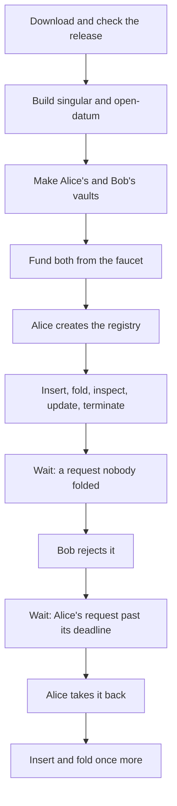

# Play Demo 1 on preprod

As a Cardano developer who knows `cardano-cli`, wallets, faucets and Koios but
has never used Singular, you want to play Demo 1 yourself on the public preprod
network, from the latest release, copying the commands as they stand. You
download the release, check it, build two commands, make two wallets (Alice's
and Bob's), fund them from the faucet and run sixteen steps. Every step either
succeeds or is refused with the refusal this page says it will give.

When it works, a registry you created holds keys that Alice inserted, changed
and terminated, that Bob folded for her, and that a new owner of the name took
over; you have read every receipt and seen the refusals; and the transactions
of your play are on preprod for anyone to look up. The steps take about seventy
minutes on preprod, mostly waiting for two windows to pass.



## What has run where

Read this before you spend anything, because it says how much of this page has
been played on preprod and how much has not.

| Part | Where it has run | What is not shown |
| --- | --- | --- |
| Steps 3 to 16: insert, fold, inspect, update, terminate, reject, reclaim, with Alice signing from her vault and Bob signing externally | On preprod on 18 October 2026, from release v0.12.0: the funding transaction and thirteen registry transactions landed, none failed, and a final readback found all fourteen in a block with at least nine confirmations. The fees of the thirteen registry transactions came to 6.92 tADA. | The run joined a registry created on 12 October instead of creating its own, with a Koios token. |
| Step 1: create the registry | Every change runs it on a private development node, in the hosted check of the release archive, and the [development-node page](demo1-devnet.md) runs it from the extracted archive. On preprod the registry the 18 October run joined was created by an earlier release, and nothing created a registry from v0.12.0. | No create of this release has been played on preprod. |
| Steps without a token | Not measured. | Whether a whole play fits the public Koios tier without a token. |

## What you need

- A Linux machine with [Nix](https://nixos.org/download) and flakes enabled, plus
  `git`, `jq` and `curl`. The Nix shell of
  [singular-demo](https://github.com/lambdasistemi/singular-demo) gives you the programs without a build. The release ships no ready-built binaries yet. A binary install that needs no Nix is coming in [issue 695](https://github.com/lambdasistemi/singular/issues/695).
- About ninety minutes with a terminal open the whole time, and enough preprod
  test ada (written tADA) for both wallets; the funding step says how much.
- A Koios token file is optional and described below.

The words used here are the ones on the
[development-node page](demo1-devnet.md#words-used-on-this-page): a registry, its
state token, requests that wait to be folded, the processing window and the
retract window, a vault and a bundle.

## Download and check the release

Choose the release. This page was written against v0.12.0; the latest release is
always listed at https://github.com/lambdasistemi/singular/releases/latest and a
newer archive's own `DEMO1.md` is the authority for that release. The release
carries two archives and one checksum file. You need the on-chain archive, which
holds the compiled validators, the sources of both commands and the run page; the
documentation archive is 220 MB and not needed here.

```bash
tag=v0.12.0
version="${tag#v}"
base="https://github.com/lambdasistemi/singular/releases/download/$tag"
mkdir singular-demo && cd singular-demo
curl -fLO "$base/singular-onchain-$version.tar.gz"
curl -fLO "$base/SHA256SUMS"
# The checksum file also lists the documentation archive, which you did not download.
sha256sum --check --ignore-missing SHA256SUMS
```

Expect one line, `singular-onchain-0.12.0.tar.gz: OK`. Extract the archive into
a directory of its own; it has no top-level directory, and it carries its own
`SHA256SUMS` that would overwrite the one you downloaded. Then check every file
inside it and the compiled validators' identities, which needs only `bash` and
`jq`.

```bash
mkdir archive && tar xzf "singular-onchain-$version.tar.gz" -C archive
cd archive
sha256sum --check --quiet SHA256SUMS
bash verify-identities.sh
```

The last line reads `identity verification: PASS (both partitions, from this
archive alone)`. To check the release end to end, including a run of the same
journey on a private node, use the
[download and verify page](verify-release.md). Every command below runs from this
extracted directory, the one that holds `DEMO1.md` and `onchain/`.

## Build the two commands

**The quick way: the shell.** From the extracted archive's directory,

```sh
nix develop github:lambdasistemi/singular-demo --accept-flake-config
```

opens a shell with `singular`, `open-datum`, the development node `devnet` and
`jq` on the path, all built by the project's CI. With the caches accepted it
builds only the shell itself and fetches about 190 MiB instead of compiling the
Haskell stack. Its limits: it is pinned to release v0.12.0, it is built for x86_64
Linux only, it needs Nix, and it keeps the development node's files in one directory per
user, so run one node at a time (on a multi-user Nix install a user outside
`trusted-users` cannot take the caches from a flake; the
[shell's README](https://github.com/lambdasistemi/singular-demo) says what to change). In that shell, name the
programs like this, skip the build below, and carry on in the same shell:

```sh
root="$PWD"
singular="$(command -v singular)"
open_datum="$(command -v open-datum)"
blueprint="$root/onchain/plutus.json"
```

The shell's own `$blueprint` holds the same bytes as `onchain/plutus.json`, but it
sits in the Nix store with no `version.txt` beside it, and `singular registry
describe` (step 2) refuses a blueprint without one, so keep the archive's file as
`blueprint`.

**The other way: build from the archive.** This suits another release or another
system. Nix reads a flake from a Git tree, and the application's flake reaches the
registry's sources one directory up, so make the extracted archive a Git tree
first. This commits nothing and contacts nothing; Nix warns that the tree is
dirty, which is expected.

```bash
root="$PWD"
git init -q && git add -A
singular="$(nix build --quiet --no-link --print-out-paths ./offchain#singular)/bin/singular"
open_datum="$(nix build --quiet --no-link --print-out-paths ./applications/open-datum/offchain#open-datum)/bin/open-datum"
blueprint="$root/onchain/plutus.json"
```

Compiling both commands from source builds a large Haskell stack and takes a long
time. The project's public binary cache holds both for `x86_64-linux`, about 100
MiB each. Add it before the first build, with these two settings on the `nix
build` command line or, if your user is not trusted by the Nix daemon, as
`extra-substituters` and `extra-trusted-public-keys` in `/etc/nix/nix.conf`:

```bash
--option extra-substituters https://paolino.cachix.org \
--option extra-trusted-public-keys paolino.cachix.org-1:ecmgO3CXdgSWA2cHlm4srknd/cLFMLmK3i3NrzeDFaE=
```

The flakes also name the Cardano build cache `https://cache.iog.io`; Nix asks
once whether to accept it. `singular --version` prints the program, its version and
the commit it was built from; a build that carries no commit says `commit
unknown`, and the printed store path then tells which build you hold. The blueprint is
`onchain/plutus.json`, beside the `version.txt` that names the release.

## Make Alice's and Bob's wallets

Each wallet is a vault: a file that holds a fresh signing key sealed by a
passphrase. The key never leaves the file, no command prints it, and neither
wallet needs `cardano-cli`. A script supplies the passphrase as one line on an
inherited file descriptor, `--passphrase-fd 3` with `3< file`; typed at a prompt,
the command asks twice when it creates a vault and once when it opens one. Keep
the files private, and use these wallets for test ada only.

```bash
umask 077
mkdir wallets
printf '%s\n' "alice's passphrase" > wallets/alice.passphrase
printf '%s\n' "bob's passphrase" > wallets/bob.passphrase
"$singular" wallet create --vault wallets/alice.vault --network-magic 1 --passphrase-fd 3 3< wallets/alice.passphrase
"$singular" wallet create --vault wallets/bob.vault --network-magic 1 --passphrase-fd 3 3< wallets/bob.passphrase
alice_addr="$("$singular" wallet address --vault wallets/alice.vault --network-magic 1 --passphrase-fd 3 3< wallets/alice.passphrase)"
bob_addr="$("$singular" wallet address --vault wallets/bob.vault --network-magic 1 --passphrase-fd 3 3< wallets/bob.passphrase)"
printf 'alice %s\nbob   %s\n' "$alice_addr" "$bob_addr"
```

Each `wallet create` prints the wallet's address, an `addr_test1…` enterprise
address; `wallet address` prints the same one again. Creating over an existing
vault is refused with `vault already exists`.

## Fund both wallets from the faucet

Open the [Cardano testnet faucet](https://docs.cardano.org/cardano-testnets/tools/faucet),
choose preprod, and request test ada once for each printed address. Singular has
no payment command, and this page needs no other tool: the faucet's single
output is enough, nothing is split and no self-payment is needed. Every write
spends the wallet's largest ada-only output and returns its change to the wallet,
and a command that finds the wallet short refuses before it submits, naming the
shortfall.

What the 18 October play measured, so you can judge how much to ask for:

| Item | Measured |
| --- | --- |
| Funding of that play | Alice 400 tADA and Bob 300 tADA, as several 50 tADA outputs. |
| Fees of the thirteen registry transactions | Alice's eight cost 3.48 tADA, Bob's five 3.44 tADA, 6.92 tADA together; each costs between 0.36 and 0.89 tADA. |
| Held while a request waits | 3 tADA per request: the key's 2 tADA deposit and a 1 tADA folder's fee. |
| Held while a key is active | the 2 tADA deposit, paid back when the key is terminated. |
| Creating a registry | at least 162.65 tADA when no script of this release is on the chain yet, measured on a development node; less when scripts are already published, which the create preview shows before anything is submitted. |

In that play Alice's balance fell by 7.34 tADA and Bob's by 3.58 tADA, the fees plus what is still locked or
spent as a folder's fee at the end; the run did not reconcile each term. So Alice needs the creation amount and
about 10 tADA more, and Bob about 10 tADA. Check what arrived with Koios, which you will use for everything else too:

```bash
koios_url=https://preprod.koios.rest/api/v1
curl -fsS "$koios_url/address_info" -H 'content-type: application/json' \
  -d "{\"_addresses\":[\"$alice_addr\",\"$bob_addr\"]}" | jq '.[] | {address, balance}'
```

Both balances should be above zero before you go on. A faucet request can take a
minute to land.

## Tell the commands where Koios is

Every command reads and submits through one Koios API. Preprod's base URL is
`https://preprod.koios.rest/api/v1` and its network magic is `1`. Preprod uses a
reviewed time recording that ships inside the commands, so you pass no time
directory. A token file is optional: put a Koios bearer token alone in a file and
pass it with `--koios-token-file`; the commands read it without putting the
token in an argument, and no receipt or log shows it. Every command replays the
registry's history through Koios, so a long play makes many requests. The 18
October play used a token; how far the public tier without one gets was not
measured.

```bash
provider=(--koios-url "$koios_url" --network-magic 1)
# Optional: provider+=(--koios-token-file koios.token)
```

## Helpers for the steps

Alice signs from her vault and Bob signs externally, exactly as on the
development-node page. The helper `waits_for_signatures` expects the exit status
19 that an external write ends with. `wait_for_slot` waits for the ledger's tip
slot to pass a slot a receipt names, because the windows are judged from the
ledger's tip and never from your clock.

```bash
alice=(--vault wallets/alice.vault --passphrase-fd 3)
waits_for_signatures() { local status=0; "$@" || status=$?; [ "$status" -eq 19 ]; }
sign() { "$singular" wallet sign --vault wallets/bob.vault --passphrase-fd 3 --out "witnesses-$1" "$1.bundle" 3< wallets/bob.passphrase; }
send() { "$singular" submit --witnesses "witnesses-$1" "${provider[@]}" --receipt "$1.submitted.json" "$1.bundle"; }
wait_for_slot() { until [ "$(curl -fsS "$koios_url/tip" | jq -r '.[0].abs_slot')" -gt "$1" ]; do sleep 15; done; }
jq -n '{map:[{k:{bytes:"6e616d65"},v:{bytes:"616c696365"}}]}' > payload.json
jq -n '{map:[{k:{bytes:"6e616d65"},v:{bytes:"626f62"}}]}' > payload-update.json
```

The two payloads are Plutus data in the detailed JSON schema: a one-entry map from
the bytes of `name` to the bytes of `alice` and of `bob`.

## Step 1: Alice creates the registry

A preview builds what the create would submit, from Alice's address alone, and
signs, submits and writes nothing. It names the registry's state token and its
seed before anything is spent, and it refuses with the missing amount if Alice's
wallet holds too little. The create then publishes the scripts the chain does not
yet hold and boots the registry. Alice's wallet holds one output, so no seed is
given: the registry boots from the change of the first publication. The windows
are the defaults, ten minutes to fold a request and five minutes after that to
take it back.

```bash
"$open_datum" create --preview --state-dir reg --blueprint "$blueprint" "${provider[@]}" --wallet-address "$alice_addr"
"$open_datum" create --state-dir reg --blueprint "$blueprint" "${provider[@]}" "${alice[@]}" 3< wallets/alice.passphrase > create.json
token=(--state-token "$(jq -r .stateToken create.json)")
jq '{outcome, stateToken, seed, processTime, retractTime}' create.json
```

The receipt's `stateToken` is the registry's name: the policy and the asset name
in hex, joined by a dot. Every later command takes it as `--state-token`. If
someone gave you a state token instead, skip this step and set `token` to it:
`token=(--state-token POLICY.NAME)`. The directory `reg` only keeps your own
journal; nothing in it names the registry.

## Step 2: read the registry page

The create receipt prints the command that reads the registry page, as
`describeCommand`. Run it as printed, with this release's `singular` first on the
path.

```bash
export PATH="$(dirname "$singular"):$PATH"
eval "$(jq -r .describeCommand create.json)"
```

The page says which registry this is, which release it runs, what its rules are
and what it holds now. It is read through Koios, whose answers nothing here
verifies, and it is unsigned.

## Step 3: Alice books the insertion of her key

An insertion books and stops. Alice is the key's controller. The request stays
pending until someone folds it, and the receipt names it and the deadline by
which it must be folded. `--max-outlay` caps what the write may put out of the
wallet: a write whose measured outlay passes it is refused before anything is
signed, and its receipt names the total and its parts under `outlay`. On preprod
the booking measured 6.16 tADA on 18 October: its 0.39 tADA fee, the 3 tADA it
locks and a 2.77 tADA bound on the fold that follows. The 8 tADA allowance below
covers it. If the network's parameters have moved and a write is refused for its
outlay, read that receipt and raise the allowance to cover the total.

```bash
"$open_datum" insert --state-dir reg --blueprint "$blueprint" "${token[@]}" --key alice \
  --payload payload.json "${provider[@]}" "${alice[@]}" --max-outlay 8000000 3< wallets/alice.passphrase > insert.json
jq '{outcome, request, foldDeadline}' insert.json
```

Expect `success`. `request` is the booking's transaction and an output number,
`TXID#0`; the deadline is about nine minutes after the booking, as a time and as a
slot. The booking cost 0.39 tADA in fees on 18 October.

## Step 4: Bob folds it, signing externally

Bob has to fold before the deadline. Any wallet may fold. Bob's write names his
address and a new bundle file, builds its whole run as that bundle and exits 19,
the outcome `waiting-for-signatures`, having signed and sent nothing. His vault
then signs the bundle and the signed bundle is sent. Until `submit` finds the
transactions on chain, the receipt's own fields are only what the bundle
expects, under `expected`.

```bash
waits_for_signatures "$open_datum" fold --state-dir reg --blueprint "$blueprint" "${token[@]}" "${provider[@]}" \
  --wallet-address "$bob_addr" --bundle fold-insert.bundle --max-outlay 5000000
sign fold-insert && send fold-insert
```

The fold cost 0.81 tADA in fees. If the deadline passes first, the fold is
refused naming it, before anything is signed, and the request stays pending.

## Step 5: read the key back

An inspect reads the key with no signing key and submits nothing. Its receipt on
preprod is about 13 MB because it carries the session's evidence, so keep it in a
file and read the fields you want. The key reads `active`.

```bash
"$open_datum" inspect --state-dir reg --blueprint "$blueprint" "${token[@]}" --key alice "${provider[@]}" > inspect.json
jq '{leaf, root, output: .applicationOutput.output, payload: .applicationOutput.payload}' inspect.json
```

You can also ask Koios, on its own, whether it finds the same output. The
readback needs the active policy and the key's name, which the receipt's
envelope holds, and it compares the output, the inline datum's bytes and their
hash with the receipt.

```bash
policy="$(jq -r '.applicationOutput.envelope.fields[0].fields[2].bytes' inspect.json)"
tools/demo1_readback.sh --provider koios --policy "$policy" --name "$(jq -r .key inspect.json)" \
  --inspect inspect.json --out koios-readback.json
```

It exits 0 and prints `readback: PASS` only when Koios finds exactly one output
holding the token, with the receipt's datum, within 600 slots of the node's tip.

## Step 6: Alice replaces the payload

Only the controller may change the payload. The root does not move.

```bash
"$open_datum" update --state-dir reg --blueprint "$blueprint" "${token[@]}" --key alice \
  --payload payload-update.json "${provider[@]}" "${alice[@]}" --max-outlay 2000000 3< wallets/alice.passphrase
```

## Step 7: read it back

```bash
"$open_datum" inspect --state-dir reg --blueprint "$blueprint" "${token[@]}" --key alice "${provider[@]}" > inspect.json
jq '{leaf, root, payload: .applicationOutput.payload}' inspect.json
```

The key is still `active`, the root is the one from step 5 and the payload is
the new one. The readback of step 5 works on this receipt too.

## Step 8: Alice books the termination of her key

```bash
"$open_datum" terminate --state-dir reg --blueprint "$blueprint" "${token[@]}" --key alice \
  "${provider[@]}" "${alice[@]}" --max-outlay 8000000 3< wallets/alice.passphrase > terminate.json
jq '{outcome, request, foldDeadline}' terminate.json
```

## Step 9: Bob folds the termination

The fold burns the key's token and pays the deposit back to Alice. Naming the
request makes the fold an expectation: it is refused unless that request is among
the ones it settles.

```bash
waits_for_signatures "$open_datum" fold --state-dir reg --blueprint "$blueprint" "${token[@]}" "${provider[@]}" \
  --request "$(jq -r .request terminate.json)" --wallet-address "$bob_addr" --bundle fold-terminate.bundle --max-outlay 5000000
sign fold-terminate && send fold-terminate
```

## Step 10: read it back

```bash
"$open_datum" inspect --state-dir reg --blueprint "$blueprint" "${token[@]}" --key alice "${provider[@]}" > inspect.json
jq '{leaf, root}' inspect.json
```

The key reads `terminal`, and the receipt says no live output holds it.

## Step 11: reject a request nobody folded

A request that nobody folded and its owner did not take back stays pending past
both its windows and blocks the registry's fold. Alice books one and nobody folds
it. While either window is open a reject is refused and writes no bundle. That
refusal is the first expected one: exit 10, the outcome `client-refusal`, and a
receipt that names the slot where the retract window closes. When the ledger's
tip passes that slot, any wallet may reject; here, Bob's, the external way.

```bash
"$open_datum" insert --state-dir reg --blueprint "$blueprint" "${token[@]}" --key late \
  --payload payload.json "${provider[@]}" "${alice[@]}" --max-outlay 8000000 3< wallets/alice.passphrase
"$singular" registry reject --state-dir reg --blueprint "$blueprint" "${token[@]}" "${provider[@]}" \
  --wallet-address "$bob_addr" --bundle reject.bundle > reject-early.json || [ "$?" -eq 10 ]
jq '{outcome, reason, tipSlot, pendingRequests}' reject-early.json
```

The reason reads "1 pending request is still inside a window, and a reject takes
every pending request, so none is built", and names the request, when its
processing window ends and when its retract window closes. Nothing is written or
submitted. Wait for the closing slot, about fifteen minutes after the booking,
then reject; the bundle expires about two minutes after it is built, so sign and
send it at once.

```bash
wait_for_slot "$(jq -r '.pendingRequests[0].retractEndsSlot' reject-early.json)"
waits_for_signatures "$singular" registry reject --state-dir reg --blueprint "$blueprint" "${token[@]}" "${provider[@]}" \
  --wallet-address "$bob_addr" --bundle reject.bundle --max-outlay 5000000
sign reject && send reject
```

The reject cost 0.51 tADA. Alice's request returns to her less the 1 tADA
folder's fee, which stays with Bob's wallet, and the registry's root does not
move.

## Step 12: Bob books a new insertion

The cleared registry takes requests again. Bob books the key `bob`, signing
externally; his own address is the controller.

```bash
waits_for_signatures "$open_datum" insert --state-dir reg --blueprint "$blueprint" "${token[@]}" --key bob \
  --payload payload.json "${provider[@]}" --wallet-address "$bob_addr" --bundle insert-bob.bundle --max-outlay 8000000
```

While Bob's bundle waits for its signatures, two further refusals are worth
seeing; both change nothing on chain. A second write of Bob's in the same
registry stops with exit 19 and the outcome `waiting-for-signatures`, naming the
waiting bundle and building nothing. And a vault signs only a bundle that lists
its address: Alice's vault is refused on Bob's bundle with exit 1, the message
that the vault's address is not among the bundle's signers, and no witness file.

```bash
waits_for_signatures "$open_datum" insert --state-dir reg --blueprint "$blueprint" "${token[@]}" --key bobTwo \
  --payload payload.json "${provider[@]}" --wallet-address "$bob_addr" --bundle insert-two.bundle --max-outlay 8000000
"$singular" wallet sign --vault wallets/alice.vault --passphrase-fd 3 --out witnesses-stranger insert-bob.bundle 3< wallets/alice.passphrase || [ "$?" -eq 1 ]
```

Now Bob signs and sends. Running `singular submit` a second time on the same bundle finds the
transactions on chain and sends nothing.

```bash
sign insert-bob && send insert-bob
"$singular" submit --witnesses witnesses-insert-bob "${provider[@]}" insert-bob.bundle
```

## Step 13: Alice folds it

```bash
"$open_datum" fold --state-dir reg --blueprint "$blueprint" "${token[@]}" "${provider[@]}" \
  "${alice[@]}" --max-outlay 5000000 3< wallets/alice.passphrase
"$open_datum" inspect --state-dir reg --blueprint "$blueprint" "${token[@]}" --key bob "${provider[@]}" > inspect.json
jq '{leaf, root}' inspect.json
```

The key `bob` reads `active`. Alice folded Bob's request with her own wallet.

## Step 14: Alice takes a request back

Alice books a different insertion, `carol`, and keeps its request reference from
the receipt. When the ledger's tip passes the processing deadline the request
may be taken back by its owner, inside its retract window. Before that,
`reclaim` is refused, naming when it opens. Reclaim returns the whole locked 3
tADA to Alice; the root does not move.

```bash
"$open_datum" insert --state-dir reg --blueprint "$blueprint" "${token[@]}" --key carol \
  --payload payload.json "${provider[@]}" "${alice[@]}" --max-outlay 8000000 3< wallets/alice.passphrase > carol.json
wait_for_slot "$(jq -r .foldDeadline.slot carol.json)"
"$singular" registry reclaim --state-dir reg --blueprint "$blueprint" "${token[@]}" --request "$(jq -r .request carol.json)" \
  "${provider[@]}" "${alice[@]}" --max-outlay 5000000 3< wallets/alice.passphrase
"$open_datum" inspect --state-dir reg --blueprint "$blueprint" "${token[@]}" --key carol "${provider[@]}" > inspect.json
jq '{leaf, pendingRequests}' inspect.json
```

The key `carol` reads `unknown`, with no pending request. The wait is about nine
minutes.

## Step 15: Alice books another insertion

The reclaimed request no longer blocks the registry.

```bash
"$open_datum" insert --state-dir reg --blueprint "$blueprint" "${token[@]}" --key dave \
  --payload payload.json "${provider[@]}" "${alice[@]}" --max-outlay 8000000 3< wallets/alice.passphrase
```

## Step 16: Bob folds it

```bash
waits_for_signatures "$open_datum" fold --state-dir reg --blueprint "$blueprint" "${token[@]}" "${provider[@]}" \
  --wallet-address "$bob_addr" --bundle fold-dave.bundle --max-outlay 5000000
sign fold-dave && send fold-dave
"$open_datum" inspect --state-dir reg --blueprint "$blueprint" "${token[@]}" --key dave "${provider[@]}" > inspect.json
jq '{leaf, root}' inspect.json
```

The key `dave` reads `active`. The registry now holds `bob` and `dave` active and
`alice` terminal, with `late` and `carol` unknown, and no request pending.

## When something stops

Every command that stops prints why, as one outcome with its own exit status. The
table on the [development-node page](demo1-devnet.md#when-a-command-stops) lists
them. A command never resubmits on its own. After a timeout or a partial outcome,
run `inspect` on the key: it reads the journal, checks each unresolved
submission against the chain and moves the saved state only as far as the chain
shows. [Recovering a registry command](cli-recovery.md) follows a bundle from
there. A bundle whose transactions carry a deadline dies by expiry, and running
the command again rebuilds it.

## What this does not claim

The open-datum application protects the payload and the deposit, nothing more; it
is a demonstration of the registry's mechanics. Koios answers are unverified
claims, and the several reads behind one command need not come from one chain
state. The play above is one run of one registry on one network. It does not show
every compiled validator, every ledger transaction or a registry created by this
release on preprod. The
[reviewer's map](demo1-preprod.md) lists what is established and what is still
waiting.
