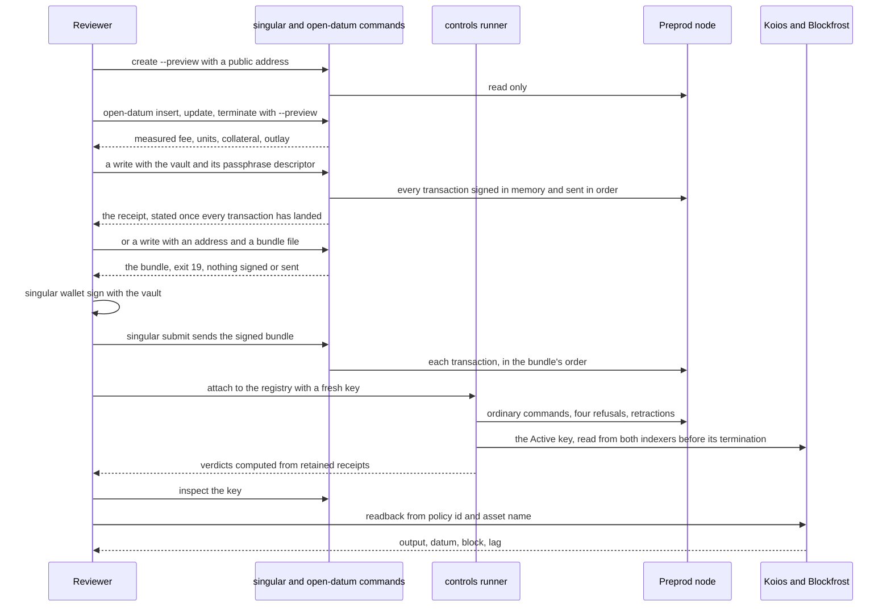
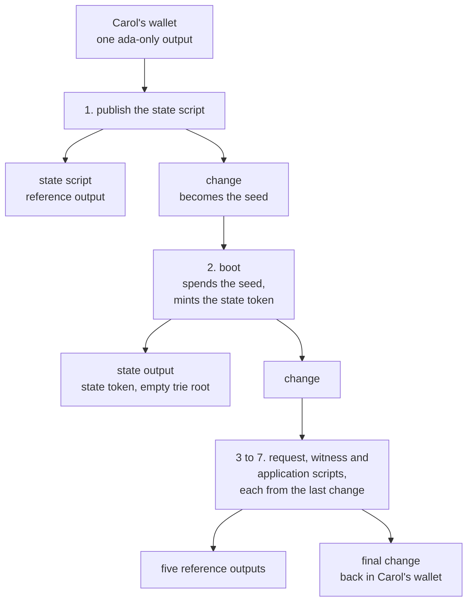

# Demo 1 on preprod: what a reviewer checks

## The story

As a reviewer, I download the pinned archive and check one registry and one fresh key on the public preprod network. The key is inserted and its payload is changed by its controller. It is found again from its policy id and asset name alone, through two independent public indexers. Four attacks are refused at their script boundaries, each beside an accepting control. The key is terminated and its protected deposit comes back. Every claim rests on a confirmed transaction or a fresh read, never on local state.

This page is the reviewer's map. It says what the archive lets you replay, what has been shown so far and on which chain, and what still waits for an explicit decision. It is not a record of a public run: none has happened.

## What you run

The ordinary `singular registry` and `open-datum` commands are the product path. Two more tools ship in the same archive: a controls runner that attaches to a registry that already exists, and a readback that asks a public indexer.

- **Sign without a key file, in one command or in three.** The reviewer's wallets come from `singular wallet create`: a vault sealed by a passphrase, whose printed address is all a development node needs to fund it. With `--vault` and the descriptor its passphrase is read from, a write opens the vault, builds its whole run as one bundle, signs every transaction in memory, sends them in order and prints its receipt once all of them have landed. With an address and a new bundle file instead, the write builds the same bundle, signs and sends nothing and exits with status 19; `singular wallet sign --vault` signs the bundle and `singular submit` sends it, and the command's own fields are only expected until `submit` finds the bundle on chain. The controls runner below is a harness and keeps its key files.
- **Measure before writing.** A preview names the caller by a public address, builds what each command would submit and prints its fee, the execution units the node's own evaluator measured, the collateral it states and returns, and the outlay. The fold of an insertion or a termination is a command of its own, `registry fold`, run by any wallet once the booking confirms, so the preview bounds it from the network's parameters.
- **Fund for the whole take.** An approval a booking mints returns to the wallet in the change output of the fold or retraction that releases it, so that output is no longer ada-only. A take refuses, before it writes, a wallet without one ada-only output for every insert, terminate and retraction of its story and one more, each large enough for the allowance or outlay bound and the ledger's minimum output.
- **Four refusals on one registry.** An update that needs another wallet's signature, a release outside any fold, a second insertion of the Active key and an insertion of the Terminal key are each refused by the node at the script that owns the rule, beside the ordinary command that does the same thing legitimately.
- **Reclaim what a refusal leaves.** A refused insertion leaves its request pending, and a registry's fold judges each pending request on its own and settles every request that passes, up to nine, so the refused one stays pending, named with its reason in the receipt's `excluded` list. The owner retracts the one its own insertion left, inside its retract window, only while the registry still reads as the readback that saw it pending did; the verdict requires the retained body to spend that request and the wallet to hold exactly the bond released less the fee. A take stops, with its receipts kept, at any outcome its step does not name and at any requirement that does not hold, and it is refused before it writes anything unless the operator states a collateral allowance.
- **Read the key back.** The take asks Koios and Blockfrost itself, between the key's final update and its termination, while the token is held, and stops before its next write if either is missing, unreachable, behind or in disagreement. The readback records each request and response, the output the indexer says holds the asset, its inline datum with its hash recomputed, the indexer's tip and the node's chain point and the lag between them. It succeeds only when the output reference and datum bytes are the node's, and the take judges the record from the provider's answers it keeps, never from the summary it states. A record's digest shows the bytes judged are the bytes kept, not that the provider answered honestly.

## What is established today

| Claim | Evidence | Chain |
| --- | --- | --- |
| A booking's fee and units are measured, and its collateral is stated | accounting checks against the public preprod parameters; the ordinary journey on a development node | development node |
| A preview signs, submits and writes nothing | your state directory is byte for byte the same afterwards | development node |
| **Pending, not established:** the four refusals, each beside its accepting control, on one existing registry, twice with fresh keys, and the same key read from two indexers before its termination | no completed gate supports it yet. The attach gate failed at an earlier commit (its receipt is kept) and an earlier run of it held three of thirty-one cases; a take's verdict is computed from retained receipts, so the claim holds only when a completed gate's receipts at the submitted commit say so | development node, pending |
| An indexer readback compares output, datum bytes and hash, and lag | a local indexer answering in the public services' shapes; each alteration fails for its own reason; the credential appears nowhere but the indexer's log | local indexer |

Nothing in that table is a preprod confirmation, and its pending row is not a claim. A development node's evaluation is not preprod execution, and the live preprod cost models are read as public inputs only.

## What waits for a decision

- Signing and submitting anything on the public network, and the release that publishes the archive.
- The recording of the actual commands.
- The Blockfrost credential, which stays with its owner; the readback takes a reference to a file, never a value.

## Funding a create from one output

As Carol, I fund a fresh wallet with one output and run `create` with no `--seed` flag. The preview tells me my registry's state token and its seed before anything is submitted. Then the create runs its seven transactions, each paid from the change of the one before, and the last change comes back to my wallet. I never split my wallet by hand.

As Carol, I funded Gina with one 200 tADA output on a fresh devnet with no state carrier anywhere: preview named the token with no refusal, `create` completed, the seed was the first publication's change, every reference is live, and Bob read the registry from the token alone. A 5 tADA one-output wallet is refused before anything is submitted with one `publication-unfunded` verdict in preview and in create (the state publication alone needs 53,698,530 lovelace); a 105 tADA one-output wallet covers the first publication but is refused at a later step with one verdict (the whole run needs at least 162,649,217 lovelace). With a live carrier (Grace, one 200 tADA output after Alice), the seed is her output and the boot is paid from it. An explicit `--seed` names a held output, or the previewed chained seed to pin the identity; a held sole output while the state must be published is refused with omit-`--seed`. Reference-script outputs left by earlier creates do not count as funding. Built under the decision of 2026-10-12 ([#491](https://github.com/lambdasistemi/singular/issues/491)) as a chain from one output:

- **Why the seed can come second.** The state script is the same for every registry and is not tied to any seed, so the seed does not have to exist before the first publication.
- **The identity is still known at preview.** The registry's token name is the SHA-256 of the seed's output reference. That reference is the first publication's transaction id and an output number, and the transaction id is computed from the body before submission.
- **A half-built create has one way forward.** It always continues from the last transaction's change ([#478](https://github.com/lambdasistemi/singular/issues/478)).

Remaining limits: the wallet is read once and an output spent between steps still fails a later step with the wallet changed; there is no resume of a half-made run; the oversize check is an estimate.

## What this does not show

One bounded run shows that the four refusals happen at their script boundaries for that key on that registry. It is not a universal statement about every compiled validator and ledger transaction, and an indexer that misses an output proves nothing either way. The duplicated token carrier case stays a model and validator test with its conditional argument, and is not run on a live chain.
