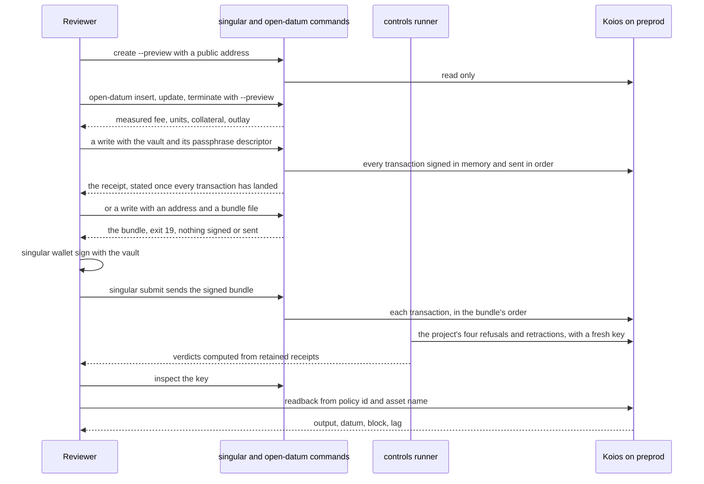
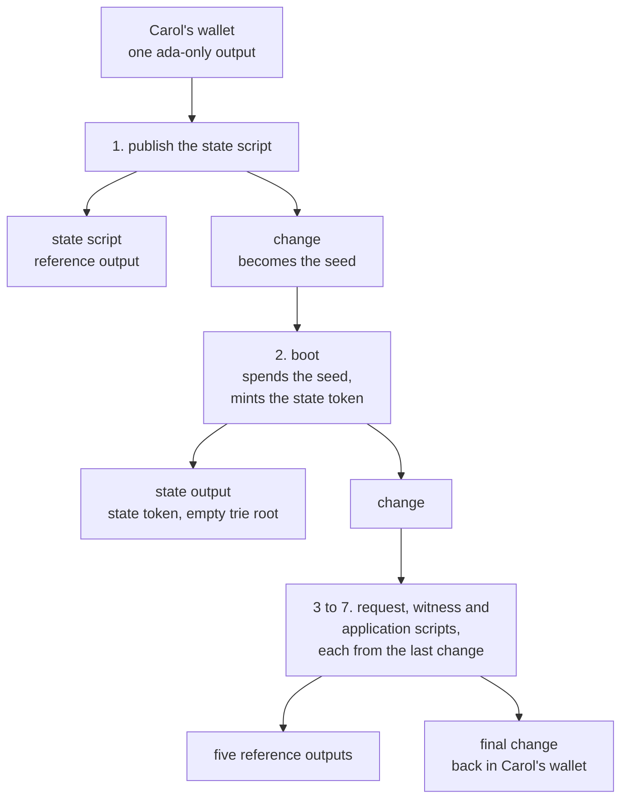

# Demo 1 on preprod: what a reviewer checks

## The story

As a reviewer, I download the pinned archive and check one registry and its keys on the public preprod network. A key is inserted and its payload is changed by its controller. It is found again from its policy id and asset name alone, through the public Koios indexer. A request nobody folded is rejected and another is taken back by its owner. The key is terminated and its protected deposit comes back. Every claim rests on a confirmed transaction or a fresh read, never on local state.

This page is the reviewer's map. It says what the archive lets you replay, what has been shown so far and on which chain, and what still waits. To play the steps yourself, use the [preprod runbook](demo1-on-preprod.md); to see them run on a private node first, use the [development-node page](demo1-devnet.md).

## What you run

The ordinary `singular registry` and `open-datum` commands are the product path. Two more tools ship in the same archive: a controls runner that the project runs against a registry that already exists, and a readback that asks Koios.

- **Sign without a key file, in one command or in three.** The reviewer's wallets come from `singular wallet create`: a vault sealed by a passphrase, whose printed address is all a development node needs to fund it. With `--vault` and the descriptor its passphrase is read from, a write opens the vault, builds its whole run as one bundle, signs every transaction in memory, sends them in order and prints its receipt once all of them have landed. With an address and a new bundle file instead, the write builds the same bundle, signs and sends nothing and exits with status 19; `singular wallet sign --vault` signs the bundle and `singular submit` sends it, and the command's own fields are only expected until `submit` finds the bundle on chain. The controls runner below is a test tool and keeps its key files.
- **Measure before writing.** A preview names the caller by a public address, builds what each command would submit and prints its fee, the execution units the local evaluator measured, the collateral it states and returns, and the outlay. The fold of an insertion or a termination is a command of its own, `open-datum fold`, run by any wallet once the booking confirms, so the preview bounds it from the network's parameters.
- **Four refusals on one registry, run by the project.** An update that needs another wallet's signature, a release outside any fold, a second insertion of the Active key and an insertion of the Terminal key are each refused by the node at the script that owns the rule, beside the ordinary command that does the same thing legitimately. The controls runner that rehearses them keeps key files and needs a node socket for its own independent probe of the chain, so it is not part of the path a user follows.
- **Reclaim what a refusal leaves.** A refused insertion leaves its request pending, and a registry's fold judges each pending request on its own and settles every request that passes, up to nine, so the refused one stays pending, named with its reason in the receipt's `excluded` list. The owner retracts the one its own insertion left, inside its retract window, only while the registry still reads as the readback that saw it pending did; the verdict requires the retained body to spend that request and the wallet to hold exactly the bond released less the fee. The controls runner stops, with its receipts kept, at any outcome its step does not name and at any requirement that does not hold, and it is refused before it writes anything unless the operator states a collateral allowance.
- **Read the key back.** `tools/demo1_readback.sh --provider koios` asks Koios for the asset by policy id and name alone, and records each request and response, the output Koios says holds the asset, its inline datum with its hash recomputed, Koios's tip and the node's chain point, and the lag between them. It succeeds only when the output reference and datum bytes are the receipt's, and the verdict is judged from the answers it keeps, never from the summary it states. A record's digest shows the bytes judged are the bytes kept, not that Koios answered honestly.

## What is established today

| Claim | Evidence | Chain |
| --- | --- | --- |
| Alice signed eight writes from her vault in one command each, and Bob signed five writes externally (exit 19, then `singular wallet sign`, then `singular submit`): insert, fold, update, terminate, fold, reject, insert, fold, insert, reclaim, insert, fold | the thirteen transactions below, each read back from Koios when it landed; a final readback found all of them in a block with at least nine confirmations | preprod, 18 October 2026, release v0.12.0 |
| A reject asked for inside a window is refused by the client with exit 10 and builds no bundle; a second write while Bob's bundle waits stops with exit 19 and builds nothing; Alice's vault refuses to sign Bob's bundle | the three refusals' receipts of the same play, each beside its accepting step | preprod, 18 October 2026 |
| A booking's fee and units are measured, and its collateral is stated | accounting checks against the public preprod parameters; the ordinary journey on a development node | development node |
| A preview signs, submits and writes nothing | your state directory is byte for byte the same afterwards | development node |
| **Pending, not established:** the four refusals, each beside its accepting control, on one existing registry, twice with fresh keys, and the same key read from Koios before its termination, by the controls runner | no completed gate supports it yet. The attach gate failed at an earlier commit (its receipt is kept) and an earlier run of it held three of thirty-one cases; a run's verdict is computed from retained receipts, so the claim holds only when a completed gate's receipts at the submitted commit say so | development node, pending |
| A Koios readback compares output, datum bytes and hash, and lag | the 18 October play passed it for `alice` after the first fold, 0 slots behind; a local indexer answering in Koios's shapes fails each alteration for its own reason | preprod; local indexer |

The 18 October play joined a registry created on 12 October by an earlier release, so it shows nothing about a registry created by v0.12.0 on preprod. The registry's windows were ten minutes to fold and five more to take a request back. Its thirteen registry transactions, in order, each of which anyone can look up in a preprod explorer:

| Step | Signer | Transaction | Block | Fee in lovelace |
| --- | --- | --- | --- | --- |
| insert `alice` | Alice, vault | `ed91601c4175a0856b74ce714ae2717ce5b5dfc241703e96ab6326398ee383fe` | 5308058 | 391529 |
| fold | Bob, external | `8a48a41798eb6e47f771642bd57a5de3cd6026e5b612f6a5de7bc72f4aa0215d` | 5308067 | 814403 |
| update | Alice, vault | `16baf4010d3acdcacf4dbc31a81079d64576016ce045f723123f24a846b146bb` | 5308073 | 357395 |
| terminate | Alice, vault | `00c8578a7e65dc931bb9141cc8f138f64b1cfeb8d7fd316906d84231e55b5558` | 5308078 | 368915 |
| fold | Bob, external | `d7a2be6ba6326053c07f58a49a9f7f330705909c4851a1dc94b324dbb958312c` | 5308086 | 894755 |
| insert `late` | Alice, vault | `fbdef86c5b25eaf8741031248d1e6dfbadbc1a6bd7cd1bd50adc52d267fe1d82` | 5308091 | 391353 |
| reject | Bob, external | `54dd8782b00fce3042d4ed07ea894a36cb7fbcf7343dfa6d664473ed2e9cda0d` | 5308125 | 509456 |
| insert `bob` | Bob, external | `a268ca522787d68f98cb77252c77c271291b9aa6299c93188c74b5a99188edd7` | 5308132 | 391177 |
| fold | Alice, vault | `38c0ad8124af4905912f195bc86d9a7615f2108535edb2dbbbe842b6d4ec6d22` | 5308145 | 814076 |
| insert `carol` | Alice, vault | `c6c27ac34ebd21cbb9cf357ae7cd18806046e390a267c27e36bc118de89c73e3` | 5308152 | 391529 |
| reclaim | Alice, vault | `32adb92d93dc0f542fde3bf9f52b4274524d4b45edb045c5912eb9a5d4fd3dcd` | 5308192 | 374576 |
| insert `dave` | Alice, vault | `5359f19feda07f4df2133858a9e8c09f4db2d03893c584b4b4e7c64795ae3ff6` | 5308200 | 391353 |
| fold | Bob, external | `65625001af72d939d356dc931b10af3c5e7951a94d8c18889a0e76f4384b9474` | 5308212 | 826180 |

Nothing in the development-node rows is a preprod confirmation. A development node's evaluation is not preprod execution, and the live preprod cost models are read as public inputs only.

## What is still waiting

- A registry created by the latest release on preprod, and the cost of that create there.
- The four refusals of the controls runner on preprod, with a completed gate.
- A recording of the actual commands.
- Binaries for Linux and macOS; today every user builds from source or from the public binary cache.

## Funding a create from one output

As Carol, I fund a fresh wallet with one output and run `create` with no `--seed` flag. The preview tells me my registry's state token and its seed before anything is submitted. Then the create runs its seven transactions, each paid from the change of the one before, and the last change comes back to my wallet. I never split my wallet by hand.

As Carol, I funded Gina with one 200 tADA output on a fresh devnet with no state carrier anywhere: preview named the token with no refusal, `create` completed, the seed was the first publication's change, every reference is live, and Bob read the registry from the token alone. A 5 tADA one-output wallet is refused before anything is submitted with one `publication-unfunded` verdict in preview and in create (the state publication alone needs 53,698,530 lovelace); a 105 tADA one-output wallet covers the first publication but is refused at a later step with one verdict (the whole run needs at least 162,649,217 lovelace). With a live carrier (Grace, one 200 tADA output after Alice), the seed is her output and the boot is paid from it. An explicit `--seed` names a held output, or the previewed chained seed to pin the identity; a held sole output while the state must be published is refused with omit-`--seed`. Reference-script outputs left by earlier creates do not count as funding. Built under the decision of 2026-10-12 ([#491](https://github.com/lambdasistemi/singular/issues/491)) as a chain from one output:

- **Why the seed can come second.** The state script is the same for every registry and is not tied to any seed, so the seed does not have to exist before the first publication.
- **The identity is still known at preview.** The registry's token name is the SHA-256 of the seed's output reference. That reference is the first publication's transaction id and an output number, and the transaction id is computed from the body before submission.
- **A half-built create has one way forward.** It always continues from the last transaction's change ([#478](https://github.com/lambdasistemi/singular/issues/478)).

Remaining limits: the wallet is read once and an output spent between steps still fails a later step with the wallet changed; there is no resume of a half-made run; the oversize check is an estimate.

## What this does not show

One bounded run shows that the steps behave as described for those keys on that registry. It is not a universal statement about every compiled validator and ledger transaction, and an indexer that misses an output proves nothing either way. The duplicated token carrier case stays a model and validator test with its conditional argument, and is not run on a live chain.
