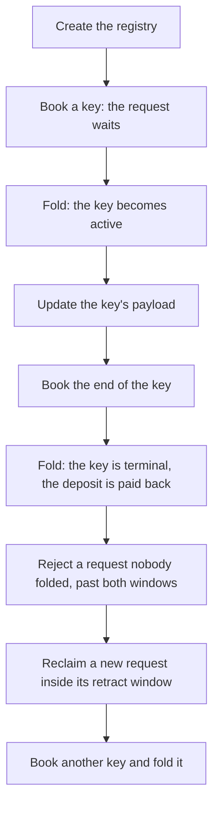

# Demo 1: play a registry from creation to termination

As a Cardano developer who knows wallets, faucets and Koios but has never used
Singular, you want to watch a registry work before you read how it is built: a
registry is created, a key is put in it, changed and ended, the registry refuses
what it must refuse, and two people sign their writes in two different ways. Demo
1 is that play, in sixteen steps. The steps, and the programs to run them, live in
a repository of their own, [singular-demo](https://github.com/lambdasistemi/singular-demo).
This page says what the play shows and where to play it.

## What the play shows

Two people, Alice and Bob, share one registry. Its application, open datum, lets
a key carry a payload that only the key's controller may replace, and keeps a
deposit of 2 tADA with the key until the key is terminated.

The play creates the registry, books a key and folds it so that the key becomes
active, updates its payload, books and folds the key's end, then rejects a request
that nobody folded, reclaims a new one inside its retract window, and books and
folds one more key.

A write does not change the registry at once. It books a request, which waits
until someone folds it, and any wallet may fold. A request that nobody folds
within its processing window can be rejected once a second window, the retract
window, has also passed; inside that second window its owner can take it back.
The play walks each of these, so that you see the refusals where they happen: a
reject that comes too early is refused, and so is a reclaim that comes too early.

The two people sign in the two ways Singular offers. Alice names her vault, a
file holding her signing key sealed by a passphrase, and one command builds,
signs and sends. Bob names only his wallet's address and a bundle file: the
command builds the transactions into the file, signs nothing, and exits with
status 19, which means it is waiting for signatures. Then Bob signs the bundle
from his vault and sends it, so the machine that builds a write never needs to
hold the key.

## Where to play it

Every way below plays the same sixteen steps. The table lists three: the
step-by-step page to paste from, which needs the programs, and the Nix shell and the
Ubuntu kit, which are two ways to get the programs. Start with the step-by-step page.

| You want to | Go to | What you need |
| --- | --- | --- |
| Paste one block per step into a terminal, with a copy button on each block | [the step-by-step page](https://lambdasistemi.github.io/singular-demo/) | a terminal, and the programs from one of the next two rows |
| The programs without building them | the [Nix shell](https://github.com/lambdasistemi/singular-demo), opened with `nix develop github:lambdasistemi/singular-demo --accept-flake-config` | Nix, on x86_64 Linux |
| The programs without Nix | the Ubuntu kit, attached to the [releases of singular-demo](https://github.com/lambdasistemi/singular-demo/releases) | Ubuntu 24.04 on x86_64 |

The [singular-demo repository](https://github.com/lambdasistemi/singular-demo)
describes the shell and the kit, what each is pinned to and what it was tested on.

## What it does not claim

Everything the step-by-step page runs happens on a private test chain that it
starts; nothing touches a public network. The open datum application protects the
payload and the deposit and nothing more: it demonstrates the registry's
mechanics. The receipts of a play are evidence of behaviour on a private chain
only, and no complete conformance is claimed here. What the project does claim,
and what it leaves open, is on the [conformance evidence](conformance-evidence.md)
page. What is deployed on the public preprod network, and the transactions the
project's own journeys submitted there, are recorded in
[the preprod record](preprod.md).

## The release behind it

The play runs a release of Singular. These pages are about the release itself,
not about the steps: [install the commands without Nix](install.md) and
[download and verify a release](verify-release.md). Each release archive also
carries the same story as a run page, `DEMO1.md`
([the page in the repository](https://github.com/lambdasistemi/singular/blob/main/onchain-release/DEMO1.md)),
which builds the commands from the archive and which the project's hosted checks
run against every change.
