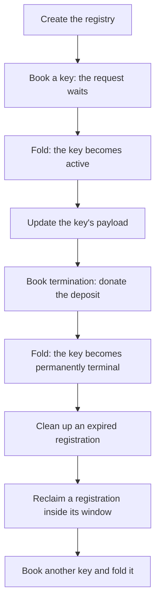

# Demo 1: play a registry from creation to termination

As a Cardano developer who knows wallets, faucets and Koios but has never used
Singular, you want to watch a registry work before you read how it is built: a
registry is created, a key is put in it, changed and ended, the registry refuses
what it must refuse, and two people sign their writes in two different ways. Demo
1 introduces that play. The steps, and the programs to run them, live in
a repository of their own, [singular-demo](https://github.com/lambdasistemi/singular-demo).
This page says what the play shows and where to play it.

## What the play shows

Two people, Alice and Bob, share one registry. Its application, open datum, lets
a key carry a payload that only the key's controller may replace, and keeps the
protected deposit with the live holding. Booking permanent termination donates
that deposit to the treasury.

A registration starts as a pending request. Any wallet may fold it, making the
key active and delivering its token, payload and protected deposit to the
committed holding. Its controller may update the payload without spending the
registry state.

The controller books permanent termination by donating the protected deposit to
the treasury and moving the active token into a pending termination request.
Any wallet may fold that request, burning its approval and active token and
making the key permanently terminal. The folder receives the request's held
value and pays the transaction fee. A termination has no reclaim window.

A registration that nobody folds can be reclaimed by its refund address inside
its reclaim window. After that window, anyone can clean it up: the protected
deposit returns to the refund address and the caller receives the held value
above that deposit. A reclaim outside its window and a cleanup before its
window are refused. The [command guide](registry-commands.md) gives the flags
and receipts for each operation.

The two people sign in the two ways Singular offers. Alice names her vault, a
file holding her signing key sealed by a passphrase, and one command builds,
signs and sends. Bob names only his wallet's address and a bundle file: the
command builds the transactions into the file, signs nothing, and exits with
status 19, which means it is waiting for signatures. Then Bob signs the bundle
from his vault and sends it, so the machine that builds a write never needs to
hold the key.

## Where to play it

The demo repository records its release and the steps it supports. The table lists five entry points: the recorded
run to watch, the Killercoda scenario to play in a browser, the step-by-step page
to paste from, which needs the programs, and the Nix shell and the Ubuntu kit,
which are two ways to get the programs. To play on your own machine, start with
the step-by-step page.

| You want to | Go to | What you need |
| --- | --- | --- |
| Watch the whole play without running anything | [the recorded run](https://lambdasistemi.github.io/singular-demo/demo1/run/) | a browser |
| Play it in a browser with nothing installed | the Killercoda scenario, [step by step](https://killercoda.com/paolino/course/killercoda/demo1-steps) or [as one script](https://killercoda.com/paolino/course/killercoda/demo1-script) | a browser and a Killercoda login |
| Paste one block per step into a terminal, with a copy button on each block | [the step-by-step page](https://lambdasistemi.github.io/singular-demo/) | a terminal, and the programs from one of the next two rows |
| The programs without building them | the [Nix shell](https://github.com/lambdasistemi/singular-demo), opened with `nix develop github:lambdasistemi/singular-demo --accept-flake-config` | Nix, on x86_64 Linux |
| The programs without Nix | the Ubuntu kit, attached to the [releases of singular-demo](https://github.com/lambdasistemi/singular-demo/releases) | Ubuntu 24.04 on x86_64 |

The [singular-demo repository](https://github.com/lambdasistemi/singular-demo)
describes the shell and the kit, what each is pinned to and what it was tested on.

## What it does not claim

Everything the step-by-step page runs happens on a private test chain that it
starts; nothing touches a public network. The open datum application protects the
payload and the deposit and nothing more: it demonstrates the registry's
mechanics. The receipts of a play are evidence of behaviour on a private chain
only, and no complete conformance is claimed here. What the project does claim,
and what it leaves open, is on the [conformance evidence](conformance-evidence.md)
page. What is deployed on the public preprod network, and the transactions the
project's own journeys submitted there, are recorded in
[the preprod record](preprod.md).

## The release behind it

The play runs a release of Singular. These pages are about the release itself,
not about the steps: [install the commands without Nix](install.md) and
[download and verify a release](verify-release.md).
