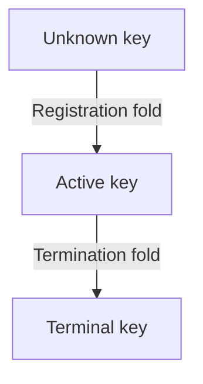

# Singular: registry design and economics

As a reviewer, read this page to learn what a registration or termination commits, where its tokens and lovelace go, and which promises have checked evidence. The paper explains the complete mechanism, its assumptions and its counterexamples: <a href="https://lambdasistemi.github.io/singular/docs/economics-paper.pdf">download the paper PDF</a>. The documentation build compiles the PDF from the committed LaTeX sources using the `llncs` class.

**Implementation standing: not yet conformant.** The validators and builders still implement superseded economic rules. The [conformance evidence](conformance-evidence.md) keeps affected requirements unmet; a Lean proof is not a ledger receipt or deployment acceptance.

## Named, unique, permanent; permissionless and reusable

**Singular is a permissionless and reusable mint of named, unique and permanent tokens on Cardano.** This is the adopted definition and the paper's organizing promise. The five meanings below distinguish checked model results from application goals and demonstrations.

[Cardano KERI](https://github.com/lambdasistemi/cardano-keri) motivates checkpoints selectable by KERI identifier and evidence of whether an identifier was ever convicted on Cardano. For KERI a conviction is a termination, and it is permanent. A lookup of an identifier at a registry root has three outcomes. An active leaf proves that the identifier is registered and not convicted at that root: “not convicted” means active. A terminal leaf proves conviction. An unknown leaf proves only that the identifier is not registered on Singular; that is a different answer and is never presented as “not convicted”. The stored Absent leaf belongs to the extension edges outside the contract of the first release and is not part of this reading. **Existing checked declaration:** `Singular.Statements.termination` keeps a terminal leaf terminal through every later accepted batch, and `Singular.Statements.terminal_attestation_permanent` keeps a held terminal attestation held and its leaf terminal. **Hand proof supplied:** by induction over the accepted batches from the genesis state, a key terminal at one reachable state is terminal at every later one, so an active leaf at a root shows the key was never terminal before it: an active identifier was never convicted before that root. **Missing mechanization:** the lookup is a logical read of the root and verifying a concrete lookup proof is a correspondence obligation; a lookup is valid only against the current root until the next fold; durable attestations are future work, proposed and not proved; Singular alone does not verify duplicity or establish a KERI history, and the consumer integration remains open.

### Named

Each token has a name: registering a name mints exactly one token for it, and the registry is the only way to mint it. Holding the token is holding the name. The story is a registered name represented by a token an application holds with its own payload.

**Existing checked declaration:** `Singular.Statements.insert_active_transaction_row` describes the original registry's one minted active asset, its key-derived model name and its destination holding. `Singular.Statements.world_supply_sync` counts the economic world's actual singular tags across application custody and pending terminations. The register below supplies the exact pin and axiom lines. **Missing mechanization:** the actual minting policy and name encoding need correspondence evidence; holding the representative proves no legal right or personal identity.

### Unique

A name can be taken only with a proof that it is absent, so two people cannot hold separate genuine tokens for the same name in one registry. Bob tries to register Alice's already registered name and is refused.

**Existing checked declaration:** `Singular.Statements.insert_active_transaction_row` refuses a subsequent approved registration of the same key with `key-exists`. `Singular.Statements.world_supply_sync` bounds economic supply by one, including a token in a pending termination. **Missing mechanization:** actual absence-proof verification is a validator correspondence obligation. “Absent” in this story means unknown and untaken, not the historical stored Absent leaf. Booking does not reserve a name or establish who ought to own it.

### Permanent

Terminating a name burns its token and records it as terminal; it can never be issued again. Alice terminates her name, then tries to register it again and is refused. For KERI, termination is intended to be conviction: the convicted identifier must never come back in that registry.

**Hand proof supplied:** read as a lookup, a terminal leaf proves conviction and an active leaf at a reachable root shows the key was never terminal before it; an unknown leaf proves only that the identifier is not registered. **Existing checked declaration:** `Singular.Statements.termination` refuses requests at a terminal key in a reachable original registry and preserves its terminal leaf through later accepted batches. `Singular.Statements.booked_termination_foldable` supplies a conditional economic fold making the key terminal, and `Singular.Statements.world_supply_sync` then gives zero supply. **Missing mechanization:** KERI's conviction and custody release require application evidence. The economic termination donates everything held except the tip, as `Singular.Statements.fold_routes_every_amount` states; Alice receives no deposit back.

### Permissionless

Anyone creates a registry, anyone books a name, anyone settles pending requests, all from public chain data. The creator has no power over the names. These participation promises remain subject to application authorization, funding and admission. Bob, who did not create the registry, settles pending requests, Alice's included.

**Existing checked declarations:** `Singular.Statements.fold_inputs_public` equates the original builder with construction from its public view; `Singular.Statements.fold_requires_no_signer` proves empty required signers and invariance under changed approval signatures. **Missing mechanization:** these are original-builder results, not an economic-builder public-data theorem or a running demonstration. Creation, chain-data retrieval and Bob's actual batch require off-chain and validator evidence. No inclusion guarantee follows.

### Reusable

The same mint serves any application: open-datum today, a closed variant in the demonstration, KERI checkpoints next, with no change to its contract. Each name's token lives in its owner's application, which decides what the name points to.

**Missing mechanization:** the concrete application demonstration uses a closed flag on the same release and commands. It sets the payload at registration, refuses every update and leaves only termination. This is application-validator and executable behavior outside the checked registry model; this paper asserts no release or running-demonstration receipt. KERI integration and serving both application kinds in one registry through application tags remain future work.

## The mechanism at a glance

The registry records a permanent lifecycle. Registration changes an unknown key to active; termination changes an active key to terminal. The application authorizes registration and controls the resulting singular tag. It consents to termination by releasing that genuine tag into a request. Singular does not judge the application's release rule. Checked lifecycle and custody evidence appears in the declaration register below.

Pending requests occupy their own outputs. Folds spend and continue the registry state output. Rejection reads that output by reference and spends only the rejected registrations. It needs a current lifecycle mismatch or expiry after both registration windows. Compatible registrations are protected through the reclaim window; a lost race can create a mismatch earlier. A termination has no rejection, retraction or expiry exit.

## Requests, tokens and clocks

Let R be the registration cost, t the declared tip, and a the declared carrier lovelace. Booking enforces the fixed minimum tip. The carrier amount follows actual ledger minimum rules; the model proves exact declared amounts and does not compute those minima.

| Request | Exact holdings | Clock and exits |
|---|---|---|
| Registration | R + t + a lovelace, one application tag and one trie-ready tag | Booked time is the upper end of a nonempty interval of bounded width. Fold, signed retraction or rejection. |
| Termination | t + a lovelace, the genuine singular tag and one trie-ready tag; no application tag | No booked time or refund address. Fold only. |

A registration's application tag commits to its payload and nonce; its trie-ready tag commits to the operation and the same nonce. Both are minted in the same booking and burned on every exit. Application tags minted elsewhere are outside Singular's supply guarantee and cannot substitute for this booking. Termination booking moves the singular tag from custody; its fold burns that tag and the trie-ready tag. A registration fold mints the singular tag at the booked destination with the declared carrier and datum.

The fixed parameters are registration cost, minimum tip, maximum booking width, processing and reclaim windows, policy bindings and registry identity. The minimum tip retains the wire key `maxFee`. There is no parameter-update or migration authority. The paper treats the maximum booking width being smaller than the processing window as a sizing criterion, distinct from the checked booking-width bound.

## Every exit and every amount

**Existing checked declaration:** fold routing separates state continuation, exact carrier outputs, donation and ordinary funding. With ordinary inputs I, ordinary outputs O, total tips T and ledger fee f, it proves O + f = I + T and f ≤ I. Donation equals the registration costs plus held-minus-tip for every termination. Ordinary change remains a separate output even at a carrier's address. Ordinary funding and change are lovelace only: the fold and retraction both refuse an unrelated native asset.

| Exit | Allocation and evidence limit |
|---|---|
| Registration folded | R to the treasury, a and the singular tag to the destination, t as gross ordinary allocation. |
| Registration rejected | Each refund address gets at least the sum of R + a for its distinct rejected requests. The model makes no exact processor-reward claim. |
| Registration retracted | All held lovelace returns at least, tip included; both tags burn. Ordinary funding pays the ledger fee, the transaction balances, no tip is taken and nothing goes to the treasury. |
| Termination folded | Held minus tip to the treasury, tip as gross ordinary allocation; no refund or destination output. |

**Hand proof supplied:** subtracting in the integers gives O − I = T − f. If the processor owns the ordinary funding pool and no other role, that is its monetary net before external costs. It is not a wealth statement about every address receiving an output. The paper's separate net-payoff table includes the booking fee, destination carrier and treasury donation; its rows sum to minus ledger fees, not to request holdings.

Rejection refunds are added per address, with distinct request inputs and one shared interval. A repeated input or one live compatible member refuses the entire batch. A fold that lands first spends the referenced state output, so an in-flight rejection must be rebuilt; no starvation bound is proved.

A zero donation omits the field. Conway transaction-body field 22 accepts a positive donation; optional field 21 is the separate current-treasury assertion. Donation alone does not assert the current treasury balance. The paper cites the exact [Conway CDDL revision](https://github.com/IntersectMBO/cardano-ledger/blob/8909b60669705039603c5407afc18e8a860288b1/eras/conway/impl/cddl/data/conway.cddl) and its [treasury-value check](https://github.com/IntersectMBO/cardano-ledger/blob/8909b60669705039603c5407afc18e8a860288b1/eras/conway/impl/src/Cardano/Ledger/Conway/Rules/Ledger.hs).

## What is checked, and at what strength

**Existing checked declaration** means the register below quotes the declaration's fresh axiom result at the exact model pin. **Hand proof supplied** means the paper gives an argument and its premises. **Proposed statement** means a conditional design or sizing criterion. **Missing mechanization** marks an unproved boundary. These four labels do not imply implementation conformance.

The exact model revision is `4254a3073fe0457946eba0a68d974c999c930ebf`, the last ancestor commit changing the model, checked with Lean 4.27.0. Economic reachability starts from any reachable original registry with empty pending pools and a zero treasury counter, then admits bookings, rejections, retractions and economic folds. It does not claim a complete economic history from ledger genesis.

| Property | Status and actual scope |
|---|---|
| Fixed parameters | Existing checked declaration for the original registry step and batch; the paper supplies the argument through the economic fold's explicit projection. |
| Rejection preserves the registry | Existing checked declaration for arbitrary accepted economic rejection, including state, termination pool and singular supply. |
| Rejection before a fold | Existing checked declaration preserves the original admitted registry fold and its needed outputs under disjointness. Whole economic-fold and ledger validity are missing mechanization. |
| Live protection | Existing checked declaration protects compatible pending registrations until expiry; booking time is not before inclusion. A mismatch is outside that premise. |
| Current-state evidence | Existing checked declaration requires the actual unspent reference, exact state token, inline configuration and current root. |
| Refund floors | Existing checked declarations sum held-minus-tip per rejection address and return full held value on accepted retraction. Retraction also has checked fee funding and balance; rejection has no exact-reward theorem. |
| Registration charge | Existing checked declarations bound donation by the number of registrations times R and include R in failed-registration refund floors. |
| Unrejectable termination | Existing checked declaration rules out both rejection grounds for a genuine pending termination. |
| One pending termination per key | Existing checked declaration counts supply across custody and pending requests. |
| Booked termination provenance | Existing checked declaration traces a folded termination to genuine custody release at an accepted booking. The application's rule is external. |
| Termination availability | Existing checked declaration constructs a coherent unspent set and transaction at any model time, assuming willing processing, fee within tip and sufficient ordinary funding. It does not establish live funds, ledger minima or inclusion. |
| Retraction availability | Existing checked declaration constructs a coherent unspent set and balanced accepted retraction for a pending registration, a nonempty reclaim interval, the refund signature and ordinary funding covering the chosen fee. No wallet availability or ledger acceptance follows. |
| Processor cap | Existing checked declaration bounds fold ordinary outputs by ordinary inputs plus tips. It is neither a positive wage nor a theorem about all exits. |
| Measured minimum tip | Proposed statement; missing mechanization and measurements. The fee envelope must include the reference read and required refund output. |

## Limitations and counterexamples

**Existing checked declarations:** `Singular.Statements.retraction_pays_only_the_refund_and_the_fee` proves full refund, zero donation, unchanged treasury, fee covered by ordinary funding and balance. If I is that funding, f the fee and P all outputs elsewhere than the refund address, then P ≤ I − f. The model has no wallet-ownership or output-purpose observation: other-address change and third-party payment are indistinguishable, but neither can consume the request's cost or tip. `Singular.Statements.pending_registration_can_be_retracted` proves existence with explicit reachable-world, pending-request, nonempty-window, signing and funding premises. Neither theorem supplies wallet funds, ledger minima, builder success or inclusion.

**Hand proof supplied:** a request holding 3,000,000 lovelace cannot alone return that amount and pay a 170,000 fee. With 200,000 ordinary funding, the model's construction returns 3,030,000 to the refund address and balances. If the requester owns the refund and funding, its net loss is the booking fee plus the retraction fee, with no processor or treasury allocation. These numbers illustrate the checked construction under its premises, not measured ledger costs.

**Hand proof supplied: conditional rejection cap.** The refund promise is a floor, not an exact split; a processor may leave some tip to the requester. If the transaction additionally balances with zero donation, all outputs outside its refund addresses plus its fee total at most the tips. The paper derives this bound from the summed floors and names balance as an extra premise. Its exact-refund net-payoff illustration is also conditional, not a claim about every accepted rejection.

**Hand proof supplied:** a self-rejecting funder can make the tip an internal transfer, so the design has no universal treasury flood price. Successful junk folds still pay R and occupy turns. Two registrations can race for one key; the loser retains its refund floor, not priority or ownership. A processor's fee can exceed the tip. A rejection sharing a request input with a proposed fold can invalidate that fold despite preserving the state output. Repeated folds can invalidate rejection references indefinitely.

**Proposed statement:** the minimum tip should cover measured singleton costs within a declared ledger envelope. The paper derives conditional inequalities for costs and windows, without assuming a minimum service rate or full batches. No measurements establish the selected registration cost, minimum tip or booking-width bound. A later fee or output-minimum change can invalidate the envelope.

The application's release rule and custody integration, the open-datum adaptation, the cardano-keri adaptation and validator/builder correspondence with live receipts remain open. The singular tag's fate is decided: mint and delivery on registration, movement at termination booking, burn at termination fold. No key-ownership, squatting, inclusion, priority or application-security guarantee follows from Singular's token counts.

## Future work: reusable names and durable evidence

**Proposed statement: non-terminality.** Deleting an active key would let an application reuse its name. This is a proposed extension to a different lifecycle contract, not a way to undo termination in an existing permanent registry.

**Proposed statement: proof durability through witnesses.** The other four proposed edges would create an absent witness, change that absent state to active, delete the absent state, and mint a terminal witness on demand. A separate presence witness would be minted with a name's token and burned when the name is terminated or deleted. Absence, presence and termination would then each have an attestation token. These five edges and the presence witness are proposed, not proved functionality of the active contract.

**Hand proof supplied:** a transaction referencing the application output holding a name's token loses that input when an application update spends it. A proof against the current registry root similarly depends on a state output that another fold may spend. The goal of the proposed witnesses is to make such evidence more durable. **Missing mechanization:** their minting, invalidation, custody and verification rules need a future model and implementation evidence. Presence and absence cannot be promised valid after their conditions cease to hold.

## Checked declaration register

The entries below are generated from a fresh run of `lake env lean tools/axioms.lean` over the pinned source, with every cited name confirmed by `git show` at that revision. Each row uses the full revision above and quotes its axiom line verbatim. Standard axioms are printed as observed; none of these entries contains an additional axiom or `sorryAx`. Definitions and supplied hand arguments are distinguished from checked declarations in the paper.

<!-- checked-declarations -->

| Pinned source | Verbatim axiom result |
|---|---|
| [Termination.lean:141](../lean/Singular/Statements/Termination.lean#L141) | `AXIOMS Singular.Statements.at_most_one_pending_termination [propext, Quot.sound, Classical.choice]` |
| [Booking.lean:13](../lean/Singular/Statements/Booking.lean#L13) | `AXIOMS Singular.Statements.booked_request_has_exact_contents [propext, Quot.sound, Classical.choice]` |
| [Booking.lean:192](../lean/Singular/Statements/Booking.lean#L192) | `AXIOMS Singular.Statements.booked_request_tags_commit_to_own_fields [propext, Quot.sound, Classical.choice]` |
| [FoldTermination.lean:36](../lean/Singular/Statements/FoldTermination.lean#L36) | `AXIOMS Singular.Statements.booked_termination_foldable [propext, Quot.sound, Classical.choice]` |
| [Termination.lean:221](../lean/Singular/Statements/Termination.lean#L221) | `AXIOMS Singular.Statements.booked_termination_tag_commits_to_own_operation [propext, Quot.sound, Classical.choice]` |
| [Booking.lean:82](../lean/Singular/Statements/Booking.lean#L82) | `AXIOMS Singular.Statements.booked_time_is_interval_end [propext, Quot.sound, Classical.choice]` |
| [Booking.lean:127](../lean/Singular/Statements/Booking.lean#L127) | `AXIOMS Singular.Statements.booked_time_not_before_inclusion [propext, Quot.sound, Classical.choice]` |
| [Booking.lean:140](../lean/Singular/Statements/Booking.lean#L140) | `AXIOMS Singular.Statements.booking_width_within_limit [propext, Quot.sound, Classical.choice]` |
| [FoldAccounting.lean:11](../lean/Singular/Statements/FoldAccounting.lean#L11) | `AXIOMS Singular.Statements.fold_donates_registration_cost [propext, Quot.sound, Classical.choice]` |
| [Delivery.lean:164](../lean/Singular/Statements/Delivery.lean#L164) | `AXIOMS Singular.Statements.fold_inputs_public [propext, Quot.sound, Classical.choice]` |
| [ExitPayments.lean:17](../lean/Singular/Statements/ExitPayments.lean#L17) | `AXIOMS Singular.Statements.fold_requires_no_signer [propext, Quot.sound]` |
| [FoldAccounting.lean:25](../lean/Singular/Statements/FoldAccounting.lean#L25) | `AXIOMS Singular.Statements.fold_routes_every_amount [propext, Quot.sound, Classical.choice]` |
| [RegistrationTransaction.lean:34](../lean/Singular/Statements/RegistrationTransaction.lean#L34) | `AXIOMS Singular.Statements.insert_active_transaction_row [propext, Quot.sound, Classical.choice]` |
| [RejectionProtection.lean:13](../lean/Singular/Statements/RejectionProtection.lean#L13) | `AXIOMS Singular.Statements.live_request_not_rejected [propext, Quot.sound, Classical.choice]` |
| [FoldTermination.lean:13](../lean/Singular/Statements/FoldTermination.lean#L13) | `AXIOMS Singular.Statements.only_booked_terminations_fold [propext, Quot.sound, Classical.choice]` |
| [Preservation.lean:19](../lean/Singular/Statements/Preservation.lean#L19) | `AXIOMS Singular.Statements.parameters_preserved_by_batch [propext, Quot.sound, Classical.choice]` |
| [Preservation.lean:11](../lean/Singular/Statements/Preservation.lean#L11) | `AXIOMS Singular.Statements.parameters_preserved_by_fold [propext, Quot.sound, Classical.choice]` |
| [Retraction.lean:59](../lean/Singular/Statements/Retraction.lean#L59) | `AXIOMS Singular.Statements.pending_registration_can_be_retracted [propext, Quot.sound, Classical.choice]` |
| [FoldAccounting.lean:50](../lean/Singular/Statements/FoldAccounting.lean#L50) | `AXIOMS Singular.Statements.processors_take_at_most_the_tips [propext, Quot.sound, Classical.choice]` |
| [Refunds.lean:90](../lean/Singular/Statements/Refunds.lean#L90) | `AXIOMS Singular.Statements.refunds_sum_per_address [propext, Quot.sound, Classical.choice]` |
| [Refunds.lean:68](../lean/Singular/Statements/Refunds.lean#L68) | `AXIOMS Singular.Statements.registration_cost_returned_on_exit [propext, Quot.sound, Classical.choice]` |
| [RejectionState.lean:91](../lean/Singular/Statements/RejectionState.lean#L91) | `AXIOMS Singular.Statements.rejection_batch_members_distinct [propext, Quot.sound, Classical.choice]` |
| [RejectionState.lean:67](../lean/Singular/Statements/RejectionState.lean#L67) | `AXIOMS Singular.Statements.rejection_cannot_invalidate_fold [propext, Quot.sound, Classical.choice]` |
| [RejectionState.lean:12](../lean/Singular/Statements/RejectionState.lean#L12) | `AXIOMS Singular.Statements.rejection_leaves_registry_untouched [propext, Quot.sound, Classical.choice]` |
| [Refunds.lean:12](../lean/Singular/Statements/Refunds.lean#L12) | `AXIOMS Singular.Statements.rejection_refund_floor [propext, Quot.sound, Classical.choice]` |
| [RejectionState.lean:43](../lean/Singular/Statements/RejectionState.lean#L43) | `AXIOMS Singular.Statements.rejection_requires_referenced_state [propext, Quot.sound, Classical.choice]` |
| [Retraction.lean:16](../lean/Singular/Statements/Retraction.lean#L16) | `AXIOMS Singular.Statements.retraction_pays_only_the_refund_and_the_fee [propext, Quot.sound, Classical.choice]` |
| [Refunds.lean:30](../lean/Singular/Statements/Refunds.lean#L30) | `AXIOMS Singular.Statements.retraction_refund_floor [propext, Quot.sound, Classical.choice]` |
| [RejectionState.lean:105](../lean/Singular/Statements/RejectionState.lean#L105) | `AXIOMS Singular.Statements.sweep_leaves_pool_untouched [propext, Quot.sound, Classical.choice]` |
| [TagSupply.lean:13](../lean/Singular/Statements/TagSupply.lean#L13) | `AXIOMS Singular.Statements.tag_supplies_equal_pending [propext, Quot.sound, Classical.choice]` |
| [Preservation.lean:135](../lean/Singular/Statements/Preservation.lean#L135) | `AXIOMS Singular.Statements.terminal_attestation_permanent [propext, Quot.sound, Classical.choice]` |
| [Preservation.lean:223](../lean/Singular/Statements/Preservation.lean#L223) | `AXIOMS Singular.Statements.termination [propext, Quot.sound, Classical.choice]` |
| [Termination.lean:13](../lean/Singular/Statements/Termination.lean#L13) | `AXIOMS Singular.Statements.termination_booking_has_exact_contents [propext, Quot.sound, Classical.choice]` |
| [Termination.lean:151](../lean/Singular/Statements/Termination.lean#L151) | `AXIOMS Singular.Statements.termination_request_carries_genuine_token [propext, Quot.sound, Classical.choice]` |
| [RejectionProtection.lean:52](../lean/Singular/Statements/RejectionProtection.lean#L52) | `AXIOMS Singular.Statements.termination_unrejectable [propext, Quot.sound, Classical.choice]` |
| [Booking.lean:185](../lean/Singular/Statements/Booking.lean#L185) | `AXIOMS Singular.Statements.trie_ready_tag_is_not_state_token [propext]` |
| [Termination.lean:54](../lean/Singular/Statements/Termination.lean#L54) | `AXIOMS Singular.Statements.world_supply_sync [propext, Quot.sound, Classical.choice]` |
| [Accounting.lean:82](../lean/Singular/Statements/Accounting.lean#L82) | `AXIOMS Singular.Statements.zero_donation_omits_field [propext, Quot.sound, Classical.choice]` |

The axiom report digest is `d22520a04f196bfe52e69ac18d156cce82c78d34f4a6365a16a2138a2815a2f9`. The trusted base includes Lean's kernel and the printed axioms, specification adequacy, authentic ledger observations, application authorization and the unproved model-to-validator correspondence. Executable commitment functions are stand-ins; tag counts do not establish cryptographic binding.
