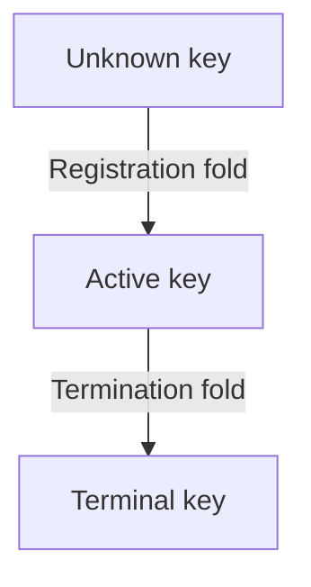

# Singular: registry design and economics

As a reviewer, read this page to learn what a registration or termination commits, where its tokens and lovelace go, and which promises have checked evidence. The paper explains the complete mechanism, its assumptions and its counterexamples: <a href="../economics-paper.pdf">download the paper PDF</a>. The documentation build compiles the PDF from the committed LaTeX sources using the `llncs` class.

**Implementation standing: not yet conformant.** The validators and builders still implement superseded economic rules. The [conformance evidence](conformance-evidence.md) keeps affected requirements unmet; a Lean proof is not a ledger receipt or deployment acceptance.

## The mechanism at a glance

The registry records a permanent lifecycle. Registration changes an unknown key to active; termination changes an active key to terminal. The application authorizes registration and controls the resulting singular tag. It consents to termination by releasing that genuine tag into a request. Singular does not judge the application's release rule. Checked lifecycle and custody evidence appears in the declaration register below.

Pending requests occupy their own outputs. Folds spend and continue the registry state output. Rejection reads that output by reference and spends only the rejected registrations. It needs a current lifecycle mismatch or expiry after both registration windows. Compatible registrations are protected through the reclaim window; a lost race can create a mismatch earlier. A termination has no rejection, retraction or expiry exit.

## Requests, tokens and clocks

Let R be the registration cost, t the declared tip, and a the declared carrier lovelace. Booking enforces the fixed minimum tip. The carrier amount follows actual ledger minimum rules; the model proves exact declared amounts and does not compute those minima.

| Request | Exact holdings | Clock and exits |
|---|---|---|
| Registration | R + t + a lovelace, one application tag and one trie-ready tag | Booked time is the upper end of a nonempty interval of bounded width. Fold, signed retraction or rejection. |
| Termination | t + a lovelace, the genuine singular tag and one trie-ready tag; no application tag | No booked time or refund address. Fold only. |

A registration's application tag commits to its payload and nonce; its trie-ready tag commits to the operation and the same nonce. Both are minted in the same booking and burned on every exit. Application tags minted elsewhere are outside Singular's supply guarantee and cannot substitute for this booking. Termination booking moves the singular tag from custody; its fold burns that tag and the trie-ready tag. A registration fold mints the singular tag at the booked destination with the declared carrier and datum.

The fixed parameters are registration cost, minimum tip, maximum booking width, processing and reclaim windows, policy bindings and registry identity. The minimum tip retains the wire key `maxFee`. There is no parameter-update or migration authority. The paper treats the maximum booking width being smaller than the processing window as a sizing criterion, distinct from the checked booking-width bound.

## Every exit and every amount

**Existing checked declaration:** fold routing separates state continuation, exact carrier outputs, donation and ordinary funding. With ordinary inputs I, ordinary outputs O, total tips T and ledger fee f, it proves O + f = I + T and f ≤ I. Donation equals the registration costs plus held-minus-tip for every termination. Ordinary change remains a separate output even at a carrier's address.

| Exit | Allocation and evidence limit |
|---|---|
| Registration folded | R to the treasury, a and the singular tag to the destination, t as gross ordinary allocation. |
| Registration rejected | Each refund address gets at least the sum of R + a for its distinct rejected requests. The model makes no exact processor-reward claim. |
| Registration retracted | The checked floor returns all held lovelace, tip included, and burns both tags. Retraction paying a ledger fee is missing mechanization. |
| Termination folded | Held minus tip to the treasury, tip as gross ordinary allocation; no refund or destination output. |

**Hand proof supplied:** subtracting in the integers gives O − I = T − f. If the processor owns the ordinary funding pool and no other role, that is its monetary net before external costs. It is not a wealth statement about every address receiving an output. The paper's separate net-payoff table includes the booking fee, destination carrier and treasury donation; its rows sum to minus ledger fees, not to request holdings.

Rejection refunds are added per address, with distinct request inputs and one shared interval. A repeated input or one live compatible member refuses the entire batch. A fold that lands first spends the referenced state output, so an in-flight rejection must be rebuilt; no starvation bound is proved.

A zero donation omits the field. Conway transaction-body field 22 accepts a positive donation; optional field 21 is the separate current-treasury assertion. Donation alone does not assert the current treasury balance. The paper cites the exact [Conway CDDL revision](https://github.com/IntersectMBO/cardano-ledger/blob/8909b60669705039603c5407afc18e8a860288b1/eras/conway/impl/cddl/data/conway.cddl) and its [treasury-value check](https://github.com/IntersectMBO/cardano-ledger/blob/8909b60669705039603c5407afc18e8a860288b1/eras/conway/impl/src/Cardano/Ledger/Conway/Rules/Ledger.hs).

## What is checked, and at what strength

**Existing checked declaration** means the register below quotes the declaration's fresh axiom result at the exact model pin. **Hand proof supplied** means the paper gives an argument and its premises. **Proposed statement** means a conditional design or sizing criterion. **Missing mechanization** marks an unproved boundary. These four labels do not imply implementation conformance.

The exact model revision is `303b4fd816b4a7dbd1e2fac5958eb85d0e72a03d`, the last ancestor commit changing the model, checked with Lean 4.27.0. Economic reachability starts from any reachable original registry with empty pending pools and a zero treasury counter, then admits bookings, rejections, retractions and economic folds. It does not claim a complete economic history from ledger genesis.

| Property | Status and actual scope |
|---|---|
| Fixed parameters | Existing checked declaration for the original registry step and batch; the paper supplies the argument through the economic fold's explicit projection. |
| Rejection preserves the registry | Existing checked declaration for arbitrary accepted economic rejection, including state, termination pool and singular supply. |
| Rejection before a fold | Existing checked declaration preserves the original admitted registry fold and its needed outputs under disjointness. Whole economic-fold and ledger validity are missing mechanization. |
| Live protection | Existing checked declaration protects compatible pending registrations until expiry; booking time is not before inclusion. A mismatch is outside that premise. |
| Current-state evidence | Existing checked declaration requires the actual unspent reference, exact state token, inline configuration and current root. |
| Refund floors | Existing checked declarations sum held-minus-tip per rejection address and return full held value on accepted retraction. They do not prove positive-fee retraction or exact rejection reward. |
| Registration charge | Existing checked declarations bound donation by the number of registrations times R and include R in failed-registration refund floors. |
| Unrejectable termination | Existing checked declaration rules out both rejection grounds for a genuine pending termination. |
| One pending termination per key | Existing checked declaration counts supply across custody and pending requests. |
| Booked termination provenance | Existing checked declaration traces a folded termination to genuine custody release at an accepted booking. The application's rule is external. |
| Termination availability | Existing checked declaration constructs a coherent unspent set and transaction at any model time, assuming willing processing, fee within tip and sufficient ordinary funding. It does not establish live funds, ledger minima or inclusion. |
| Processor cap | Existing checked declaration bounds fold ordinary outputs by ordinary inputs plus tips. It is neither a positive wage nor a theorem about all exits. |
| Measured minimum tip | Proposed statement; missing mechanization and measurements. The fee envelope must include the reference read and required refund output. |

## Limitations and counterexamples

**Missing mechanization: retraction paying a ledger fee.** The current retraction judgement permits exactly one request input and requires its full refund. A request holding 3,000,000 lovelace cannot return that amount and pay a 170,000 fee in a balanced transaction. An ordinary funding input is refused. The checked floor remains true; real-ledger retractability is not established, and affected acceptance remains open.

**Hand proof supplied: conditional rejection cap.** The refund promise is a floor, not an exact split; a processor may leave some tip to the requester. If the transaction additionally balances with zero donation, all outputs outside its refund addresses plus its fee total at most the tips. The paper derives this bound from the summed floors and names balance as an extra premise. Its exact-refund net-payoff illustration is also conditional, not a claim about every accepted rejection.

**Hand proof supplied:** a self-rejecting funder can make the tip an internal transfer, so the design has no universal treasury flood price. Successful junk folds still pay R and occupy turns. Two registrations can race for one key; the loser retains its refund floor, not priority or ownership. A processor's fee can exceed the tip. A rejection sharing a request input with a proposed fold can invalidate that fold despite preserving the state output. Repeated folds can invalidate rejection references indefinitely.

**Proposed statement:** the minimum tip should cover measured singleton costs within a declared ledger envelope. The paper derives conditional inequalities for costs and windows, without assuming a minimum service rate or full batches. No measurements establish the selected registration cost, minimum tip or booking-width bound. A later fee or output-minimum change can invalidate the envelope.

The application's release rule and custody integration, the open-datum adaptation, the cardano-keri adaptation and validator/builder correspondence with live receipts remain open. The singular tag's fate is decided: mint and delivery on registration, movement at termination booking, burn at termination fold. No key-ownership, squatting, inclusion, priority or application-security guarantee follows from Singular's token counts.

## Checked declaration register

The entries below are generated from a fresh run of `lake env lean tools/axioms.lean` over the pinned source, with every cited name confirmed by `git show` at that revision. Each row uses the full revision above and quotes its axiom line verbatim. Standard axioms are printed as observed; none of these entries contains an additional axiom or `sorryAx`. Definitions and supplied hand arguments are distinguished from checked declarations in the paper.

<!-- checked-declarations -->

| Pinned source | Verbatim axiom result |
|---|---|
| [Termination.lean:141](https://github.com/lambdasistemi/singular/blob/303b4fd816b4a7dbd1e2fac5958eb85d0e72a03d/lean/Singular/Statements/Termination.lean#L141) | `AXIOMS Singular.Statements.at_most_one_pending_termination [propext, Quot.sound, Classical.choice]` |
| [Booking.lean:13](https://github.com/lambdasistemi/singular/blob/303b4fd816b4a7dbd1e2fac5958eb85d0e72a03d/lean/Singular/Statements/Booking.lean#L13) | `AXIOMS Singular.Statements.booked_request_has_exact_contents [propext, Quot.sound, Classical.choice]` |
| [Booking.lean:192](https://github.com/lambdasistemi/singular/blob/303b4fd816b4a7dbd1e2fac5958eb85d0e72a03d/lean/Singular/Statements/Booking.lean#L192) | `AXIOMS Singular.Statements.booked_request_tags_commit_to_own_fields [propext, Quot.sound, Classical.choice]` |
| [FoldTermination.lean:36](https://github.com/lambdasistemi/singular/blob/303b4fd816b4a7dbd1e2fac5958eb85d0e72a03d/lean/Singular/Statements/FoldTermination.lean#L36) | `AXIOMS Singular.Statements.booked_termination_foldable [propext, Quot.sound, Classical.choice]` |
| [Termination.lean:221](https://github.com/lambdasistemi/singular/blob/303b4fd816b4a7dbd1e2fac5958eb85d0e72a03d/lean/Singular/Statements/Termination.lean#L221) | `AXIOMS Singular.Statements.booked_termination_tag_commits_to_own_operation [propext, Quot.sound, Classical.choice]` |
| [Booking.lean:82](https://github.com/lambdasistemi/singular/blob/303b4fd816b4a7dbd1e2fac5958eb85d0e72a03d/lean/Singular/Statements/Booking.lean#L82) | `AXIOMS Singular.Statements.booked_time_is_interval_end [propext, Quot.sound, Classical.choice]` |
| [Booking.lean:127](https://github.com/lambdasistemi/singular/blob/303b4fd816b4a7dbd1e2fac5958eb85d0e72a03d/lean/Singular/Statements/Booking.lean#L127) | `AXIOMS Singular.Statements.booked_time_not_before_inclusion [propext, Quot.sound, Classical.choice]` |
| [Booking.lean:140](https://github.com/lambdasistemi/singular/blob/303b4fd816b4a7dbd1e2fac5958eb85d0e72a03d/lean/Singular/Statements/Booking.lean#L140) | `AXIOMS Singular.Statements.booking_width_within_limit [propext, Quot.sound, Classical.choice]` |
| [FoldAccounting.lean:11](https://github.com/lambdasistemi/singular/blob/303b4fd816b4a7dbd1e2fac5958eb85d0e72a03d/lean/Singular/Statements/FoldAccounting.lean#L11) | `AXIOMS Singular.Statements.fold_donates_registration_cost [propext, Quot.sound, Classical.choice]` |
| [FoldAccounting.lean:25](https://github.com/lambdasistemi/singular/blob/303b4fd816b4a7dbd1e2fac5958eb85d0e72a03d/lean/Singular/Statements/FoldAccounting.lean#L25) | `AXIOMS Singular.Statements.fold_routes_every_amount [propext, Quot.sound, Classical.choice]` |
| [RejectionProtection.lean:13](https://github.com/lambdasistemi/singular/blob/303b4fd816b4a7dbd1e2fac5958eb85d0e72a03d/lean/Singular/Statements/RejectionProtection.lean#L13) | `AXIOMS Singular.Statements.live_request_not_rejected [propext, Quot.sound, Classical.choice]` |
| [FoldTermination.lean:13](https://github.com/lambdasistemi/singular/blob/303b4fd816b4a7dbd1e2fac5958eb85d0e72a03d/lean/Singular/Statements/FoldTermination.lean#L13) | `AXIOMS Singular.Statements.only_booked_terminations_fold [propext, Quot.sound, Classical.choice]` |
| [Preservation.lean:19](https://github.com/lambdasistemi/singular/blob/303b4fd816b4a7dbd1e2fac5958eb85d0e72a03d/lean/Singular/Statements/Preservation.lean#L19) | `AXIOMS Singular.Statements.parameters_preserved_by_batch [propext, Quot.sound, Classical.choice]` |
| [Preservation.lean:11](https://github.com/lambdasistemi/singular/blob/303b4fd816b4a7dbd1e2fac5958eb85d0e72a03d/lean/Singular/Statements/Preservation.lean#L11) | `AXIOMS Singular.Statements.parameters_preserved_by_fold [propext, Quot.sound, Classical.choice]` |
| [FoldAccounting.lean:50](https://github.com/lambdasistemi/singular/blob/303b4fd816b4a7dbd1e2fac5958eb85d0e72a03d/lean/Singular/Statements/FoldAccounting.lean#L50) | `AXIOMS Singular.Statements.processors_take_at_most_the_tips [propext, Quot.sound, Classical.choice]` |
| [Refunds.lean:92](https://github.com/lambdasistemi/singular/blob/303b4fd816b4a7dbd1e2fac5958eb85d0e72a03d/lean/Singular/Statements/Refunds.lean#L92) | `AXIOMS Singular.Statements.refunds_sum_per_address [propext, Quot.sound, Classical.choice]` |
| [Refunds.lean:70](https://github.com/lambdasistemi/singular/blob/303b4fd816b4a7dbd1e2fac5958eb85d0e72a03d/lean/Singular/Statements/Refunds.lean#L70) | `AXIOMS Singular.Statements.registration_cost_returned_on_exit [propext, Quot.sound, Classical.choice]` |
| [RejectionState.lean:91](https://github.com/lambdasistemi/singular/blob/303b4fd816b4a7dbd1e2fac5958eb85d0e72a03d/lean/Singular/Statements/RejectionState.lean#L91) | `AXIOMS Singular.Statements.rejection_batch_members_distinct [propext, Quot.sound, Classical.choice]` |
| [RejectionState.lean:67](https://github.com/lambdasistemi/singular/blob/303b4fd816b4a7dbd1e2fac5958eb85d0e72a03d/lean/Singular/Statements/RejectionState.lean#L67) | `AXIOMS Singular.Statements.rejection_cannot_invalidate_fold [propext, Quot.sound, Classical.choice]` |
| [RejectionState.lean:12](https://github.com/lambdasistemi/singular/blob/303b4fd816b4a7dbd1e2fac5958eb85d0e72a03d/lean/Singular/Statements/RejectionState.lean#L12) | `AXIOMS Singular.Statements.rejection_leaves_registry_untouched [propext, Quot.sound, Classical.choice]` |
| [Refunds.lean:12](https://github.com/lambdasistemi/singular/blob/303b4fd816b4a7dbd1e2fac5958eb85d0e72a03d/lean/Singular/Statements/Refunds.lean#L12) | `AXIOMS Singular.Statements.rejection_refund_floor [propext, Quot.sound, Classical.choice]` |
| [RejectionState.lean:43](https://github.com/lambdasistemi/singular/blob/303b4fd816b4a7dbd1e2fac5958eb85d0e72a03d/lean/Singular/Statements/RejectionState.lean#L43) | `AXIOMS Singular.Statements.rejection_requires_referenced_state [propext, Quot.sound, Classical.choice]` |
| [Refunds.lean:30](https://github.com/lambdasistemi/singular/blob/303b4fd816b4a7dbd1e2fac5958eb85d0e72a03d/lean/Singular/Statements/Refunds.lean#L30) | `AXIOMS Singular.Statements.retraction_refund_floor [propext, Quot.sound, Classical.choice]` |
| [RejectionState.lean:105](https://github.com/lambdasistemi/singular/blob/303b4fd816b4a7dbd1e2fac5958eb85d0e72a03d/lean/Singular/Statements/RejectionState.lean#L105) | `AXIOMS Singular.Statements.sweep_leaves_pool_untouched [propext, Quot.sound, Classical.choice]` |
| [TagSupply.lean:13](https://github.com/lambdasistemi/singular/blob/303b4fd816b4a7dbd1e2fac5958eb85d0e72a03d/lean/Singular/Statements/TagSupply.lean#L13) | `AXIOMS Singular.Statements.tag_supplies_equal_pending [propext, Quot.sound, Classical.choice]` |
| [Preservation.lean:223](https://github.com/lambdasistemi/singular/blob/303b4fd816b4a7dbd1e2fac5958eb85d0e72a03d/lean/Singular/Statements/Preservation.lean#L223) | `AXIOMS Singular.Statements.termination [propext, Quot.sound, Classical.choice]` |
| [Termination.lean:13](https://github.com/lambdasistemi/singular/blob/303b4fd816b4a7dbd1e2fac5958eb85d0e72a03d/lean/Singular/Statements/Termination.lean#L13) | `AXIOMS Singular.Statements.termination_booking_has_exact_contents [propext, Quot.sound, Classical.choice]` |
| [Termination.lean:151](https://github.com/lambdasistemi/singular/blob/303b4fd816b4a7dbd1e2fac5958eb85d0e72a03d/lean/Singular/Statements/Termination.lean#L151) | `AXIOMS Singular.Statements.termination_request_carries_genuine_token [propext, Quot.sound, Classical.choice]` |
| [RejectionProtection.lean:52](https://github.com/lambdasistemi/singular/blob/303b4fd816b4a7dbd1e2fac5958eb85d0e72a03d/lean/Singular/Statements/RejectionProtection.lean#L52) | `AXIOMS Singular.Statements.termination_unrejectable [propext, Quot.sound, Classical.choice]` |
| [Booking.lean:185](https://github.com/lambdasistemi/singular/blob/303b4fd816b4a7dbd1e2fac5958eb85d0e72a03d/lean/Singular/Statements/Booking.lean#L185) | `AXIOMS Singular.Statements.trie_ready_tag_is_not_state_token [propext]` |
| [Termination.lean:54](https://github.com/lambdasistemi/singular/blob/303b4fd816b4a7dbd1e2fac5958eb85d0e72a03d/lean/Singular/Statements/Termination.lean#L54) | `AXIOMS Singular.Statements.world_supply_sync [propext, Quot.sound, Classical.choice]` |
| [Accounting.lean:82](https://github.com/lambdasistemi/singular/blob/303b4fd816b4a7dbd1e2fac5958eb85d0e72a03d/lean/Singular/Statements/Accounting.lean#L82) | `AXIOMS Singular.Statements.zero_donation_omits_field [propext, Quot.sound, Classical.choice]` |

The axiom report digest is `1f8cf8a5c792a9419da90ef0ab465923248a74914790985c10943b71c1621a08`. The trusted base includes Lean's kernel and the printed axioms, specification adequacy, authentic ledger observations, application authorization and the unproved model-to-validator correspondence. Executable commitment functions are stand-ins; tag counts do not establish cryptographic binding.
