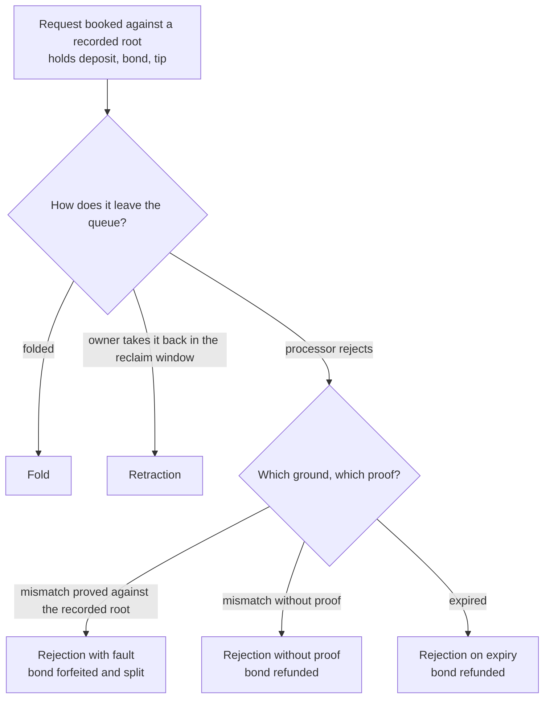

# Economics of protected rejection

As a scientist reviewing the registry economics from outside the project, read this page and learn what the paper claims, which Lean declaration each claim cites, and which proofs have landed. Every row below is marked not yet mechanized until the model behind it is built; nothing here is stated as a result.

The full draft lives beside this page as a PDF: <a href="../economics-paper.pdf">economics-paper.pdf</a>. It is built from LaTeX sources under `paper/economics` by the documentation build, so the PDF on the site always matches the committed sources.

## Who this is for

A reviewer who was not part of the design and wants the whole economic mechanism on one page before opening the paper: which amounts move in each outcome, which parameters the creator sets, and which statements are proved, argued by hand, or kept as counterexamples.

## Abstract

A permissionless registry lets anyone fold a queued request into shared state, so a request that waits in the queue can be cancelled by a stranger who collects the fee for the slot. The paper gives the economic rules of one such registry. Every request carries a bond beside its deposit. A processor that rejects a request forfeits the bond only when it proves, against the state root the request recorded at booking, that the request was already faulty then; any other rejection refunds the bond. The forfeited bond is split between the proving processor and the treasury. A fold that terminates a key donates a termination fee to the treasury. The paper states each property as a definition with a theorem, gives the transfer function as one table, derives every parameter constraint as an inequality with a worked example in lovelace, and lists exactly what the mechanism does not price, with counterexamples.

## Format and sources

The paper is written in LaTeX and built into this site by a Nix derivation. The intended style is the LIPIcs class, which is not shipped in the pinned TeX Live set, so this draft uses the `llncs` class from TeX Live and says so here. The bibliography holds only verified entries: a located whitepaper that could not be found is not cited, and a griefing survey whose author name is unconfirmed is not cited until its author is confirmed.

## What each outcome pays

The transfer function, net per party and excluding the value of the key itself. The deposit returns to the owner except where the edge rule routes it; the bond returns except on a proved fault. The tip returns on a retraction and pays the processor on everything else.

| Outcome | Requester | Processor | Treasury |
|---|---|---|---|
| Fold | tip and booking fee lost; bond returned | tip minus fold fee | termination fee per terminated key |
| Retraction | booking and retraction fees lost; deposit, tip and bond returned | nothing | nothing |
| Rejection with fault proved | bond, tip and booking fee lost; deposit returned | tip plus processor share minus rejection fee | bond minus processor share |
| Rejection without proof | tip and booking fee lost; deposit and bond returned | tip minus rejection fee | nothing |
| Rejection on expiry | tip and booking fee lost; deposit and bond returned | tip minus rejection fee | nothing |

The processor share of a forfeited bond is the floor of the split times the bond; the treasury receives the remainder, so the two shares always add up to the bond exactly. A donation that is zero is omitted from the transaction, since the donation field accepts only positive amounts.

## Theorem to Lean mapping

For this draft the table is written from the reviewed plan, with every row marked not yet mechanized. The generator that derives the table from the audit report arrives with the model; until then the names below are the planned declarations, checked against the plan page, and the files are fixed: theorems and kept counterexamples live in the statements module the axioms guard, definitions in the economics module.

| Lean name | What it states | Status |
|---|---|---|
| `transfer_conserves` | owner floor, treasury floor and processor ceiling add up to the request holdings in every outcome | not yet mechanized |
| `forfeit_shares_add_up` | processor share plus treasury share equals the bond exactly | not yet mechanized |
| `treasury_share_positive` | with the split below one and a positive bond the treasury share is positive | not yet mechanized |
| `parameters_preserved_by_fold` | bond, split and termination fee are equal before and after every fold | not yet mechanized |
| `fold_returns_bond` | a fold owes the owner the bond | not yet mechanized |
| `retraction_returns_everything` | a retraction owes deposit, tip and bond | not yet mechanized |
| `expiry_never_forfeits` | a rejection on the expiry ground owes the owner deposit and bond | not yet mechanized |
| `termination_donates_fee` | a fold that terminates a key owes the treasury at least the fee per terminated key, also in a batch | not yet mechanized |
| `zero_owed_means_no_donation` | a zero owed amount imposes no donation, so the field can be omitted | not yet mechanized |
| `forfeit_requires_fault_at_booking` | a rejection that forfeits carries a map whose commitment is the recorded booking root and in which the edge has no successor at the key | not yet mechanized |
| `no_proof_no_forfeit` | a rejection without a valid booking proof owes the owner deposit and bond | not yet mechanized |
| `known_stays_known` | a known key never becomes unknown, so a fault at booking of a registration persists as a mismatch | not yet mechanized |
| `honest_requester_keeps_bond` | a request that passed the booking admission against a reachable state where its edge was admissible loses no deposit and no bond to any admitted rejection | not yet mechanized |
| `honest_payoff_floor` | the requester lovelace outcome is at least minus the tip, before fees | not yet mechanized |
| `live_compatible_request_protected` | no request that can be folded now can be rejected before expiry | not yet mechanized |
| `rejection_without_proof_processor_cap` | on a rejection without proof the processor keeps at most the tip | not yet mechanized |
| `self_rejection_cost` | a requester that is also the processor of its own faulty request loses at least the treasury share | not yet mechanized |
| `termination_cost_floor` | ending a key as terminal costs at least the fee; the deposit comes back | not yet mechanized |
| `duplicate_bookings_cost_only_tip` | concurrent bookings of one untaken key are all admissible at the booking root; the losers cost their tip, not the bond; kept as a counterexample | not yet mechanized |
| `rejection_requires_no_signer` | a rejection requires no signer, so anyone may submit it, the owner of an expired request included | not yet mechanized |
| `owner_exit_after_expiry` | after the reclaim window the owner exits by rejecting its own request on the expiry ground and pays only fees | not yet mechanized |
| `full_processor_split_costs_nothing` | with the split equal to one a self-rejecting requester pays nothing; kept to show the constraint | not yet mechanized |
| `honest_loses_tip_on_race` | a requester that lost a race loses its tip; fixes the scope of the honesty theorem | not yet mechanized |
| `key_capture_not_priced` | a front-runner that registers the key first is not charged for the capture; kept as a counterexample | not yet mechanized |

Flood cost per faulty request, the griefing factor bound, the processor incentive to clear faults, and the collusion bounds are inequalities derived by hand from the transfer lemmas, since they speak of key value, opportunity cost and fee volatility, which the model does not contain. The paper labels each as a hand argument.

## Limitations in one paragraph

Four facts bound the design: duplicate concurrent bookings cost the tip plus fees, not the bond; squatting a key without terminating it is not priced by the termination fee, and the defence is the application approval policy, stated as an assumption; a zero donation cannot be expressed, so the field is omitted; the tip returns on a retraction and pays the processor on every other outcome. The paper lists every property that does not hold with its counterexample, and states the safe price ranges, the liveness hazards, and the model-to-validator correspondence as an assumption with its gaps.
