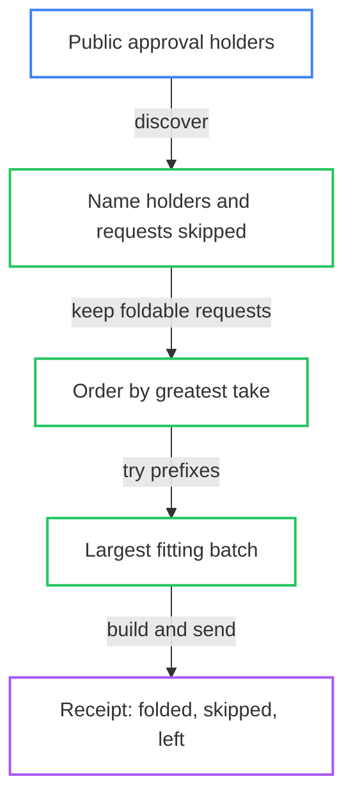

# Fold pending requests from public data

As a folder, you find a registry's pending requests from public data without a
file from anyone who booked them. You fold as many as fit, keep each request's
value above what the application requires, and can read the measured limit
before deciding what to fold.



The flow starts with public holders of the application's approvals. Discovery
names the holders and requests it skips, orders the foldable requests by your
take, and tries prefixes until it finds the largest fitting batch. The receipt
accounts for what folded, what was skipped and what is left.

## Discover and fold

Give the registry's address, the release blueprint, your provider and your own
wallet. Your wallet need not have booked any request. Registrations and
terminations of this registry can share a transaction when their keys differ.

```sh
open-datum fold --blueprint plutus.json \
  --registry "$registry" \
  --koios-url https://preprod.koios.rest/api/v1 \
  --vault bob.vault
```

Requests are ordered by your take, greatest first, with output references
breaking ties. A registration's take is the request's held ADA above the
deposit its holding must keep. A termination's take is the request's whole
held ADA. Your wallet receives the transaction's change and pays its fee;
the gross take is not the same as profit after that fee.

To cap discovery, give the maximum number you want in `--limit`. The cap does
not promise that many will fit.

```sh
open-datum fold --blueprint plutus.json \
  --registry "$registry" --limit "$cap" \
  --koios-url https://preprod.koios.rest/api/v1 \
  --vault bob.vault
```

Only exceeding a transaction size, memory or steps limit permits a shorter
prefix. A failed public read, failed registry replay or another construction
error stops with its own reason. It never becomes an empty or shorter answer.
The current network decides what fits; the measured workload below is not a
fixed cap built into this command.

## Choose a named batch

Repeat `--pending` to choose the entire ordered batch yourself. It is built as
named or refused, never trimmed, even if you also give `--limit`.

```sh
open-datum fold --blueprint plutus.json \
  --registry "$registry" --pending "$first" --pending "$second" \
  --koios-url https://preprod.koios.rest/api/v1 \
  --vault bob.vault
```

| Attempt | Result |
|---|---|
| A request of another registry in a named batch | Refused, naming the request and registry |
| Requests with the same key, or the same pending reference repeated | Refused, naming the key or request |
| A named batch exceeds a network limit | Refused with that limit; no request is silently dropped |
| No request can fold | Nothing to fold; discovered skips are still named |
| A public read fails or is incomplete | Unavailable, naming the read; no empty answer is claimed |
| A constructed transaction moves anything else under the state policy | Rejected by the state script |

## Read the fold receipt

The receipt names the registry's new root and state output. Its `folded` list
names the key, request kind and pending output reference of every folded
request. Its `skipped` list names each omitted holder's reference and reason.
Its `left` count is the foldable requests beyond the chosen prefix. A skipped
request is never counted as left.

Automatic discovery skips these kinds of holder or request and keeps folding
the rest. A named batch instead refuses a bad request. A skip always names a
request, or a holder that looked like one, that this fold did not take.

| Kind of skip | Meaning |
|---|---|
| Held at a key address | The approval's holder is a wallet output, not an application request |
| Decoded for another registry | The request belongs to a different state policy or state token name |
| Not accepted by the application's decode | The holder is at the application but is not a request the application accepts, and is not a registry's configuration output |
| Individually unfoldable | Its key is already registered (usually a request booked before the key was registered), its termination key is not live, its deposit is too small, its processing window is closed, or a preceding foldable request already kept its key |

The first individually foldable request for a key keeps it in take order. An
earlier unfoldable request never reserves the key. If every discovered request
is skipped, nothing to fold still carries every skipped reference and reason.

A registry's configuration output holds an approval of the application too, but
it is not a request. The application names it as its configuration, so a fold
neither takes it nor lists it under `skipped`, and it stays unspent.

## What has been exercised

The packaged development-network registration journey starts a folder in fresh
directories with none of the booker's files. It discovers and folds a mixed
batch, checks the folder's change from the chain, and accounts separately for
folded, skipped and left requests. It skips another registry's request and an
unfoldable duplicate, and it checks that the registry's configuration holder is
in neither list and stays unspent. A duplicate-free control and a later fold of
what was left accompany it.

An approval at a key address and a malformed request datum are unit-tested
only; the packaged journey does not construct accepted transactions creating
those holders. Unit tests also exercise the other individually unfoldable
reasons beside passing controls. Development-network refusals exercise a
foreign named request, a duplicate key, an oversized named batch and a
transaction moving another state-policy asset, each beside an accepted control.
These observations do not establish an executable comparison with the model.
The [conformance record](consumer-conformance.md) keeps those gaps visible.

## Read the measured limits

These are evaluations of kept transactions under the preprod parameters
whose recording date and source the first table below states. The
[release decision table](release-decision-table.md) shows which figures moved
against the earlier recording. A development node given the same limits, prices and fees corroborates the
accepted size and refusal of the next. This is not a submission to preprod.
The packaged node cannot run preprod's current execution model; the ledger
evaluator uses the recorded target model separately. Protocol parameters can
change by governance.

The transaction slots use the captured development network's time. The result
is script evaluation under the recorded parameters, not preprod transaction
validation or inclusion. The fees are those of the kept node-balanced bodies,
not a quote for another network. Re-evaluating the same kept bytes reproduces
the figures; fresh captures may vary and publish their differences separately.

<!-- batch-limits:start -->

These figures are generated from the [kept measurement receipt](https://github.com/lambdasistemi/singular/blob/main/test/fixtures/batch-measurement/receipt.json).

| Binding | Recorded value |
|---|---|
| Receipt SHA-256 | `271153081b482f31a243cab692a1fa31b793a7c596c569218a4f01cc15e052fc` |
| Parameter recording date | Fri, 30 Oct 2026 13:24:40 GMT |
| Parameter source | [test/fixtures/batch-measurement/parameters/preprod-2026-10-30/cli_protocol_params-b777448425778d13.json](https://github.com/lambdasistemi/singular/blob/main/test/fixtures/batch-measurement/parameters/preprod-2026-10-30/cli_protocol_params-b777448425778d13.json) |
| Parameter source SHA-256 | `1211aa0b6219e5ba4248580882ff06fb60802b2b727a172ab8e5f288ad74e217` |
| Evaluated parameter bytes SHA-256 | `49e19000ee0c4b8f7d289378b639693a987793fa5066f3080a83ad4013d6ef09` |
| Applied request script | `ScriptHash "67bb50e5aab678b9955e1d8981050a14e0f93da912b3a8b4a7161ca7"` |
| Applied state script | `ScriptHash "499291dbc77fb84b590e4f2d728788aa06191627a2c5c95b6bc4d679"` |
| Maximum transaction memory | 17500000 |
| Maximum transaction steps | 10000000000 |
| Maximum ledger-counted bytes | 16384 |

The largest accepted named prefix and the next refused size follow.
Bytes are the complete signed transaction length; ledger-counted bytes are listed separately. Fees are lovelace from the development-node-balanced transaction body.

| Kind | Accepted requests | Next refused requests | Exceeded limit | Memory | Steps | Signed bytes | Fee (lovelace) | Ledger-counted bytes |
|---|---|---|---|---|---|---|---|---|
| registrations | 4 | 5 | memory | 13856729 | 5756358462 | 3219 | 1775931 | 3218 |
| terminations | 7 | 8 | memory | 15666610 | 6324460088 | 4358 | 1971430 | 4357 |
| mixed | 6 | 7 | memory | 17105790 | 7051990680 | 4318 | 2105169 | 4317 |

Per-request figures are exact total divided by accepted count, including transaction overhead. A fraction is exact, not a rounded price.

| Kind | Memory per request | Steps per request | Signed bytes per request | Fee per request (lovelace) |
|---|---|---|---|---|
| registrations | 13856729/4 | 5756358462/4 | 3219/4 | 1775931/4 |
| terminations | 15666610/7 | 6324460088/7 | 4358/7 | 1971430/7 |
| mixed | 17105790/6 | 7051990680/6 | 4318/6 | 2105169/6 |

The marginal last request is the difference from the preceding kept prefix. It is an observation for this ordered workload, not a constant cost per request.

| Kind | Last-request memory | Last-request steps | Last-request signed bytes | Last-request fee (lovelace) |
|---|---|---|---|---|
| registrations | 5266225 | 2171769251 | 723 | 492264 |
| terminations | 3292625 | 1380971343 | 534 | 313051 |
| mixed | 3156357 | 1318646751 | 468 | 297790 |

The workload starts from the registry sizes below. The listed sequence is the accepted named prefix; the mixed result concerns that alternating order only. The digest binds the full initial datum shapes in the receipt, alongside the kept trie inputs.

| Kind | Pending pool | Registry size before fold | Key bytes | Accepted kind order | Initial datum shapes SHA-256 |
|---|---|---|---|---|---|
| registrations | 12 | 0 | 10 | registration, registration, registration, registration | d4754712e4097fd3acda3aa98bbb0b8004aa824be54824b34997b03b1a6f0f33 |
| terminations | 12 | 12 | 10 | termination, termination, termination, termination, termination, termination, termination | a17291318b46dbd97e13151f681e134e67617c6ee6db95065795e1dd9eb62b25 |
| mixed | 12 | 6 | 10 | registration, termination, registration, termination, registration, termination | 4864cdd37ec32e5d745738367f3a662ef49c0eac5d6690bf5df1f638637dbacb |

<!-- batch-limits:end -->

## What the measurement does not cover

The figures concern exactly the registry sizes, trie inputs, scripts, keys,
payload shapes and parameters in the receipt. They say nothing about another
registry size, trie depth, scripts, key or payload shapes, or parameters. The
mixed figure does not cover every ordering or every ratio of registrations to
terminations. The trie library's proofs are assumed sound.

The [command reference](registry-commands.md#fold-registrations-and-terminations-into-the-registry)
gives the surrounding registration and termination commands. The
[provider and wallet settings](singular-node.md#the-settings-you-give) describe
the options shared by the examples above.

## Appendix: regenerate this page

The measurement job re-evaluates the kept transactions and captures a fresh
boundary for each kind. The documentation check regenerates the marked block
and refuses differences in either the page or the receipt. To refresh the
block explicitly, run `python3 tools/batch_limits.py --write`, then regenerate
the page's speech and changed narration.
