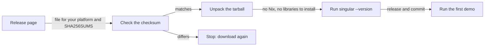
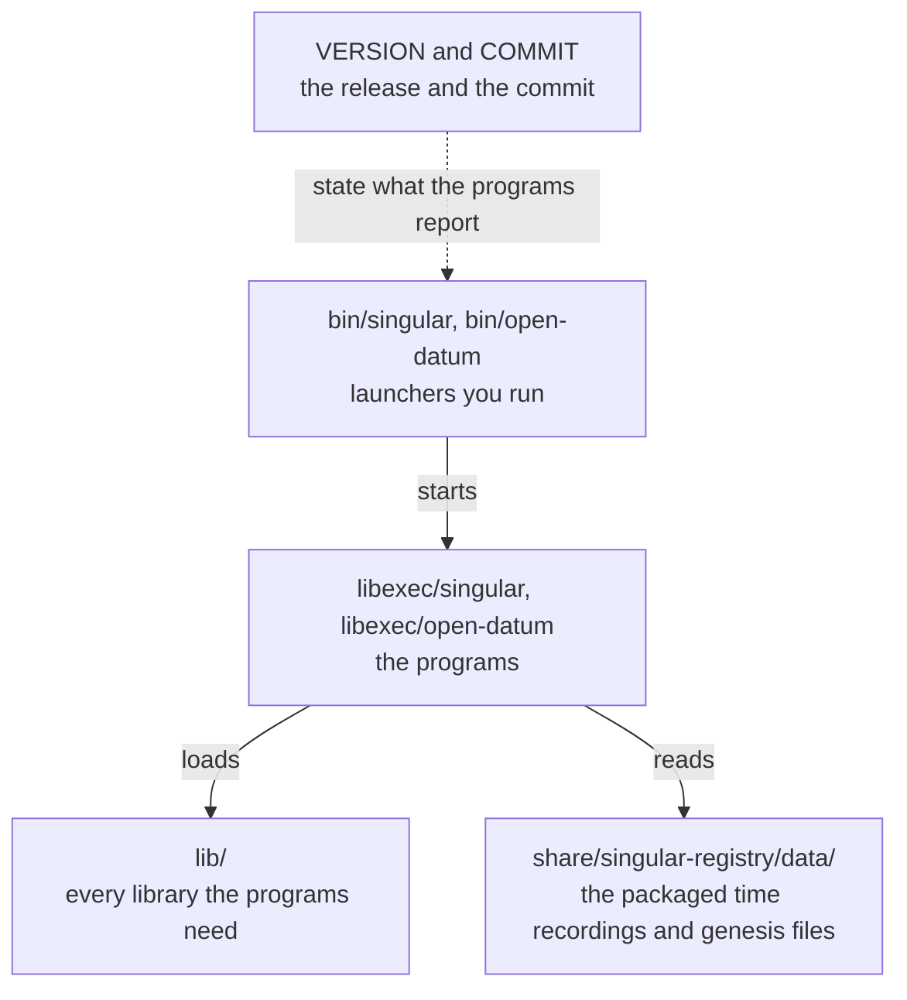
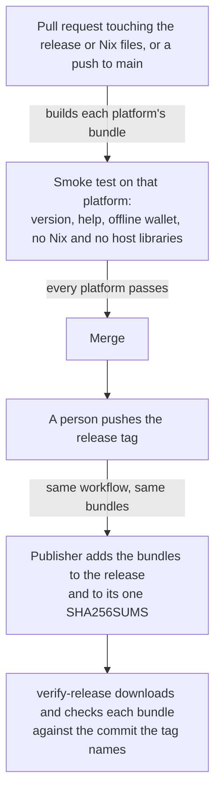

# Install the commands without Nix

You develop for Cardano on Linux or on an Apple Silicon Mac and you want to play
the first demo without installing Nix or compiling the Haskell stack. You
download the file for your platform from a release, check it against the
release's checksums, unpack it, run `singular --version` and see the release and
the commit the program was built from, and then run the commands of the first
demo.

## What you download

Every release after 0.12.0 carries one tarball per platform beside the
documentation and on-chain archives, and one `SHA256SUMS` that lists all of
them. A tarball holds both commands, `singular` and `open-datum`, with every
library and data file they need.

| Your machine | The file to download |
| --- | --- |
| Linux on x86_64, any distribution | `singular-X.Y.Z-x86_64-linux.tar.gz` |
| macOS on Apple Silicon | `singular-X.Y.Z-aarch64-darwin.tar.gz` |

Replace `X.Y.Z` with the release you want. The releases are listed at
<https://github.com/lambdasistemi/singular/releases>.



## Install on Linux

You need `curl`, `tar` and `sha256sum`, which every distribution carries. The
programs bring their own C library and do not use the distribution's.

```sh
version=X.Y.Z
system=x86_64-linux
curl -fsSLO "https://github.com/lambdasistemi/singular/releases/download/v${version}/singular-${version}-${system}.tar.gz"
curl -fsSLO "https://github.com/lambdasistemi/singular/releases/download/v${version}/SHA256SUMS"
grep " singular-${version}-${system}.tar.gz\$" SHA256SUMS | sha256sum --check
tar -xzf "singular-${version}-${system}.tar.gz"
export PATH="$PWD/singular-${version}-${system}/bin:$PATH"
singular --version
open-datum --version
```

## Install on macOS

macOS ships `curl`, `tar` and `shasum`. The command is the same with the
platform and the checksum tool changed.

```sh
version=X.Y.Z
system=aarch64-darwin
curl -fsSLO "https://github.com/lambdasistemi/singular/releases/download/v${version}/singular-${version}-${system}.tar.gz"
curl -fsSLO "https://github.com/lambdasistemi/singular/releases/download/v${version}/SHA256SUMS"
grep " singular-${version}-${system}.tar.gz\$" SHA256SUMS | shasum -a 256 --check
tar -xzf "singular-${version}-${system}.tar.gz"
export PATH="$PWD/singular-${version}-${system}/bin:$PATH"
singular --version
open-datum --version
```

The programs are signed ad hoc, which Apple Silicon requires of any program, and
are not signed with an Apple developer certificate or notarised. A file downloaded with `curl` and unpacked with `tar` is not
quarantined and runs. A file downloaded with a browser is quarantined, and macOS
may refuse to open the programs inside it with a message that the developer
cannot be verified. After you have checked the checksum, remove the quarantine
mark once:

```sh
xattr -dr com.apple.quarantine "singular-${version}-${system}"
```

## What you see when it works

Each command prints its name, the release and the commit it was built from, and
exits with status 0. The commit is the one the release's tag names.

```text
singular X.Y.Z (commit <the 40 hexadecimal characters of the release commit>)
open-datum X.Y.Z (commit <the 40 hexadecimal characters of the release commit>)
```

The wallet commands run offline, so they are the quickest check that the programs
work on your machine. Choose a passphrase; the program reads it from the standard
input here and never takes it as an argument.

```sh
mkdir try && cd try
printf '%s\n' 'a passphrase of your choice' | singular wallet create --vault vault --network-magic 1 --passphrase-fd 0
printf '%s\n' 'a passphrase of your choice' | singular wallet address --vault vault --network-magic 1 --passphrase-fd 0
```

Both commands print the same address, which begins with `addr_test1` on the
preprod network. From here the commands are the ones of the
[first demo](first-demo.md).

## What is inside the tarball

The folder `bin` holds the two commands you run. Each is a short launcher that
points the real program at the libraries and data files in the same folder and
starts it, so nothing is read from outside the folder, and moving the folder
moves the installation.



On Linux the folder `lib` also holds the C library and its loader, and the launcher
starts the program through that loader, which is why the programs do not depend on
the distribution's libraries. On macOS the programs load only the libraries macOS
itself provides and the ones in `lib`.

## When it does not work

| What you see | What it means and what to do |
| --- | --- |
| The checksum check names a mismatch | The file is not the published one. Do not unpack it; download it again. |
| `cannot execute` or `Exec format error` on Linux | The machine is not x86_64. Run `uname -m`; the bundle is for `x86_64`. Use the Nix route below. |
| macOS says the developer cannot be verified | The file was quarantined by a browser. Remove the mark as shown above. |
| `--version` prints `commit unknown` | The program was not built by the release pipeline. Download the release file. |

## Other platforms and the Nix route

Releases carry bundles for Linux on x86_64 and macOS on Apple Silicon only. Linux
on aarch64 and macOS on Intel have no bundle yet. On those, and for anyone who
prefers it, the Nix route stays as it was: with Nix and flakes enabled, run a
command straight from the release.

```sh
nix run "github:lambdasistemi/singular/vX.Y.Z?dir=offchain#singular" -- --version
nix run "github:lambdasistemi/singular/vX.Y.Z?dir=applications/open-datum/offchain#open-datum" -- --version
```

Both print the same release and commit line as the bundle's commands do.

To check a release end to end, including the commands built from its archive,
follow [Download and verify a release](verify-release.md). That verifier also
checks each bundle against the commit the release tag names.

## How a release gets its bundles

As a maintainer, you want a release to publish only bundles that were already
built and run on their own platform, so that a broken platform is found in a pull
request and never after the tag.



The Linux bundle is built on the self-hosted runner and the macOS bundle on a
GitHub-hosted Apple Silicon runner, each from the release-bundle output of the
repository's flake. A bundle failing on either platform fails the release before
anything is published, and the publisher refuses a release that lacks a bundle
for any platform listed in `tools/release_bundles.sh`. Nothing in a pull request
publishes: the built tarballs are kept as workflow artifacts for a week.
