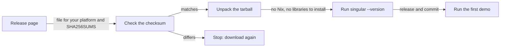
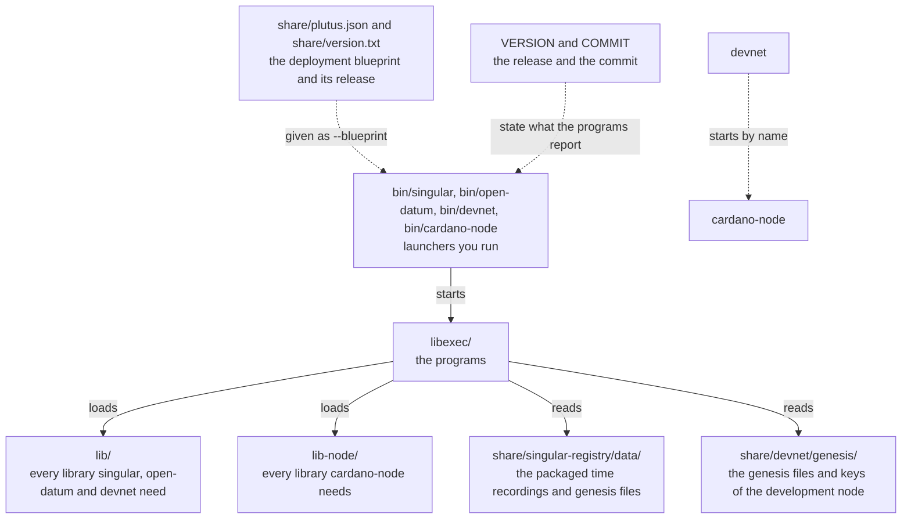
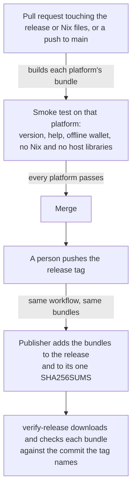

# Install the commands without Nix

You develop for Cardano on Linux or on an Apple Silicon Mac and you want to play
the first demo without installing Nix or compiling the Haskell stack. On a Mac
you install the commands with one Homebrew command; on Linux you install a DEB or
an RPM, or run an AppImage; on either you can instead download the tarball for
your platform, check it against the release's checksums and unpack it. You run
`singular --version` and see the release and the commit the program was built
from, and then run the commands of the first demo. From the release after 0.13.1
every one of these also holds the private development node the first demo
starts, so that node needs no `nix` command either.

## What you download

Every release after 0.12.0 carries one tarball per platform beside the
documentation and on-chain archives, and one `SHA256SUMS` that lists all of
them. A tarball holds both commands, `singular` and `open-datum`, with every
library and data file they need. The tarballs of the releases after 0.13.1 also
hold `devnet`, the program that starts a private development node, the Cardano
node 10.7.0 it starts and the genesis files that node reads.

The releases after 0.13.1 also carry the Linux packages, with their own checksum
file `singular-X.Y.Z-x86_64-linux.SHA256SUMS`, and a Homebrew formula for the
Mac. The sizes are approximate.

| Your machine | The file to download | Its size |
| --- | --- | --- |
| A Mac with Apple Silicon | `brew install lambdasistemi/tap/singular`, or `singular-X.Y.Z-aarch64-darwin.tar.gz` | about 200 MB |
| Debian, Ubuntu and their relatives on x86_64 | `singular-X.Y.Z-x86_64-linux.deb` | about 215 MB |
| Fedora, RHEL and their relatives on x86_64 | `singular-X.Y.Z-x86_64-linux.rpm` | about 215 MB |
| Any Linux on x86_64, one command as one file | `singular-X.Y.Z-x86_64-linux.AppImage`, `open-datum-…`, `devnet-…` | about 42, 42 and 166 MB |
| Any Linux on x86_64, all three in one folder | `singular-X.Y.Z-x86_64-linux.tar.gz` | about 75 MB |

Replace `X.Y.Z` with the release you want. The releases are listed at
<https://github.com/lambdasistemi/singular/releases>.



## Install with Homebrew on a Mac

For the releases after 0.13.1, a Mac with Apple Silicon and
[Homebrew](https://brew.sh) installs the latest release with one command, and
`brew upgrade` takes the next one:

```sh
brew install lambdasistemi/tap/singular
singular --version
open-datum --version
devnet --version
```

Homebrew downloads the macOS tarball from the release, checks it against the
checksum the formula carries and links `singular`, `open-datum` and `devnet` onto
your path. The Cardano node stays inside the installation, where `devnet` finds
it, so it never replaces a node you installed yourself. The formula's own test
runs `--version` of the three commands.

## Install the Linux packages

For the releases after 0.13.1, a DEB or an RPM installs all three commands into
`/usr/bin`, with everything they need, on any distribution of its family, and
your package manager removes them again. An AppImage holds one command as one
file you run where it lies.

```sh
version=X.Y.Z
base="https://github.com/lambdasistemi/singular/releases/download/v${version}"
curl -fsSLO "$base/singular-${version}-x86_64-linux.deb"
curl -fsSLO "$base/singular-${version}-x86_64-linux.SHA256SUMS"
grep " singular-${version}-x86_64-linux.deb\$" "singular-${version}-x86_64-linux.SHA256SUMS" | sha256sum --check
sudo apt install "./singular-${version}-x86_64-linux.deb"
singular --version
```

On Fedora and its relatives the RPM goes in the same way, with
`sudo dnf install ./singular-${version}-x86_64-linux.rpm`. An AppImage, for example
`singular-${version}-x86_64-linux.AppImage`, is made executable with `chmod +x` and
run as `./singular-${version}-x86_64-linux.AppImage --version`; it needs FUSE and
user namespaces, which desktop distributions allow. The packages put their files
under `/nix/store` and the commands in `/usr/bin`; they do not need Nix and do not
install it.

## Install on Linux

You need `curl`, `tar` and `sha256sum`, which every distribution carries. The
programs bring their own C library and do not use the distribution's.

```sh
version=X.Y.Z
system=x86_64-linux
curl -fsSLO "https://github.com/lambdasistemi/singular/releases/download/v${version}/singular-${version}-${system}.tar.gz"
curl -fsSLO "https://github.com/lambdasistemi/singular/releases/download/v${version}/SHA256SUMS"
grep " singular-${version}-${system}.tar.gz\$" SHA256SUMS | sha256sum --check
tar -xzf "singular-${version}-${system}.tar.gz"
export PATH="$PWD/singular-${version}-${system}/bin:$PATH"
singular --version
open-datum --version
```

## Install on macOS

macOS ships `curl`, `tar` and `shasum`. The command is the same with the
platform and the checksum tool changed.

```sh
version=X.Y.Z
system=aarch64-darwin
curl -fsSLO "https://github.com/lambdasistemi/singular/releases/download/v${version}/singular-${version}-${system}.tar.gz"
curl -fsSLO "https://github.com/lambdasistemi/singular/releases/download/v${version}/SHA256SUMS"
grep " singular-${version}-${system}.tar.gz\$" SHA256SUMS | shasum -a 256 --check
tar -xzf "singular-${version}-${system}.tar.gz"
export PATH="$PWD/singular-${version}-${system}/bin:$PATH"
singular --version
open-datum --version
```

The programs are signed ad hoc, which Apple Silicon requires of any program, and
are not signed with an Apple developer certificate or notarised. A file downloaded with `curl` and unpacked with `tar` is not
quarantined and runs. A file downloaded with a browser is quarantined, and macOS
may refuse to open the programs inside it with a message that the developer
cannot be verified. After you have checked the checksum, remove the quarantine
mark once:

```sh
xattr -dr com.apple.quarantine "singular-${version}-${system}"
```

## What you see when it works

Each command prints its name, the release and the commit it was built from, and
exits with status 0. The commit is the one the release's tag names.

```text
singular X.Y.Z (commit <the 40 hexadecimal characters of the release commit>)
open-datum X.Y.Z (commit <the 40 hexadecimal characters of the release commit>)
devnet X.Y.Z (commit <the 40 hexadecimal characters of the release commit>)
```

The wallet commands run offline, so they are the quickest check that the programs
work on your machine. Choose a passphrase; the program reads it from the standard
input here and never takes it as an argument.

```sh
mkdir try && cd try
printf '%s\n' 'a passphrase of your choice' | singular wallet create --vault vault --network-magic 1 --passphrase-fd 0
printf '%s\n' 'a passphrase of your choice' | singular wallet address --vault vault --network-magic 1 --passphrase-fd 0
```

Both commands print the same address, which begins with `addr_test1` on the
preprod network. From here the commands are the ones of the
[Demo 1](demo1.md).

The development node starts with `devnet` and prints one line of settings once
its chain is up. It runs until you stop it, and stopping `devnet` stops the Cardano
node it started.

```sh
devnet > devnet.out &
until [ -s devnet.out ]; do sleep 1; done
head -n 1 devnet.out
kill %1
```

The line is a JSON document that names the node's `providerUrl` and
`networkMagic`, which is 42. The Demo 1 runbook in the
[singular-demo](https://github.com/lambdasistemi/singular-demo) repository funds
wallets on such a node and plays the whole demo. The node keeps its files in one
folder under your temporary directory, so run one development node at a time.

## What is inside the tarball

The folder `bin` holds the commands you run: `singular`, `open-datum`, `devnet`
and `cardano-node`. Each is a short launcher that points the real program at the
libraries and data files in the same folder and starts it, so nothing is read from
outside the folder, and moving the folder moves the installation.



The folder `share` also holds the deployment blueprint, `plutus.json`, that the
commands take as `--blueprint`, with `version.txt` beside it naming the release:
the on-chain archive carries the same blueprint and adjacent version label.

On Linux the folders `lib` and `lib-node` each also hold a C library and its loader,
and the launcher starts the program through that loader, which is why the programs
do not depend on the distribution's libraries. The Cardano node is built against
another C library than the other three programs, which is why it has a folder of
its own. On macOS the programs load only the libraries macOS itself provides and
the ones in `lib` and `lib-node`.

## Where the blueprint is

Homebrew, the DEB, the RPM and the tarballs of a release after 0.13.1 bring the deployment blueprint the
commands were released with, so Demo 1 needs no second download. It is the same
file the on-chain archive ships as `onchain/plutus.json`, and `verify-release`
checks that the two are identical. Each copy has the release's `version.txt`
beside it.

| You installed with | The blueprint |
| --- | --- |
| Homebrew | `$(brew --prefix singular)/libexec/share/plutus.json` |
| The DEB or the RPM | `/usr/share/singular/plutus.json` |
| The tarball | `singular-X.Y.Z-<system>/share/plutus.json` |
| The on-chain archive | `onchain/plutus.json`, checked by its `verify-identities.sh` |

Name it once and pass it to every command, for example
`blueprint=/usr/share/singular/plutus.json` and then `--blueprint "$blueprint"`.

## If your registry was made by an earlier release

When the registry you want to use was made by an earlier release, the commands you
installed tell you which release serves it, or that no release is known. The
[compatibility record](compatibility.md) lists, for each release in the release
table, the release that serves the registries it made: this release, an earlier
one, or none that is known.

## When it does not work

| What you see | What it means and what to do |
| --- | --- |
| The checksum check names a mismatch | The file is not the published one. Do not unpack it; download it again. |
| `cannot execute` or `Exec format error` on Linux | The machine is not x86_64. Run `uname -m`; the bundle is for `x86_64`. Use the Nix route below. |
| macOS says the developer cannot be verified | The file was quarantined by a browser. Remove the mark as shown above. |
| `--version` prints `commit unknown` | The program was not built by the release pipeline. Download the release file. |
| `devnet` exits before it prints its settings | Another development node of yours may be running, because it keeps its files in one folder under your temporary directory. Stop it and start `devnet` again. |
| A command says this release does not serve the registry | The registry was made by other contracts. The message names the release that serves it, or says that no release is known; the [compatibility record](compatibility.md) lists the answer for each release in the release table. |

## Other platforms and the Nix route

Releases carry bundles for Linux on x86_64 and macOS on Apple Silicon only. Linux
on aarch64 and macOS on Intel have no bundle yet. On those, and for anyone who
prefers it, the Nix route stays as it was: with Nix and flakes enabled, run a
command straight from the release.

```sh
nix run "github:lambdasistemi/singular/vX.Y.Z?dir=offchain#singular" -- --version
nix run "github:lambdasistemi/singular/vX.Y.Z?dir=applications/open-datum/offchain#open-datum" -- --version
```

Both print the same release and commit line as the bundle's commands do.

To check a release end to end, including the commands built from its archive,
follow [Download and verify a release](verify-release.md). That verifier also
checks each bundle against the commit the release tag names.

## How a release gets its bundles

As a maintainer, you want a release to publish only bundles that were already
built and run on their own platform, so that a broken platform is found in a pull
request and never after the tag.



The Linux bundle is built on the self-hosted runner and the macOS bundle on a
GitHub-hosted Apple Silicon runner, each from the release-bundle output of the
repository's flake. A bundle failing on either platform fails the release before
anything is published, and the publisher refuses a release that lacks a bundle
for any platform listed in `tools/release_bundles.sh`. Nothing in a pull request
publishes: the built tarballs are kept as workflow artifacts for a week.

The Linux packages and the Homebrew formula follow the organisation's shared
release actions and Nix helpers
([dev-assets](https://github.com/paolino/dev-assets)). A pull request builds the
AppImages, the DEB and the RPM, runs every command from each one unpacked, and
then installs the DEB on Ubuntu and the RPM on Fedora and runs each AppImage, on
machines without Nix. It also builds the formula from the macOS tarball, installs
it through a local tap that points at that tarball, and runs `brew test`. The
release tag publishes the Linux packages once the release exists. The formula
follows once `verify-release` has passed: it is pushed to the
[organisation's tap](https://github.com/lambdasistemi/homebrew-tap) only if the
release's macOS tarball is the one the formula names, then installed from the tap
and tested. A manual run of the bundles workflow can publish the dev channels: the
`dev-linux` packages and the `singular-dev` formula.

A pull request that builds the bundles also plays the registration journey from
those files, twice: from the Linux bundle unpacked, and from the DEB installed with
the system package manager, each on a machine that has no Nix. The commands and the
blueprint come only from the bundle or the package, and the development node is the
one the bundle or the package carries; the job shows where each command and the
blueprint resolved to. The journey creates a registry, registers, updates and
terminates a key, reads it back and folds a discovered batch on a development
network. Every verdict is computed from the chain's record or from files, and none is
typed; create, register, update, terminate, read and the discovered batch fold are
each judged from the chain's record and shown failing on altered input. The same
pull request assembles the release as the pipeline does, adds both bundles and runs
`verify-release` on it, so that a broken bundle journey is found in the pull request
and not after the tag.
