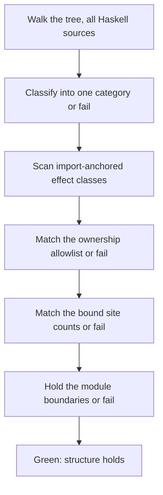
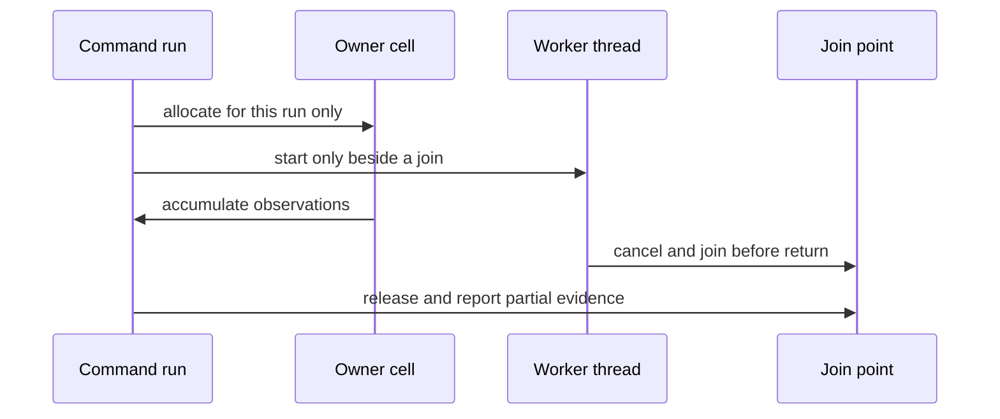
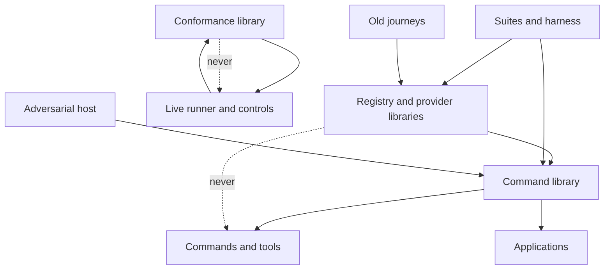

# Who owns an effect

A contributor adding a mutable cell, a worker thread or an environment read
wants to know where it belongs, who releases it and what check will ask
about it. A reviewer wants to see each effect's owner, lifetime and reason
in one place instead of reconstructing them from imports. This page is that
map: what the census covers, which effects are allowed where, which way the
module boundaries run, what evidence backs each predecessor ticket, and what
stays openly unfulfilled.

## The story this serves

As a contributor, I add a counter to a command, a retry loop to a client or
a coordination flag to a test, and the ownership check tells me exactly
which file to classify it in, what to write beside it and what happens if I
do not — before the review starts.

As a reviewer, I open this page and can tell which effects are necessary,
who owns them, how long they live and which conformance-state work is still
unfulfilled — without reading four hundred modules.

As an integrator, I learn that the product is single-threaded unless a
written reason says otherwise, that no thread outlives its command, and
that the unsafe escape hatch is absent from the tree — each with the check
that would catch a regression.

## What the census covers

The census discovers every Haskell source by walking the tree — no per-file
list — and puts each in exactly one structural category. Anything it cannot
classify fails the run instead of slipping through.

| Category | Directories | Sources |
| --- | --- | --- |
| Production | the registry library, the naming sources, the local-services and Koios libraries, the command library, the application libraries | 141 |
| Tools | deployment, devnet, the recorder entry points, the archive commands, the application entry points, the `singular` entry | 31 |
| Conformance library | the suite's programs, bindings, comparisons and receipts | 33 |
| Conformance runner | the live row runners and their command-line controls | 40 |
| Application host | the adversarial host package | 6 |
| Tests and harness | every suite, fixture, fake and harness library | 180 |
| Old journeys | the retained registry journey executables | 19 |

450 sources in total. The census establishes structural facts — which files
can name which effects — and never runtime behavior. That a module can name
a mutable cell says nothing about what it does with it; what a command does
is settled by the cage tests, the journeys and the hosted runs below, not
here.

## Which effects are gated, and which only recorded

A gated effect needs a file-level entry in the ownership allowlist naming
its owner, lifetime, access model and reason. A new file naming one without
an entry fails; an entry whose effect is gone fails as stale.

| Effect | What names it | Sites today |
| --- | --- | --- |
| Mutable cells | the IO reference library | 77 files |
| Coordination cells | the MVar library, or the whole concurrency import beside a use | 8 files |
| Software transactions | the STM libraries | none |
| Unsafe escapes | the unsafe IO library | none |
| Thread creation | forkIO and kin | none |
| Structured concurrency | the Async library | 13 files |

Three rows deserve emphasis. No module imports the unsafe IO library, so no
unsafe escape exists in the tree; the control that plants one proves the
check rejects it. No module calls forkIO; the product's only concurrency is
the Async library's scoped combinators. No module uses STM; the one match
for the word is a theorem name, not a transaction, which is why the STM
class is import-anchored rather than token-anchored.

Two further surfaces are recorded by the census but enforced elsewhere.
Timeout bounds belong to the calling-thread confirmation design, whose
deadline tests own them. Environment reads belong to the explicit-input
rule, whose release-build exclusion the release controls own. Their
carriers are named in the evidence map below.

## Where the production effects live

Every production effect below is allowlisted with the prose beside its
implementation. The allowlist is the machine register; this table is the
reader's summary.

| Owner module | Effect | Lifetime and reason |
| --- | --- | --- |
| The command session | one connection flag and the blueprint progress | one command; serial on the calling thread |
| The reconcile lookup | one view cache | one reader call; fresh per call, serial |
| The fixture recorder | recorded exchanges | one recorder command; written out as fixtures |
| The terminal capabilities | raw and fact buffers | one observed session; partial evidence survives exceptions |
| The Koios runtime | the open-session registry | process composition; masked acquire with finally release |
| The pure trie adapter | one handle per caller | one serial builder, replay or mirror run; externally serialized |
| The trie manager | one per-token map | one serial run; speculation in State, never on the shared map |
| The observation session | the last-observation cell | one observation call; horizon continuity across polls |

The two trie adapters used to read as mutable state smuggled into pure
computations. They are compatibility adapters with named callers and no
locking: sharing one across threads without external serialization is a
defect, and the haddock above each constructor says so.

## Why the product stays single-threaded

The product runs on the calling thread unless a written, compelling reason
says otherwise, and no thread outlives the command that started it. Four
sites carry such reasons, each beside its implementation with its join:

- The devnet probe runs a node and a client together, joined before the
  probe returns.
- The private facade serves sessions beside their followers, each session
  cancelling and joining its children before the next starts.
- The conformance node runner holds one node-to-client thread per session,
  joined before the session ends.
- The CLI-backend control bounds one confirmation wait with an explicit
  cancel, observed and joined before the run ends.

The test parallelism (two mapConcurrently_ shards over independent
examples) and the test coordinations (entered/released/hold flags joined by
withAsync before each example ends) are harness-owned: they run only under
the suites, never in a release build. A newly introduced forkIO, async or
concurrently site in a product package fails the ownership check until it
is classified with its reason and its join.

## Which way dependencies run

Effects flow one way: libraries expose capabilities, commands and runners
compose them, tests drive them. Five boundaries hold this shape over the
discovered extent — namespaces, not file lists, so a moved module is
rechecked with nothing to edit:

- the conformance library never imports the runner (the library stays
  runnable without live effects);
- the offchain libraries never import the command layer (commands consume
  the libraries, never the reverse);
- each journey executable keeps its local modules (old runners are never
  extended by sharing);
- no ordinary executable links a host module (the adversary stays outside
  the release, its test-only reader excepted);
- the command layer is imported only at composition — commands,
  applications and tests.

## Decisions this design took

| Chosen | Rejected | Why |
| --- | --- | --- |
| Import-anchored effect classes | plain token grep | combinator words and theorem names have prose readings; a token grep flags sentences, while the compiler requires the import at each real site |
| Bound per-token site counts | file-level classes alone | a new allocation in an already classified file keeps imports unchanged; only counts reject it, proved by the same-class control |
| Bound per-function site counts | file totals alone | moving a site between functions keeps file totals unchanged; only per-function counts reject it, observed passing before the fix and proved by the substitution control |
| One allowlist with prose reasons | bare path lists | a path without owner, lifetime and reason is an exemption waiting for a use; stale entries fail |
| Shell check beside the Python census | a Nix-only app | matches the confinement-check precedent: runs in the developer shell locally and hosted, same code both places |
| bare wait excluded from binding | counting every combinator word | wait is overwhelmingly a binder for a handle the same owned expression spawned; the spawn token tripwires it, and the exclusion is stated here |
| Import lists and export lists excluded from counts | counting every mention | an import list naming a combinator is not a site; only code occurrences bind |

## What backs the predecessors, and what stays open

Each row names the accepted evidence or the explicitly open requirement.
Local paths are never public evidence; the hosted records below are.

| Requirement | Evidence | Limit |
| --- | --- | --- |
| Release-hook exclusion | the release-build control excluding compiled test controls from ordinary closures, and the ordinary-executables check against the bypass, both hosted | ordinary builds only; recovery controls keep their real behavior |
| Temporary-directory isolation | the single process-wide TMPDIR owner with masked acquisition and joining callbacks | harness-owned; unrelated environment mutators stay outside it |
| Confirmation lifetime | the calling-thread timeout with real-client deadline tests and a documented fake limit | timeouts stay infrastructure exceptions, never refusals |
| Explicit CLI state | the selected confirmed values with flag-group refusal tests | documented in the command guide |
| Pure trie computation | pure snapshot functions with the mutable adapters marked caller-owned | adapters provide no locking |
| Ancillary bookkeeping and raw retention | the merged retention pull request at its exact head, with the five cross-wallet bundles inspected: matching pins, raw journals and signed bodies bound to their hosted jobs | bytes retained; no signature or ledger proof follows from retained bytes |
| This ticket's census, guide and drift controls | the ownership check and its nine controls, green at the candidate head; hosted CI is the merge gate | source-text lead only; behavior settled by the journeys and hosted runs |
| Conformance interpreter and replay state | no accepted delivery, owner, lane, branch or pull request — **unfulfilled** | inventory and file splits never mark it complete; it waits on its own scheduling |

## How to change effect code

1. Write the owner, lifetime and reason beside the implementation, not only
   in the allowlist.
2. Regenerate the site binding from the tree and review its diff beside the
   code change; commit both together.
3. Run the ownership check and its controls; hosted CI repeats them at the
   candidate head.

A change touching the session, receipt or reconcile modules beyond comments
needs the stacked follow-on lane's attention first; ask before growing
there.
