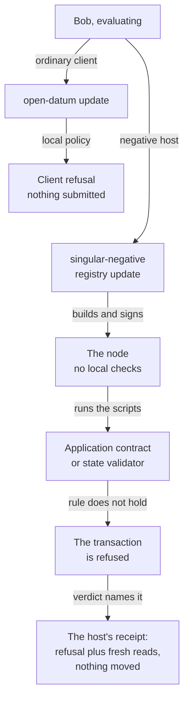
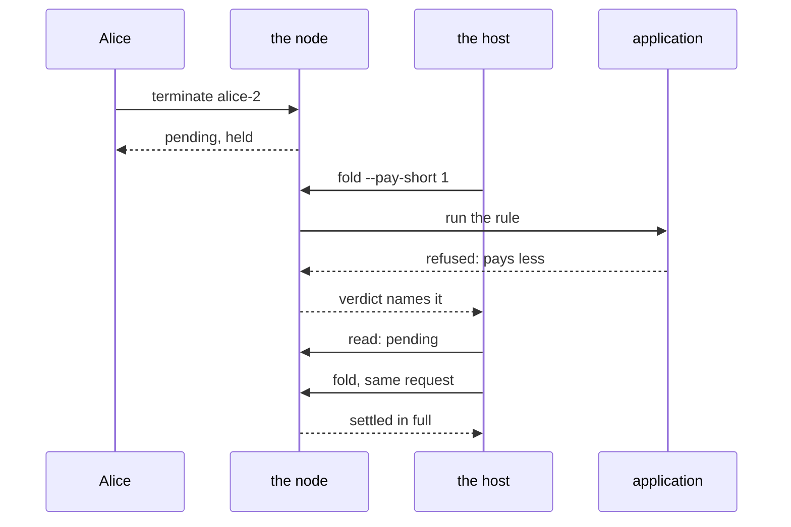

# What `singular-negative` shows

You are evaluating Singular, and this repository is all you have. It
claims rules: only a key's controller may update that key, a key the
registry already holds cannot be taken again, a holding is released
only inside a fold. This page shows where those rules are enforced —
on the chain, by scripts — and how you can watch each refusal happen
from the release archive, with no trust in the client that ships with
the repository.

## Who this is for

You are a person deciding whether to build on Singular. The ordinary
client is polite to its user: several of the registry's rules it
enforces itself, before your transaction ever leaves the machine. A
refusal from the client proves nothing about the chain, so politeness
is exactly what an evaluator must be able to switch off.

`singular-negative` is that switch. It is its own executable in the
release archive, built from the same command-line and registry sources
as the ordinary executables, with the safeguards taken out: it builds
the transaction you asked for, signs with whatever key file you name,
skips every local check and every local script evaluation, and submits.
The node takes the transaction or refuses it, and when it refuses, the
verdict names the script that refused.

Two people make it concrete. Alice has registered the key `alice-1`
and is its controller; Bob is anyone else. Bob types the same move to
both executables.

To the ordinary client:

```bash
open-datum update --key alice-1 --payload new.json --vault bob.vault
```

The client reads the key's envelope, sees that its controller is not
the key that would sign, and refuses: *the envelope's controller is 0x…
but this command signs as 0x…*. Nothing is submitted. The node never
sees the move.

To the negative host, the same move:

```bash
singular-negative registry update --key alice-1 --payload new.json --wallet-skey bob.skey
```

Both executables read `new.json` the same way: ordinary JSON is stored as plain JSON, and a
file in the detailed schema is given with `--payload-schema detailed`, as
[store ordinary JSON as a key's payload](payload-json.md) says.

The negative host's parts keep key files as harness controls: it signs
with whatever key file you name and opens no vault, so its command lines
on this page name `--wallet-skey`, and only they do. Every `open-datum`
line a reader types here signs from a vault (`--vault FILE`, the
passphrase typed once at the prompt, or read from `--passphrase-fd N`
in a script) or names an address and a bundle file for a signer
elsewhere.

The host builds the update, signs it as Bob, and submits it
unevaluated. The application's spending contract refuses it, the
node's verdict names that script, and a fresh read shows the registry,
the key's holding and the wallets exactly as they were.

Beside every forbidden move its accepting control runs too: the same
command with the one forbidden difference removed, from the same
registry state, signed by the same signer. A refusal only means
something when the same machinery succeeds on the next line.

## Who refuses what

One move, two clients. The ordinary client answers from its own local
policy; the negative host sends the move to the node and the chain's
scripts answer.



The diagram follows one move through the two clients. The ordinary
client answers from its own reading of the key's envelope — it names a
controller, and this signer is not it — and submits nothing. The
negative host builds the transaction, signs with whatever key file was
named, submits with no local check and no local script evaluation, and
the chain's scripts answer: the application's spending contract for a
spend of a holding, the registry's state validator for a fold. The
refusal comes back with the failing script's hash and its role in the
registry the command opened — `application-spending`,
`application-at-fold` or `state-validator` — and a fresh read confirms
nothing moved. Nothing is typed in: the expected script is read from
the registry's own pins, so a pass never comes from a literal someone
wrote down.

## The short fold of a booked termination

One sequence carries the most rules at once, over one request. Alice
has registered `alice-2` and is its controller. She books its
termination and stops at the pending request; the termination is not
done until a fold settles it. Bob, who is nobody in particular, then
tries to settle it for less than owed, and finally settles it honestly.



The sequence is connected over one pending request. Alice, the
controller of `alice-2`, books its termination with the ordinary
command and stops at the pending request; the termination is not done
until a fold settles it. Bob, who is nobody in particular, first
settles it for one lovelace less than owed, through the host: the
application's script at the fold refuses, the request stays pending,
the deposit stays held. Bob then folds the same request honestly,
through the same host and from the same state: the honest fold burns
the key's token, leaves the key terminal and pays the controller
exactly what the booking owes. The one difference between the two
folds is the payment, and that difference alone moves the verdict from
refusal to acceptance.

## A closed registry refuses an update

Some registries are closed: created with `open-datum create --closed`,
their payloads are written once, and no update ever lands. The
ordinary client says so before it builds anything — an update on a
closed registry is refused on the machine, with nothing submitted.
The host skips the client and asks the chain instead.

Alice registers `alice-1` in a closed registry and folds it active,
both with the ordinary commands. Through the host she then submits
her own honest update of that key, signed by her, with no tamper
flag and no local evaluation. The node refuses it, and the verdict
names the registry's own closed application in the spending role: the
refusal comes from the chain's script, not from the client's policy.
A fresh read shows the registry exactly as it was. The create receipt
names the closed application, and its pin is the closed pin — it
matches the closed preview's pin and differs from the open pin of
the same seed, so the refused script can only be closed-datum's.

The control runs in the same registry, on the same key: Alice books
its termination and folds it, with the ordinary commands. The node
accepts both, and the key reads as terminal. The chain refuses the
update and nothing else.

## Every forbidden move, and what refuses it

The scenario set is fourteen pairs in ten stories: the rewrite of a
protected field has five variants, one per protected field. Each pair
is one forbidden command and its accepting control, run on a fresh
development node from the extracted release archive. The pair list
itself lives in `applications/open-datum/negative/pairs.json`; the
model statements behind the thirteen open-registry refusals are on the
ticket's [data model page](../specs/358-singular-negative/data-model.md).
The write-once rule behind `closed-update` has no Lean statement, by
[operator ruling](../specs/650-closed-datum/ruling.md): the closed
registry's refusal is shown by the run, not by a theorem.

After the command-line split landed
([lambdasistemi/singular#528](https://github.com/lambdasistemi/singular/issues/528)),
the ordinary surface is two executables: `singular`, with the
registry's own commands — create, fold, reject, reclaim, inspect — and
`open-datum`, with the application's — insert, update, terminate,
fold, inspect. The host keeps one namespace, `singular-negative
registry …`, with the shared flag group, so a host command reads the
same today as it did before the split. The mirrors named below are the
post-split ordinary spellings.

| Forbidden command under `singular-negative` | Refused by | The ordinary command it mirrors | What the ordinary command does instead | The accepting control |
|---|---|---|---|---|
| `registry update --key alice-1 --payload new.json --wallet-skey bob.skey` — a stranger's update (`stranger-updates-the-key`) | the application's spending contract | `open-datum update --key alice-1 --payload new.json --vault bob.vault` | refuses before submitting: the envelope names its controller, and this signer is not it | the controller's own update of the same key |
| the controller's update `--tamper controller` (`controller-tamper-controller`) | the application's spending contract | `open-datum update --key alice-1 --payload new.json --vault alice.vault` | rebuilds the holding with the same address, the same value, the same recorded control and only the payload changed; no ordinary flag rewrites a protected field | the controller's update with no tamper flag |
| the controller's update `--tamper deposit` (`controller-tamper-deposit`) | the application's spending contract | the same `open-datum update` | the same: the recorded deposit is protected, not an input | the controller's update with no tamper flag |
| the controller's update `--tamper token` (`controller-tamper-token`) | the application's spending contract | the same `open-datum update` | the same: the key's token stays with the holding, not an input | the controller's update with no tamper flag |
| the controller's update `--tamper address` (`controller-tamper-address`) | the application's spending contract | the same `open-datum update` | the same: the holding's address is protected, not an input | the controller's update with no tamper flag |
| the controller's update `--tamper datum` (`controller-tamper-datum`) | the application's spending contract | the same `open-datum update` | the same: the recorded control travels with the holding, not an input | the controller's update with no tamper flag |
| `registry terminate --key alice-1 --wallet-skey bob.skey` — a stranger's termination booking (`stranger-terminates-the-key`) | the application's spending contract, at the booking | `open-datum terminate --key alice-1 --vault bob.vault` | refuses before submitting: the termination booking is the controller's | the controller's own termination booking |
| `registry withdraw --key alice-1 --wallet-skey alice.skey` (`controller-withdraws-outside-a-fold`) | the application's spending contract | none: no ordinary command releases a holding outside a fold | books the termination (`open-datum terminate`) and folds it (`open-datum fold`); the release happens inside the fold | the same release inside the honest fold of the booked termination |
| `registry insert --key alice-1 --payload new.json --wallet-skey bob.skey`, the key already active (`stranger-registers-a-taken-key`) | the registry's state validator, at the fold | `open-datum insert --key alice-1 --payload new.json --vault bob.vault` | refuses before submitting: the key is already registered | the same insertion of a fresh key the registry never held, from the same registry state |
| the same insertion signed by the key's owner (`owner-registers-a-taken-key-again`) | the registry's state validator, at the fold | the same `open-datum insert` | the same refusal: ownership of the key does not reopen it | the same fresh-key insertion from the same state |
| `registry insert --key alice-1 --payload new.json --wallet-skey alice.skey`, the key terminal (`owner-revives-a-terminated-key`) | the registry's state validator | the same `open-datum insert` | refuses before submitting: the key is already retired, permanently | the same fresh-key insertion from the same terminal state |
| the same revival signed by a stranger (`stranger-revives-a-terminated-key`) | the registry's state validator | the same `open-datum insert` | the same refusal: a terminated key stays terminal for everyone | the same fresh-key insertion from the same terminal state |
| `registry fold --pay-short 1 --wallet-skey bob.skey` over the pending termination of `alice-2` (`short-fold-of-a-booked-termination`) | the application's spending contract, at the fold | `open-datum fold --vault bob.vault` | builds the fold from the public view and pays the controller exactly what the booking owes; no ordinary flag pays less | the honest fold of the same request |
| `registry update --key alice-1 --payload new.json --wallet-skey alice.skey` on a registry created with `open-datum create --closed` (`closed-update`) | the closed application's spending contract | `open-datum update --key alice-1 --payload new.json --vault alice.vault` | refuses before submitting: the registry is closed, a payload is written once and an update is refused | the termination of the same key, booked and folded |

Read the four insertion rows together, because their timing is the
subtle part: an insertion is only a request. Under the host, the
booking of a taken key is accepted — a request is a request — and the
refusal comes later, when the host folds it and the registry's state
validator sees the key is already held. The ordinary client stops the
same move much earlier, from its own reading of the registry's entry,
which is exactly why the host exists: only it can show you the chain's
own answer.

Three forms have no ordinary equivalent at all, and they are the
host's own spellings:

- `registry withdraw` spends a holding directly, with the release
  redeemer, outside any fold. The ordinary surface has no such command:
  a release exists only inside the fold of a booked termination.
- `registry update … --tamper FIELD` rewrites one protected field of
  the holding's record — controller, deposit, token, address or datum.
  The ordinary update accepts no such flag and cannot express the move.
- `registry fold … --pay-short N` builds the fold paying the controller
  that many lovelace less than owed. The ordinary fold has no flag to
  deviate from what is owed.

Every ordinary spelling the host accepts is handed to the shared
parser unchanged, and the ordinary executables refuse these three
bypass spellings as unknown commands — the release check reads the
built ordinary executables to prove they contain no host module and no
copy of the bypass.

## What each command prints

Each host command prints one JSON receipt on standard output. For a
refused move it carries: the command and its outcome class
(`ledger-refusal` — distinct from `client-refusal`, `encoding-failure`
and `setup-failure`, which are never counted as the chain's word), the
node's own refusal text, the failed script hashes with their roles in
the opened registry, the registry's application and state pins, and two
reads — before and after — of the registry state root, the key's
holding with its value and envelope, the wallet's outputs, the pending
requests and the held deposit. A pair passes only when the after-read
equals the before-read.

For an accepted command the receipt names what the chain took: the
update names its transaction id, a booking names the request it
created, a fold names the requests it folded. So one run shows both
halves: the transaction the host really built, and the node's own
verdict on it.

## How to run it

From a checkout of this repository — the command assembles the release
archive itself, extracts it outside the checkout, and builds the host,
the ordinary executables and the development node from the archive's
own flakes:

```bash
nix run --quiet .#negative-host-parts          # every scenario name, one per line of JSON
nix run --quiet .#negative-host-part -- 'stranger-updates-the-key'
nix run --quiet .#negative-host-mutants        # every mutant validator, one at a time
nix run --quiet .#negative-host-ordinary       # the ordinary executables hold no bypass
```

One scenario run starts a fresh node, funds Alice and Bob, runs the
forbidden command and its accepting control, judges every clause from
the receipts alone, and scans every receipt and output for the key
bytes the run generated (keys are given by path and never printed).
The fourteen scenario names are the pairs of the table above.

The hosted workflow runs every pair on every push: it discovers the
scenario list from the host's own table, runs each scenario as its own
job from the release archive, and aggregates them under the two stable
check names `Negative host pairs` and `Negative host mutants`. Those
two names are what a repository can require; the jobs beneath them may
grow as pairs are added, the names stay.

## A refused insertion strands a booking, and its owner reclaims it

An insertion of a taken key is refused at its fold, not at its booking,
so the booking the host made stays pending on the chain, holding its
deposit. The owner takes it back with the ordinary command:

```bash
singular registry reclaim --request TRANSACTION#INDEX --blueprint plutus.json \
  --state-token POLICY.NAME --koios-url URL --network-magic N \
  --vault owner.vault
```

The reclaim is governed by time, and the timing matters. A booking's
retract window opens only after the registry's processing window has
passed — that ordering is the model's own, not a client convenience —
so a reclaim submitted earlier is refused by the ordinary command before signing: it reports `not-phase2` and submits nothing. The
scenario run creates its registry with a processing window of 120
seconds and a retract window of 600 seconds (the other scenarios use a
30-second retract window), then waits out the two minutes of
processing before submitting one reclaim. This is a timed reclaim, not
an immediate one. The reclaim's receipt names the command (`reclaim`),
its outcome (`success`), the request and its edge (`insertActive`),
and the read afterwards shows the booking collected and the deposit
returned to its owner.

## What a run does not show

A refusal shows the rule held for that transaction on that chain; the
model statements and validator tests carry the general guarantee. The
runs on this page are evidence about each transaction they ran, not a
proof about every transaction there could be.

What is deliberately not there yet:

- **Rejection pairs.** A folder turning a request away is not among
  the pairs; protected rejection is its own work
  ([lambdasistemi/singular#498](https://github.com/lambdasistemi/singular/issues/498),
  [lambdasistemi/singular#529](https://github.com/lambdasistemi/singular/issues/529)).
- **Two update rules with no pair.** The rule that a continuation keeps
  at least the protected deposit in its value, and the rule that
  exactly one output carries the key's token, are refused earlier by
  other rules in every pair here, so neither is exercised by its own
  pair
  ([lambdasistemi/singular#552](https://github.com/lambdasistemi/singular/issues/552)).
- **Each pair must be able to fail.** A green refusal proves nothing
  unless a validator that dropped the rule would have accepted the
  move. For every refusing rule a mutant validator removes exactly
  that rule, the release archive is rebuilt from the mutated source,
  and the pair must flip — the node must accept what the rule refuses.
  Nine mutants cover all fourteen pairs.
- **The crafting exists twice.** The conformance harness keeps its own
  copy of the crafted transactions; the host's copy is the one the
  release archive ships
  ([lambdasistemi/singular#551](https://github.com/lambdasistemi/singular/issues/551)).
- **A finished local run may leave its node behind.** A part run
  locally can leave its development node and working directories on
  the machine
  ([lambdasistemi/singular#560](https://github.com/lambdasistemi/singular/issues/560));
  hosted runners are unaffected.

| Mutant | The rule it removes | The pair that must flip |
|---|---|---|
| `update-controller-signature` | the controller must sign an update | `stranger-updates-the-key` |
| `update-escape` | the continuation stays at the holding's address | `controller-tamper-address` |
| `update-control` | the continuation keeps the holding's recorded control | `controller-tamper-controller`, `controller-tamper-datum`, `controller-tamper-deposit` |
| `token-continuation-leaves-the-holding` | the token continuation stays at the holding's address and keeps its recorded control — both rules, removed together | `controller-tamper-token` |
| `termination-booking-controller-checks` | a termination booking is the controller's — the owner and controller-signature checks, removed together | `stranger-terminates-the-key` |
| `release-no-fold` | a holding is released only inside a fold | `controller-withdraws-outside-a-fold` |
| `release-additive` | a fold pays the controller at least what is owed | `short-fold-of-a-booked-termination` |
| `registry-accepts-a-taken-key` | the registry's defence of a taken key — the labelled `key-exists` refusal in the fold and the insert step's own precondition (the Merkle-Patricia-Forestry library's insert requires the key to be absent, the same check the label sits behind) — both parts, removed together | `stranger-registers-a-taken-key`, `owner-registers-a-taken-key-again`, `owner-revives-a-terminated-key`, `stranger-revives-a-terminated-key` |
| `closed-update-accepted` | the closed application's refusal of an update — the labelled `closed-datum-update` refusal in the closed spend, delegated to the open spend instead | `closed-update` |

The registry row removes two things at once because one alone could never flip: taking out only the labelled refusal leaves the node refusing, since the insert step makes the same check itself. The runner builds this mutant the same way as the others, inside its own scratch copy only: the pin of the registry's state script, the registry manifest, the permanent-contract file and the known-scripts module are regenerated, and so are the application's blueprint, manifest and record, so the executables built there accept the mutated hashes. The checkout, the shipped loader and the permanent contract are not changed, and the run checks that. The control pair for this mutant is `stranger-updates-the-key`.

The mutant table is the honest measure of the refusal evidence: each
row names the one rule a validator had to lose before the chain would
take the move it refuses today. Beside every mutant a control pair
that a different rule refuses must stay refused, so a patch that
disabled more than its named rule could not hide.
