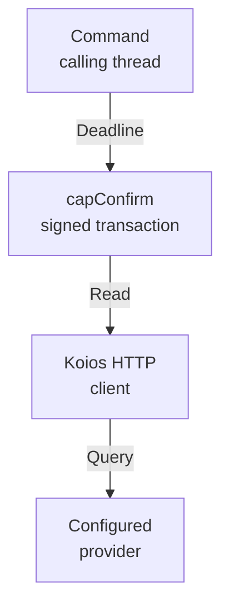

# Off-chain API reference

A contributor reading the builder and blueprint guide wants to click a
module of this library and land on its real interface — signatures,
documentation, and the highlighted source — for exactly the code this
repository ships. This page is the entry point of that reference for the
off-chain registry library: a generated Haddock reference, rebuilt with
the documentation site from this same source tree, so what you read here
documents exactly the code this candidate was built from — and, as the
extent below states, a few of its modules are documented for the
contributor without being importable by a caller. One boundary on that
promise is named below: identifiers and modules that belong to other
packages are visible in the generated pages but are not clickable,
because their documentation is not bundled with this site.

## What this reference contains

Every module of the off-chain registry library is listed below. Each entry
links two pages of the generated reference: the module page — exports,
types, and documented declarations — and the hyperlinked source page with
the rendered, highlighted Haskell this candidate was built from. On this
site the links open the generated pages; read from the repository, the
same links open the source files themselves at the revision you are
viewing.

The module extent is the public library of the off-chain Cabal file — every
exposed module, every internal module, and every module the library
re-exports under its own name. That complete extent is 77 modules in
three kinds: 60 explicitly exposed modules and 4 re-exported modules
are what a caller imports; the two trie capability owners behind the
`TrieState` facade (`Singular.Registry.TrieState.Core` and `.Types`),
the three fold owners behind the `Update`
facade — `Singular.Registry.TxBuilder.Update.Build`, `.Context` and
`.Duties` — the five wire owners behind the `Types` facade —
`Singular.Registry.Wire.Primitive`, `.Request`, `.State`, `.Proof` and
`.Redeemer` — and the three deployment owners behind the `Deployment`
facade — `Singular.Registry.Deployment.Manifest`, `.Mirror` and
`.Attach` — are package-internal `other-modules` with generated pages
here for the contributor reading the facades' implementations, but no
caller import path: a caller compiles against the facades' exports, not
against these modules. `Singular.Registry.Ledger`,
`Singular.Registry.LedgerProvider`, `Singular.Registry.Evidence` and
`Singular.Registry.Signing` are the
re-exports: their implementations are owned by the public `local-services`
component (`offchain/local-services/`) and the main library exposes their
stable import paths. The generic provider interface and evidence types let a
caller supply capabilities without selecting a node runtime; the Koios
constructor supplies unbound, unverified HTTP facts through that interface.
The runtime service modules outside this extent — the terminal composition
and its transport in `koios-http`, and the remaining service modules of
`local-services` — are documented with source links in
[Runtime service ownership](offchain-node-ownership.md). The extent below is
the complete documented module surface — exposed, re-exported and
package-internal alike; the site check fails until it and this list
agree.

MkDocs environment ready!
Run: mkdocs serve
- <a href="../offchain/naming/src/Naming/Datum.hs" data-api="module">Naming.Datum</a> — <a href="../offchain/naming/src/Naming/Datum.hs" data-api="source">source</a>
- <a href="../offchain/naming/src/Naming/Register.hs" data-api="module">Naming.Register</a> — <a href="../offchain/naming/src/Naming/Register.hs" data-api="source">source</a>
- <a href="../offchain/naming/src/Naming/Request.hs" data-api="module">Naming.Request</a> — <a href="../offchain/naming/src/Naming/Request.hs" data-api="source">source</a>
- <a href="../offchain/naming/src/Naming/Verify.hs" data-api="module">Naming.Verify</a> — <a href="../offchain/naming/src/Naming/Verify.hs" data-api="source">source</a>
- <a href="../offchain/naming/src/Naming/Wire.hs" data-api="module">Naming.Wire</a> — <a href="../offchain/naming/src/Naming/Wire.hs" data-api="source">source</a>
- <a href="../offchain/naming/src/Naming/Wire/Vectors.hs" data-api="module">Naming.Wire.Vectors</a> — <a href="../offchain/naming/src/Naming/Wire/Vectors.hs" data-api="source">source</a>
- <a href="../offchain/lib/Singular/Provider/Koios/Client.hs" data-api="module">Singular.Provider.Koios.Client</a> — <a href="../offchain/lib/Singular/Provider/Koios/Client.hs" data-api="source">source</a>
- <a href="../offchain/lib/Singular/Provider/Koios/Evidence.hs" data-api="module">Singular.Provider.Koios.Evidence</a> — <a href="../offchain/lib/Singular/Provider/Koios/Evidence.hs" data-api="source">source</a>
- <a href="../offchain/lib/Singular/Provider/Koios/History.hs" data-api="module">Singular.Provider.Koios.History</a> — <a href="../offchain/lib/Singular/Provider/Koios/History.hs" data-api="source">source</a>
- <a href="../offchain/lib/Singular/Provider/Koios/Provider.hs" data-api="module">Singular.Provider.Koios.Provider</a> — <a href="../offchain/lib/Singular/Provider/Koios/Provider.hs" data-api="source">source</a>
- <a href="../offchain/lib/Singular/Provider/Koios/Recorded.hs" data-api="module">Singular.Provider.Koios.Recorded</a> — <a href="../offchain/lib/Singular/Provider/Koios/Recorded.hs" data-api="source">source</a>
- <a href="../offchain/lib/Singular/Provider/Koios/Runtime.hs" data-api="module">Singular.Provider.Koios.Runtime</a> — <a href="../offchain/lib/Singular/Provider/Koios/Runtime.hs" data-api="source">source</a>
- <a href="../offchain/lib/Singular/Provider/Koios/State.hs" data-api="module">Singular.Provider.Koios.State</a> — <a href="../offchain/lib/Singular/Provider/Koios/State.hs" data-api="source">source</a>
- <a href="../offchain/lib/Singular/Provider/Koios/Wire.hs" data-api="module">Singular.Provider.Koios.Wire</a> — <a href="../offchain/lib/Singular/Provider/Koios/Wire.hs" data-api="source">source</a>
- <a href="../offchain/lib/Singular/Registry/Address.hs" data-api="module">Singular.Registry.Address</a> — <a href="../offchain/lib/Singular/Registry/Address.hs" data-api="source">source</a>
- <a href="../offchain/lib/Singular/Registry/Application.hs" data-api="module">Singular.Registry.Application</a> — <a href="../offchain/lib/Singular/Registry/Application.hs" data-api="source">source</a>
- <a href="../offchain/lib/Singular/Registry/AssetName.hs" data-api="module">Singular.Registry.AssetName</a> — <a href="../offchain/lib/Singular/Registry/AssetName.hs" data-api="source">source</a>
- <a href="../offchain/lib/Singular/Registry/Blueprint.hs" data-api="module">Singular.Registry.Blueprint</a> — <a href="../offchain/lib/Singular/Registry/Blueprint.hs" data-api="source">source</a>
- <a href="../offchain/lib/Singular/Registry/Blueprint/Load.hs" data-api="module">Singular.Registry.Blueprint.Load</a> — <a href="../offchain/lib/Singular/Registry/Blueprint/Load.hs" data-api="source">source</a>
- <a href="../offchain/lib/Singular/Registry/Blueprint/Params.hs" data-api="module">Singular.Registry.Blueprint.Params</a> — <a href="../offchain/lib/Singular/Registry/Blueprint/Params.hs" data-api="source">source</a>
- <a href="../offchain/lib/Singular/Registry/Blueprint/Schema.hs" data-api="module">Singular.Registry.Blueprint.Schema</a> — <a href="../offchain/lib/Singular/Registry/Blueprint/Schema.hs" data-api="source">source</a>
- <a href="../offchain/lib/Singular/Registry/Candidate.hs" data-api="module">Singular.Registry.Candidate</a> — <a href="../offchain/lib/Singular/Registry/Candidate.hs" data-api="source">source</a>
- <a href="../offchain/lib/Singular/Registry/Capabilities.hs" data-api="module">Singular.Registry.Capabilities</a> — <a href="../offchain/lib/Singular/Registry/Capabilities.hs" data-api="source">source</a>
- <a href="../offchain/lib/Singular/Registry/Config.hs" data-api="module">Singular.Registry.Config</a> — <a href="../offchain/lib/Singular/Registry/Config.hs" data-api="source">source</a>
- <a href="../offchain/lib/Singular/Registry/Config/Application.hs" data-api="module">Singular.Registry.Config.Application</a> — <a href="../offchain/lib/Singular/Registry/Config/Application.hs" data-api="source">source</a>
- <a href="../offchain/lib/Singular/Registry/Confirmation.hs" data-api="module">Singular.Registry.Confirmation</a> — <a href="../offchain/lib/Singular/Registry/Confirmation.hs" data-api="source">source</a>
- <a href="../offchain/lib/Singular/Registry/Deployment.hs" data-api="module">Singular.Registry.Deployment</a> — <a href="../offchain/lib/Singular/Registry/Deployment.hs" data-api="source">source</a>
- <a href="../offchain/lib/Singular/Registry/Deployment/Attach.hs" data-api="module">Singular.Registry.Deployment.Attach</a> — <a href="../offchain/lib/Singular/Registry/Deployment/Attach.hs" data-api="source">source</a>
- <a href="../offchain/lib/Singular/Registry/Deployment/Manifest.hs" data-api="module">Singular.Registry.Deployment.Manifest</a> — <a href="../offchain/lib/Singular/Registry/Deployment/Manifest.hs" data-api="source">source</a>
- <a href="../offchain/lib/Singular/Registry/Deployment/Mirror.hs" data-api="module">Singular.Registry.Deployment.Mirror</a> — <a href="../offchain/lib/Singular/Registry/Deployment/Mirror.hs" data-api="source">source</a>
- <a href="../offchain/lib/Singular/Registry/Driver.hs" data-api="module">Singular.Registry.Driver</a> — <a href="../offchain/lib/Singular/Registry/Driver.hs" data-api="source">source</a>
- <a href="../offchain/local-services/Singular/Registry/Evidence.hs" data-api="module">Singular.Registry.Evidence</a> — <a href="../offchain/local-services/Singular/Registry/Evidence.hs" data-api="source">source</a>
- <a href="../offchain/lib/Singular/Registry/FoldAdmission.hs" data-api="module">Singular.Registry.FoldAdmission</a> — <a href="../offchain/lib/Singular/Registry/FoldAdmission.hs" data-api="source">source</a>
- <a href="../offchain/lib/Singular/Registry/FoldSelection.hs" data-api="module">Singular.Registry.FoldSelection</a> — <a href="../offchain/lib/Singular/Registry/FoldSelection.hs" data-api="source">source</a>
- <a href="../offchain/lib/Singular/Registry/Funding.hs" data-api="module">Singular.Registry.Funding</a> — <a href="../offchain/lib/Singular/Registry/Funding.hs" data-api="source">source</a>
- <a href="../offchain/local-services/Singular/Registry/Ledger.hs" data-api="module">Singular.Registry.Ledger</a> — <a href="../offchain/local-services/Singular/Registry/Ledger.hs" data-api="source">source</a>
- <a href="../offchain/local-services/Singular/Registry/LedgerProvider.hs" data-api="module">Singular.Registry.LedgerProvider</a> — <a href="../offchain/local-services/Singular/Registry/LedgerProvider.hs" data-api="source">source</a>
- <a href="../offchain/lib/Singular/Registry/Lifecycle.hs" data-api="module">Singular.Registry.Lifecycle</a> — <a href="../offchain/lib/Singular/Registry/Lifecycle.hs" data-api="source">source</a>
- <a href="../offchain/lib/Singular/Registry/Page.hs" data-api="module">Singular.Registry.Page</a> — <a href="../offchain/lib/Singular/Registry/Page.hs" data-api="source">source</a>
- <a href="../offchain/lib/Singular/Registry/PlainJson.hs" data-api="module">Singular.Registry.PlainJson</a> — <a href="../offchain/lib/Singular/Registry/PlainJson.hs" data-api="source">source</a>
- <a href="../offchain/lib/Singular/Registry/Proof.hs" data-api="module">Singular.Registry.Proof</a> — <a href="../offchain/lib/Singular/Registry/Proof.hs" data-api="source">source</a>
- <a href="../offchain/lib/Singular/Registry/Replay.hs" data-api="module">Singular.Registry.Replay</a> — <a href="../offchain/lib/Singular/Registry/Replay.hs" data-api="source">source</a>
- <a href="../offchain/local-services/Singular/Registry/Signing.hs" data-api="module">Singular.Registry.Signing</a> — <a href="../offchain/local-services/Singular/Registry/Signing.hs" data-api="source">source</a>
- <a href="../offchain/lib/Singular/Registry/StateToken.hs" data-api="module">Singular.Registry.StateToken</a> — <a href="../offchain/lib/Singular/Registry/StateToken.hs" data-api="source">source</a>
- <a href="../offchain/lib/Singular/Registry/Trie.hs" data-api="module">Singular.Registry.Trie</a> — <a href="../offchain/lib/Singular/Registry/Trie.hs" data-api="source">source</a>
- <a href="../offchain/lib/Singular/Registry/Trie/Pure.hs" data-api="module">Singular.Registry.Trie.Pure</a> — <a href="../offchain/lib/Singular/Registry/Trie/Pure.hs" data-api="source">source</a>
- <a href="../offchain/lib/Singular/Registry/Trie/PureManager.hs" data-api="module">Singular.Registry.Trie.PureManager</a> — <a href="../offchain/lib/Singular/Registry/Trie/PureManager.hs" data-api="source">source</a>
- <a href="../offchain/lib/Singular/Registry/TrieState.hs" data-api="module">Singular.Registry.TrieState</a> — <a href="../offchain/lib/Singular/Registry/TrieState.hs" data-api="source">source</a>
- <a href="../offchain/lib/Singular/Registry/TrieState/Core.hs" data-api="module">Singular.Registry.TrieState.Core</a> — <a href="../offchain/lib/Singular/Registry/TrieState/Core.hs" data-api="source">source</a>
- <a href="../offchain/lib/Singular/Registry/TrieState/Fixture.hs" data-api="module">Singular.Registry.TrieState.Fixture</a> — <a href="../offchain/lib/Singular/Registry/TrieState/Fixture.hs" data-api="source">source</a>
- <a href="../offchain/lib/Singular/Registry/TrieState/Lineage.hs" data-api="module">Singular.Registry.TrieState.Lineage</a> — <a href="../offchain/lib/Singular/Registry/TrieState/Lineage.hs" data-api="source">source</a>
- <a href="../offchain/lib/Singular/Registry/TrieState/Types.hs" data-api="module">Singular.Registry.TrieState.Types</a> — <a href="../offchain/lib/Singular/Registry/TrieState/Types.hs" data-api="source">source</a>
- <a href="../offchain/lib/Singular/Registry/TxBuilder/Boot.hs" data-api="module">Singular.Registry.TxBuilder.Boot</a> — <a href="../offchain/lib/Singular/Registry/TxBuilder/Boot.hs" data-api="source">source</a>
- <a href="../offchain/lib/Singular/Registry/TxBuilder/ConnectedFold.hs" data-api="module">Singular.Registry.TxBuilder.ConnectedFold</a> — <a href="../offchain/lib/Singular/Registry/TxBuilder/ConnectedFold.hs" data-api="source">source</a>
- <a href="../offchain/lib/Singular/Registry/TxBuilder/Edges.hs" data-api="module">Singular.Registry.TxBuilder.Edges</a> — <a href="../offchain/lib/Singular/Registry/TxBuilder/Edges.hs" data-api="source">source</a>
- <a href="../offchain/lib/Singular/Registry/TxBuilder/Internal.hs" data-api="module">Singular.Registry.TxBuilder.Internal</a> — <a href="../offchain/lib/Singular/Registry/TxBuilder/Internal.hs" data-api="source">source</a>
- <a href="../offchain/lib/Singular/Registry/TxBuilder/Internal/Edges.hs" data-api="module">Singular.Registry.TxBuilder.Internal.Edges</a> — <a href="../offchain/lib/Singular/Registry/TxBuilder/Internal/Edges.hs" data-api="source">source</a>
- <a href="../offchain/lib/Singular/Registry/TxBuilder/Internal/Identity.hs" data-api="module">Singular.Registry.TxBuilder.Internal.Identity</a> — <a href="../offchain/lib/Singular/Registry/TxBuilder/Internal/Identity.hs" data-api="source">source</a>
- <a href="../offchain/lib/Singular/Registry/TxBuilder/Internal/Lookup.hs" data-api="module">Singular.Registry.TxBuilder.Internal.Lookup</a> — <a href="../offchain/lib/Singular/Registry/TxBuilder/Internal/Lookup.hs" data-api="source">source</a>
- <a href="../offchain/lib/Singular/Registry/TxBuilder/Prepare.hs" data-api="module">Singular.Registry.TxBuilder.Prepare</a> — <a href="../offchain/lib/Singular/Registry/TxBuilder/Prepare.hs" data-api="source">source</a>
- <a href="../offchain/lib/Singular/Registry/TxBuilder/Register.hs" data-api="module">Singular.Registry.TxBuilder.Register</a> — <a href="../offchain/lib/Singular/Registry/TxBuilder/Register.hs" data-api="source">source</a>
- <a href="../offchain/lib/Singular/Registry/TxBuilder/Reject.hs" data-api="module">Singular.Registry.TxBuilder.Reject</a> — <a href="../offchain/lib/Singular/Registry/TxBuilder/Reject.hs" data-api="source">source</a>
- <a href="../offchain/lib/Singular/Registry/TxBuilder/Request.hs" data-api="module">Singular.Registry.TxBuilder.Request</a> — <a href="../offchain/lib/Singular/Registry/TxBuilder/Request.hs" data-api="source">source</a>
- <a href="../offchain/lib/Singular/Registry/TxBuilder/Retract.hs" data-api="module">Singular.Registry.TxBuilder.Retract</a> — <a href="../offchain/lib/Singular/Registry/TxBuilder/Retract.hs" data-api="source">source</a>
- <a href="../offchain/lib/Singular/Registry/TxBuilder/Update.hs" data-api="module">Singular.Registry.TxBuilder.Update</a> — <a href="../offchain/lib/Singular/Registry/TxBuilder/Update.hs" data-api="source">source</a>
- <a href="../offchain/lib/Singular/Registry/TxBuilder/Update/Build.hs" data-api="module">Singular.Registry.TxBuilder.Update.Build</a> — <a href="../offchain/lib/Singular/Registry/TxBuilder/Update/Build.hs" data-api="source">source</a>
- <a href="../offchain/lib/Singular/Registry/TxBuilder/Update/Context.hs" data-api="module">Singular.Registry.TxBuilder.Update.Context</a> — <a href="../offchain/lib/Singular/Registry/TxBuilder/Update/Context.hs" data-api="source">source</a>
- <a href="../offchain/lib/Singular/Registry/TxBuilder/Update/Duties.hs" data-api="module">Singular.Registry.TxBuilder.Update.Duties</a> — <a href="../offchain/lib/Singular/Registry/TxBuilder/Update/Duties.hs" data-api="source">source</a>
- <a href="../offchain/lib/Singular/Registry/Types.hs" data-api="module">Singular.Registry.Types</a> — <a href="../offchain/lib/Singular/Registry/Types.hs" data-api="source">source</a>
- <a href="../offchain/lib/Singular/Registry/Wait.hs" data-api="module">Singular.Registry.Wait</a> — <a href="../offchain/lib/Singular/Registry/Wait.hs" data-api="source">source</a>
- <a href="../offchain/lib/Singular/Registry/Wire/Primitive.hs" data-api="module">Singular.Registry.Wire.Primitive</a> — <a href="../offchain/lib/Singular/Registry/Wire/Primitive.hs" data-api="source">source</a>
- <a href="../offchain/lib/Singular/Registry/Wire/Proof.hs" data-api="module">Singular.Registry.Wire.Proof</a> — <a href="../offchain/lib/Singular/Registry/Wire/Proof.hs" data-api="source">source</a>
- <a href="../offchain/lib/Singular/Registry/Wire/Redeemer.hs" data-api="module">Singular.Registry.Wire.Redeemer</a> — <a href="../offchain/lib/Singular/Registry/Wire/Redeemer.hs" data-api="source">source</a>
- <a href="../offchain/lib/Singular/Registry/Wire/Request.hs" data-api="module">Singular.Registry.Wire.Request</a> — <a href="../offchain/lib/Singular/Registry/Wire/Request.hs" data-api="source">source</a>
- <a href="../offchain/lib/Singular/Registry/Wire/State.hs" data-api="module">Singular.Registry.Wire.State</a> — <a href="../offchain/lib/Singular/Registry/Wire/State.hs" data-api="source">source</a>
- <a href="../offchain/lib/Singular/Registry/Witness.hs" data-api="module">Singular.Registry.Witness</a> — <a href="../offchain/lib/Singular/Registry/Witness.hs" data-api="source">source</a>
- <a href="../offchain/lib/Singular/State/Preimage.hs" data-api="module">Singular.State.Preimage</a> — <a href="../offchain/lib/Singular/State/Preimage.hs" data-api="source">source</a> — the off-chain encoder of the Singular state, active and registration-approval preimages, byte for byte equal to the on-chain one

The facades and owners of the registry builder and blueprint extraction
are described module by module in the
[builder and blueprint modules](offchain-builder-blueprint.md) guide, and
the registry wire's five owners behind the `Types` facade in
[Who owns the registry wire](offchain-wire-types.md).

## A worked example: resolving a registry before showing it

As a third-party reader built on this library, I am handed the address of a
registry and want to show what it holds. A registry's datum pins four
policies, and a genuine registry can pin policies its creator chose, so what I
read from the datum means nothing until I have compared the pins with the ones
the application derives. `Singular.Registry.StateToken.resolveRegistry` is that
comparison. It takes the application, the release the registry was created
under, the state token and one view of the chain, and gives back either the
registry, whose datum has passed every check, or the refusal that names the
first thing that does not.

```haskell
import Data.Text (Text)
import Data.Text qualified as T
import Singular.Registry.Application (neutralApplication)
import Singular.Registry.StateToken
    ( Release (..)
    , ResolvedRegistry (..)
    , parseStateToken
    , renderIdentityRefusal
    , resolveRegistry
    )

-- | Print what a registry holds only when its pinned policies are the ones
-- the release derives for it.
readRegistry
    :: Session NoWitness IO
    -- ^ one view of the chain, from your provider
    -> Release
    -- ^ the compiled code of the release the registry was created under
    -> Text
    -- ^ the state token, POLICY.NAME in hex
    -> IO ()
readRegistry session release spelled = do
    token <- either (fail . T.unpack) pure (parseStateToken spelled)
    resolveRegistry neutralApplication release token session >>= \case
        Right registry -> print (resolvedDatum registry)
        Left refusal -> putStrLn (T.unpack (renderIdentityRefusal refusal))
```

Over Mallory's registry, whose datum pins an active policy of her own, the
function never reaches the first branch and the program prints:

```text
registry-pin-mismatch active: the datum's active policy differs from the one the release derives for this token
```

The application you pass decides which pins are compared. An application that
knows its own script, whether it states it as a blueprint title applied to the
registry, as a compiled script or as a hash, has its application policy
compared as well as the active witness policy. The neutral value used above
knows none, so it takes the application policy from the datum, compares the
active policy, and records that in the resolved registry: `resolvedApplicationPin`
says whether the application policy was compared or was not checked against any
blueprint, and a reader that shows registry content says so. A program that
derives several applications from one registry, as `open-datum` does for its
open and its closed registries, calls `resolveRegistryAmong` with its
candidates and gets back the registry and the candidate the datum's application
policy selects. `pinsDifference` is the comparison itself, exported for a
command that creates a registry and wants to compare the datum it reads back
with the pins it built.

The comparison is made when the registry is resolved and not again within the
same run, because every fold preserves the pinned policies on chain; the
[protocol page](../specs/protocol/spec.md#reading-a-registry-what-each-layer-guarantees)
says why a reader must make it.

## Interruptible confirmation

An application author supplying registry capabilities wants a cancelled or
expired command to stop its confirmation wait while retaining the transaction
it already submitted. Registry commands and open-datum writes call
`capConfirm` on the command's calling thread under the confirmation deadline.
The callback confirms exactly the supplied signed transaction; it does not
submit it again or start a background confirmation worker.



The command owns the wait and its cleanup. An IO callback must be interruptible
through its transport reads, polling and resource cleanup, and must propagate
asynchronous exceptions. A replacement that holds an uninterruptible block
delays both deadline return and caller cancellation until that block releases.
That is a capability limitation: it does not create a worker that can escape
the command. Test harnesses observing this limit must release their barrier
and join their command.

After acceptance by the submission endpoint, confirmation failure or deadline
expiry leaves the signed identity journalled as unconfirmed. Caller
cancellation also preserves that unresolved identity before propagating the
original interruption. A provider failure is partial evidence, a deadline is
a timeout, and neither is a ledger refusal or permission to resubmit. Success
records confirmation; the command's independent readback remains a later step.
The final receipt boundary rethrows asynchronous interruptions and a concrete
`WaitFailure` unchanged: an infrastructure wait failure supplies no verdict
and does not become a client or ledger refusal. Ordinary synchronous command
failures and fallback receipts retain their existing classification.
The module and field contract are in
<a href="../offchain/lib/Singular/Registry/Capabilities.hs" data-api="module">Singular.Registry.Capabilities</a>.
This effect contract leaves Lean's transaction law and the public capability
signature unchanged.

## Snapshot computations and mutable compatibility

As a library consumer, you can compute a root, membership or exclusion proof,
or an authenticated leaf from an MPF database value without allocating a
mutable manager. The computation uses the existing MPF core and never treats
the uncommitted key index as evidence for a leaf. A foreign observed root
refuses authentication; inconsistent nodes prove no leaf. Malformed node
decoding can still raise an exception, so the caller owns its evaluation and
exception boundary.

| Interface | Computation and failure contract |
| --- | --- |
| `Singular.Registry.Trie.Pure.rootFromDb` | Pure snapshot root, including the existing all-zero empty-tree root. |
| `stateTrie` | Existing insertion, deletion and ordered proof steps in `State MPFInMemoryDB`. |
| `membershipFromDb`, `exclusionFromDb` | Pure proofs from authenticated nodes; `Nothing` when no proof can be produced. |
| `provesMember`, `provesAbsent`, `verifyExclusion` | Pure verification against the caller's trusted root. |
| `Singular.CLI.Proof.rootOfDbPure`, `authenticatedLeafPure` | Pure root bytes and `Either AuthError Leaf`; explicit root mismatch or inconsistent-proof refusal. These receive a concrete snapshot, so there is no missing or hidden registry lookup. |
| `rootOfDb`, `authenticatedLeaf` | Retained IO compatibility exports, with no manager allocation. The root wrapper forces the snapshot constructor inside IO while leaving the computed root lazy. The leaf wrapper still compares roots during the IO action; decode failures remain inside a caller's handler at that stage. Neither catches exceptions or forces the later leaf result. |
| `Conformance.Cli.Proof.provenLeaf` | Independent observed-leaf computation using the same MPF primitives, with its own `try`/`evaluate` boundary: synchronous decode damage refuses an answer and asynchronous exceptions propagate. It does not call the builder's expected-leaf function. |

The legacy names `mkPureTrie`, `mkPureTrieFromRef`, `mkPureTrieManager` and
`mkPureTrieManagerFrom` identify the in-memory backend. Their IO adapters
remain **mutable**. A caller owns the adapter and any dump action for the
entire serial builder, replay or mirror lifetime. There is no locking or
thread-safety guarantee. Sharing requires external serialization of complete
sessions, including reads, writes, speculative snapshots, visibility changes and
dumps. A dump includes hidden tries and is not an atomic concurrent snapshot.
Missing and hidden manager lookups retain their existing exceptions,
`Trie not found: ` and `Trie is hidden: ` followed by the shown token.
Speculative sessions execute the existing pure `stateTrie` over a snapshot and
discard the resulting database, without allocating a mutable copy. Action and
mutation failures still occur during the IO callback; the returned value stays
lazy, as it did with the mutable callback.

Ordinary registry and open-datum commands already authenticate through
`TrieState`; the direct executable callers of the older `CLI.Proof` snapshot
functions are the preservation tests. Removing their allocation alone is
therefore a library computation improvement, not a claim that command
session ownership changed.

### Appendix: discovered adapter consumers

This source inventory explains ownership, not ledger coverage. Each retained
owner below uses serial access for the stated lifetime. Test producers stay
independent of the pure computation being compared. No public interface or
retained journey is removed.

| Source module or executable | Disposition, owner and lifetime |
| --- | --- |
| `Singular.CLI.Proof` | Snapshot computation migrated to the pure API; old IO exports remain allocation-free wrappers. |
| `Conformance.Cli.Proof` | Snapshot observation migrated; the caller owns evaluation and cancellation. |
| `Conformance.ForkKeys` | Offline proof-shape computations migrated to local `State`; its separate evolving mirror is owned by `runCheckForkExclusion` for that call. |
| `Conformance.Run.Live.classifyLeaves` | Disposable assignment-root computations migrated to local `State`; the observation still selects against the chain-read root. |
| `Singular.Registry.Trie.Pure` | Retains public mutable single-trie adapters for caller-owned evolving databases; pure snapshot operations allocate none. |
| `Singular.Registry.Trie.PureManager` | Retains public mutable per-registry adapter and dump action for the owning serial run; speculative computation uses local `State` over its snapshot without a mutable copy. |
| `Conformance.Cli.FoldHistory` | `publicFoldTrie`/`materializeFoldTrie` owns reconstruction; the returned mutable manager belongs to the one adversarial fold-builder call. Authenticated leaves and root agreement precede building. |
| `Conformance.Mirror` | The conformance environment owns an evolving chain-operation mirror for its run; each insertion updates that mirror. |
| `Conformance.Run` | The environment callback owns a manager for the run's boot/fold actions, separately from its proof mirror. |
| `Conformance.Run.CsRows` | Each constructor-witness runner owns its boot/fold manager for that one row execution. |
| `Conformance.Run.ForkProbe` | The probe session owns its manager for the connected boot/fold sequence. |
| `InsertActive.Steps` | The bounded tool session owns its boot/fold manager until the tool run ends. |
| `UpdateTerminal.Registry` | `openSession` transfers its evolving manager to the one retirement session; that session owns it until the run ends. |
| `Journey.Proofs` | The journey owns the shared mirror reference; `stepVerifyPresent` advances it before verifying against chain readback. |
| `Journey.Scenario` | The `withRunner` callback owns the evolving registry manager for the whole bounded journey. |
| `journey/register/Main` | The runner owns its loaded mirror manager and independent fresh-control manager; the second-registry control owns its separate manager for that control. Dumped values persist between runs, not IO handles. |
| `journey/recovery/Main` | The runner owns the loaded mirror manager for the recovery journey and dumps values for the next run. |
| `journey/retirement/Main` | The runner owns the loaded mirror manager for the retirement journey and dumps values for the next run. |
| `journey/repair/Main` | The runner owns separate evolving and fresh-control managers for the repair run. |
| `E2E.CageSpec` | `withE2ETimed` owns its builder manager for one devnet fixture. |
| `E2E.Fork81Spec` | One test owns an independent evolving proof fixture until its chain-root comparison ends. |
| `E2E.ReplaySpec` | One replay test owns its evolving reference; exclusion controls own a disposable copied reference for their speculative proof. |
| `Registry.TrieStateSpec` | Each example owns the unchanged IO producer and speculative manager; the frozen old leaf wrapper owns its short-lived reference only as a compatibility oracle. Computation assertions use the pure API. |
| `Conformance.Support.CliProof` | `savedTrie` owns the independent evolving producer until it yields database/root values for observation tests. |
| `Conformance.Support.FoldHistory` | Each example owns independent producer and reconstructed builder managers until their root/proof comparisons end. |
| `Conformance.Support.RunReplay` | Each example owns a builder-control manager; speculative callbacks discard their changes. |
| `OpenDatum.BurnSourceSpec` | Each fold-builder example owns its evolving fixture manager for the tested builder invocation. |
| `OpenDatum.CLISpec` | `walked` owns the independent lifecycle producer until it returns the saved snapshot and root. |

## How the reference stays honest

The reference cannot drift from the code it claims to document. The site
build derives a manifest from the same off-chain source input Haddock
ran on: for every module it records the digest of the Haskell source file
and the digest of the actual generated source page. The site check then
redoes both halves independently from this repository's own source tree —
the manifest's module extent must equal the Cabal library extent, each
recorded source digest must match the repository's file, and each
generated page in the shipped site must match its recorded digest. A
reference generated from any other source, however its label reads, fails
that comparison; a page edited after generation fails its own digest.

Every link inside the generated pages is inspected too. A reference from
one module of this library to another — a type, a function, a module,
however the tool that generated it spelled it — must resolve to a page of
this reference and, where it names an anchor, to an anchor that exists.
The check prints how many same-library links it resolved, and the
reference's own index and guide links are checked by the site's ordinary
link inventory.

Dependency documentation is a different matter. The library is built
against a large Cardano and Plutus dependency closure, and none of those
packages' Haddock pages are bundled into this site: a type such as a
ledger address or a Plutus core data value appears in the generated pages
as a visible label, but it is not a link — following it would leave this
site for documentation that is not shipped with it. Neutralizing those
labels is decided from the build's own package database, which positively
names every module each dependency owns, so a label is only unlinked when
it provably belongs to a dependency; a dead or store-path link that
reappears fails the site check, and a same-library reference may never be
treated as a dependency label to hide a broken link.

One further generator class is unlinked by structure. Haddock renders
instance method names in each instance's Methods list as same-page links,
but emits no matching anchors for them — every instance of a class lists
the same method names, so the anchor would have to be duplicated. Those
method labels stay visible as plain text inside the instance lists, and
the site check both counts them separately and still requires every
fragment link outside that exact structure to resolve.

The release archive check extends the same discipline to what gets
shipped: the staged documentation archive must carry the generated
reference member for member and byte for byte before the ordinary release
checks run.

## What the reference does not claim

This reference covers the off-chain registry library only. The four
registry commands — the journey, `insert-active`, `update-terminal` and
`deployment` — are executables, not library modules: their
command-local modules are documented with source links in
[Who owns a registry command](offchain-command-entrypoints.md), and the
library interfaces they call are the ones listed above. The conformance
suite's own library now has its own generated reference — the
[Conformance API reference](conformance-api-reference.md) — generated
and checked by the same discipline from the Conformance tree. Together
the two references cover the documented module surfaces of the two
public libraries, no more: this reference's extent is the off-chain
main library's, with the runtime service modules staying outside it in
[Runtime service ownership](offchain-node-ownership.md), and
the conformance reference's extent is the conformance library's. The
executables and the on-chain Aiken validators remain outside the
generated references. The public `local-services` component also exposes
`LocalEvaluation`, `NetworkTime`, `ProviderSettings`, `ProviderTrace`,
`SessionEvidence`, `SessionIO`, `SessionServices`, `TimeMaterial`,
`TimeSource`, `Trace`, `TraceRender`, `WaitTypes` and `Wallet`; their sources live under
`offchain/local-services/Singular/Registry/`. Their generated pages are not
in this main-library reference. The public `open-datum-application`
component (`applications/open-datum/offchain/`) carries the open-datum
application the command line composes — entry commands, envelope, booking
approval and destination, payload update, release rules, script, and the
application value:
`Singular.Application.OpenDatum.Book`,
`Singular.Application.OpenDatum.Build`,
`Singular.Application.OpenDatum.Command`,
`Singular.Application.OpenDatum.Entry`,
`Singular.Application.OpenDatum.Envelope`,
`Singular.Application.OpenDatum.InsertEnvelope`,
`Singular.Application.OpenDatum.Permanent`,
`Singular.Application.OpenDatum.Plan`,
`Singular.Application.OpenDatum.Preview`,
`Singular.Application.OpenDatum.Release`,
`Singular.Application.OpenDatum.Root`,
`Singular.Application.OpenDatum.Run`,
`Singular.Application.OpenDatum.Script`,
`Singular.Application.OpenDatum.Update` and
`Singular.Application.OpenDatum.Value`; their sources live under
`applications/open-datum/offchain/src/Singular/Application/OpenDatum/`,
and the executable's entry point lives in
`applications/open-datum/offchain/app/`.
The public `registry-cli` component (`offchain/cli/`) carries the registry
command line the two binaries link — session, journal and receipts, the
flag group, `create`, `fold`, `reject`, `reclaim`, `inspect`, reconcile,
recovery and the booking call: `Singular.CLI`, `Singular.CLI.Attached`,
`Singular.CLI.Command`, `Singular.CLI.Create`,
`Singular.CLI.Finish`, `Singular.CLI.Fold`, `Singular.CLI.FoldRules`,
`Singular.CLI.Inspect`, `Singular.CLI.Key`, `Singular.CLI.Live`,
`Singular.CLI.ManagedState`, `Singular.CLI.Outlay`, `Singular.CLI.Payload`, `Singular.CLI.Permanent`,
`Singular.CLI.Plan`, `Singular.CLI.Proof`,
`Singular.CLI.Receipt`, `Singular.CLI.ReceiptBody`, `Singular.CLI.Reclaim`,
`Singular.CLI.ReclaimRules`, `Singular.CLI.Reconcile`,
`Singular.CLI.Recovery`, `Singular.CLI.Registry`, `Singular.CLI.Reject`,
`Singular.CLI.RejectRules`, `Singular.CLI.RequestWindow`,
`Singular.CLI.Root`, `Singular.CLI.Session`, `Singular.CLI.Trace`,
`Singular.CLI.TrieHistory` and `Singular.CLI.TrieTrace`; their sources live
under `offchain/cli/src/Singular/CLI/`.

The registry packages export the booking check every ordinary verb runs
before signing: `bookingRefusal` in `Singular.CLI.Booking` decides, from
the key's current entry, whether the entry rules out the booking, naming
the key, the verb, and the leaves found and required. Every ordinary verb
of an application calls it in planning, in preview and live, so a taken
key, a terminal key, and an unknown key for update and terminate are
refused before any signing key is read. A cardano-keri application gets
the same refusal by calling the exported function in its own planning. The negative host lives beside the
application in `applications/open-datum/negative/`, with its sources under
`applications/open-datum/negative/src/Negative/` and its entry point in
`applications/open-datum/negative/app/`.
Their generated pages are not in this main-library reference either: only
the main library has a generated reference. This coverage gap stays visible; wider
generated coverage is a separate decision for the epic's owner, not a
claim this page makes. Nothing on
this page is a publication or release claim — the reference ships with
the candidate site and its future archives, and no version is tagged or
published by existing here. The behavioral evidence for the moved builder,
blueprint and wire code lives in the check commands the off-chain
development guide records, not in the existence of these pages.
