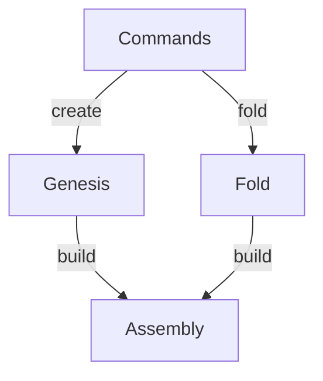
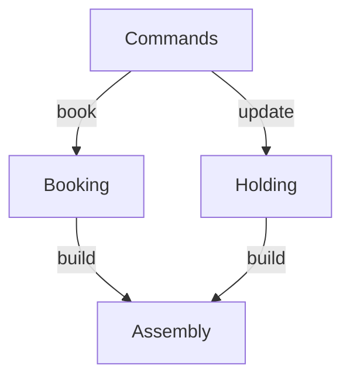

# Registry builder and blueprint modules

As a contributor changing transaction construction, you want to find the
current owner. Registry state and application requests have separate owners,
and both use shared ledger providers and transaction assembly tools.

## Current construction paths

The registry library owns creation, public state history, folds and reference
publications. The application owns booking, holding updates, termination
booking and registration exits. Commands resolve explicit inputs and submit the
transactions these owners return. See [fold responsibilities](offchain-fold-responsibilities.md)
for the boundary between application request rules and registry state changes.

## Shared representations

The blueprint facade parses the CIP-57 schema, selects compiled code and
applies parameters. Its Schema, Load and Params modules own those concerns
separately. Shared internal helpers supply ledger-data conversions, script
identity, lookup and balancing for retained callers. Funding and publication
arithmetic remain shared with the preview so preview and construction use the
same values.

| Choice | Alternative | Reason |
| --- | --- | --- |
| Separate registry and application construction | One builder containing both contracts | Each layer owns its script and datum rules. |
| Shared funding and publication arithmetic | Recompute preview amounts in commands | A preview must describe the transaction built. |
| Reference generated from candidate source | Copy a reference from an earlier release | Signatures and source must describe the checked candidate. |

The [API reference](offchain-api-reference.md) lists the discovered modules and
links their signatures and source. Compilation establishes that the retained
tree builds. Component tests and packaged journeys establish behavior at their
respective boundaries; neither implies hosted CI or public-network acceptance.

## Behavioral authority

The [registry conditions](../models/singular-application-held/lean/SingularApplicationHeld/Conditions.lean)
and [application rules](../models/open-datum-application-held/lean/OpenDatumApplicationHeld/Application.lean)
are the current model sources for these construction paths. The documentation
ships those source files and checks their bytes against the candidate source.
Changing or omitting a linked model artifact is rejected by the same check.
Model statements, compiled-validator tests and connected journeys establish
different boundaries; none substitutes for the others.
