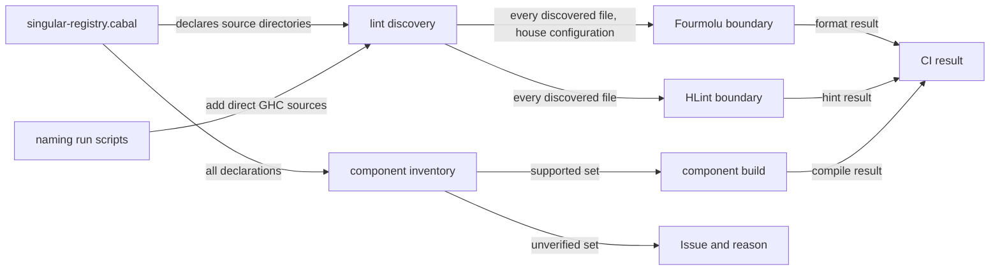

# Checking off-chain code

A contributor changing an off-chain component wants one repeatable way to find the source that CI checks and to see which supported components compile. A failed check should name the affected source or component. A passing check means only that its stated extent passed; the current maintenance work still has named lint and formatting gaps for the final epic integration.

## Run the checks

From the repository root, run the root build gate. Run the off-chain checks from `offchain/` so Nix selects that flake:

```sh
nix build --quiet .#build-gate
(cd offchain && nix run --quiet .#lint)
(cd offchain && nix build --quiet .#component-build)
```

The root build gate covers the root flake's model, site and other declared build checks. It does not build every off-chain Cabal component. The off-chain lint app runs Fourmolu and HLint on its stated source extents. The component build carrier compiles the library, its test components, and supported components used by current required workflows and shipped registry commands. It runs no executables or tests. Its inventory lists every Cabal declaration and explains which are built here, covered by another required job, or unbuildable or unverified. A failing included member makes the carrier fail; a green result does not mean that every Cabal component builds. The measured counts move with the tree — the provider retirement removed the node-internal declaration — so compare each claim with the carrier's next actual output rather than an earlier receipt.

## Where the source list comes from



`offchain/nix/checks.nix` reads every `hs-source-dirs` declaration in `offchain/singular-registry.cabal` at lint run time and adds the standalone signing controls. Every library, command and test component declares its source root. Discovery deduplicates nested directories and fails if it finds no sources or a declared directory is absent. Fourmolu uses the committed `fourmolu.yaml`, and HLint visits the same discovered files with no directory exclusions. Adding a component must update the Cabal declaration that makes it discoverable; the next lint run reports its actual extent. The format controls run from the repository root: a source accepted by formatter defaults but rejected by the house configuration must fail the check, its formatter correction must pass, and a tree without the configuration must fail loudly.

`offchain/flake.nix` derives a supported build set from the current workflow and currently supported command closure. Its inventory must account for every Cabal library, executable, and test suite, and the gate must fail when a new declaration has no classification or an omitted classification drifts. Its component manifest can be compared with the Cabal stanzas. The flake's command is the same command used by the off-chain component CI job.

## Current boundaries

The source inventory, formatter extent, HLint extent and component build extent are different claims. The nine retired naming runners have been removed with their Cabal declarations and flake exports: initialization, its refusals, maintenance, recovery, registration, retirement, repair and the two verification tools. Their old unverified inventory entries are removed as well; an absent component is not a successful build. The naming and registry libraries remain for their separate removal layer. Fourmolu and HLint continue to discover their complete remaining source extents without directory exclusions. The component carrier reports the components it actually builds, and runs no tests or commands. Historical receipts and the run pages in the old release archive describe their own revisions, not the current command surface.

## Module ownership maps

The builder and blueprint modules, the runtime services, the registry
fold and the four registry commands now each have a contributor map:
which module owns a concern, where common edits land, and which
decisions the extraction recorded. They are
[Builder and blueprint modules](offchain-builder-blueprint.md),
[Runtime service ownership](offchain-node-ownership.md),
[Who owns a registry fold](offchain-fold-responsibilities.md) and
[Who owns a registry command](offchain-command-entrypoints.md).

The final integration work for epic #272, tracked as #278, must remove these temporary gaps and put every tracked code source under actual lint and format checks. It must also cover repository code beyond off-chain Haskell. Until that work is accepted, use each command's stated extent when interpreting a green result. Any source correction still has to preserve the Lean model's behavior and the dependent consumer guarantees.
