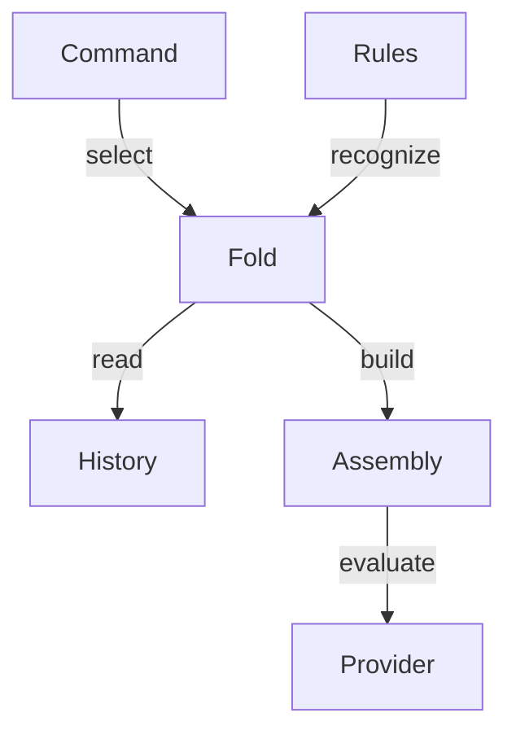

# Who owns a registry fold

As a contributor changing a fold, you want the owner of each decision to be
clear. The registry owns the state transition and batch transaction. The
application owns recognition of a pending request, its spending script and
its approval burn. The folder supplies public chain data and its own wallet.

## From a pending request to a batch

The fold discovers pending requests through the application adapter and checks
each against the selected registry and trie. Automatic selection skips
individually unfoldable requests and keeps the first foldable request for each
key. An explicitly selected batch is built in the requested order or refused;
it is never silently trimmed.

The lineage owner reconstructs the registry trie from public history.
The assembly owner constructs state continuation, request spends, token effects,
committed holdings, rewards, validity and collateral. The application adapter
supplies request recognition and spending rules. No booker's local file is an
input to the fold.

## Choices and verification limits

| Choice | Alternative | Reason |
| --- | --- | --- |
| Application supplies request recognition and spending | Registry decodes every application's format | Each application owns its pending-output format. |
| Fold reconstructs public history | Booker supplies a private trie file | Any wallet can complete a public request. |
| Explicit batches either build or refuse | Silently shorten a selected batch | The transaction must match the caller's selection. |

The state-fold and application request-fold suites exercise the current builders
against compiled validators and altered-input controls. The packaged journey
checks connected registration, update and termination on a private development
chain. These are separate evidence boundaries; see the [consumer record](consumer-conformance.md)
for requirements still uncovered.

Browse [the generated API reference](offchain-api-reference.md) for signatures
and source, and [the command guide](registry-commands.md) for caller-visible
receipts and selection behavior.
