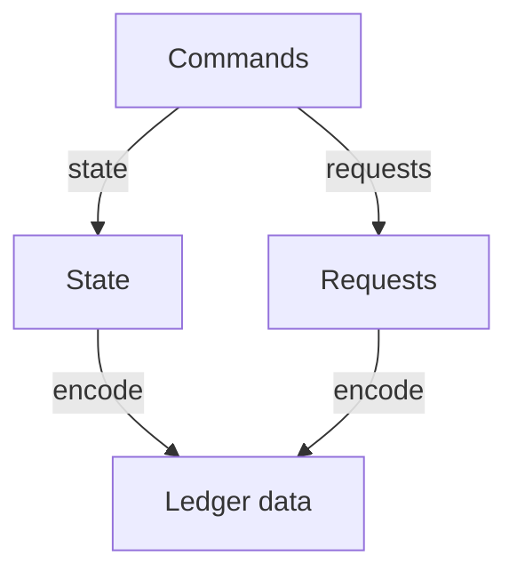
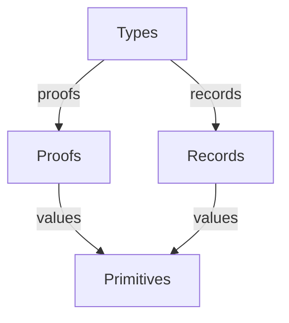

# Who owns the registry wire

As a contributor changing a wire representation, you want to find the codec
used by the command you are changing. The current registry state is encoded by
`Singular.State.Records`. The current application's requests and live holdings
are encoded by `OpenDatum.Requests.Records`.

## Current command records

Creation and folds use the state records. Registration, updates, termination
booking and registration exits use the application records. Their owning
builders construct datums and redeemers, then evaluate transactions against
the corresponding compiled validators.

Changing a representation starts with its behavioral authority and the
contract that consumes it. Constructor indices, field order and nesting are
part of the wire. A Haskell codec change alone cannot establish agreement
with a validator. Literal codec tests, compiled-validator tests and connected
journeys check different boundaries.

## Shared values and retained adapters

`Singular.Registry.Types` remains a facade for shared proof steps, edge
ordinals, output references and generic adapter codecs. Public-history
readers, recovery adapters and synthetic library tests still use these
representations. Decoding a historical record does not establish support for
its former validator or command.

The shared family has separate owners for primitive values, proofs and
records. This diagram groups those responsibilities; the generated reference
provides the exact module imports and signatures.

| Owner | Responsibility |
| --- | --- |
| `Singular.Registry.Wire.Primitive` | Shared identifiers, output references, roots and ledger-data conversion helpers. |
| `Singular.Registry.Wire.Proof` | Shared proof representations and their codecs. |
| `Singular.Registry.Wire.Request` | Generic edge vocabulary, request records and phase classification for retained adapters. |
| `Singular.Registry.Wire.State` | Generic state and custody records for retained adapters. |
| `Singular.Registry.Wire.Redeemer` | Generic minting, spending and hook representations for retained adapters. |
| `Singular.Registry.Types` | The public facade re-exporting those shared names. |

These generic codecs are separate from the current state and application
record owners above. The shared proof and edge vocabulary also remains in
use by the current trie capability. Removing obsolete transaction builders
does not remove these retained callers.

## Evidence and navigation

The Types suite checks literal encodings and decodings. The state and
application builder suites separately exercise their compiled validators.
Connected journeys check transactions at the ledger boundary. The
[consumer record](consumer-conformance.md) publishes the requirements still
uncovered; a codec test does not close those rows.

Use the [API reference](offchain-api-reference.md) to find the signatures and
source for each owner. The [builder guide](offchain-builder-blueprint.md)
maps construction paths, and the [fold guide](offchain-fold-responsibilities.md)
describes the boundary between registry state and application request rules.
