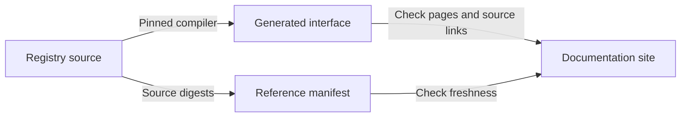

# Validator API reference

A contributor can open each registry module's generated interface, follow its
public declarations and inspect their source at the documentation build's exact
revision. The reference is generated by the pinned Aiken compiler from the same
source tree as this page.

## Open a module

The reference's <a href="../onchain/" data-api="index">index</a> lists every
documented module and searches its public members. These links open the generated
pages on the site and the source files when read in the repository.

- <a href="../onchain/lib/singular_state/fold.ak" data-api="module">singular_state/fold</a>
- <a href="../onchain/lib/singular_state/genesis.ak" data-api="module">singular_state/genesis</a>
- <a href="../onchain/lib/singular_state/preimage.ak" data-api="module">singular_state/preimage</a>
- <a href="../onchain/lib/singular_state/state.ak" data-api="module">singular_state/state</a>
- <a href="../onchain/validators/singular_state_fixtures.ak" data-api="module">singular_state_fixtures</a>
- <a href="../onchain/validators/singular_state_fold_fixtures.ak" data-api="module">singular_state_fold_fixtures</a>
- <a href="../onchain/validators/singular_state_history.ak" data-api="module">singular_state_history</a>
- <a href="../onchain/validators/singular_state_proof_builder.ak" data-api="module">singular_state_proof_builder</a>
- <a href="../onchain/lib/singular_state_proof_fixtures.ak" data-api="module">singular_state_proof_fixtures</a>
- <a href="../onchain/validators/singular_state_termination_fixtures.ak" data-api="module">singular_state_termination_fixtures</a>

## Follow a rule

The [state validator owners](onchain-validator-owners.md) page maps creation,
request handling, state recognition and token naming to their source owners.
Test support appears in the reference because its helpers are public to test
modules; it is not an additional product interface.

The documentation build generates the interface and binds its pages to source
digests. Its checks reject a missing page, changed source or a source link to
another revision.

## Coverage limits

A module has a generated page when it declares a public definition. Test cases
and a validator with no public declarations remain available in the source tree. The
application's separate on-chain project has no generated reference on this site;
that coverage gap remains explicit. Compilation and generated documentation do
not establish validator behavior or ledger acceptance.
