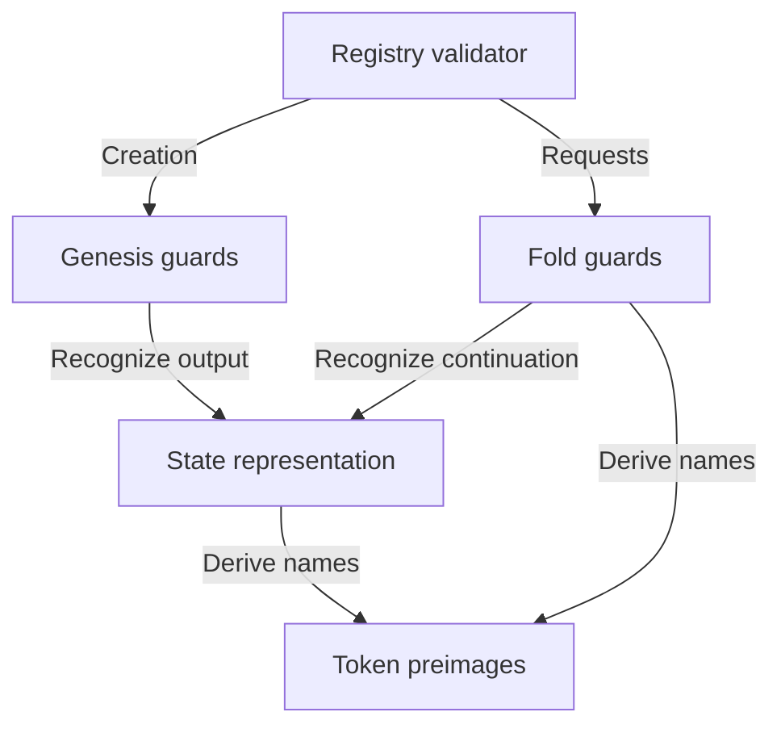

# Who owns a state validator rule

A contributor changing a registry rule can find its source owner and the checks
that exercise it here. The registry validator and the application request
validator are compiled independently, then combined into the deployment blueprint.

## Registry owners

The validator dispatches creation and request handling to their owners. Shared
state recognition and token names are defined once in the registry library.

| Responsibility | Source owner |
| --- | --- |
| Validator handlers | `onchain/validators/singular_state.ak` |
| Creation guards | <a href="../onchain/lib/singular_state/genesis.ak" data-api="module">singular_state/genesis</a> |
| Request fold guards | <a href="../onchain/lib/singular_state/fold.ak" data-api="module">singular_state/fold</a> |
| State recognition and policy mint comparison | <a href="../onchain/lib/singular_state/state.ak" data-api="module">singular_state/state</a> |
| Token and approval preimages | <a href="../onchain/lib/singular_state/preimage.ak" data-api="module">singular_state/preimage</a> |

## Check a change

Run the registry Aiken tests and identity check from `onchain/`. The application
tests run in a composed assembly so they can call both validators. The root
`script-hash-comparison` command checks both separate builds, their identity
manifests and the merged deployment blueprint, with controls that must refuse
moved hashes and differing merged script bytes.

Compilation and Aiken tests do not establish a connected ledger lifecycle or
full model correspondence. The development-network journeys and the published
conformance record state their separate evidence and gaps.
