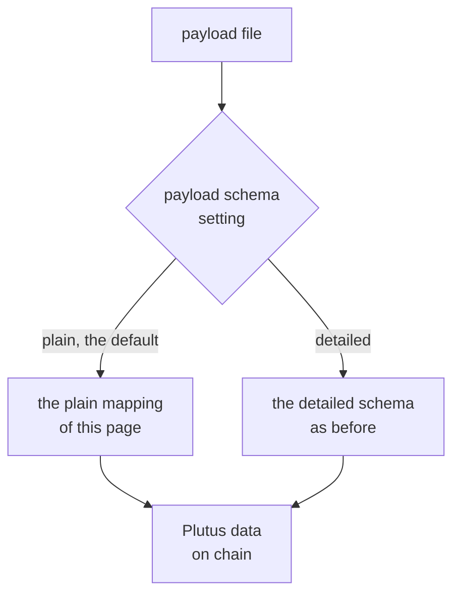
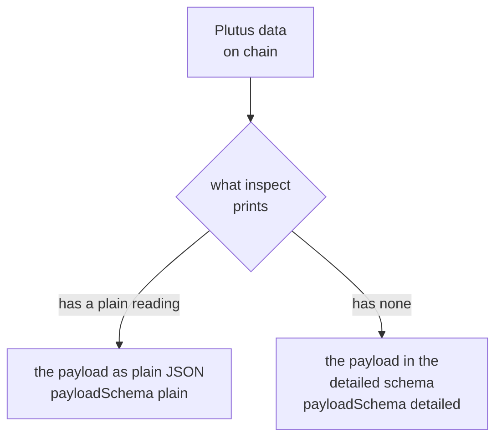

# Store ordinary JSON as a key's payload

As a reader with a registry and a key, you store the document `{"answer": 42}`
under the key by writing that file and nothing else. You read the key back and
the page shows `{"answer": 42}`. You did not have to learn first how Plutus
data is written in JSON. As an integrator who needs exact control of the bytes
on chain, you keep writing the detailed schema, `{"constructor": 0, "fields":
[{"int": 42}]}`, and say so on the command, so nothing is guessed. As someone
with a script from the previous release, you find that your payload file in the
detailed schema is refused with a sentence that tells you to say so, and is
never stored as something else.



The first diagram shows how a file is read. The setting `--payload-schema` decides
how the file becomes Plutus data: by the plain mapping of this page when the
setting is `plain` or absent, and by the detailed schema, as before, when it
is `detailed`. Either way the result is the same kind of value, Plutus data in the
key's output on chain.



The second diagram shows how a key is read back. The data is printed as plain
JSON if it has a plain reading and in the detailed schema if it has none, and the
print always says which.

## Store a document

Write the file and give it to `insert`, with no other setting:

```sh
echo '{"answer": 42}' > payload.json
open-datum insert --key alice --payload payload.json --vault alice.vault --fold
open-datum inspect --key alice | jq '.applicationOutput | {payload, payloadSchema}'
```

The second command prints the payload you wrote and the name of the schema it is
printed in:

```json
{
  "payload": {
    "answer": 42
  },
  "payloadSchema": "plain"
}
```

`update` takes the same file and the same setting, and so do the previews of
both, `keri-stub register`, and the negative host's insert and update: every
command that reads a payload file reads it one way.

## How ordinary JSON becomes data

Reading a file in the plain schema turns its JSON into Plutus data by these
rules, and by nothing else, so you can apply them by hand.

- A whole number becomes the integer. A number written `1.0` or `5e2` is a whole
  number too and is stored as `1` and `500`; the way the number was written is
  not kept. A number may have at most a thousand digits.
- A text becomes the byte string of its UTF-8. The empty text is the empty byte
  string.
- `true` becomes the constructor with index 1 and no fields, which is the Plutus
  boolean, and `false` becomes the constructor with index 0 and no fields.
- An array becomes the list of its items, mapped in order. The empty array is the
  empty list.
- An object becomes the map from each key, as a byte string of its UTF-8, to its
  value, mapped. The entries are in ascending order of the key bytes, whatever
  order the file wrote them in. The empty object is the empty map.
- `null` and a number with a fraction are refused.

A whole file is accepted, not only an object: the file may hold `42`, `"alice"`
or `[1, 2]`.

| the file holds | the key's data is |
|---|---|
| `42`, `-7`, `0`, `1.0`, `5e2` | the integer 42, -7, 0, 1 and 500 |
| `"alice"`, `""` | the byte string of the text, the empty byte string |
| `true`, `false` | the constructor 1 and the constructor 0, with no fields |
| `[1, "a"]`, `[]` | the list of the mapped items, the empty list |
| `{"b": 2, "a": 1}`, `{}` | the map with the entry for `a` first, the empty map |
| `null`, `1.5` | refused |

Worked by hand, the file `{"answer": 42}` holds one object with one key, so the
data is a map with one entry. The key is the byte string of the text `answer`,
whose bytes are `616e73776572` in hex, and the value is the integer 42. In the
detailed schema that is
`{"map":[{"k":{"bytes":"616e73776572"},"v":{"int":42}}]}`. The file `42` is the
integer 42, the same data as the detailed `{"int":42}`.

## What is refused

A refusal names the file, says what it asked for, and names the value and where
it is, written as a path from the document: `$` is the whole document, `.name` an
object key and `[2]` an item. Every refusal comes before the node is read, so a
preview with an unreachable node shows them too, and nothing is submitted.

| the file | the command says |
|---|---|
| holds `{"price": 1.5}` | `payload.json: --payload cannot be stored as plain JSON: the number 1.5 at $.price has a fraction; only whole numbers are stored` |
| holds `{"gone": null}` | `payload.json: --payload cannot be stored as plain JSON: null at $.gone has no Plutus data counterpart` |
| holds `1e5000` | `payload.json: --payload cannot be stored as plain JSON: the number at $ is too large: more than 1000 digits (1e5000)` |
| is not JSON | `payload.json: ` and then the reason the JSON reader gives |
| is in the detailed schema, and the setting is plain | `payload.json: --payload cannot be stored as plain JSON: the file is Plutus data in the detailed schema: say so with --payload-schema detailed, or nest it in an object to store it as plain JSON` |
| is not in the detailed schema, and the setting is detailed | `payload.json: --payload is not Plutus data: ` and then the reason the previous release gave |

A number is judged by its size before it is written out, so a file such as
`1e1000000000` is refused at once and the refusal names the number.

## Choose the form with the schema setting

The setting has two values, `plain` and `detailed`, and `plain` when it is absent.
It is not a standing setting: there is no environment variable and no key in the
configuration file, because the form is a property of the file you give.

| the file | the setting | what happens |
|---|---|---|
| ordinary JSON | none, or `plain` | stored by the rules above |
| the detailed schema | `detailed` | stored exactly as the previous release stored it |
| the detailed schema | none, or `plain` | refused with the instruction to say `detailed`; never stored as a map of text keys |
| ordinary JSON | `detailed` | refused as not Plutus data, with the previous release's reason |

The refusal of a detailed file covers the whole document only. A detailed-looking
object nested inside a larger document is plain JSON like any other: the file
`{"wrapper": {"int": 5}}` is stored as a map from the text `wrapper` to a map from
the text `int` to the integer 5. Every file the previous release accepted is
therefore either refused with the instruction or read exactly as before when the
setting is `detailed`; none is stored as a different datum.

## What inspect prints

`inspect` prints the key's payload under `payload` in the application output, with
the field `payloadSchema` beside it, and the update receipt prints the two fields
the same way. A payload has a plain reading when it is one that the rules above
could have produced:

- an integer of at most a thousand digits;
- a byte string that is valid UTF-8, read as a text;
- a list whose items all have a plain reading;
- a map whose keys are valid UTF-8 byte strings in strictly ascending order of
  bytes and whose values all have a plain reading;
- the constructor with index 0 or 1 and no fields, read as `false` or `true`.

When the stored data has a plain reading, `payload` is that JSON and
`payloadSchema` is `plain`. Otherwise `payload` is the detailed schema of the data
and `payloadSchema` is `detailed`: a byte string that is not text, a map with a key
that is not text or with its keys out of order, any other constructor, or a number
past the limit of a thousand digits.

The reading is a property of the data, not of how it was stored. The detailed
`{"int":42}` and the plain `42` store the same data, so both read back as `42`.
The envelope, with its control and its payload in the detailed schema, is printed
as before under `envelope`, and it is the way to read the exact data.

## Limits

- `null` is not stored. A later release may accept it without changing what is
  stored today.
- The text of a number is not kept: `1.0` is read back as `1`.
- An object's key order in the file is not kept; the stored order is ascending by
  key bytes, because JSON readers do not preserve it and a map in Plutus data is
  ordered. A key repeated in the file keeps its first value, as the JSON reader
  does.
- A payload with a byte string that is not text, a map with keys that are not text
  or any constructor other than the two booleans needs the detailed schema, and it
  prints in the detailed schema.
- A text stored as bytes by the detailed schema reads back as text when the bytes
  are valid UTF-8; nobody can tell from the chain which form wrote it.
- A whole payload that looks like a detailed document, such as `{"int": 5}` as a
  plain object, cannot be written in the plain schema because of the refusal
  above. It can be stored through the detailed schema as a map with the text key,
  and it then reads back as plain JSON; writing that JSON again needs the detailed
  form.

The settings table in [connecting singular to a ledger provider](singular-node.md)
lists `--payload` and `--payload-schema` with the commands that take them.
