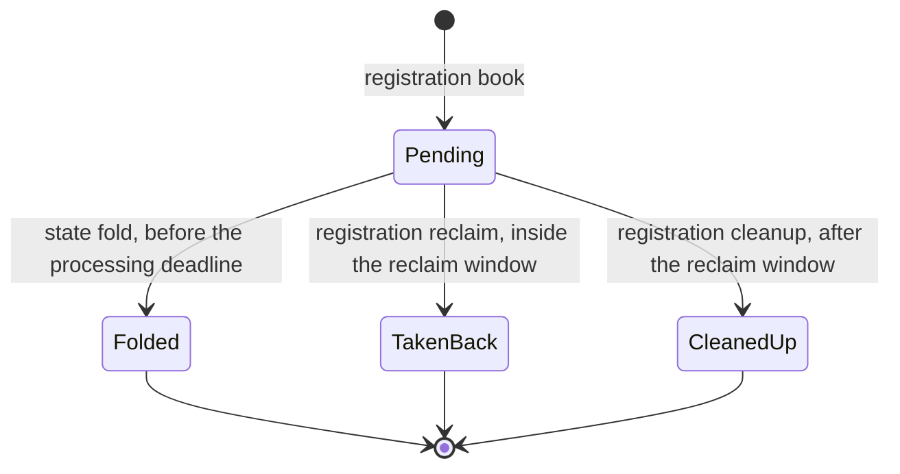
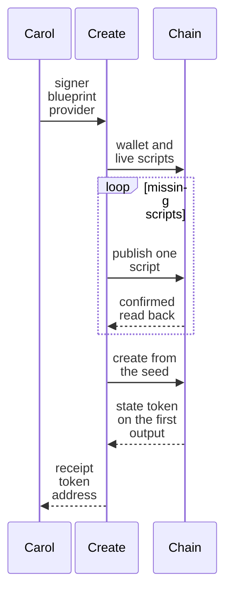
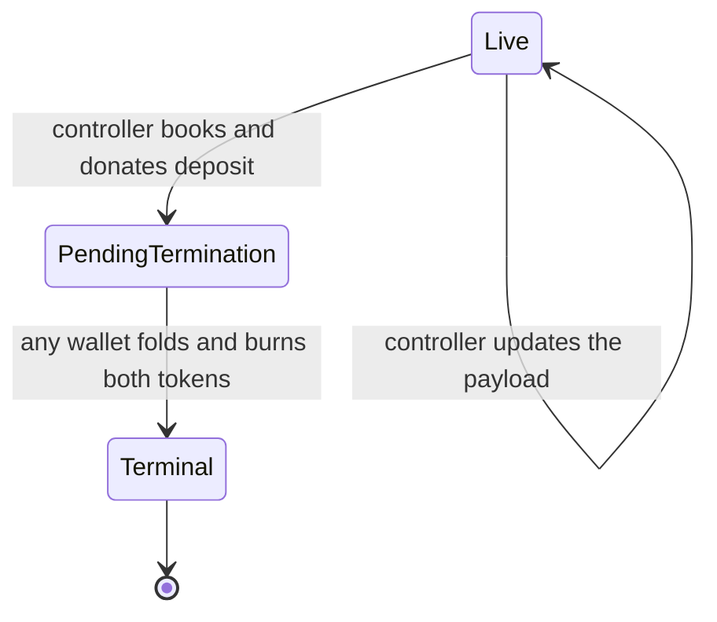
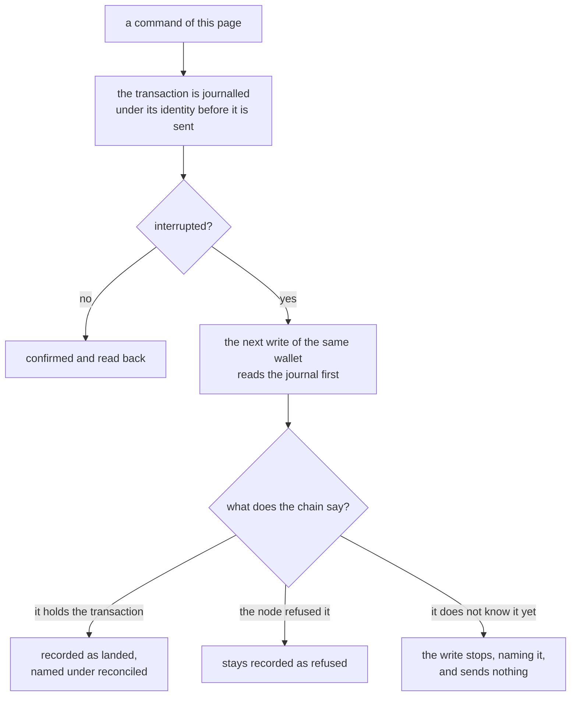

# Create a registry and manage its keys on the proved design

As Carol, you create a registry for an application with one command and read
its address and its state token from the receipt. As Alice, you book the
registration of a key with its payload and a deposit, and the receipt names the
pending registration the booking made. As Bob, you fold the registrations you
name into the registry from the chain alone, and keep what each of them holds
above its deposit. As Alice again, when nobody folds your registration you take
it back inside its reclaim window, and when that window has passed anyone can
clean it up and your deposit goes back to the refund address you chose. When a
command is interrupted, the next write of the same wallet settles what it left,
and nothing is ever sent a second time.



The first diagram shows the life of one registration. A booking makes it
pending. Until its processing deadline only a fold can spend it. After the
deadline, and until the reclaim window ends, only the refund address can take it
back. After the window anyone can clean it up.

This page describes eight commands: `singular state create`,
`open-datum state create`, `open-datum state fold`,
`open-datum registration book`, `open-datum registration reclaim` and
`open-datum registration cleanup`, `open-datum holding update` and
`open-datum holding terminate`. Every flag they take is listed with its
description and its default in [the settings table](singular-node.md#the-settings-you-give),
and each command prints the same information with `--help`.

## Create a registry

As Carol, you spend one output of your wallet to make a registry, and the output
you spend fixes the registry's identity.



The second diagram shows what a creation does. The command reads your wallet
and looks for live reference copies of the validators. The first registry of an
application publishes each in its own transaction, state first, and waits for
both before it creates the registry. If you stop between publications, a rerun
finds the live copy and publishes only the missing script. A later registry
finds both live copies and sends one transaction. The
registry's state token appears on the first output of the creation, and the
command reads it back before it prints the receipt.

```sh
open-datum state create --blueprint plutus.json \
  --koios-url https://preprod.koios.rest/api/v1 --network-magic 1 \
  --vault alice.vault
```

`open-datum state create` makes a registry of open datum. Five parameters are
fixed here for the life of the registry: the processing time and the reclaim
time of a booked registration (`--process-time` and `--reclaim-time`), the
widest validity interval a booking may declare (`--booking-width`), and the
registration cost and the minimum tip (`--registration-cost` and
`--minimum-tip`), which the registry carries and nothing enforces.

```sh
singular state create --blueprint plutus.json \
  --application-policy "$policy" \
  --koios-url https://preprod.koios.rest/api/v1 --network-magic 1 \
  --vault alice.vault
```

`singular state create` makes the registry of any application whose policy you
give with `--application-policy`: the policy is the one parameter of the state
validator. The command publishes the state validator when no live copy of it
exists, and creates the registry whose state token that validator guards.

The seed is your wallet's largest ada-only output, chosen when the registry is
built and after the validators have been published when they had to be, so the
publication cannot have spent it. `--seed` names another output of your wallet.
The wallet funds the transactions and keeps their change. The builders choose
the funding, so these commands refuse `--fund-input`, `--max-outlay` and
`--preview` by name rather than ignore them.

The receipt names the registry's address and fingerprint, its state token, the
seed, the output that now holds the state, the registry's root, the policy of
the application, each validator with the output that carries its reference
script and whether this command published it, and every transaction the command
sent with what became of it.

## Book a registration

As Alice, you book a key with its payload and a deposit under a registry you name
by its address, and the registry's configuration decides the deadlines.

```sh
open-datum registration book --blueprint plutus.json \
  --registry "$registry" --key my-key --payload payload.json \
  --koios-url https://preprod.koios.rest/api/v1 \
  --vault alice.vault
```

The booking puts a pending registration at the request address of open datum.
It holds the deposit (2 000 000 lovelace unless `--deposit` says more; a deposit
below the minimum ADA of the output that will hold the key's token with its payload
is refused, naming that minimum), the tip for whoever folds it (`--tip`, nothing by default), and its approval, the token
that a fold, a reclaim or a cleanup consumes. The payload is the file
`--payload` names, read in the form `--payload-schema` gives, plain JSON unless
you say otherwise; [store ordinary JSON as a key's payload](payload-json.md) gives
the rules. `--refund-address` says where a reclaim or a cleanup returns the
value, and it is your own address when you do not say.

The receipt names the pending registration, its approval, the key, the deposit,
the tip, the refund address and the three times that matter: when it was booked,
its processing deadline, and the end of its reclaim window. Whoever folds it, or
you taking it back, names the pending registration with `--pending`.

## Fold registrations and terminations into the registry

As Bob, you fold the registrations you name into the registry in one
transaction, and you need nothing from anyone who booked them.

```sh
open-datum state fold --blueprint plutus.json \
  --registry "$registry" --pending "$first" --pending "$second" \
  --koios-url https://preprod.koios.rest/api/v1 \
  --vault bob.vault
```

Each registration's approval is consumed and the key's token is minted into the
holding the registration committed to. The fold is built from the chain alone,
and the wallet that runs it keeps what each request holds above its deposit.
Nothing is chosen for you: every registration is named with `--pending`, and a
registration that cannot be folded refuses the command, saying why.

The receipt names the registry's new root, the output that holds the state, and
each registration folded with its key.

### Where the key's token goes

A registration commits, when it is booked, to the address that will hold its
key's token once it is folded. `open-datum registration book` commits the request
address of open datum. The fold accepts any address a registration committed to,
the address of the state validator itself included. A token folded into a holding
at the state validator's own address stays where only the state validator can
spend it. That is the choice of whoever booked the registration, and the fold
does not refuse it.

## Update a live holding

As Alice, you choose the output that holds your active key and replace its
payload. The control stays the same: its registry, active token, key,
controller and protected deposit. The holding keeps all its tokens and at
least the deposit. If the larger datum needs more minimum ADA, your wallet
supplies it. No registry state is spent by the update.

```sh
open-datum holding update --blueprint plutus.json \
    --state-token POLICY.NAME --holding TXID#IX \
    --koios-url https://preprod.koios.rest/api/v1 --network-magic 1 \
    --vault alice.vault --payload new.json
```

The receipt names the new `holding` output. Use that reference for a later
update or termination. A missing holding, another controller, or another
named registry is refused before the transaction is signed.

## Book permanent termination, then fold it

As Alice, you choose your live holding and book permanent termination.
Its protected deposit is donated to the treasury in this transaction.
The new request has no datum and holds exactly the active token and one
termination approval; its ADA is the reward available to the folder.
The active token moves into this request and is not burned at booking.
There is no reclaim or cancellation window for this booking.

```sh
open-datum holding terminate --blueprint plutus.json \
    --state-token POLICY.NAME --holding TXID#IX \
    --koios-url https://preprod.koios.rest/api/v1 --network-magic 1 \
    --vault alice.vault
```



The receipt names the `pending` output and the `treasuryDonation` in lovelace.
As Bob, you fold that pending output with `open-datum state fold`, using
`--pending TXID#IX` and your own vault. You need the public chain and your wallet;
Alice's key, local directory and records are unnecessary. The fold burns the
active token and the approval, creates no replacement holding, and leaves the
key terminal permanently. You receive the request's whole value; your ordinary
wallet input pays the transaction fee. A batch may mix terminations with
registrations of other keys. A termination has no processing deadline.

## Take a registration back, or clean it up

As Alice, you take back a registration you booked while its reclaim window is open.

```sh
open-datum registration reclaim --blueprint plutus.json \
  --registry "$registry" --pending "$pending" \
  --koios-url https://preprod.koios.rest/api/v1 \
  --vault alice.vault
```

Everything the registration holds returns to its refund address, which must be
the wallet that runs the command, and its approval is burned. Before the window
opens or after it closes the command is refused, saying when.

As anyone, you clean up an expired registration once its reclaim window has ended.

```sh
open-datum registration cleanup --blueprint plutus.json \
  --registry "$registry" --pending "$pending" \
  --koios-url https://preprod.koios.rest/api/v1 \
  --vault carol.vault
```

The deposit returns to the refund address, the wallet that runs the command keeps
what the request holds above the deposit, and the approval is burned. Both
commands name exactly one pending registration.

## When a command is interrupted

As any of the three, you may lose the connection, stop the command, or run past
`--confirm-timeout`. The command never sends a transaction twice.



The third diagram shows what happens to a transaction that was in flight. Every
transaction is written to the journal under its identity before it is sent. If
the command is interrupted, whatever the moment, the transaction keeps that
identity. The next write of the same wallet for the same registry reads its
journal before it builds anything. A transaction the chain holds is recorded as
landed and named under `reconciled` in the next receipt, and a transaction the
node refused stays recorded as refused. A transaction the chain does not yet show
stops the next write, naming it, and nothing is built or sent until it is
settled. A creation is journalled under the application and
the wallet, because the name of the registry it makes is known only once its seed
is chosen; the other commands are journalled under the registry.

`--state-dir` names the root of the journals, and the default is the per-user
state directory. [Recovering a registry command](cli-recovery.md) shows each of
these interruptions on a development network.
