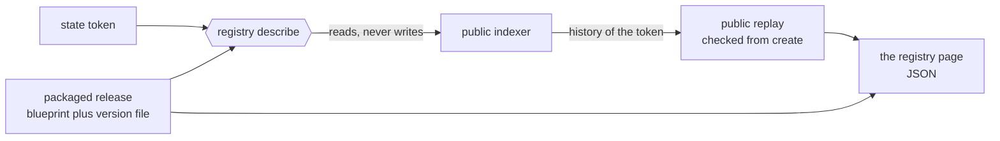

# Read the registry page generated from the chain

As Alice, you hold a registry's state token and the packaged release, and
nothing else: no wallet file of yours, nothing from the person who created
the registry. You run one command and read which registry this is, which
release it runs, what its rules are and what it holds now. As Bob, on your
own machine, you run the same command: reading the same chain state with
the same release gives you the same bytes. As a script, you read the page
with an ordinary JSON parser and take its fields by name. As an integrator,
you want to know what the page does not prove, and the page says so itself.



## Read it

From the extracted release archive, whose blueprint is `onchain/plutus.json` with
the `version.txt` beside it, and with the state token:

```sh
singular registry describe --blueprint onchain/plutus.json \
  --state-token "$state_token" \
  --koios-url "$koios_url" --network-magic 1
```

The page prints as indented JSON, which a person reads and any JSON parser
reads. A script takes a field by name:

```sh
singular registry describe --blueprint onchain/plutus.json \
  --state-token "$state_token" \
  --koios-url "$koios_url" --network-magic 1 | jq '.state.activeKeys'
```

The json switch is accepted and changes nothing, so a script that passes it
keeps working:

```sh
singular registry describe --blueprint onchain/plutus.json \
  --state-token "$state_token" \
  --koios-url "$koios_url" --network-magic 1 --json
```

The command takes the state token, the blueprint of the packaged
release, a provider and a network. It takes no wallet, no signing key,
no state directory and no file of any actor; any other setting is
refused by name before anything is read. The version label comes from
the version file beside the blueprint. From an extracted release archive,
run the archive's own `singular` with its blueprint and the adjacent
version file: the Demo 1 journey reads the page this way right after
create, from the command the create receipt printed. A success prints the page alone
and writes no file; every refusal prints one JSON receipt and exits
non-zero.

| Section | What you read | Where it comes from |
| --- | --- | --- |
| Registry | the state token, the live state output, the state script the release derives, the two policies the registry's datum pins, and whether the application policy was compared with an application's blueprint | the token, the release, the state datum |
| Release | version label, blueprint title and checksum, links to that version's release and documentation asset | the release alone; the links are computed from the label, never fetched |
| Rules | processing window, retract window, tip per request, key length bound, anyone may build a fold from public inputs | the state datum and the release's own limit |
| State | root, active and terminal key counts, folds since create, create transaction, last fold, pending requests with owner, key, edge, submission time and locked value | the public replay and the live request outputs |
| Limits | what is not shown and not claimed | fixed text |

The page carries no clock, no chain tip and no session identity, so
identical inputs give identical bytes. Pending requests appear in one
fixed order. With or without the json switch the page is the same bytes:
the keys come in alphabetical order, as the encoder prints them, and the
table above is the order of this page's sections, not of the keys.

## A page from the two-actor run

Alice's page after her own fold, on the development network: the facts that
run recorded, with the release it ran, version 0.10.1, as the command prints
them now. A later release prints its own label:

```json
{
    "command": "describe",
    "outcome": "success",
    "provenance": "the page shows the public history of the state token from create to the live state output, each fold's rebuilt root checked against the root recorded in that fold's state datum, and nothing beyond it. The history was read from Koios. The provider's answers are unverified: it supplies raw facts and untrusted reconstruction material, no ledger proofs and no anchor. The release label is the archive's own claim. The page is unsigned.",
    "registry": {
        "activeScript": "847e1671c3ce4e9c13c28c51b6f563f7d9d7cc3996c744a455715b09",
        "applicationPin": "not-checked-against-any-blueprint",
        "applicationScript": "1d906e06f8c0570316336844b3960935dee26c162e36cf9a17597b7a",
        "stateOutput": "19c5fb15336e7de3dbbe8c8c1009c1927306441fb403eaf9aa416d45a92b79b7#0",
        "stateScript": "68df9c42ebd4468be130e9cd5538a7af39cc31c146cda45f274cccc5",
        "stateToken": "68df9c42ebd4468be130e9cd5538a7af39cc31c146cda45f274cccc5.1d5542bdf2b2c8c76728a5935edd71676d1df5f389c70863b6a4d15fe33bde26",
    },
    "release": {
        "blueprintSha": "b08853db256269379ca60b25b28f435d9651c8b893e9a1af21472c9941078bad",
        "blueprintTitle": "singular/registry",
        "docsUrl": "https://github.com/lambdasistemi/singular/releases/download/v0.10.1/singular-docs-0.10.1.tar.gz",
        "releaseUrl": "https://github.com/lambdasistemi/singular/releases/tag/v0.10.1",
        "version": "0.10.1"
    },
    "rules": {
        "maxKeyBytes": 32,
        "processTime": 120000,
        "publicFold": "anyone may build a fold from the public view (Singular.Statements.fold_inputs_public)",
        "retractTime": 120000,
        "tip": 1000000
    },
    "state": {
        "activeKeys": 1,
        "createTransaction": "05377065127df10ea376c6c4d8b83aeccbc6ff79ad0cfd85a6373b9886aaac47",
        "foldsSinceCreate": 1,
        "lastFold": "19c5fb15336e7de3dbbe8c8c1009c1927306441fb403eaf9aa416d45a92b79b7",
        "pendingRequests": [],
        "root": "58397587c712dcf8e99043ab07b63dfe38fe3628000a1b09e4805f647570b76b",
        "stateOutput": "19c5fb15336e7de3dbbe8c8c1009c1927306441fb403eaf9aa416d45a92b79b7#0",
        "terminalKeys": 0
    }
}
```

One active key, no terminal keys, one fold since create: Alice's own
insertion, folded by her, read back under the fold's root.

## The registry's pinned policies

The registry section shows the two policies the registry's datum pins:
the application and active policies. They are the
registry's own statement, read from its state datum, and they never change
after the registry is created. The command compares the active
policy with the ones the release derives for this registry before it
prints anything: a registry that pins another is refused, as the refusals
below say.

The application policy is the one the command cannot derive. The command is
told the registry and the release, and the release does not say which
application the registry was created for, so the application policy shown is
the datum's own and the page says so beside it: the field
`applicationPin` reads `not-checked-against-any-blueprint`. An application's
own program, which knows its blueprint, derives the application policy as
well and compares it, and its output reads `compared`. The page never
presents a value read from the datum as if the release had derived it, and
the release section holds only the release's own claims.

## What the page does not prove

The provenance field says it in fixed text: the page shows the public
history of the state token from create to the live state output, each
fold's rebuilt root checked against the root recorded in that fold's
state datum, and nothing beyond it. The history was read from Koios.
The provider's answers are unverified: raw facts and untrusted
reconstruction material, no ledger proofs and no anchor. The release
label is the archive's own claim. The page is unsigned.

## Refusals

| When | What you see |
| --- | --- |
| A wallet, key, state directory or other write setting is given | Refused by name, before any read |
| The version file is missing, unreadable or not a version | Refused by name; no release label is printed |
| The blueprint is another release's | The foreign-release refusal, as other commands print it |
| A policy the registry pins is not the one the release derives | `registry-pin-mismatch` naming the field (`active`, `absent` or `terminal`); no page is printed |
| The indexer cannot be read | The node-unavailable outcome, as other commands print it |
| The history is incomplete or does not chain to the live root | The named trie refusal; no page is printed |

A refusal prints one JSON receipt on standard output with a non-zero
exit status, as every command does.

## What is not in this page

A block anchor for the last fold waits on its own provider read. The
documentation links are computed from the claimed version, not checked
against a published asset. The independently derived action identity
in the public report waits on its own slice. None of these changes
what the page shows; each arrives separately.
