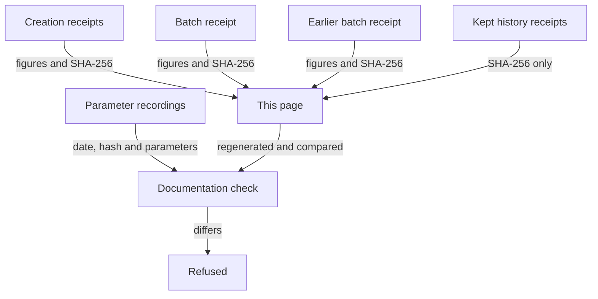

# Release decision table

As a reader deciding whether this release's measurements support your use, you find on this page the measurements this line delivered of what creating a registry costs and of the largest batch of requests one fold carries. Each row gives the conditions it was taken under, what it improved, what it made worse and what it did not measure.

Every figure on the page is read or computed from the kept receipts below. The documentation check regenerates the page from the receipts, their chain records and the parameter recordings, and refuses a page that differs, a receipt, chain record or recording that is missing or altered and a row that names no receipt.

## Reading the decision table

Each row is one measurement. The gain lists the figures that are lower than the alternative the row is compared with, and the regression lists those that are higher. Every compared figure is a cost, so lower is better. A figure that is equal is in neither list, and none measured means no compared figure was higher.

The batch rows rest on preprod protocol parameters recorded on Fri, 30 Oct 2026 13:24:40 GMT, taken from the kept batch receipt. The earlier batch receipt, kept beside it, rests on parameters recorded on Fri, 30 Oct 2026 13:24:40 GMT. The creation rows rest on the development network's protocol parameters, read from its chain at the times the kept chain records note: 2026-10-29T04:25:37Z for both designs.

## The decision table

The first two rows compare creating a registry under the previous design with the application-held design. The last three rows give the largest batch a fold carries, compared with a fold of one request.

Creating a first registry takes 3 transactions under the application-held design against 5 under the previous design. What rose: registry-creating transaction bytes: 751 to 999; registry-creating transaction fee: 695626 to 1028555 lovelace. Creating a later registry takes 1 transaction under the application-held design against 4 under the previous design. What rose: registry-creating transaction bytes: 755 to 999; registry-creating transaction fee: 695371 to 1028555 lovelace.

The largest accepted fold in the registrations workload carries 4 requests, and one more request exceeds the memory limit. Per request the largest batch costs less than a one-request fold in signed transaction bytes and fee and more in execution memory and execution steps. The largest accepted fold in the terminations workload carries 7 requests, and one more request exceeds the memory limit. Per request the largest batch costs less than a one-request fold in signed transaction bytes and fee and more in execution memory and execution steps. The largest accepted fold in the mixed workload carries 6 requests, and one more request exceeds the memory limit. Per request the largest batch costs less than a one-request fold in signed transaction bytes and fee and more in execution memory and execution steps.

| Measurement | Taken under | Gain | Regression | Not measured | Source receipt and SHA-256 |
|---|---|---|---|---|---|
| Creating a first registry, with no live copy of its scripts: transactions, bytes, fees and capital locked, previous design against application-held design | Development network; protocol parameters read from its chain at 2026-10-29T04:25:37Z for both designs: maximum transaction size 16384 bytes, memory 140000000, steps 10000000000, fee per byte 44, fixed fee 155381 Node: cardano-node 10.7.0 Previous design: open-datum 0.16.0 (commit 0c0ab880df982a728b6b89a1e80fc1308144d616) Application-held design: open-datum 0.17.0 (commit ede9f7992c4936474d3ed86f890ffa2e6fddf625) Live script copies before the creation: 0 with the previous design, 0 with the application-held design Workload: 8 funding outputs of 2000000000 lovelace, processing window 60000 ms, reclaiming window 180000 ms | Previous design to application-held design: transactions sent: 5 to 3 transaction bytes: 28296 to 19118 outputs created: 10 to 7 fees: 4695626 to 2136465 lovelace reference outputs created: 4 to 2 reference script bytes: 26557 to 17625 ADA locked in reference outputs: 122012110 to 77773950 lovelace of which, included above: transactions: 1 to 0; fees: 1000000 to 0 lovelace; ADA locked in reference outputs: 9038150 to 0 lovelace | registry-creating transaction bytes: 751 to 999 registry-creating transaction fee: 695626 to 1028555 lovelace | Fees and limits of any other network: the receipts are from a development network Variation between runs: each design is one captured run | [`specs/745-shared-publications/evidence/previous.json`](https://github.com/lambdasistemi/singular/blob/main/specs/745-shared-publications/evidence/previous.json) `5028889a475480aea5fee5b09f360c40d5031e6504f364a21b42b81fc48d0f80` [`specs/745-shared-publications/evidence/previous-chain.jsonl`](https://github.com/lambdasistemi/singular/blob/main/specs/745-shared-publications/evidence/previous-chain.jsonl) `4e51e550f5e5ecb10cdbf6ba0425abb0faa94384eaf609006a80c4cc9be76e49` [`specs/745-shared-publications/evidence/candidate.json`](https://github.com/lambdasistemi/singular/blob/main/specs/745-shared-publications/evidence/candidate.json) `445c5bdfd5ba4453e00bc13f3b17b698f077b5b9201d77e8aba43a6dc0ebf4ff` [`specs/745-shared-publications/evidence/candidate-chain.jsonl`](https://github.com/lambdasistemi/singular/blob/main/specs/745-shared-publications/evidence/candidate-chain.jsonl) `4b25d9bb4b64e70319e42ea340e1b7fc123aad21efb0a1cad9be142eb46bb4dc` |
| Creating a later registry, with the earlier shared copies live: transactions, bytes, fees and capital locked, previous design against application-held design | Development network; protocol parameters read from its chain at 2026-10-29T04:25:37Z for both designs: maximum transaction size 16384 bytes, memory 140000000, steps 10000000000, fee per byte 44, fixed fee 155381 Node: cardano-node 10.7.0 Previous design: open-datum 0.16.0 (commit 0c0ab880df982a728b6b89a1e80fc1308144d616) Application-held design: open-datum 0.17.0 (commit ede9f7992c4936474d3ed86f890ffa2e6fddf625) Live script copies before the creation: 1 with the previous design, 2 with the application-held design Workload: 8 funding outputs of 2000000000 lovelace, processing window 60000 ms, reclaiming window 180000 ms | Previous design to application-held design: transactions sent: 4 to 1 transaction bytes: 16801 to 999 outputs created: 8 to 3 fees: 3695371 to 1028555 lovelace reference outputs created: 3 to 0 reference script bytes: 15293 to 0 ADA locked in reference outputs: 71576410 to 0 lovelace of which, included above: transactions: 1 to 0; fees: 1000000 to 0 lovelace; ADA locked in reference outputs: 9038150 to 0 lovelace | registry-creating transaction bytes: 755 to 999 registry-creating transaction fee: 695371 to 1028555 lovelace | Fees and limits of any other network: the receipts are from a development network Variation between runs: each design is one captured run | [`specs/745-shared-publications/evidence/previous.json`](https://github.com/lambdasistemi/singular/blob/main/specs/745-shared-publications/evidence/previous.json) `5028889a475480aea5fee5b09f360c40d5031e6504f364a21b42b81fc48d0f80` [`specs/745-shared-publications/evidence/previous-chain.jsonl`](https://github.com/lambdasistemi/singular/blob/main/specs/745-shared-publications/evidence/previous-chain.jsonl) `4e51e550f5e5ecb10cdbf6ba0425abb0faa94384eaf609006a80c4cc9be76e49` [`specs/745-shared-publications/evidence/candidate.json`](https://github.com/lambdasistemi/singular/blob/main/specs/745-shared-publications/evidence/candidate.json) `445c5bdfd5ba4453e00bc13f3b17b698f077b5b9201d77e8aba43a6dc0ebf4ff` [`specs/745-shared-publications/evidence/candidate-chain.jsonl`](https://github.com/lambdasistemi/singular/blob/main/specs/745-shared-publications/evidence/candidate-chain.jsonl) `4b25d9bb4b64e70319e42ea340e1b7fc123aad21efb0a1cad9be142eb46bb4dc` |
| Largest batch of registrations one fold carries: 4 accepted, 5 exceed the memory limit | Preprod protocol parameters recorded Fri, 30 Oct 2026 13:24:40 GMT: maximum transaction memory 17500000, steps 10000000000, size 16384 bytes Evaluated by the ledger evaluator under those parameters; the development node cardano-node 10.7.0 accepted the batch of 4 and refused the batch of 5 Revision: the receipt records none; the applied scripts are request `67bb50e5aab678b9955e1d8981050a14e0f93da912b3a8b4a7161ca7` and state `499291dbc77fb84b590e4f2d728788aa06191627a2c5c95b6bc4d679` Registry before the fold: 0 entries; pending pool 12; key bytes 10 | Against a one-request fold of the same workload from the same registry: signed transaction bytes per request: 3219/4 in the largest batch against 1262 in a one-request fold fee per request: 1778010/4 lovelace in the largest batch against 669373 lovelace in a one-request fold | Against a one-request fold of the same workload from the same registry: execution memory per request: 13875377/4 in the largest batch against 2210762 in a one-request fold execution steps per request: 5770269582/4 in the largest batch against 923290554 in a one-request fold | Transaction evaluation under preprod parameters recorded on the stated date, corroborated by a development node; no preprod submission. Protocol parameters can change by governance. Transaction slots use the retained development network's time; this is phase-two evaluation, not preprod phase-one validation. No claim for another registry size, trie depth, scripts, key or payload shapes, or parameters. Folding the same requests one at a time in separate transactions: the comparison is with the one-request fold from the same starting registry | [`test/fixtures/batch-measurement/receipt.json`](https://github.com/lambdasistemi/singular/blob/main/test/fixtures/batch-measurement/receipt.json) `24d17325b6fba67f9cd3398ff242969a0e347080560303d23cb7a6315fdb8dae` |
| Largest batch of terminations one fold carries: 7 accepted, 8 exceed the memory limit | Preprod protocol parameters recorded Fri, 30 Oct 2026 13:24:40 GMT: maximum transaction memory 17500000, steps 10000000000, size 16384 bytes Evaluated by the ledger evaluator under those parameters; the development node cardano-node 10.7.0 accepted the batch of 7 and refused the batch of 8 Revision: the receipt records none; the applied scripts are request `67bb50e5aab678b9955e1d8981050a14e0f93da912b3a8b4a7161ca7` and state `499291dbc77fb84b590e4f2d728788aa06191627a2c5c95b6bc4d679` Registry before the fold: 12 entries; pending pool 12; key bytes 10 | Against a one-request fold of the same workload from the same registry: signed transaction bytes per request: 4358/7 in the largest batch against 1286 in a one-request fold fee per request: 1971430/7 lovelace in the largest batch against 623868 lovelace in a one-request fold | Against a one-request fold of the same workload from the same registry: execution memory per request: 15666610/7 in the largest batch against 1733944 in a one-request fold execution steps per request: 6324460088/7 in the largest batch against 659109804 in a one-request fold | Transaction evaluation under preprod parameters recorded on the stated date, corroborated by a development node; no preprod submission. Protocol parameters can change by governance. Transaction slots use the retained development network's time; this is phase-two evaluation, not preprod phase-one validation. No claim for another registry size, trie depth, scripts, key or payload shapes, or parameters. Folding the same requests one at a time in separate transactions: the comparison is with the one-request fold from the same starting registry | [`test/fixtures/batch-measurement/receipt.json`](https://github.com/lambdasistemi/singular/blob/main/test/fixtures/batch-measurement/receipt.json) `24d17325b6fba67f9cd3398ff242969a0e347080560303d23cb7a6315fdb8dae` |
| Largest mixed batch of registrations and terminations one fold carries: 6 accepted, 7 exceed the memory limit | Preprod protocol parameters recorded Fri, 30 Oct 2026 13:24:40 GMT: maximum transaction memory 17500000, steps 10000000000, size 16384 bytes Evaluated by the ledger evaluator under those parameters; the development node cardano-node 10.7.0 accepted the batch of 6 and refused the batch of 7 Revision: the receipt records none; the applied scripts are request `67bb50e5aab678b9955e1d8981050a14e0f93da912b3a8b4a7161ca7` and state `499291dbc77fb84b590e4f2d728788aa06191627a2c5c95b6bc4d679` Registry before the fold: 6 entries; pending pool 12; key bytes 10 | Against a one-request fold of the same workload from the same registry: signed transaction bytes per request: 4320/6 in the largest batch against 1475 in a one-request fold fee per request: 2102386/6 lovelace in the largest batch against 693626 lovelace in a one-request fold | Against a one-request fold of the same workload from the same registry: execution memory per request: 17081874/6 in the largest batch against 2403764 in a one-request fold execution steps per request: 7031315136/6 in the largest batch against 975239857 in a one-request fold | Transaction evaluation under preprod parameters recorded on the stated date, corroborated by a development node; no preprod submission. Protocol parameters can change by governance. Transaction slots use the retained development network's time; this is phase-two evaluation, not preprod phase-one validation. No claim for another registry size, trie depth, scripts, key or payload shapes, or parameters. Folding the same requests one at a time in separate transactions: the comparison is with the one-request fold from the same starting registry Any order of registrations and terminations other than this one: registration, termination, registration, termination, registration, termination | [`test/fixtures/batch-measurement/receipt.json`](https://github.com/lambdasistemi/singular/blob/main/test/fixtures/batch-measurement/receipt.json) `24d17325b6fba67f9cd3398ff242969a0e347080560303d23cb7a6315fdb8dae` |

## What moved against the earlier recording

As a reader comparing this release's batch limits with the earlier recording, you find below the figures that moved and the figures that did not. Each row gives, for one measurement, the figures that moved with the figure in each receipt, and the figures that are equal in both receipts. The equal parameters are counted, not listed.

The earlier receipt holds parameters recorded Fri, 30 Oct 2026 13:24:40 GMT, and its batches were measured at 2026-10-30T13:36:39Z. This receipt holds parameters recorded Fri, 30 Oct 2026 13:24:40 GMT, and its batches were measured at 2026-10-31T19:53:51Z.

Both receipts evaluated the same recording of 31 protocol parameters, the same parameter bytes were evaluated and both receipts apply the same scripts, so a figure that moved comes from the new capture of the same workload, made on a fresh development node with the commands the repository held when it was captured, and not from a change of parameters or scripts.

| Measurement | Moved: earlier receipt, parameters recorded Fri, 30 Oct 2026 13:24:40 GMT, measured 2026-10-30T13:36:39Z | Moved: this receipt, parameters recorded Fri, 30 Oct 2026 13:24:40 GMT, measured 2026-10-31T19:53:51Z | Unchanged since the earlier receipt | Source receipts and SHA-256 |
|---|---|---|---|---|
| Batch of registrations: the largest accepted batch and a one-request fold | execution memory of the largest accepted batch: 13856729 execution steps of the largest accepted batch: 5756358462 fee of the largest accepted batch: 1775931 lovelace | execution memory of the largest accepted batch: 13875377 execution steps of the largest accepted batch: 5770269582 fee of the largest accepted batch: 1778010 lovelace | requests in the largest accepted batch: 4 limit the next request exceeds: memory signed transaction bytes of the largest accepted batch: 3219 execution memory of a one-request fold: 2210762 execution steps of a one-request fold: 923290554 signed transaction bytes of a one-request fold: 1262 fee of a one-request fold: 669373 lovelace | [`test/fixtures/batch-measurement/previous/receipt.json`](https://github.com/lambdasistemi/singular/blob/main/test/fixtures/batch-measurement/previous/receipt.json) `271153081b482f31a243cab692a1fa31b793a7c596c569218a4f01cc15e052fc` [`test/fixtures/batch-measurement/parameters/preprod-2026-10-30/cli_protocol_params-b777448425778d13.json`](https://github.com/lambdasistemi/singular/blob/main/test/fixtures/batch-measurement/parameters/preprod-2026-10-30/cli_protocol_params-b777448425778d13.json) `1211aa0b6219e5ba4248580882ff06fb60802b2b727a172ab8e5f288ad74e217` [`test/fixtures/batch-measurement/receipt.json`](https://github.com/lambdasistemi/singular/blob/main/test/fixtures/batch-measurement/receipt.json) `24d17325b6fba67f9cd3398ff242969a0e347080560303d23cb7a6315fdb8dae` |
| Batch of terminations: the largest accepted batch and a one-request fold | none moved | none moved | requests in the largest accepted batch: 7 limit the next request exceeds: memory execution memory of the largest accepted batch: 15666610 execution steps of the largest accepted batch: 6324460088 signed transaction bytes of the largest accepted batch: 4358 fee of the largest accepted batch: 1971430 lovelace execution memory of a one-request fold: 1733944 execution steps of a one-request fold: 659109804 signed transaction bytes of a one-request fold: 1286 fee of a one-request fold: 623868 lovelace | [`test/fixtures/batch-measurement/previous/receipt.json`](https://github.com/lambdasistemi/singular/blob/main/test/fixtures/batch-measurement/previous/receipt.json) `271153081b482f31a243cab692a1fa31b793a7c596c569218a4f01cc15e052fc` [`test/fixtures/batch-measurement/parameters/preprod-2026-10-30/cli_protocol_params-b777448425778d13.json`](https://github.com/lambdasistemi/singular/blob/main/test/fixtures/batch-measurement/parameters/preprod-2026-10-30/cli_protocol_params-b777448425778d13.json) `1211aa0b6219e5ba4248580882ff06fb60802b2b727a172ab8e5f288ad74e217` [`test/fixtures/batch-measurement/receipt.json`](https://github.com/lambdasistemi/singular/blob/main/test/fixtures/batch-measurement/receipt.json) `24d17325b6fba67f9cd3398ff242969a0e347080560303d23cb7a6315fdb8dae` |
| Mixed batch of registrations and terminations: the largest accepted batch and a one-request fold | execution memory of the largest accepted batch: 17105790 execution steps of the largest accepted batch: 7051990680 signed transaction bytes of the largest accepted batch: 4318 fee of the largest accepted batch: 2105169 lovelace execution memory of a one-request fold: 2400944 execution steps of a one-request fold: 974289433 fee of a one-request fold: 693395 lovelace | execution memory of the largest accepted batch: 17081874 execution steps of the largest accepted batch: 7031315136 signed transaction bytes of the largest accepted batch: 4320 fee of the largest accepted batch: 2102386 lovelace execution memory of a one-request fold: 2403764 execution steps of a one-request fold: 975239857 fee of a one-request fold: 693626 lovelace | requests in the largest accepted batch: 6 limit the next request exceeds: memory signed transaction bytes of a one-request fold: 1475 | [`test/fixtures/batch-measurement/previous/receipt.json`](https://github.com/lambdasistemi/singular/blob/main/test/fixtures/batch-measurement/previous/receipt.json) `271153081b482f31a243cab692a1fa31b793a7c596c569218a4f01cc15e052fc` [`test/fixtures/batch-measurement/parameters/preprod-2026-10-30/cli_protocol_params-b777448425778d13.json`](https://github.com/lambdasistemi/singular/blob/main/test/fixtures/batch-measurement/parameters/preprod-2026-10-30/cli_protocol_params-b777448425778d13.json) `1211aa0b6219e5ba4248580882ff06fb60802b2b727a172ab8e5f288ad74e217` [`test/fixtures/batch-measurement/receipt.json`](https://github.com/lambdasistemi/singular/blob/main/test/fixtures/batch-measurement/receipt.json) `24d17325b6fba67f9cd3398ff242969a0e347080560303d23cb7a6315fdb8dae` |
| Preprod protocol parameters: every parameter of the two receipts | none moved | none moved | 31 of 31 parameters | [`test/fixtures/batch-measurement/previous/receipt.json`](https://github.com/lambdasistemi/singular/blob/main/test/fixtures/batch-measurement/previous/receipt.json) `271153081b482f31a243cab692a1fa31b793a7c596c569218a4f01cc15e052fc` [`test/fixtures/batch-measurement/parameters/preprod-2026-10-30/cli_protocol_params-b777448425778d13.json`](https://github.com/lambdasistemi/singular/blob/main/test/fixtures/batch-measurement/parameters/preprod-2026-10-30/cli_protocol_params-b777448425778d13.json) `1211aa0b6219e5ba4248580882ff06fb60802b2b727a172ab8e5f288ad74e217` [`test/fixtures/batch-measurement/receipt.json`](https://github.com/lambdasistemi/singular/blob/main/test/fixtures/batch-measurement/receipt.json) `24d17325b6fba67f9cd3398ff242969a0e347080560303d23cb7a6315fdb8dae` |

## Conditions the figures were taken under

The creation receipts share one development network genesis and one set of protocol parameters, and the batch receipt carries the preprod parameters it evaluated under. The hashes below bind those inputs.

| Condition | Value |
|---|---|
| Development network, Shelley genesis SHA-256 | `fe73bc3cbe2fdda6252a502907910a417a6940dd436c320e56b0e30f034ecaf2` |
| Development network, Byron genesis SHA-256 | `7ce284b6929a13c51de05453b6b81942f99daffe3d9b00be43b38adfd24580b8` |
| Development network, protocol parameters, CBOR SHA-256 | `9f9a1e07d4db2441bed128d468ebab7c2ee4e271c5ba358a0afc3271e42bdeb8` |
| Development network, protocol parameters, JSON SHA-256 | `135d40e7b1461697bb6690105bf71aedf638696cbced6f0b53a1ccb8a87bf5d7` |
| Earlier preprod parameters, recording date | Fri, 30 Oct 2026 13:24:40 GMT |
| Earlier preprod parameters, source | [`test/fixtures/batch-measurement/parameters/preprod-2026-10-30/cli_protocol_params-b777448425778d13.json`](https://github.com/lambdasistemi/singular/blob/main/test/fixtures/batch-measurement/parameters/preprod-2026-10-30/cli_protocol_params-b777448425778d13.json) |
| Earlier preprod parameters, source SHA-256 | `1211aa0b6219e5ba4248580882ff06fb60802b2b727a172ab8e5f288ad74e217` |
| Preprod parameters, recording date | Fri, 30 Oct 2026 13:24:40 GMT |
| Preprod parameters, source | [`test/fixtures/batch-measurement/parameters/preprod-2026-10-30/cli_protocol_params-b777448425778d13.json`](https://github.com/lambdasistemi/singular/blob/main/test/fixtures/batch-measurement/parameters/preprod-2026-10-30/cli_protocol_params-b777448425778d13.json) |
| Preprod parameters, source SHA-256 | `1211aa0b6219e5ba4248580882ff06fb60802b2b727a172ab8e5f288ad74e217` |
| Preprod parameters, evaluated bytes SHA-256 | `49e19000ee0c4b8f7d289378b639693a987793fa5066f3080a83ad4013d6ef09` |

## The kept receipts

The receipts, the chain records they name and the preprod parameter recordings are committed with the repository. Their SHA-256 is computed when this page is generated, so a file that changes also changes this page.

The receipt measured 2026-10-29T17:06:36Z under parameters recorded Sun, 04 Oct 2026 18:06:12 GMT is kept as history: its file and its parameter recording are hashed in the table below and neither is compared with the other receipts on this page.

| Kept file | SHA-256 |
|---|---|
| [`specs/745-shared-publications/evidence/previous.json`](https://github.com/lambdasistemi/singular/blob/main/specs/745-shared-publications/evidence/previous.json) | `5028889a475480aea5fee5b09f360c40d5031e6504f364a21b42b81fc48d0f80` |
| [`specs/745-shared-publications/evidence/previous-chain.jsonl`](https://github.com/lambdasistemi/singular/blob/main/specs/745-shared-publications/evidence/previous-chain.jsonl) | `4e51e550f5e5ecb10cdbf6ba0425abb0faa94384eaf609006a80c4cc9be76e49` |
| [`specs/745-shared-publications/evidence/candidate.json`](https://github.com/lambdasistemi/singular/blob/main/specs/745-shared-publications/evidence/candidate.json) | `445c5bdfd5ba4453e00bc13f3b17b698f077b5b9201d77e8aba43a6dc0ebf4ff` |
| [`specs/745-shared-publications/evidence/candidate-chain.jsonl`](https://github.com/lambdasistemi/singular/blob/main/specs/745-shared-publications/evidence/candidate-chain.jsonl) | `4b25d9bb4b64e70319e42ea340e1b7fc123aad21efb0a1cad9be142eb46bb4dc` |
| [`test/fixtures/batch-measurement/receipt.json`](https://github.com/lambdasistemi/singular/blob/main/test/fixtures/batch-measurement/receipt.json) | `24d17325b6fba67f9cd3398ff242969a0e347080560303d23cb7a6315fdb8dae` |
| [`test/fixtures/batch-measurement/parameters/preprod-2026-10-30/cli_protocol_params-b777448425778d13.json`](https://github.com/lambdasistemi/singular/blob/main/test/fixtures/batch-measurement/parameters/preprod-2026-10-30/cli_protocol_params-b777448425778d13.json) | `1211aa0b6219e5ba4248580882ff06fb60802b2b727a172ab8e5f288ad74e217` |
| [`test/fixtures/batch-measurement/previous/receipt.json`](https://github.com/lambdasistemi/singular/blob/main/test/fixtures/batch-measurement/previous/receipt.json) | `271153081b482f31a243cab692a1fa31b793a7c596c569218a4f01cc15e052fc` |
| [`test/fixtures/batch-measurement/history/preprod-2026-10-04/receipt.json`](https://github.com/lambdasistemi/singular/blob/main/test/fixtures/batch-measurement/history/preprod-2026-10-04/receipt.json) | `488ed245c81ad8cdfd0824358e9ea5d288de6a86e4ca9f77367a02562da1c25b` |
| [`offchain/test/fixtures/koios/preprod/cli_protocol_params-b777448425778d13.json`](https://github.com/lambdasistemi/singular/blob/main/offchain/test/fixtures/koios/preprod/cli_protocol_params-b777448425778d13.json) | `9df0ddb2f85a7fae3df18039bdd476d911605a680299e4d9228d59f232cb5276` |

## Regenerate this page

Run `python3 tools/decision_table.py --write` to regenerate the page, then regenerate its speech and changed narration. The documentation check runs `python3 tools/decision_table.py --check`.
