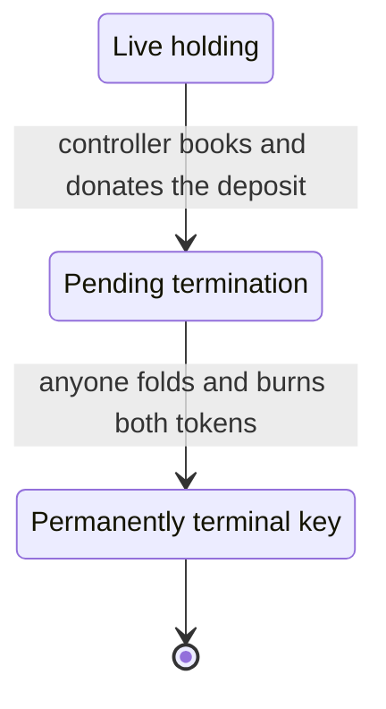

# Permanently terminate a key

As a key's controller, you want to end its registration permanently. You first
book a termination from its live holding. Any wallet can then complete it by
folding the public request. The protected deposit goes to the treasury when
you book, and the active token is burned when the request is folded.

## Book, then complete

The booking command requires the holding's controller to sign. It donates the
protected deposit and moves the active token into a pending request with one
termination approval, no datum and the ADA available to reward its folder.
The active token is not burned at booking.

The fold consumes the public request, burns its approval and active token,
continues the registry with the terminal leaf and pays the request's whole
held value to the folder. The folder pays the transaction fee and needs no
file or signature from the controller. A termination cannot be reclaimed or
cancelled, and the terminal key cannot be registered again.

Follow [the termination commands](registry-commands.md#book-permanent-termination-then-fold-it)
for the flags, the pending output reference and the treasury donation reported
by the booking receipt. Use the holding reference returned by your latest update.

## Refusals and evidence

A missing holding, a different controller or another named registry is refused
before signing. An unavailable provider answer remains unavailable; it does not
establish absence or a ledger refusal.

The [consumer conformance record](consumer-conformance.md) publishes the
requirements and their evidence limits. A local builder check is not a
connected ledger history. [Demo 1](demo1.md) links the playable application
journey and the release it runs.
