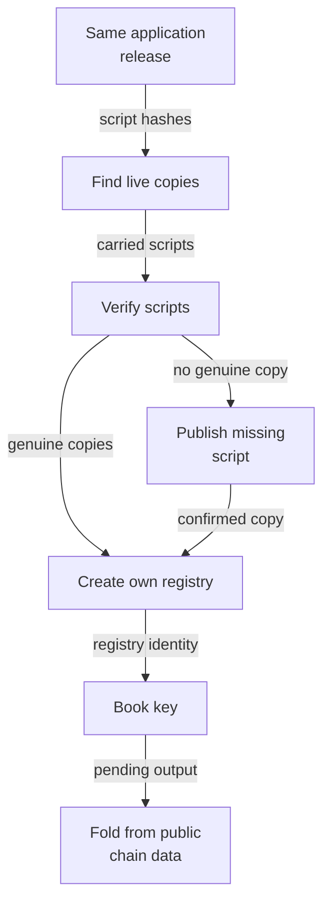

# Create another registry on shared publications

As a registry creator, you can create your own registry using the live state and application scripts another wallet published for the same application release. You supply your own funded wallet, the release blueprint and provider settings. You need no file, key, registry state or publication address from that creator. Your registry has its own state token, configuration and root.

[Install the commands](install.md) and obtain the matching `plutus.json` from the [verified release](verify-release.md). The [registry command guide](registry-commands.md) describes booking, folding and recovery. The example below follows the development-network journey; its wallet keys are generated for that run. Use your own provider URL and network-time directory for the network your wallet uses.



The provider proposes live reference outputs. The command hashes the scripts those outputs actually carry before reusing them. Creation spends a fresh seed and reads the verified scripts by reference. A missing copy is published first. The new registry then uses the same booking and folding commands as the first registry.

## Create with your own wallet

Erin's fresh working directory contains only her own key and the release blueprint. Her home and state directory contain no earlier creator's records. The journey runs this command with its generated provider settings:

```sh
open-datum create --blueprint plutus.json --state-dir state \
  --process-time 60000 --reclaim-time 180000 --booking-width 60000 \
  --koios-url "$provider_url" --network-time "$network_time" --network-magic 42 \
  --wallet-skey erin.skey > create.json
```

Keep the receipt's `stateToken` and `registry` address as public identifiers for your registry. When both copies remain live, `submissions` contains the creation alone; neither script entry reports a publication. If a copy has been spent or is absent, the command publishes only that missing copy before creating the registry.

## Read reuse and discovery from the receipt

Read these fields from your actual receipt:

```sh
jq '{stateToken, registry, scripts,
     submissions: [.submissions[] | {step, tx, case, observed}]}' create.json
```

| Field in each `scripts` entry | What it tells you |
| --- | --- |
| `script` | State or application script. |
| `hash` | Expected hash of the script, including its language and applied parameters. |
| `reference` | The output holding the selected live copy. |
| `published` | Whether this invocation published that copy. This retained field agrees with `outcome`. |
| `outcome` | `reused` or `published`, one final outcome per script. |
| `discovery.status` | Whether a genuine live copy was found, or `no live copy`. |
| `discovery.candidates` | Every proposed output, its found and expected script hashes, and its genuine or foreign verdict. |

A foreign candidate stays visible even when another candidate is genuine and reused. If no genuine copy exists, the command skips foreign candidates and publishes the expected script. The provider's live-output query cannot distinguish a spent copy from one that never existed. An explicit reference location supplied to a command is still checked for a missing or mismatched script.

Discovery here means lookup by script hash through your configured provider. A different application policy or release has a different applied state script and cannot reuse the earlier application's state copy. Publishing references for everyone and a general public discovery service remain outside this workflow. No witness-policy publication or witness-pin configuration is required.

## Register a key in the new registry

Alice books a key, an initial payload and a deposit in Erin's registry. The journey supplies the new registry's public state token as `state_token`:

```sh
printf '%s\n' '{"name":"shared"}' > shared-payload.json
open-datum insert --blueprint plutus.json --state-token "$state_token" \
  --key journey-shared-registry --payload shared-payload.json \
  --deposit 3000000 --tip 1000000 \
  --koios-url "$provider_url" --network-time "$network_time" --network-magic 42 \
  --wallet-skey alice.skey
```

Bob starts a new working directory and home containing only his own key and the public release. He finds the pending registration through the chain provider, matching the registry identity and key. He supplies that public output reference as `pending`; Alice's payload file, key and command journal are not inputs:

```sh
open-datum fold --blueprint plutus.json --state-token "$state_token" --pending "$pending" \
  --koios-url "$provider_url" --network-time "$network_time" --network-magic 42 \
  --wallet-skey bob-shared.skey
```

The journey reads the included transactions independently: the fold consumes that registration's approval, burns it, mints the key's token into a holding carrying the booked payload and exact deposit, and spends and continues Erin's own state with a changed root. Altering the observation to name the first registry's state or to remove the holding's deposit fails the same check. The complete journey also checks that no transaction publishes a witness policy or adds a witness pin.

## Read the measured costs

The [creation-cost comparison](creation-cost.md#measured-creations) is generated from the committed measurement receipts and checked against the included transaction bytes. Its table separates transaction fees from ADA locked in reference outputs. The later application-held creation reuses both scripts and creates no reference output; your own registry's state and configuration still lock their own ADA. Fees are measurements on the frozen development-network parameters, not a quote for another network or release.

The [candidate receipt](../specs/745-shared-publications/evidence/candidate.json) contains `first.totals` and `later.totals`, with the transactions beneath each creation. From a repository checkout, read the measured figures directly:

```sh
jq '{first: .first.totals, later: .later.totals}' \
  specs/745-shared-publications/evidence/candidate.json
```

The [carrying experiment](creation-cost.md#can-creation-carry-its-scripts) records the actual sizes, evaluation and node outcomes of alternative creation forms. The shipped command keeps the shared-publication path.

## Recovery and evidence limits

After an interruption around publication, rerunning reuses every live copy and publishes only what is missing. An uncertain submission preserves its saved transaction identity and signed body; a later invocation reconciles it without automatically resubmitting it. Create is not idempotent: a further invocation can create another registry from a new seed. Repeating a spent explicit seed keeps the existing refusal. See [command recovery](cli-recovery.md).

Run the same packaged-command journey and retain its receipts:

```sh
NO_PIN_JOURNEY_RESULTS="$PWD/shared-publication-results" \
  nix run --quiet .#no-pin-registration-journey
```

The results directory must not already exist. It contains the creation receipts, discovery records, independent chain views, creation measurements, the shared-registration observation and its rejected controls, folder directory listings and a readable receipt. Throwaway wallet keys are removed when the run exits; partial diagnostics remain if a command fails.

The [conformance inventory](consumer-conformance.md) publishes the reuse requirements beside the existing requirements. Its runner computes their standings from receipts. These rows remain uncovered because no executable comparison with the application-held model exists yet. The registration journey, recovery partitions and measurement receipts are separate evidence boundaries and establish nothing about agreement with the model. An executable conformance language for creation claims is outside this change. Public discovery for everyone, batch limits and release acceptance remain separate work.
