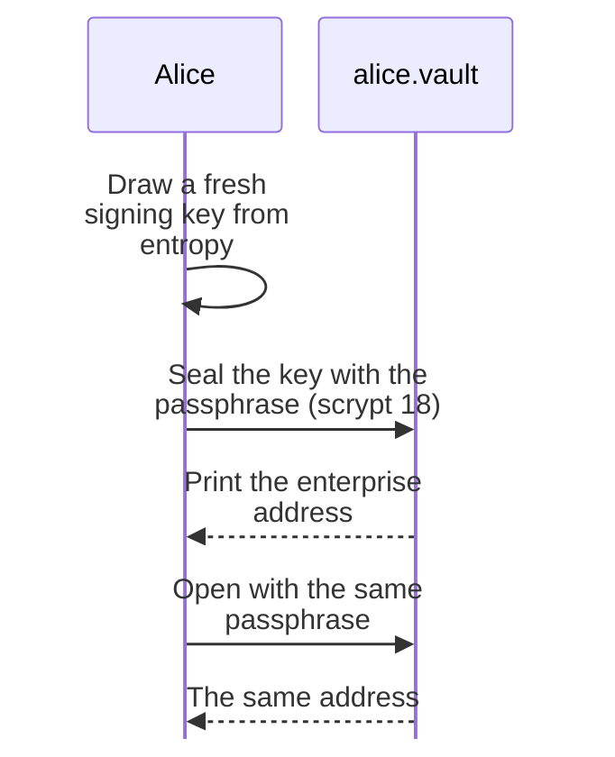
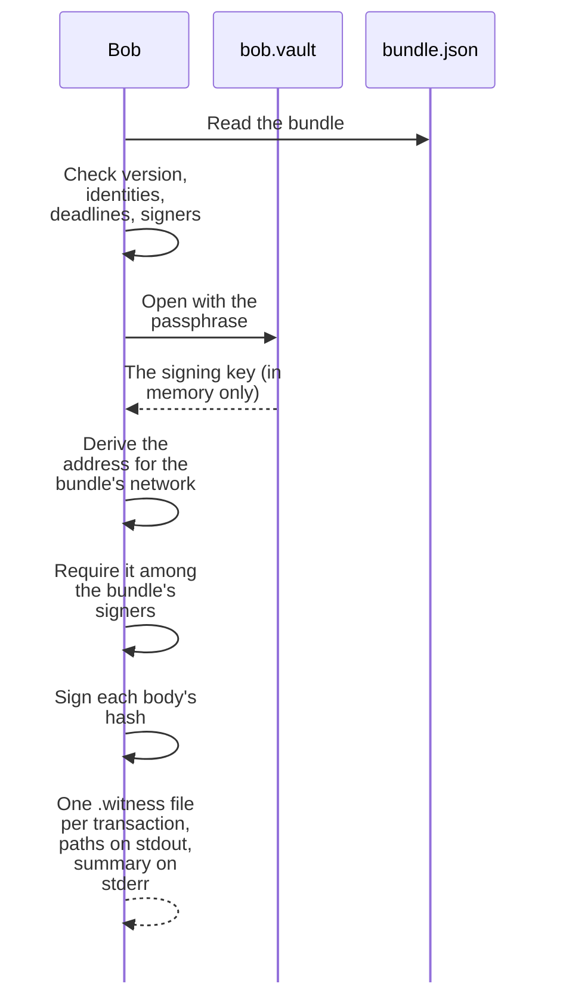
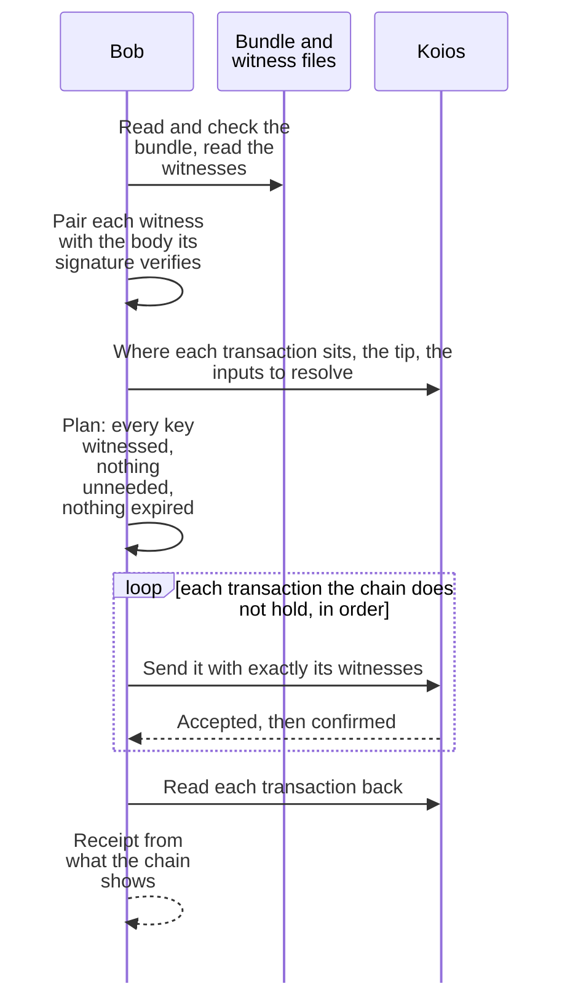
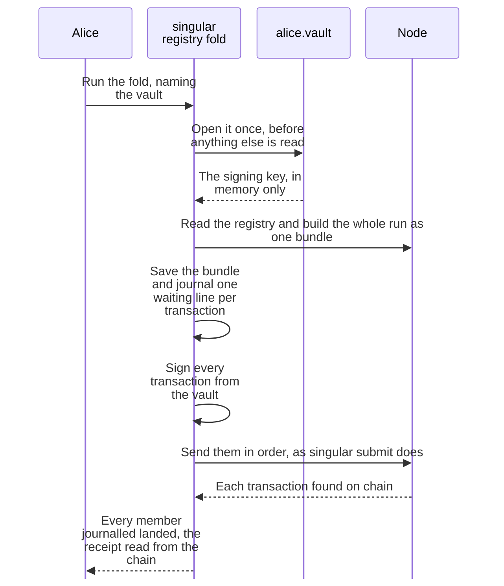
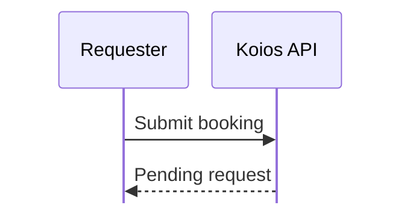
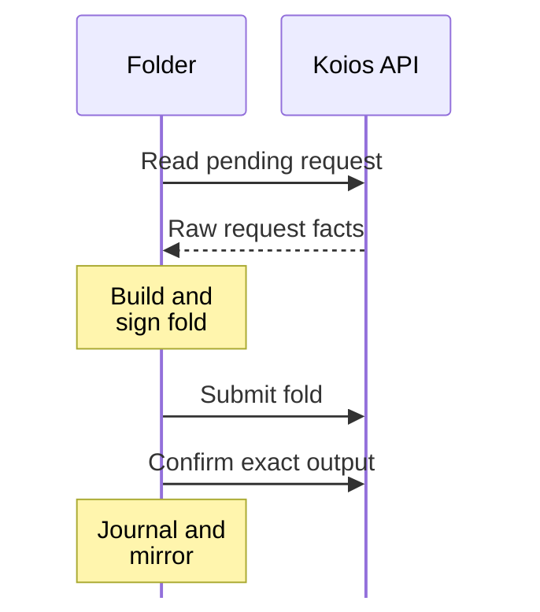
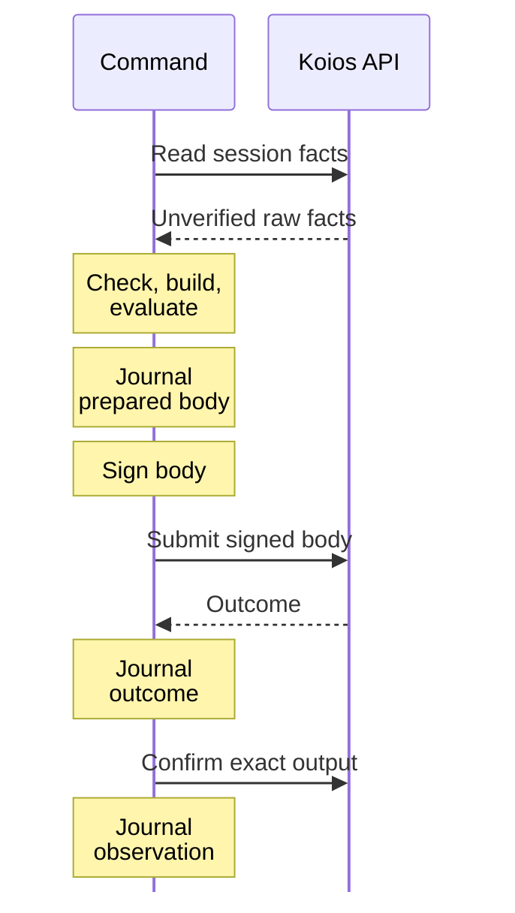

# Connecting singular to a ledger provider

Dated qualification, 2026-10-15: rejection after the window, rejection before the deadline, request value and refund routing, rejection and retraction refund controls, and rejection inside the processing and retraction windows are all unmet by ruling: implementation follows the superseded rule; the ruled rule is not implemented. The live comparisons still exercise the legacy rejection that spends the registry state output. The ruled rejection reads that output by reference and never spends it. Agreement with the legacy path is not acceptance of the ruled design. The earlier processing-window consumer requirement and the unresolved refund-routing requirement remain open. Historical results below retain their original revision and evidence binding; they do not establish current acceptance.

As a registry operator, you want to use `create`, `fold`, `reclaim`, `reject`, `inspect` and `describe`
through `singular registry`, and `create`, `insert`, `update`, `terminate`, `fold` and `inspect`
through `open-datum`, with a Koios API on your chosen network.
You supply the API settings and pinned time material; writes also use your local
payment signing key. Commands read raw facts through one logical session, build
and evaluate locally, submit signed transactions, and preserve recovery evidence
in the registry journal.

The ordinary provider is Koios. Old backend and socket settings are refused
before acquisition or registry effects. The current provider session promises
no coherent chain snapshot and carries no verification witness.

## The settings you give

| Setting | Commands | What it is |
| --- | --- | --- |
| `--koios-url URL` | `create`, `fold`, `reclaim`, `reject`, `inspect`, `describe`, `singular submit`, `insert`, `update`, `terminate` | The Koios API base URL used for raw reads and signed submission. There is one ordinary provider path. |
| `--koios-token-file FILE` | `create`, `fold`, `reclaim`, `reject`, `inspect`, `describe`, `singular submit`, `insert`, `update`, `terminate` | An optional authentication token read from this file. Keep its contents private; receipts and logs redact it. |
| `--network-time DIR` | `create`, `fold`, `reclaim`, `reject`, `inspect`, `describe`, `singular submit`, `insert`, `update`, `terminate` | Pinned time-manifest.json, shelley-genesis.json and era-history.cbor. Preprod can use the reviewed packaged recording; generated network 42 requires its exact published directory. |
| `--network-magic N` | `create`, `fold`, `reclaim`, `reject`, `inspect`, `describe`, `singular submit`, `singular wallet create`, `singular wallet address`, `insert`, `update`, `terminate` | The requested network: 1 for preprod or 42 for the generated development network. Time material and provider answers must agree with it; unsupported time networks refuse. Mainnet's magic is refused for writes. The wallet commands take it alone, with no provider: it selects the network the address is built for. |
| `--wallet-skey FILE` | `create`, `insert`, `update`, `terminate`, `fold`, `reclaim`, `reject` | Your payment signing key: a `cardano-cli` text envelope, its `cborHex` value or the 32 key bytes as bare hex, or the 32 raw key bytes. The key funds and signs every write; it is read and never printed — only the address derived from it appears. `inspect` and `describe` refuse it. |
| `--process-time MS` | `create` | How long a booked request may wait for its fold, in positive integer milliseconds: 600 000 (ten minutes) when omitted. Fixed for the life of the registry. |
| `--retract-time MS` | `create` | How long the owner may reclaim a request after its processing deadline, in positive integer milliseconds: 300 000 (five minutes) when omitted. Fixed for the life of the registry. |
| `--application-policy HEX` | `singular create` | The application policy pinned at creation, as hex, for an application whose script does not depend on the registry identity. `open-datum create` carries its own from its application value and refuses this flag. |
| `--confirm-timeout SECONDS` | the four singular writes and the five open-datum writes | How long each submission may take to appear on chain; ten minutes when not given. Past it the command stops with the submission journalled as unconfirmed and never resubmits it. |
| `--state-dir ROOT` | `singular create`, `singular fold`, `singular reject`, `singular reclaim`, `singular inspect`, `open-datum create`, `open-datum insert`, `open-datum update`, `open-datum terminate`, `open-datum fold`, `open-datum inspect` | Optional state root override. Absent, each command resolves its own managed state directory under the platform per-user state location (`XDG_STATE_HOME`, falling back to `$HOME/.local/state`, namespace `singular`), partitioned by network, complete state token and the caller's stable wallet payment identity: the same identity reuses its journal and lock across invocations and key-file relocation, and different wallets and tokens never share one. A configured root keeps the same partitioning; it is never a per-registry directory. The journal of your submissions, their saved bodies and, while `create` runs, its pending identity live under that partition. |
| `--state-token POLICY.NAME` | `insert`, `update`, `terminate`, `fold`, `reclaim`, `reject`, `inspect`, `describe` | The registry, by its state token: the policy and the name in hex, as `create` prints it. Read from `SINGULAR_STATE_TOKEN` when the flag is absent; the flag wins. The command derives everything else from the token, the blueprint and the chain before it builds anything, and refuses by name when they disagree. `create` refuses it: it makes one. |
| `--blueprint PLUTUS_JSON` | `create`, `fold`, `reclaim`, `reject`, `inspect`, `describe`, `insert`, `update`, `terminate` | The registry partition's compiled blueprint, the `onchain/plutus.json` a release archive carries. |
| `--wallet-address ADDR` | `create`, `insert`, `update`, `terminate`, `inspect`, `singular fold`, `singular reclaim`, `singular reject`, `open-datum insert`, `open-datum update`, `open-datum terminate`, `open-datum fold` | Your wallet's public address, in place of the signing key on a preview: the command reads that wallet and prints what it would submit, and signs, submits and journals nothing. On `inspect` it locates the managed journal that address's wallet reconciles, with the same lock-or-skip semantics as a write; without it `inspect` is a stateless chain read that checks no wallet journal and creates no state. On `singular create`, `singular fold`, `singular reclaim`, `singular reject`, `open-datum create`, `open-datum insert`, `open-datum update`, `open-datum terminate` and `open-datum fold` it names an external signer in place of the signing key, together with `--bundle`: the address must be bech32 and pay a key, so a script or bootstrap address is refused, naming it, and so is `--wallet-skey` beside it, because a write takes exactly one signer. Such a run builds its whole chain as one bundle and ends with the outcome `waiting-for-signatures`, exit status 19, as `--bundle` describes. |
| `--bundle FILE` | `singular create`, `singular fold`, `singular reclaim`, `singular reject`, `open-datum create`, `open-datum insert`, `open-datum update`, `open-datum terminate`, `open-datum fold` | The new file an external signer's run is written to: one bundle of unsigned transactions for `singular wallet sign`. It goes with `--wallet-address`: either one alone is refused, a preview refuses it, and an existing path is refused with its bytes untouched. The command builds its whole run as that one bundle in build order, signs and sends nothing, saves the bundle and each unsigned body beside the journal with one `waiting-for-signatures` line per transaction, and ends with the outcome `waiting-for-signatures`, exit status 19. The bundle holds, on `singular create` and `open-datum create`, its whole chain in the order it builds it (the state publication when no carrier is live, the boot, the request, the witness publications and the pinned application publication); on `singular fold`, `singular reclaim` and `singular reject`, the preparation when the funding needs one and then the command's own transaction spending it; on `open-datum insert` and `open-datum terminate`, the preparation when needed and then the booking, and with `--fold` also the fold's preparation when needed and the fold; on `open-datum update`, the preparation when needed and then the update; on `open-datum fold`, the preparation when needed and then the fold. Its receipt names the bundle (its hash, the written and saved paths, the signer, and per transaction its step, identity, deadline and effects) and states the command's own fields under `expected`, because nothing has landed yet: for the open-datum writes these are the booking, the request, the fold deadline, the live output and the root, and open-datum's own booked, updated and root-seen lines are not narrated for a staged run, which narrates each of its transactions as built and staged; the root line a fold narrates comes from the shared fold and is not yet marked staged. A create bundle names no state token and carries no deadline, and create keeps its pending identity recorded, so the token the bundle will mint is never lost. While a bundle of the wallet is waiting for signatures, the next `open-datum insert`, `open-datum update`, `open-datum terminate` or `open-datum fold` of that registry by the same wallet, by the key file or by an external signer, stops before building anything with the outcome `waiting-for-signatures` and exit status 19, naming the bundle (its hash and saved path) and the members awaited with their deadlines, builds nothing, writes no bundle file and journals nothing of its own, while the earlier bundle's members found on chain are recorded as landed; a second `open-datum create` is stopped the same way by an earlier create's waiting bundle, not by another write's. A bundle that has landed or died never blocks, and the next write's receipt reports it under `reconciled`. |
| `--seed TXID#IX` or `--preview` | `create` | The output the new registry is booted from, which fixes its identity: your wallet's largest ada-only output when a live state carrier exists, or the first publication's change when the state script must be published (preview names it before anything is submitted). An explicit `--seed` names a held output, or the previewed chained seed to pin the identity; a held sole output while the state must be published is refused — omit `--seed` and the first publication's change becomes the seed. |
| `--closed` | `open-datum create` | Boot a closed-datum registry whose payload is written once. The receipt names the application `open_datum.closed_datum`. Every later command follows the registry's mode with no further flag, and an update on a closed registry stops before anything is built or signed, saying the registry is closed. |
| `--preview` | `insert`, `update`, `terminate` | Build and measure what the command would submit — fee, measured units, stated collateral, outlay — from the wallet a public address names, and print it; nothing is signed, submitted or journalled. |
| `--fund-input TXID#IX` | `insert`, `update`, `terminate`, `fold`, `reclaim`, `reject` | The wallet output that funds and collateralises the write. `create`, `inspect` and `describe` refuse it rather than ignore it. |
| `--max-outlay LOVELACE` | `insert`, `update`, `terminate`, `fold`, `reclaim`, `reject` | The most the write may put out of your wallet. A booking, an update, a fold, reclaim or reject past it is not signed; an insert or terminate given `--fold` whose fold, built after its booking confirms, costs more than the booking left of it stops partial, its request pending and the fold unsigned. `create`, `inspect` and `describe` refuse it. |
| `--fold` | `insert`, `terminate` | Also fold pending requests, including the one this command just booked, in the same command and by the same routine `registry fold` runs. Without it the command books and stops. A preview and `update` refuse it. |
| `--request TXID#IX` | `fold`, `reclaim` | The pending request to act on. Required by reclaim, which takes back only that request. On fold it is optional, and an expectation: without it the fold settles every settleable pending request, up to the capacity bound, in ledger input order and names every request it leaves out. With it the command is refused unless that request is among the settled ones, naming why it is not. A named request that is not pending is refused. |
| `--key KEY` | `insert`, `update`, `terminate`, `inspect` | The registry key the command acts on, as text: its UTF-8 bytes, between 1 and 32 of them. A string that looks like hex is still text. Give this or `--key-hex`, not both. |
| `--key-hex HEX` | `insert`, `update`, `terminate`, `inspect` | The same key spelled as base16 bytes, for a key that is not printable text. The receipts print every key as hex, and as text when its bytes are valid UTF-8. |
| `--outputs-at ADDR` | `inspect` | A public address, bech32, whose outputs the receipt also lists, each with its output reference and what it actually holds, read from the provider. It is a read apart from any write: nothing is signed, submitted or journalled. Every other command refuses it. |
| `--payload DATUM_JSON` | `insert`, `update` | The key's payload, a datum in detailed-schema JSON. `insert` makes it the key's first value: the command builds the protected control itself, from the registry's state asset and active policy, the key, the signing wallet's payment key hash as controller (the public address's on a preview) and the deposit. `update` replaces the payload; the protected control stays as it was. A file that is not Plutus data is refused: by `insert`, in either mode, before anything is read from the provider; by `update`, before anything is signed or submitted. |
| `--deposit LOVELACE` | `insert` | The deposit the key's envelope protects, a whole number of lovelace: 2 000 000 when not given, and refused below that. The minimum is the client's own policy; the chain enforces only that a request's deposit equals the control's at booking and that an update keeps at least the control's deposit, and sets no floor. |
| `--receipt FILE` | `singular create`, `singular fold`, `singular reject`, `singular reclaim`, `singular inspect`, `singular submit`, `open-datum create`, `open-datum insert`, `open-datum update`, `open-datum terminate`, `open-datum fold`, `open-datum inspect` | Also write the JSON receipt the command prints on standard output to this file. |
| `--vault FILE` | `singular wallet create`, `singular wallet address`, `singular wallet sign`, `singular create`, `singular fold`, `singular reclaim`, `singular reject` | The encrypted wallet vault. `wallet create` makes this file — a fresh signing key sealed inside it — and refuses an existing path of any kind, a symbolic link included, leaving its bytes untouched; the file is created readable by its owner only, and a failed write removes what it made. `wallet address` and `wallet sign` open it. On `singular create`, `singular fold`, `singular reclaim` and `singular reject` it names the signer in place of the signing key: the command opens the vault once, before anything else is read, builds the same bundle an external signer's run writes for the vault's address, signs every transaction from the vault and sends them in order as `singular submit` does. When every one has landed, each is journalled landed and the receipt states the command's fields as fact. When the node refuses one, the bundle is journalled dead and the run ends as a ledger refusal naming what went through. An uncertain answer ends the run partial, and the next run settles the bundle by identity. A wrong passphrase or an unreadable vault is refused, naming the vault, and so is `--wallet-skey` or `--wallet-address` beside it, because a write takes exactly one signer. |
| `--passphrase-fd FD` | `singular wallet create`, `singular wallet address`, `singular wallet sign`, `singular create`, `singular fold`, `singular reclaim`, `singular reject` | The inherited file descriptor the passphrase is read from, one line: the way a script supplies it. Without it the passphrase is typed at a prompt on the terminal with the echo off — twice on a creation, once on an opening or a signing — and a differing confirmation is refused. On a write it goes with `--vault`, and alone it is refused. The passphrase itself is never taken as an argument, and no output, refusal, journal line or trace names it. |
| `--out DIR` | `singular wallet sign` | Where the witness files go: one file per transaction of the bundle, each named by its transaction's identity with `.witness` appended and created exclusively — an existing file is refused with its bytes untouched. The directory is made when absent; the bundle's own directory when not given. |
| `--witnesses FILE` | `singular submit` | A witness file `singular wallet sign` wrote, or a directory standing for the `.witness` files it holds; give it once per file or directory. Each witness is matched to its transaction by its signature, never by its file name. |
| `--json` | `singular describe` | Print the registry page as JSON for a program to read; without it the page prints as text for a person. A success prints the page alone and writes no file. |
| `--trace LEVEL` | `create`, `fold`, `reclaim`, `reject`, `inspect`, `describe`, `singular submit`, `singular wallet create`, `singular wallet address`, `singular wallet sign`, `insert`, `update`, `terminate` | How much the command narrates as it runs: `off`, `what` (its protocol steps: the registry, key, request, edge and transaction it acts on, and each verdict) or `how` (also the mechanics under each step: reads, script evaluation, build, signing, submission, confirmation, with their times). When not given: `what` if standard error is a terminal, otherwise `off`. Any other value is refused before anything runs. |
| `--trace-to SINK` | `create`, `fold`, `reclaim`, `reject`, `inspect`, `describe`, `singular submit`, `singular wallet create`, `singular wallet address`, `singular wallet sign`, `insert`, `update`, `terminate` | Where the narration goes: `stderr`, or `file:PATH`, appended a line at a time as each event happens. Give it more than once to narrate to several places; standard error when not given. Any other value is refused before anything runs. |
| `--trace-format FORMAT` | `create`, `fold`, `reclaim`, `reject`, `inspect`, `describe`, `singular submit`, `singular wallet create`, `singular wallet address`, `singular wallet sign`, `insert`, `update`, `terminate` | `text`, indented lines for a person, or `json`, one JSON object per line for a program. When not given: text on standard error, JSON in a file. |

The URL, network magic and one signer (the signing key, or on `singular create`, `singular fold`, `singular reclaim`, `singular reject`, `open-datum create`, `open-datum insert`, `open-datum update`, `open-datum terminate` and `open-datum fold` an address with its bundle file) travel together on a write: naming only some of
them is refused as partially configured, and so is a write that names none,
because `singular` never starts a node of its own — a registry booted on a
chain that dies with the process could not be attached to again. The
connection settings are read from the command line only.
[Public environment configuration](#public-environment-configuration) supplies
the optional registry-token fallback and phase-log path.

```sh
open-datum insert --state-dir ./work --blueprint plutus.json \
  --state-token "$state_token" --key keyA --payload alice.json \
  --koios-url "$koios_url" --network-magic 1 \
  --wallet-skey ~/keys/payment.skey
```

## Keeping your signing key in an encrypted vault

As Alice, I keep my payment signing key in one encrypted file instead of
a plaintext key on disk. I run `singular wallet create` naming a new vault
and a network, type a passphrase twice, and see my address on one line:

```sh
singular wallet create --vault alice.vault --network-magic 1
```

My key exists only inside that file: nothing else is written, no public
part is kept beside it, and reading my address later means opening the
vault — the same address prints, from the same passphrase:

```sh
singular wallet address --vault alice.vault --network-magic 1
```

A script supplies the passphrase on an inherited file descriptor, one
line, and is never asked for a confirmation:

```sh
singular wallet create --vault alice.vault --network-magic 1 --passphrase-fd 9
```



Creating over an existing path — a symbolic link included — is refused
with that path's bytes untouched; the vault file is made readable by its
owner only, and a write that fails removes the file it made. A wrong
passphrase, a corrupt file and a file that is not a vault all answer one
refusal naming no secret, nothing prints on standard output, and the
empty passphrase is refused at birth. Every creation draws a fresh key
from the operating system's entropy: fresh entropy for every vault.

The vault is an ordinary age file, one passphrase recipient with scrypt
work factor 18, holding the key's standard text envelope as its
plaintext. Any age tool opens it with the passphrase and yields the
envelope: `age --decrypt alice.vault` asks for the passphrase on the
terminal and prints the plaintext, and the decrypted bytes are the
`cardano-cli` key format itself, accepted wherever a signing-key file
is read.

## Signing a bundle of unsigned transactions offline

As Bob, I receive a bundle of unsigned transactions from a writer —
one JSON file — and I run `singular wallet sign` on an offline
machine, naming my vault and the bundle. I type my passphrase once
and get one witness file per transaction, with the paths on standard
output and a short summary of what I signed on standard error:

```sh
singular wallet sign --vault bob.vault bundle.json
singular wallet sign --vault bob.vault --passphrase-fd 9 --out witnesses bundle.json
```

The writer's side is a `singular registry create`, `fold`, `reject` or `reclaim` run, or an `open-datum create`, `insert`, `update`, `terminate` or `fold` run, that names `--wallet-address` and `--bundle` in place of the signing key: it builds its whole run as one bundle in build order, signs and sends nothing, states its own fields under `expected` in its receipt, and exits with status 19, `waiting-for-signatures`.



The bundle names the network it is built for, so no network setting is
taken: every provider and registry option is refused by name, and the
command opens no connection — it reads nothing but the bundle file,
the vault file and the passphrase. A bundle is refused by name, and
nothing is written, when a recorded identity is not the hash of its
transaction's body, a recorded deadline is not the body's validity
upper bound, an identity names two transactions, a key hash a body
requires is covered by no signer address, or the vault's own address
is not among the signers. A witness file that already exists is
refused with its bytes untouched.

Each witness is the standard `TxWitness ConwayEra` text envelope of
one verification-key witness — my public key and my signature over
that transaction's own hash — so the submitting command (or any
Cardano tool) can check and assemble them. The effects lines a bundle
carries are the writer's claims: the summary shows them, and nothing
trusts them. Whether the signers list is complete cannot be checked
offline — inputs cannot be resolved — and expiry is not judged without
a clock that knows the slot; both are the submitting command's
judgement. No output, refusal or file names the passphrase or any key
byte.

## Submitting a signed bundle

As Bob, I hand back the witnesses for a bundle and run `singular submit`
with the node settings. The transactions are sent in the bundle's
order, and the receipt says what the chain shows. If the run is cut
short, I run the same command again: it sends only the transactions the
chain does not hold yet. If a body has expired, it says to rebuild the
bundle and sends nothing. It needs no wallet key and keeps no state.

```sh
singular submit --witnesses witnesses --koios-url "$koios_url" \
  --network-magic 1 --receipt submitted.json bundle.json
singular submit --witnesses alice.witness --witnesses bob.witness \
  --koios-url "$koios_url" --network-magic 1 bundle.json
```



The witness files are the ones `singular wallet sign` writes; a
directory stands for the `.witness` files it holds, and each witness is
matched to a transaction by its signature, never by its file name. The
command checks everything it can before it sends anything, in this
order. Without touching the chain, it refuses a bundle the signing step
would refuse, a witness file it cannot read, and a witness whose
signature verifies against no transaction of the bundle. Then it reads
the chain once: where each transaction sits, the tip, and the inputs of
each transaction not on chain yet — an input an earlier transaction of
the bundle produces is taken from that transaction, every other from
the chain. Witnesses are required for the transactions this run will
send, and for those alone. It refuses a witness for a key none of them
needs, a transaction left without a witness for a key it needs (its
required signers and the payment keys of what it spends), an input
found nowhere, and a transaction not on chain whose validity upper
bound the tip has reached, with the word rebuild. A refusal exits as a
client refusal, naming its cause, with an empty list of submissions.

A transaction the chain already holds, found by its identity, is
skipped before those checks, and the witnesses supplied for it are
ignored: the inputs it spent can no longer be read from the chain, and
it is never sent again. A witness that cannot be read, or that verifies
against no transaction of the bundle, is refused all the same, before
the chain is read, even when every transaction is already on chain.

Each transaction the chain does not hold is sent in turn, carrying
exactly its own witnesses, and confirmed before the next. An answer
that may or may not mean the node took the transaction stops the run as
partial, and nothing is sent again within the run; the next run finds
what landed. Once every transaction is on chain, the receipt is read back
from the chain: for each transaction, whether this run sent it or found
it, its chain point, its confirmations, and each of its outputs —
unspent with what it holds, or spent since — plus the bundle's hash.

The effect lines a bundle carries are its writer's claims: the receipt
shows them under claims and never says they were confirmed. The
completeness of the signatures is judged here, against the inputs the
chain resolves, which the offline signing step cannot do. Expiry is
judged against the tip read before the first send. A command that stops
leaves nothing behind but its receipt, and it never resubmits on its
own. A valid signature by an unneeded key over an already-landed body is
not reported.

## Signing a write elsewhere, or from your vault

As Bob, I keep my key away from the machine that talks to the node. I run a write — `singular registry create`, `fold`, `reject` or `reclaim` — naming my address and a new bundle file in place of the signing key. The command builds its whole run as one bundle of unsigned transactions, signs and sends nothing, and exits with status 19, `waiting-for-signatures`. I sign the bundle with `singular wallet sign` and send it with `singular submit`.

As Alice, I name my vault instead. I type my passphrase once, or hand it over through a descriptor in a script. The command builds the same bundle, signs every transaction from the vault, and sends them in order as `singular submit` does. Its receipt reads what the chain shows.

```sh
singular registry fold --state-dir ./reg --blueprint plutus.json --state-token POLICY.NAME \
  --koios-url URL --network-magic 1 --wallet-address ADDR --bundle fold.bundle
singular registry fold --state-dir ./reg --blueprint plutus.json --state-token POLICY.NAME \
  --koios-url URL --network-magic 1 --vault alice.vault --passphrase-fd 9
```

A write takes exactly one signer:

| signer | the flags | what the command does | how it ends |
|---|---|---|---|
| a key file | `--wallet-skey FILE` | signs and sends each transaction as it builds it | the command's own outcome |
| an address, signing elsewhere | `--wallet-address ADDR --bundle FILE` | builds the run as one bundle, writes the file and saves it beside the journal | `waiting-for-signatures`, status 19 |
| your vault | `--vault FILE`, and `--passphrase-fd FD` in a script | builds the same bundle, signs it from the vault in memory and sends it through the core of `singular submit` | the submission's outcome |



The address must pay a key: a script address is refused, naming it. A key file, an address and a vault are three signers, and naming two of them is refused. A passphrase descriptor without a vault is refused too. A wrong passphrase or an unreadable vault is refused, naming the vault, before anything else is read or written. No receipt, journal line, trace or error carries the passphrase or a key byte.

### What each receipt says

- **A key file**: the receipt it has always printed.
- **Signing elsewhere**: the outcome `waiting-for-signatures` and the bundle. That is its hash, the written and the saved path, the signer, and per transaction its step, identity, deadline and effect lines. The command's own fields sit under `expected`, because nothing has landed yet.
- **Your vault**: the outcome of the submission, the bundle, and per transaction the submit core's chain facts under `submissions`. When every transaction has landed, the command's fields are stated as fact. Otherwise they stay under `expected`. When the node refuses a transaction, the run ends as a ledger refusal, and `wentThrough` names the transactions that landed before it.

Status 19 also ends any write that a pending bundle stops before it builds anything. Its receipt names that bundle under `pendingBundle`: its hash, its saved path, and the transactions still awaited with their deadlines. [Recovering a registry command](cli-recovery.md) follows a bundle from there.

### How long a bundle can wait

A bundle can be sent until the first deadline of its transactions. The builders' validity bounds are unchanged by signing elsewhere. Each command's builder may choose at most this deadline:

| command | the latest deadline its bundle may carry |
|---|---|
| `singular registry reject` | about two minutes after it is built |
| `singular registry fold` | the processing deadline of the earliest request it folds |
| `singular registry reclaim` | the end of the request's retract window |
| `singular registry create` | none: its transactions carry no upper bound, so the bundle stays pending until it lands |

A builder can choose an earlier bound. It takes a near one when the end of a window cannot be translated to a slot yet, and it never goes past the ledger's horizon. So the deadline a transaction actually carries is the one the receipt prints for it, `deadline` per transaction, and it can be only seconds or minutes after the build: sign and send before that printed deadline.

A pending create bundle blocks its own state directory only, which is keyed by the network, the token it will mint and the wallet. A second create from the same wallet and seed waits for it. So does one without `--seed` while the same output is unspent, because it picks that output again. A create naming another output with `--seed` makes a different registry, which nothing blocks, and the pending create's journal stays as a record.

## Naming the registry by its state token

As Carol, the creator, I run `create` from an empty directory. Its receipt
names `stateToken`, the registry's state token as `POLICY.NAME` in hex, and
`describeCommand`, the working `singular registry describe` line built from
the arguments the create ran with: the blueprint as given, the new state
token, the provider and network settings, and the network time directory
when given. It names no wallet key and no credential file. Run it as printed
to read the registry page. I
publish nothing else and keep no file anyone else needs: `create` writes no
identity file, and the pending identity it records before its first submission
is removed once it finishes.

As Bob, I start from an empty directory with the release, my wallet and a
Koios URL, and give every command the state token. The command derives the
registry from the token and the blueprint and checks it against the chain
before it builds anything, refusing by name, in this order:

| Refusal | What the chain disagrees with |
| --- | --- |
| `state-token-foreign-release` | the token's policy is not this release's state script |
| `state-token-not-found` | the provider has no record of the asset |
| `state-token-burned` | the asset's supply is not one |
| `state-token-seed-mismatch` | the minting transaction spends no input whose derived name is the token's |
| `state-output-missing` | no output holds the token at the state address with a state datum |
| `registry-pin-mismatch FIELD` | one of the datum's four policies differs from the one the release derives |
| `network-mismatch` | the provider's network is not the release's |

Each command then looks up only the reference scripts its own transactions
run, by hash: the provider's answer first, then your own wallet's outputs,
which are read only when the provider has none for some script, taking the
lowest output reference among the outputs that carry the right script. A
command that runs no reference script, such as `inspect`, looks up none.
The hash is computed from the script each output carries, never taken from
the provider. When neither has one the command refuses
`reference-missing ROLE HASH: not found by this provider or wallet`, naming
`singular registry publish-references` as the remedy.
An empty provider answer means only that this provider found none.

The provider's answers are unverified, and the token is not signed by anyone:
a genuine registry of the same release made by someone else passes every
check. The ledger revalidates every reference input of a write, so a stale or
wrong carrier can fail a submission but never run another script. A registry
made by an earlier release is refused by name here and stays operable with
the release that made it.

## Choosing a registry's windows

As a registry creator, you choose the processing and retract windows when you
run `registry create`, through `--process-time MS` and `--retract-time MS`.
Each must be a positive integer number of milliseconds; any other value is
refused before the command builds or signs anything. When omitted, they are
600 000 and 300 000 milliseconds: ten minutes to fold a booked request, then
five minutes for its owner to reclaim it.

Both windows are written into the state datum and fixed for the life of the
registry. A later command cannot change them. The successful `create` receipt
and `inspect` report `processTime` and `retractTime` read from that datum;
booking deadlines follow the registry's actual windows, including those of a
registry created before these defaults changed. The defaults give public
network reads and folds more time; development-network CI explicitly creates
its throwaway registries with shorter windows.

## Booking and folding

An `insert` or a `terminate` books a request and stops. The request waits at
the registry; the command's receipt names it, the booking's transaction, and
the fold deadline — the request's submission time plus the registry's
processing time — as a POSIX time, and as a slot when pinned time converts it. Nothing is folded, and the
registry's root, its mirror and its saved state do not move.

Before anything is signed, `insert`, `update` and `terminate` check the
key's current entry: a booking the entry rules out is refused with the key
and a named reason. An insert of a key that is already registered, or
already retired, is refused; an update or a terminate of a key that is
not registered, or already retired, is refused. The refusal is labelled
client policy in the receipt, and it runs the same way in planning, in
preview and live. The fold still validates every booking it folds, so a
booking made through the permissive builders can still reach the chain's
own refusal at the fold.

`registry fold` folds pending requests. It is an ordinary command: it signs and
funds with the wallet it is given, journals its own transactions, and may be
run by any wallet, not only the one that booked. An insertion's request carries
the envelope its fold delivers, so the folder reads it from the pending request
on the chain; nothing the booking wrote to its own state directory is needed.



The requester books with its wallet. The folder reads that pending request,
then builds, signs and funds the fold with the folder's wallet; the saved
registry journal, mirror and state follow the observed fold:

As Carol, I fold with whatever wallet I have. `fold`, `reject` and `reclaim`
fund and collateralise from an ada-only output of my wallet that carries no
reference script. When my wallet holds none it can use — my ada sits beside
my tokens, or beside published scripts — the command first spends one
transaction of its own to prepare a funding output: ada only, made as the
transaction's first output, with everything else the spent outputs held
returned to me in a remainder, tokens included, and no reference script ever
spent. The preparation is journalled under the command's name like any other
transaction, and the receipt names it; a wallet that already holds a usable
output gets no preparation at all. When my wallet cannot pay for both the
preparation and the command, the command refuses before signing anything,
naming what is needed and what I hold, and submits nothing. Naming an output
with `--fund-input` is final: it is used as it is when it suits, and refused
with today's text when it does not.



`registry fold` judges each pending request on its own — against the registry's live state, the host clock and the application's rules — and settles every request that passes, up to the capacity bound, in ledger input order, at most one per key. Two users who book at the same moment are settled by one fold. The receipt's `capacity` field states the bound, 9, with its provenance: an estimate, not a measurement, of how many requests fit in a fold. A request past the bound is named `capacity` and is for the next fold. A fold is never refused because several requests are pending. The fold folds `insertActive` and `updateTerminal`; any other edge is refused `edge-inadmissible` in the model's words.

Every request the fold leaves out is named in the receipt with its reason and where the reason comes from. Nine reasons are the model's own refusal words, reported verbatim; five are the processor's own selection policy, which the model has no counterpart for. The table lists all fourteen names by source.

| source | reasons |
| --- | --- |
| model refusal, verbatim | `edge-inadmissible`, `no-approval`, `approval-mismatch`, `key-exists`, `token-missing`, `key-unknown`, `not-booked`, `terminal-immutable`, `not-phase1` |
| selection policy | `undecodable`, `application-datum-unreadable`, `application-required`, `key-in-batch`, `capacity` |

A request refused in the model's words failed the model's own check — its edge, its window, its approval, or its leaf against the live state — and stays refused while the state still rules it out. The window check asks the model's admission at the probe bound the folder would build under, the clock plus the thirty seconds a fold needs to be included: a bound past the request's deadline is refused `not-phase1`, and a bound equal to the deadline admits, as the chain admits it. A request left out by selection policy failed the processor's own rule: it does not decode as a request; its carried datum does not read, or, for a termination under the neutral value, the value carries no holding rules and the detail names the application's own executable; an earlier included request already names its key; or the fold is at its capacity bound. A request named `capacity` is for the next fold. A request refused `not-phase1` stays pending — it cannot become settleable, because its deadline is fixed by its booking and the remaining time only shortens; its owner can take it back with `registry reclaim` after its processing deadline, while its retract window remains open, and `registry reject` clears requests past both their windows.

The receipt no longer carries the single-request fields it once printed at the top level: `request`, `key`, `edge`, `liveOutput`, `envelope`, `released` and `deposit`, and the datum hash and datum bytes of a datum delivery, are gone. Each fact about a settled request is read from its entry in `settled`: its request, key, edge, owner, settlement and deadline, where the settlement carries the live output and the envelope, or the datum hash and bytes, or the released output and the deposit. What stays at the top level are the facts of the transaction: the folder, the fold transaction, the root, the fold deadline, the validity bound slot, the post-build verdict, the host clock and the time remaining, then the three lists. `settled` names each settled request in ledger order; `excluded` names each left-out request with its request, reason, source and detail, in ledger order; `capacity` states the bound with its provenance. The example shows the lists with two pending requests of which one is left out: the first settles, the second is named with its reason and source, and the capacity states the bound of 9 with its provenance.

```json
{
  "settled": [
    {
      "request": "9a51d7e4…#0",
      "key": "6b657937",
      "edge": "insertActive",
      "owner": "…",
      "settlement": {"liveOutput": "9a51d7e4…#1", "envelope": {…}},
      "deadline": {"posixMs": 0, "slot": null}
    }
  ],
  "excluded": [
    {
      "request": "b27c8f11…#2",
      "reason": "not-phase1",
      "source": "model-refusal",
      "detail": "the request's processing deadline, 1010000 ms, is before the probe bound 1030000 ms the fold would build under: no fold is built"
    }
  ],
  "capacity": {
    "bound": 9,
    "provenance": "an estimate, not a measurement: about nine requests fit in a fold under preprod's execution budget of 14 million memory units, bound by trie-proof verification"
  }
}
```

`--request R` is an expectation: the command is refused unless R is among the settled requests. The refusal names why R is not settled: R's own reason and source when R is pending but left out, or that R is not pending — folded, retracted or never booked. With pending requests but nothing settleable, the command is refused `nothing-to-fold`, naming every exclusion with its reason and source. With nothing pending it says so: nothing is pending and there is no request to fold. Past its window means past the processing deadline as the probe bound reads it: the bound the folder would build under, the clock plus the thirty seconds a fold needs to be included, past the request's deadline.

`insert --fold` and `terminate --fold`, which run through the `open-datum` executable since the command-line split, take the same selection and print the same lists as `registry fold`. The fold-derived facts are no longer printed beside them: the live output, the envelope, the released output and the deposit are read from the entry for the request they just booked in `settled`. What the combined forms keep of their own is the booking's key fields, the booking transaction, the fold transaction and the root. If the request the command just booked is left out, the command stops partial: the booking is confirmed and its request stays pending, named with the reason.

Before anything is signed the command still refuses the outlay past `--max-outlay` and a funding output that is not the wallet's.

A booking wallet is judged on what the booking costs. Opening a write session applies no wallet threshold. Before anything is built, a wallet holding less than the fold reserve (from the network parameters and the reference scripts the fold reads) is refused, and a wallet with no ada-only output, or with `--fund-input` not among its ada-only outputs, is refused. After the booking is built and before it is signed, a wallet holding less than the measured outlay (its fee, the bond its request locks and the bound on the fold that follows) is refused. The shortfall refusal is `client-refusal`, its reason ends `(client policy)`, carrying the wallet address, what it holds, what is required, the shortfall, the UTxO count, that the policy is the client's, and whether what is required is the fold reserve or the measured outlay. An empty wallet or a foreign funding output is refused as `client-refusal` with `(client policy)`, carrying the wallet address, the UTxO count, what it holds and the client policy, and no required or shortfall. The empty-wallet refusal ends with the faucet step — Fund this address, then rerun. On preprod the faucet is https://docs.cardano.org/cardano-testnets/tools/faucet. It pays a single output; send one self-payment afterwards so the wallet also holds an ada-only output to spend as collateral — while the foreign funding choice does not. Preview and write judge the same wallet at the same points in the same order. `update` gets only the empty check; `reject`, `reclaim`, `fold` and `create` get no measured judgement: a build that succeeds proves the wallet pays the fee.

That check is the fast refusal, not the proof. After the fold is built and
before it is signed, its validity upper bound is judged again from the built
body and the host clock: the bound must be at or before the slot of the
deadline when pinned time converts it, or, when it does not, must begin at or
before the deadline time; a bound pinned time cannot convert, or a clock that has
meanwhile come within the margin, is refused unsigned, with the bound, the
clock and the deadline in the receipt.

The deadline the fold is judged against is the earliest among the settled requests, each as its booking's receipt states. A fold refused for it submitted nothing, and pending requests stay pending.

What this page still does not claim, stated plainly: the capacity of 9 is an estimate, not measured on a real network, and this page claims no preprod number; measuring it belongs to #530. Recovery of a fold of several requests is proved by unit-level checks, and the interruption of such a fold on a development network is not executed yet. One fold's batch is compared by the state, mint and payments it reaches, never by a model transaction it does not build; folding requests together is not shown equal to folding them apart, and two orders are not shown to give equal roots. For a batch with two different defects the model names the edge set, then the window, then the law, while the chain checks each request's window beside its law, so the first reason can differ and no live row compares such a batch. A retraction still carries its own submission time until its admission moves onto the request's.

## Reclaiming your pending request

As a requester, you can take back your pending insertion or terminal-witness
request after its processing deadline, while its retract window remains open.
`registry reclaim` requires `--request TXID#IX` and signs with the wallet you
give it. It refuses before building when that request is not pending, belongs
to another wallet, or names an update or deletion edge that Lean cannot retract.

```bash
singular registry reclaim --state-dir reg --blueprint onchain/plutus.json \
  --request TXID#IX --koios-url "$koios_url" --network-time "$time_dir" --network-magic 42 \
  --wallet-skey alice.skey --receipt reclaim.json
```

The command judges the window from the actual tip observed through its session and converted
processing deadline: that deadline must convert, and the tip must reach it.
The retract deadline stays open while its converted slot is ahead of the tip,
or when a conversion refusal cannot establish its closing slot, exactly as reject judges it.
An unconverted processing deadline does not prove opening and is refused before
the window, naming the opening time. A known, reached retract deadline is closed;
the refusal names `registry reject` as the way to clear expired requests. No
host clock or estimated slot decides admission. Conversions extend the pinned final era. A moving ledger horizon separately caps the built upper bound, and a short usable interval refuses before signing; a build failure is no evidence of a successful reclaim.

Inside the window, the existing retract builder pays the owner all the
request's locked lovelace in one output whose inline datum is that request's
reference. The command checks that output and the built validity interval before
signing. When the retract deadline has no slot, the built upper bound must still
be placed in time by that same session's pinned time and be no later than the deadline. The
receipt names the request, retract transaction, actual locked value,
owner, return address and output, returned value and any minimum-output top-up.
It does not assume a protected holding deposit ever reached the request.
After confirmation, it reads back the consumed request, exact return output and
unchanged registry root before journalling `observed`. The mirror and `state.json`
do not move. The next request can be booked and folded normally.

## Rejecting expired requests

A request that no fold settles and whose owner does not take it back stays
pending, and `registry reject` clears it. It is an ordinary command: it
signs and funds with the wallet it is given and journals its own transactions.
It rejects every pending request in one transaction, using the registry's
published reference scripts, and the registry's root, its mirror and its saved
state do not move.

A request is rejected only once it is past both its windows: the processing
window, in which the registry's fold may take it, and the retract window after
it, in which its owner may take it back. That is judged from the ledger, not
from the host's clock. The command converts the retract deadline — the
request's submission time plus the registry's processing time and retract time
— to a slot using the pinned time consumed by its build session, and builds only when that session's observed
tip is at or past it. A deadline pinned time cannot place in a slot is taken as
still open. Before anything is signed the command refuses, naming the reason:
nothing pending; any pending request still inside a window, each named with
when its retract window closes, as a time, as a slot when pinned time converts it,
and the provider's observed tip slot; the outlay past `--max-outlay`; a funding output
that is not the wallet's; and a built reject that does not carry each owner's
whole refund in one designated output.

Each owner is refunded the request's value less the tip, in the one output
designated for that request; the wallet that runs the reject keeps the tip. The
receipt names every rejected request, the value it actually locked (its
lovelace and any other assets: a request holds only what was put into it, and
one whose deposit never landed holds no deposit), the tip, and where the refund
went: the output, its recipient and its amount, with the top-up when the
minimum output required one. After the reject confirms the command reads back
that every rejected request output is gone, that the root is where it was, and
that each refund is live at its owner as built, before it journals the reject
observed.

The check is exact on one shape. The chain pays a refund only when the
designated output covers the owed amount by itself; a refund split across
several outputs to the same owner is accepted by the model and refused by the
chain (issue #361), and `reject` never builds it. A reject that succeeds is
that shape on this chain, not general reject-refund conformance.

## What a write records

As a registry operator, you can identify the session and raw facts used for a
prepared transaction, and distinguish them from its submission and later
confirmation. Shared HTTP sessions are `Unbound`: several reads in one session
may observe different chain states. Every supplied fact is explicitly
`Unverified` with `NoVerifierConfigured`; no witness verifies it.



A prepared receipt carries the actual acquisition identity, fact/verdict extent
and raw-source records. Its chain-point field is empty for an Unbound session.
An inspect or confirmation tip is a separate observation, not proof that the
prepared reads belonged to that block. A provider's facts also cannot override
the ledger's refusal of a transaction.

Confirmation waits for the exact transaction output, rather than a status flag
alone. With an upper validity bound, its provider deadline is the POSIX start of
that slot plus 120 seconds; with no upper bound, it is now plus 300 seconds.
The CLI's `--confirm-timeout` also bounds its wait. The latest observed block can
establish expiry. An unresolved submission remains journalled and is not sent
again by recovery.

## Choosing a usable validity interval

As a caller building under load, you want a usable interval before construction
starts. The builder selects bounds only when at least ten seconds of usable
slots remain at its observed tip. Build duration and later provider observations
can consume that interval; this selection does not guarantee ledger acceptance. Floor, ceiling and slot-start
conversions use the pinned genesis/history, with only the final era's end opened.
A time before genesis refuses `TimeBeforeHistory`; a fresh protocol major that
differs from the pin refuses `EraBeyondPinned` before construction.

The moving ledger horizon is the first epoch boundary at or after the observed
tip plus the authenticated consensus buffer. The selected upper is the smaller
of the registry's original upper and the horizon minus one. The usable lower is
the larger of the actual finite lower and tip plus one; an omitted body lower
stays omitted.

An empty interval refuses `WindowPastLedgerHorizon`. A nonempty registry-limited
interval shorter than ten seconds refuses `WindowTooShort` without waiting. If
the horizon alone shortens an otherwise longer window, the builder waits once
for a later horizon before constructing the body. The wait is bounded by ten
seconds of slots and 20 seconds of wall time; a stalled horizon refuses
`HorizonWaitTimedOut` with the last observed tip and horizon. The wait is logged
and neither signs nor submits anything. These observations remain Unbound.

## Following what a command does

As a registry operator, you can watch a command take its protocol steps while
it runs, and keep the same account as data. Every command narrates one stream
of events: at `--trace what`, the registry it attached, each key and request it
read, the edge action it takes on them and its result; at `--trace how`, also
the mechanics under each step, each with its time. Standard output still
carries the receipt alone, so a script reading the receipt is unaffected by
any narration.

On a terminal a command narrates `what` to standard error unless told
otherwise. A fold, narrated at `how`:

```text
registry 7c58a200… (root 58397587…, 1 pending)
  how  read state, requests via Koios ................................... 0.8s
  request 5e0f19c2…#0 insertActive "alice-3" (deadline 2026-10-06 07:31:26Z, slot 135588686)
    fold insertActive
      how  evaluate 3 scripts ✓ (mem 1.24M, steps 439M) ................. 0.4s
      how  build fold ................................................... 0.6s
      how  sign 9a51d7e4…, fee 0.889465 tADA ............................ 0.1s
      how  submit tx 9a51d7e4… at tip slot 135588101 .................... 0.4s
      how  confirm tx 9a51d7e4… ........................................ 17.4s
      how  observe tx 9a51d7e4… ......................................... 2.0s
    result "alice-3" insertActive folded, output 9a51d7e4…#1
  root 58397587… → 4f2be0a1…
fold success ........................................................... 53.4s
```

Each line is indented by where it happened: the registry, then the key or
request, then the edge action, with each mechanic under the action it belongs
to. Identifiers are shortened in text; amounts are in tADA. A failure says
where it happened, and the four places are distinct: refused by the client
before anything was submitted, refused by local script evaluation before
anything was submitted, rejected by the ledger, or refused by the provider, so
that no ledger judged the transaction.

With `--trace-format json`, or a `file:PATH` sink, each event is one JSON
object on its own line, written as it happens: its `level` (`what` or `how`),
its `scope` (the registry, key, request, edge action and transaction it
happened in, outermost first) and its `event` with that event's fields, in
full. The last line of every stream is `command-ended`, naming the command,
the outcome class of its receipt and its elapsed time. Keys are written in
base16, and no event carries a signing key or the text of a failure: a failure
names only its type.

```sh
singular registry fold --state-dir ./reg --blueprint plutus.json \
  --koios-url "$koios_url" --network-magic 1 \
  --wallet-skey ~/keys/payment.skey \
  --trace how --trace-to stderr --trace-to file:fold.trace.jsonl
```

A sink that cannot be written, a closed standard error or a full disk loses
that sink's narration and nothing else: the other sinks, the receipt, the
journal and the exit status are as they would be with no narration at all.

## When the provider cannot be used

| What happened | What you see |
| --- | --- |
| A write omits its URL, network or signing key | configuration refusal before provider reads and key access, naming the missing setting |
| An old backend selector, socket flag or socket environment setting is supplied | its named removed-setting refusal before provider acquisition or registry effects |
| Mainnet magic is supplied for a write | configuration refusal; writes are restricted to test networks |
| The API cannot answer or the requested time network is unsupported | `node-unavailable` at startup, preserving the existing outcome and diagnostic |
| Time source identities, start, network or protocol major disagree | the specific time refusal; no unsigned body is supplied for signing |
| `inspect` is given a signing key | configuration refusal; inspect has no signing or submission capability |
| The API becomes unavailable after submission | an unresolved journalled result within the confirmation bound; recovery does not resubmit it |

## Reading through an index

The former `--backend node` / `--backend indexer` comparison is retired. Ordinary
commands use the Koios path only. They do not create an in-memory chain index or
accept an ordinary node socket: the production node read adapter and the
in-memory indexer are removed with the provider migration, and no registry
command names a node backend. Private generated nodes and independent LSQ
probes remain test harness components behind the private facade; none of
them ships with the terminal.

An index must not fabricate transaction history for genesis-only allocations.
The retained private genesis-only control uses genuine initial ledger outputs
and refuses `coverage-incomplete`, naming their output references, with exit 12
and no registry write. Funding those allocations through a real transaction
creates full-block history that the accepting control can read. This is a
private source control, not a promise that every remote service detects all
missing history. Missing or inconsistent registry reconstruction remains a
refusal and must not become an empty registry.

## Public environment configuration

As an operator, I can supply `SINGULAR_STATE_TOKEN` when I omit
`--state-token`; an explicit command-line token takes precedence. The token
names the registry, and never selects a provider. `SINGULAR_LOG=PATH` appends
phase events to a file alongside the narration sinks selected by `--trace`,
`--trace-to` and `--trace-format`. It does not replace those sinks or change
their command-line precedence. An empty phase-log path disables that sink.

<a id="test-harness-hooks"></a>

## Harness appendix: test hooks

Released `singular` and `open-datum` binaries carry no fault-injection or hidden trie-diagnostic hooks.
