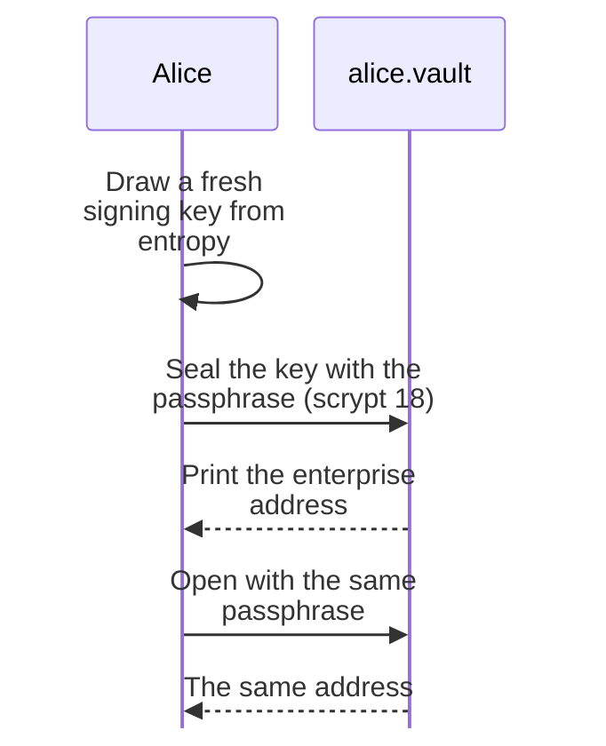
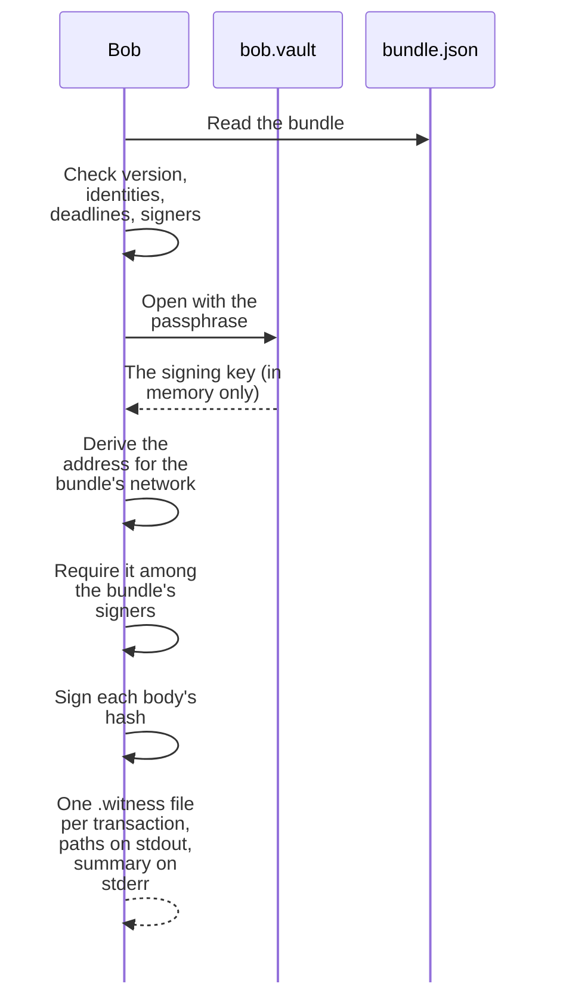
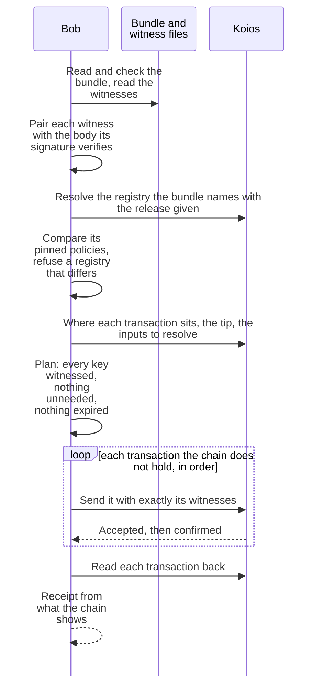

# Connecting singular to a ledger provider

Dated qualification, 2026-10-15: rejection after the window, rejection before the deadline, request value and refund routing, rejection and retraction refund controls, and rejection inside the processing and retraction windows are all unmet by ruling: implementation follows the superseded rule; the ruled rule is not implemented. The live comparisons still exercise the legacy rejection that spends the registry state output. The ruled rejection reads that output by reference and never spends it. Agreement with the legacy path is not acceptance of the ruled design. The earlier processing-window consumer requirement and the unresolved refund-routing requirement remain open. Historical results below retain their original revision and evidence binding; they do not establish current acceptance.

As a registry operator, you create a registry through `singular registry create` and sign and submit bundles through `singular wallet` and `singular submit`. You use the `state`, `registration` and `holding` command groups
through `open-datum`, with a Koios API on your chosen network.
The commands that create a registry and book, fold, reclaim and clean up a registration
are described in [create a registry and register keys on the proved design](registry-commands.md).
You supply the API settings and pinned time material; each write is signed from
your vault, or by a signer elsewhere through a bundle file (see
[Signing a write elsewhere, or from your vault](#signing-a-write-elsewhere-or-from-your-vault)).
Commands read raw facts through one logical session, build
and evaluate locally, submit signed transactions, and preserve recovery evidence
in the registry journal.

Words such as registry, state token, request, fold, window, vault and bundle are
explained as they first appear in the
[step-by-step page of singular-demo](https://lambdasistemi.github.io/singular-demo/);
the [Demo 1 page](demo1.md) tells the story in short.

The ordinary provider is Koios. Old backend and socket settings are refused
before acquisition or registry effects. The current provider session promises
no coherent chain snapshot and carries no verification witness.

## Asking the program for help

As a registry operator, you can ask either program what it does before you read this page or any other. `singular --version` and `open-datum --version` print the program's name, its version and the commit it was built from; a build that carries no commit says `commit unknown`. `singular --help` and `open-datum --help` print one screen: what the program is for, and every command with a line about it. Each command has its own `--help` that shows only that command: its settings, each with a description and a default, the signer routes grouped with the vault first and the key file, which is legacy, last, the environment variables it reads, an example for a command that writes, and how it ends.

A mistyped command or flag prints what is wrong in one line, the usage of the command you were heading for and where its help is, and exits with status 2. A mistyped command also names the nearest command. A failure that no command reported itself, such as a file that cannot be read, ends as one line on standard error saying what failed, with status 1, never the runtime's own report of an uncaught exception. Both programs complete commands and flags in your shell: `source <(singular --bash-completion-script "$(which singular)")` for bash, with `--zsh-completion-script` and `--fish-completion-script` for the other shells.

The overview of each program follows, quoted from the program itself. The first line of every help page names the version and the commit; it is left out here, and `VERSION` stands for the version of the build. The documentation check runs the programs and fails when a quotation, or the settings table below, disagrees with what they print.

<!-- quoted-help: singular -->
```text
Usage: singular COMMAND

Create a Singular registry on Cardano, and sign and submit transaction
bundles.

Available settings:
  Show this help text
  switch: -h|--help

  Output version information: VERSION
  switch: --version

All commands:
  singular registry create    Create the registry of an application
  singular wallet create      Create a vault with a fresh key
  singular wallet address     Print the address of a vault's key
  singular wallet sign        Sign a bundle of transactions offline
  singular submit             Send a signed bundle, print its receipt

Help on one command: singular COMMAND --help
Shell completion (bash): source <(singular --bash-completion-script "$(which singular)")
  zsh and fish: --zsh-completion-script and --fish-completion-script instead.

Every command takes --trace, --trace-to and --trace-format to narrate
what it does; standard output carries the receipt alone.
```

<!-- quoted-help: open-datum -->
```text
Usage: open-datum COMMAND

Keep payloads under keys in a registry on Cardano: create a registry, book
registrations, update and terminate holdings, and fold pending requests.

Available settings:
  Show this help text
  switch: -h|--help

  Output version information: VERSION
  switch: --version

All commands:
  open-datum create           Create a registry
  open-datum fold             Fold the registrations and terminations you name
  open-datum insert           Book the registration of a key
  open-datum reclaim          Take back a registration you booked
  open-datum cleanup          Clean up an expired registration
  open-datum update           Replace the payload of a live holding
  open-datum terminate        Book permanent termination of a live holding

Help on one command: open-datum COMMAND --help
Shell completion (bash): source <(open-datum --bash-completion-script "$(which open-datum)")
  zsh and fish: --zsh-completion-script and --fish-completion-script instead.

Every command takes --trace, --trace-to and --trace-format to narrate
what it does; standard output carries the receipt alone.
```

## The settings you give

| Setting | Commands | What it is |
| --- | --- | --- |
| `--koios-url URL` | `singular submit`, `singular registry create`, `open-datum create`, `open-datum fold`, `open-datum insert`, `open-datum reclaim`, `open-datum cleanup`, `open-datum update`, `open-datum terminate` | The Koios API base URL used for raw reads and signed submission. There is one ordinary provider path. When the flag is absent, `SINGULAR_KOIOS_URL` or the key `koios-url` of the config file gives it; see [the three forms](#giving-the-chain-the-contracts-and-the-registry-once). |
| `--koios-token-file FILE` | `singular submit`, `singular registry create`, `open-datum create`, `open-datum fold`, `open-datum insert`, `open-datum reclaim`, `open-datum cleanup`, `open-datum update`, `open-datum terminate` | An optional authentication token read from this file. Keep its contents private; receipts and logs redact it. When the flag is absent, `SINGULAR_KOIOS_TOKEN_FILE` or the key `koios-token-file` of the config file gives it; see [the three forms](#giving-the-chain-the-contracts-and-the-registry-once). |
| `--network-time DIR` | `singular submit`, `singular registry create`, `open-datum create`, `open-datum fold`, `open-datum insert`, `open-datum reclaim`, `open-datum cleanup`, `open-datum update`, `open-datum terminate` | Pinned time-manifest.json, shelley-genesis.json and era-history.cbor. Preprod can use the reviewed packaged recording; generated network 42 requires its exact published directory. When the flag is absent, `SINGULAR_NETWORK_TIME` or the key `network-time` of the config file gives it. |
| `--network-magic N` | `singular submit`, `singular wallet create`, `singular wallet address`, `singular registry create`, `open-datum create`, `open-datum fold`, `open-datum insert`, `open-datum reclaim`, `open-datum cleanup`, `open-datum update`, `open-datum terminate` | The requested network: 1 for preprod or 42 for the generated development network. Time material and provider answers must agree with it; unsupported time networks refuse. Mainnet's magic is refused for writes. The wallet commands take it alone, with no provider: it selects the network the address is built for. When the flag is absent, `SINGULAR_NETWORK_MAGIC` or the key `network-magic` of the config file gives it. |
| `--process-time MS` | `open-datum create` | How long a booked request may wait for its fold, in positive integer milliseconds: 600 000 (ten minutes) when omitted. Fixed for the life of the registry. |
| `--reclaim-time MS` | `open-datum create` | How long the refund address may take a registration back after its processing deadline, in milliseconds: 300 000 (five minutes) when omitted. Fixed for the life of the registry. |
| `--booking-width MS` | `open-datum create` | The widest validity interval a booking may declare, in milliseconds: 300 000 (five minutes) when omitted. Fixed for the life of the registry. |
| `--registration-cost LOVELACE` | `open-datum create` | The registration cost the registry carries, in whole lovelace: 0 when omitted. Nothing enforces it. Fixed for the life of the registry. |
| `--minimum-tip LOVELACE` | `open-datum create` | The minimum tip the registry carries, in whole lovelace: 0 when omitted. Nothing enforces it. Fixed for the life of the registry. |
| `--application-policy HEX` | `singular registry create` | The application policy pinned at creation, as hex, for an application whose script does not depend on the registry identity. `open-datum create` carries its own from its application value and refuses this flag. `singular registry create` requires it: it is the one parameter of the state validator, and the registry it creates is the registry of that application. |
| `--confirm-timeout SECONDS` | the one singular write and the seven open-datum writes | How long each submission may take to appear on chain; ten minutes when not given. Past it the command stops with the submission journalled as unconfirmed and never resubmits it. |
| `--state-dir DIR` | `singular registry create`, `open-datum create`, `open-datum fold`, `open-datum insert`, `open-datum reclaim`, `open-datum cleanup`, `open-datum update`, `open-datum terminate` | Optional state root override. Absent, each command resolves its own managed state directory under the platform per-user state location (`XDG_STATE_HOME`, falling back to `$HOME/.local/state`, namespace `singular`), partitioned by network, complete state token and the caller's stable wallet payment identity: the same identity reuses its journal and lock across invocations and key-file relocation, and different wallets and tokens never share one. A configured root keeps the same partitioning; it is never a per-registry directory. The journal of your submissions, their saved bodies and, while `create` runs, its pending identity live under that partition. When the flag is absent, `SINGULAR_STATE_DIR` or the key `state-dir` of the config file gives it. |
| `--state-token POLICY.NAME` | `open-datum fold`, `open-datum insert`, `open-datum reclaim`, `open-datum cleanup`, `open-datum update`, `open-datum terminate` | The registry, by its state token: the policy and the name in hex, as `create` prints it. When the flag is absent, `SINGULAR_STATE_TOKEN` or the key `state-token` of the config file gives it; the flag wins. The command derives everything else from the token, the blueprint and the chain before it builds anything, and refuses by name when they disagree. `create` refuses it: it makes one. Beside `--registry` it must name the registry that address holds, or the command is refused naming both. |
| `--registry ADDRESS` | `open-datum fold`, `open-datum insert`, `open-datum reclaim`, `open-datum cleanup`, `open-datum update`, `open-datum terminate` | The registry address printed by `open-datum create`, carrying its state token and network. It supplies both when their separate settings are absent; a disagreement is refused naming both. |
| `--config FILE` | `singular submit`, `singular wallet create`, `singular wallet address`, `singular wallet sign`, `singular registry create`, `open-datum create`, `open-datum fold`, `open-datum insert`, `open-datum reclaim`, `open-datum cleanup`, `open-datum update`, `open-datum terminate` | The JSON file that gives the settings above that have a key when neither the command line nor the environment does; the variable `SINGULAR_CONFIG` names it too. When neither is given the file is `singular.json` in the folder the command runs from, if there is one. See [the three forms](#giving-the-chain-the-contracts-and-the-registry-once). |
| `--blueprint FILE` | `singular submit`, `singular registry create`, `open-datum create`, `open-datum fold`, `open-datum insert`, `open-datum reclaim`, `open-datum cleanup`, `open-datum update`, `open-datum terminate` | The registry partition's compiled blueprint, the `onchain/plutus.json` a release archive carries. When the flag is absent, `SINGULAR_BLUEPRINT` or the key `blueprint` of the config file gives it. For `singular submit` it is the release the registry a bundle names was created under, which the registry's pinned policies are checked against before the first send; a create bundle names no registry and needs none. |
| `--wallet-address ADDR` | `singular registry create`, `open-datum create`, `open-datum fold`, `open-datum insert`, `open-datum reclaim`, `open-datum cleanup`, `open-datum update`, `open-datum terminate` | Your public signing address, together with --bundle, selects an external signer. The address must pay a key. A write takes exactly one signer; a vault or key file beside it is refused. |
| `--bundle FILE` | `singular registry create`, `open-datum create`, `open-datum fold`, `open-datum insert`, `open-datum reclaim`, `open-datum cleanup`, `open-datum update`, `open-datum terminate` | The new file an external signer's run is written to: unsigned transactions for `singular wallet sign`. It goes with `--wallet-address`; an existing path is refused with its bytes untouched. The receipt records the staged run. See [offline signing](#signing-a-bundle-of-unsigned-transactions-offline). |
| `--seed TXID#IX` | `singular registry create`, `open-datum create` | The output the new registry is booted from, which fixes its identity. On `create` it is your wallet's largest ada-only output when a live state carrier exists, or the first publication's change when the state script must be published; an explicit `--seed` names a held output, or the previewed chained seed to pin the identity, and a held sole output while the state must be published is refused — omit `--seed` and the first publication's change becomes the seed. On `singular registry create` and `open-datum create` it is your wallet's largest ada-only output, chosen when the registry is built and after the validators have been published when they must be, so the publication cannot have spent it. |
| `--key KEY` | `open-datum insert` | The registry key the registration is for, as text: its UTF-8 bytes, between 1 and 32 of them. Give this or `--key-hex`, not both. |
| `--key-hex HEX` | `open-datum insert` | The same key spelled as base16 bytes, for a key that is not printable text. The receipts print every key as hex, and as text when its bytes are valid UTF-8. |
| `--payload FILE` | `open-datum insert`, `open-datum update` | The payload the registration carries, a JSON file read in the form `--payload-schema` names (plain JSON when it is absent). The booking puts it, with the key and the deposit, in the pending registration. A file that cannot be read in that form is refused, naming the file and the value, before anything is read from the provider. |
| `--payload-schema NAME` | `open-datum insert`, `open-datum update` | The form the payload file is written in: `plain`, the default, reads ordinary JSON and stores it as Plutus data by the table in [store ordinary JSON as a key's payload](payload-json.md), and `detailed` reads the detailed Plutus data schema, the way the previous release read every payload. A file in the detailed schema given without `detailed` is refused with the instruction to say so, and a plain document given with `detailed` is refused as not Plutus data; none is stored as a different datum. Any other value is refused. |
| `--deposit LOVELACE` | `open-datum insert` | The deposit the key's envelope protects, a whole number of lovelace: 2 000 000 when not given, and refused below that. The minimum is the client's own policy; the chain enforces only that a request's deposit equals the control's at booking and that an update keeps at least the control's deposit, and sets no floor. `open-datum insert` also refuses a deposit below the minimum ADA of the output that will hold the key's token with its payload, naming that minimum, because no fold could deliver it. |
| `--tip LOVELACE` | `open-datum insert` | What the pending registration holds above the deposit for the wallet that folds it, in whole lovelace: 0 when omitted. The wallet that runs the fold keeps it, and so does the wallet that runs the cleanup after the reclaim window. |
| `--refund-address ADDR` | `open-datum insert` | Where a reclaim or a cleanup returns the registration's value, a bech32 address: your own address when omitted. A reclaim must be run by the wallet of that address. |
| `--holding TXID#IX` | `open-datum update`, `open-datum terminate` | The live holding to spend, by transaction identity and output index. Required; none is chosen automatically. The named registry and signing controller must match its protected control. |
| `--pending TXID#IX` | `open-datum fold`, `open-datum reclaim`, `open-datum cleanup` | The pending request to act on, as the receipt of `open-datum insert` names it. Nothing is chosen for you. The fold takes the flag once for each registration it folds in its one transaction; a reclaim and a cleanup take exactly one. |
| `--receipt FILE` | `singular submit`, `singular registry create`, `open-datum create`, `open-datum fold`, `open-datum insert`, `open-datum reclaim`, `open-datum cleanup`, `open-datum update`, `open-datum terminate` | Also write the JSON receipt the command prints on standard output to this file. |
| `--vault FILE` | `singular wallet create`, `singular wallet address`, `singular wallet sign`, `singular registry create`, `open-datum create`, `open-datum fold`, `open-datum insert`, `open-datum reclaim`, `open-datum cleanup`, `open-datum update`, `open-datum terminate` | The encrypted wallet vault. `singular wallet create` creates it, and `singular wallet address` and `singular wallet sign` open it. On a retained writer it selects the signing key in place of a key file or external signer. The command opens it once before running. An unreadable vault or a wrong passphrase is refused. The flag, `SINGULAR_VAULT` and the config key `vault` follow the [settings precedence](#giving-the-chain-the-contracts-and-the-registry-once). |
| `--passphrase-fd N` | `singular wallet create`, `singular wallet address`, `singular wallet sign`, `singular registry create`, `open-datum create`, `open-datum fold`, `open-datum insert`, `open-datum reclaim`, `open-datum cleanup`, `open-datum update`, `open-datum terminate` | The inherited file descriptor the passphrase is read from, one line: the way a script supplies it. It wins over the variable `SINGULAR_PASSPHRASE`, which gives the passphrase on a development network only (see [the passphrase from the environment](#the-passphrase-from-the-environment-on-a-development-network)). Without either, the passphrase is typed at a prompt on the terminal with the echo off — twice on a creation, once on an opening or a signing — and a differing confirmation is refused. On a write it goes with `--vault`, and alone it is refused. The passphrase itself is never taken as an argument, and no output, refusal, journal line or trace names it. The commands of the proved design take it the same way. |
| `--wallet-skey FILE` | `singular registry create`, `open-datum create`, `open-datum fold`, `open-datum insert`, `open-datum reclaim`, `open-datum cleanup`, `open-datum update`, `open-datum terminate` | Being retired ([issue 672](https://github.com/lambdasistemi/singular/issues/672)): not a way to start. Your payment signing key: a `cardano-cli` text envelope, its `cborHex` value or the 32 key bytes as bare hex, or the 32 raw key bytes. The key funds and signs every write; it is read and never printed — only the address derived from it appears. `inspect` refuse it. The five open-datum writes still accept the key file, until it is retired; the registry's `singular` commands, the negative host, the bounded journey and the deployment tool keep key files for now (issue 672 retires the registry's), and the last three are harnesses. |
| `--out DIR` | `singular wallet sign` | Where the witness files go: one file per transaction of the bundle, each named by its transaction's identity with `.witness` appended and created exclusively — an existing file is refused with its bytes untouched. The directory is made when absent; the bundle's own directory when not given. |
| `--witnesses FILE` | `singular submit` | A witness file `singular wallet sign` wrote, or a directory standing for the `.witness` files it holds; give it once per file or directory. Each witness is matched to its transaction by its signature, never by its file name. |
| `--trace LEVEL` | `singular submit`, `singular wallet create`, `singular wallet address`, `singular wallet sign`, `singular registry create`, `open-datum create`, `open-datum fold`, `open-datum insert`, `open-datum reclaim`, `open-datum cleanup`, `open-datum update`, `open-datum terminate` | How much the command narrates as it runs: `off`, `what` (command progress and outcome) or `how` (also transaction mechanics: reads, script evaluation, build, signing, submission and confirmation, with their times). When not given: `what` if standard error is a terminal, otherwise `off`. Any other value is refused before anything runs. When the flag is absent, `SINGULAR_TRACE` or the key `trace` of the config file gives it. |
| `--trace-to SINK` | `singular submit`, `singular wallet create`, `singular wallet address`, `singular wallet sign`, `singular registry create`, `open-datum create`, `open-datum fold`, `open-datum insert`, `open-datum reclaim`, `open-datum cleanup`, `open-datum update`, `open-datum terminate` | Where the narration goes: `stderr`, or `file:PATH`, appended a line at a time as each event happens. Give it more than once to narrate to several places; standard error when not given. Any other value is refused before anything runs. When the flag is absent, `SINGULAR_TRACE_TO` or the key `trace-to` of the config file gives one place; repeat the flag to narrate to several. |
| `--trace-format FORMAT` | `singular submit`, `singular wallet create`, `singular wallet address`, `singular wallet sign`, `singular registry create`, `open-datum create`, `open-datum fold`, `open-datum insert`, `open-datum reclaim`, `open-datum cleanup`, `open-datum update`, `open-datum terminate` | `text`, indented lines for a person, or `json`, one JSON object per line for a program. When not given: text on standard error, JSON in a file. When the flag is absent, `SINGULAR_TRACE_FORMAT` or the key `trace-format` of the config file gives it. |

The URL, network magic and one signer (a key file, a vault, or an address with its bundle file) travel together on a write: naming only some of
them is refused as partially configured, and so is a write that names none,
because `singular` never starts a node of its own — a registry booted on a
chain that dies with the process could not be attached to again. The refusal
says which part is missing and, for the signer, the three ways to name one: the
vault first, then an address with its bundle file, and last the key file, which is
legacy. The settings that do not change from one command to the next (the node,
the contracts, the registry, the token file, the narration and the vault) can be given once,
as [the next section](#giving-the-chain-the-contracts-and-the-registry-once)
says; the key file, an external signer and everything else a command does are typed on the command.
[Public environment configuration](#public-environment-configuration) lists the
variables and the phase-log path.

```sh
open-datum insert --state-dir ./work --blueprint plutus.json \
  --state-token "$state_token" --key keyA --payload alice.json \
  --koios-url "$koios_url" --network-magic 1 \
  --vault ~/keys/alice.vault
```

The file `alice.json` is the key's payload, ordinary JSON stored as plain JSON unless
`--payload-schema detailed` says it is written in the detailed Plutus data schema;
[store ordinary JSON as a key's payload](payload-json.md) gives the rules.

## Giving the chain, the contracts and the registry once

As a registry operator, you type the same six settings on nearly every command: the Koios address, the network magic and the pinned time directory (the chain), the blueprint (the compiled contracts), and the state directory and the state token, or the registry's address, which holds the state token and the network (the registry). You can write them once. Each has three forms, and the first one that is present wins.

| Order | Where it is given | Written as, for the Koios address |
| --- | --- | --- |
| first | the command line | `--koios-url https://preprod.koios.rest/api/v1` |
| second | the environment | `SINGULAR_KOIOS_URL=https://preprod.koios.rest/api/v1` |
| third | the config file | `"koios-url": "https://preprod.koios.rest/api/v1"` |
| last | the default | what `--help` says for the setting, when it has one |

The variable is `SINGULAR_` followed by the flag's name in capitals with underscores, and the key is the flag's name without its dashes. The six above are `--koios-url`, `--network-time`, `--network-magic`, `--blueprint`, `--state-dir` and `--state-token`. Six more have the same three forms: `--registry`, `--koios-token-file`, the narration controls `--trace`, `--trace-to` and `--trace-format`, and `--vault`. The `--help` of every command lists the three forms of each of them that the command takes, and says where the config file is.

The config file is one JSON object. Both programs read the same file: it is `singular.json` in the folder you run the command from, or the file named by `--config FILE` or by the variable `SINGULAR_CONFIG`. With a file like this in your demo folder, `open-datum insert --key alice --payload payload.json --vault alice.vault` is a whole command, and it does exactly what the same command with the six flags does:

```json
{
  "koios-url": "https://preprod.koios.rest/api/v1",
  "network-time": "time",
  "network-magic": 1,
  "blueprint": "contracts/plutus.json",
  "state-dir": "reg",
  "state-token": "POLICY.NAME"
}
```

What you see when something is wrong:

- A missing setting is refused in the usual line, `missing --koios-url`, and below it one line names the flag, the variable and the key that would give it.
- A file that does not exist when you named it, that is not JSON, that is not one object, or that holds a key the program does not read is refused in one sentence naming the file. A key that is nearly a setting's name says which one it nearly is. A default `singular.json` that is not there is no file; one that is there and broken is refused. A problem with the file never stops `--help` or `--version`.
- A path in the file means what the same path means on the command line: it is read from the folder the command runs from.
- A value is text or a number, as `network-magic` above; an empty text or `null` is no setting.
- Nothing else can come from the file or the environment. The key file, an external signer, the passphrase and what a command does stay on the command line: a file that names a passphrase is refused, and the passphrase stays on the terminal prompt or on the descriptor `--passphrase-fd` names. The environment gives a passphrase only on a development network, as `SINGULAR_PASSPHRASE`; the section after the vault one says how.

A line that carries every flag it needs means what it meant before. An environment variable or a file only fills in what the line leaves out, so a flag you type is never overruled.

### The vault from the environment or the file

As an operator who signs with a vault, you can name it once: `SINGULAR_VAULT=alice.vault`, or `"vault": "alice.vault"` in the config file, and `open-datum insert --key alice --payload payload.json` signs from it. The passphrase is not part of this: it stays on the terminal prompt, or on the descriptor `--passphrase-fd` names on the command, with a vault from either source just as with a typed one. A development network can also take it from the environment, as the next section says.

A write is signed by exactly one signer, so a vault you did not type on the command never joins another signer you did. If the line names the key file `--wallet-skey`, or an external signer with `--wallet-address` or `--bundle`, the command is refused in one sentence that names where the vault comes from and the flag on the line, before anything is read or sent:

```text
open-datum: --vault comes from the variable SINGULAR_VAULT and --wallet-skey is on the command line, and only one of the two can be used: unset the variable, or leave --wallet-skey out
```

For a vault from the file, the sentence names the key and the file (`the "vault" key of singular.json`) and says to remove the key. The wallet commands `wallet create`, `wallet address` and `wallet sign` take the vault from either source too: `wallet create` still refuses a path that is taken before it asks for a passphrase.

### The passphrase from the environment on a development network

As a reader of the tutorial on a private development network, I sign with a deliberately weak passphrase and do not want to type it at every command. I export it once, and every command that opens a vault reads it, with the other settings given as the sections above describe:

```sh
export SINGULAR_PASSPHRASE=weak
singular wallet create --vault alice.vault --network-magic 42
open-datum insert --key alice --payload payload.json --vault alice.vault
```

`wallet create` takes the variable for both of its asks, so a creation is not asked to confirm. A development network is any network that is not one of the three public ones the build names: mainnet (network magic 764824073), preprod (1) and preview (2). On those three, a command that would read the variable is refused in one sentence that names the variable and the network, before the vault is read. The sentence is the line a wallet command prints on standard error and the reason in the receipt of a write that was refused by the client:

```text
SINGULAR_PASSPHRASE is set and the network is preprod (network magic 1), but the variable is for development networks only: unset it and type the passphrase, or name --passphrase-fd
```

The decision uses the network magic the command already receives. `wallet sign` is offline and takes no network magic, so it uses the network the bundle names, once it has read the bundle and before it reads the vault. A write is refused on mainnet before any passphrase is considered, so for a write the variable is refused on preprod and preview.

The variable is the whole of this: there is no config key for it and no flag, and a config file that names a passphrase is refused. The descriptor wins: with `--passphrase-fd N` on the command the variable is not read, on any network. With neither, the prompt is as before. A variable that is set but empty is refused, naming the variable, rather than taken as an empty passphrase.

The variable is for a passphrase that protects nothing. Every process you start inherits your environment, and a process of your account can read it, so a real vault keeps the prompt or the descriptor.

## Keeping your signing key in an encrypted vault

As Alice, I keep my payment signing key in one encrypted file instead of
a plaintext key on disk. I run `singular wallet create` naming a new vault
and a network, type a passphrase twice, and see my address on one line:

```sh
singular wallet create --vault alice.vault --network-magic 1
```

My key exists only inside that file: nothing else is written, no public
part is kept beside it, and reading my address later means opening the
vault — the same address prints, from the same passphrase:

```sh
singular wallet address --vault alice.vault --network-magic 1
```

A script supplies the passphrase on an inherited file descriptor, one
line, and is never asked for a confirmation:

```sh
singular wallet create --vault alice.vault --network-magic 1 --passphrase-fd 9
```

On a development network a script can set `SINGULAR_PASSPHRASE` instead, which a descriptor outranks; preprod and the other public networks refuse the variable (see [the passphrase from the environment](#the-passphrase-from-the-environment-on-a-development-network)).



Creating over an existing path — a symbolic link included — is refused
before a passphrase is asked for, with that path's bytes untouched; `wallet address` on a vault that is not there or cannot be read says so in one sentence naming the file, also before it asks for a passphrase; the vault file is made readable by its
owner only, and a write that fails removes the file it made. A wrong
passphrase, a corrupt file and a file that is not a vault all answer one
refusal naming no secret, nothing prints on standard output, and the
empty passphrase is refused at birth. Every creation draws a fresh key
from the operating system's entropy: fresh entropy for every vault.

The vault is an ordinary age file, one passphrase recipient with scrypt
work factor 18, holding the key's standard text envelope as its
plaintext. Any age tool opens it with the passphrase and yields the
envelope: `age --decrypt alice.vault` asks for the passphrase on the
terminal and prints the plaintext, and the decrypted bytes are the
`cardano-cli` key format itself, accepted wherever a signing-key file
is read.

## Signing a bundle of unsigned transactions offline

As Bob, I receive a bundle of unsigned transactions from a writer —
one JSON file — and I run `singular wallet sign` on an offline
machine, naming my vault and the bundle. I type my passphrase once
and get one witness file per transaction, with the paths on standard
output and a short summary of what I signed on standard error:

```sh
singular wallet sign --vault bob.vault bundle.json
singular wallet sign --vault bob.vault --passphrase-fd 9 --out witnesses bundle.json
```

The writer's side is a `singular registry create` run, or an `open-datum create`, `insert`, `update`, `terminate` or `fold` run, that names `--wallet-address` and `--bundle` in place of the signing key: it builds its whole run as one bundle in build order, signs and sends nothing, states its own fields under `expected` in its receipt, and exits with status 19, `waiting-for-signatures`.



The bundle names the network it is built for, so no network setting is
taken: every provider and registry option is refused by name, and the
command opens no connection — it reads nothing but the bundle file,
the vault file and the passphrase. A bundle is refused by name, and
nothing is written, when a recorded identity is not the hash of its
transaction's body, a recorded deadline is not the body's validity
upper bound, an identity names two transactions, a key hash a body
requires is covered by no signer address, or the vault's own address
is not among the signers. A witness file that already exists is
refused with its bytes untouched.

Each witness is the standard `TxWitness ConwayEra` text envelope of
one verification-key witness — my public key and my signature over
that transaction's own hash — so the submitting command (or any
Cardano tool) can check and assemble them. The effects lines a bundle
carries are the writer's claims: the summary shows them, and nothing
trusts them. The registry a bundle names is the writer's statement too:
the summary says so beside the name, and `singular submit` is where the
bundle meets the chain. Whether the signers list is complete cannot be checked
offline — inputs cannot be resolved — and expiry is not judged without
a clock that knows the slot; both are the submitting command's
judgement. No output, refusal or file names the passphrase or any key
byte.

## Submitting a signed bundle

As Bob, I hand back the witnesses for a bundle and run `singular submit`
with the node settings and, when the bundle names a registry, the release
that registry was created under. The transactions are sent in the bundle's
order, and the receipt says what the chain shows. If the run is cut
short, I run the same command again: it sends only the transactions the
chain does not hold yet. If a body has expired, it says to rebuild the
bundle and sends nothing. It needs no wallet key and keeps no state.

```sh
singular submit --witnesses witnesses --blueprint onchain/plutus.json \
  --koios-url "$koios_url" --network-magic 1 --receipt submitted.json bundle.json
singular submit --witnesses alice.witness --witnesses bob.witness \
  --blueprint onchain/plutus.json --koios-url "$koios_url" --network-magic 1 bundle.json
```



A bundle that names a registry is checked against it before anything else is
read from the chain. The command resolves that registry with the release the
bundle was created under, the blueprint I give, and compares its pinned
policies exactly as every other command does: a registry whose pins differ is
refused naming the field, the refusal is a client refusal with the cause
`registry-pin-mismatch` and an empty list of submissions, and nothing is sent.
The older bundles still submit, because the bundle format is unchanged and the
release I give is the one the registry was created under. A bundle that names a
registry and comes with no release is refused, cause `release-not-given`, before
the chain is read. A bundle that names no registry is refused, cause
`bundle-names-no-registry`, unless it is a create bundle: a create bundle names
none because its registry does not exist until it is sent, and it needs no
release. Without this refusal a writer could drop the name from a bundle to skip
the comparison. The registry name in a bundle is its writer's statement, and
`wallet sign` says so in its summary: `submit` checks the registry the bundle
names, not that its transactions act on it. The receipt carries the standing of
the application pin, `applicationPin`, once.

The witness files are the ones `singular wallet sign` writes; a
directory stands for the `.witness` files it holds, and each witness is
matched to a transaction by its signature, never by its file name. The
command checks everything it can before it sends anything, in this
order. Without touching the chain, it refuses a bundle the signing step
would refuse, a bundle that names no registry and is not a create bundle,
a bundle that names a registry when no release is given, a witness file it
cannot read, and a witness whose signature verifies against no transaction of
the bundle. Then it resolves the registry the bundle names and compares its
pinned policies. Then it reads the chain once: where each transaction sits, the tip, and the inputs of
each transaction not on chain yet — an input an earlier transaction of
the bundle produces is taken from that transaction, every other from
the chain. Witnesses are required for the transactions this run will
send, and for those alone. It refuses a witness for a key none of them
needs, a transaction left without a witness for a key it needs (its
required signers and the payment keys of what it spends), an input
found nowhere, and a transaction not on chain whose validity upper
bound the tip has reached, with the word rebuild. A refusal exits as a
client refusal, naming its cause, with an empty list of submissions.

A transaction the chain already holds, found by its identity, is
skipped before those checks, and the witnesses supplied for it are
ignored: the inputs it spent can no longer be read from the chain, and
it is never sent again. A witness that cannot be read, or that verifies
against no transaction of the bundle, is refused all the same, before
the chain is read, even when every transaction is already on chain.

Each transaction the chain does not hold is sent in turn, carrying
exactly its own witnesses, and confirmed before the next. An answer
that may or may not mean the node took the transaction stops the run as
partial, and nothing is sent again within the run; the next run finds
what landed. Once every transaction is on chain, the receipt is read back
from the chain: for each transaction, whether this run sent it or found
it, its chain point, its confirmations, and each of its outputs —
unspent with what it holds, or spent since — plus the bundle's hash.

The effect lines a bundle carries are its writer's claims: the receipt
shows them under claims and never says they were confirmed. The
completeness of the signatures is judged here, against the inputs the
chain resolves, which the offline signing step cannot do. Expiry is
judged against the tip read before the first send. A command that stops
leaves nothing behind but its receipt, and it never resubmits on its
own. A valid signature by an unneeded key over an already-landed body is
not reported.

## Booking and folding

As a controller, use [the registry command guide](registry-commands.md) to book
registrations, update holdings and book permanent termination. The fold takes
explicit pending references and can be run by another wallet from public chain
inputs. Its command is `open-datum fold`.

## Naming the registry

Use the state token or the registry address printed by creation. The
[registry command guide](registry-commands.md) describes the retained forms.

## Choosing a registry's windows

Use `open-datum create --process-time MS --reclaim-time MS` to choose the
processing and reclaim windows once. The guide describes their defaults and the
booking-width parameter.

## What a write records

The [recovery guide](cli-recovery.md) describes the retained commands' journals,
transaction identities and refusal to resubmit an uncertain transaction.

## Signing a write elsewhere, or from your vault

Use `--vault FILE` for a local vault, or `--wallet-address ADDR --bundle FILE`
for an external signer. The retained writers use the same signer options.
See [offline signing](#signing-a-bundle-of-unsigned-transactions-offline) and
[submission](#submitting-a-signed-bundle).

### What each receipt says

The [registry command guide](registry-commands.md) describes the receipt for each
retained operation.

### How long a bundle can wait

The [recovery guide](cli-recovery.md) describes unresolved submissions. No automatic
resubmission follows an interrupted or uncertain send.

## Reading a key

The removed reader has replacement: none, issue 744.

## Following what a command does

As a registry operator, you can watch a command's progress while it runs and
keep its typed event stream as data. The retained commands emit command and
transaction events. Protocol-fact narration is unavailable on these commands.
Standard output carries the receipt alone, so narration does not change a
script's receipt input.

On a terminal a command narrates `what` to standard error unless told otherwise.

Indentation reflects the event's scope. Transaction mechanics retain their
identifiers and elapsed times. A failure says
where it happened, and the four places are distinct: refused by the client
before anything was submitted, refused by local script evaluation before
anything was submitted, rejected by the ledger, or refused by the provider, so
that no ledger judged the transaction.

With `--trace-format json`, or a `file:PATH` sink, each event is one JSON
object on its own line, written as it happens: its `level` (`what` or `how`),
its `scope` (outermost first) and its `event` with that event's fields, in
full. The last line of every stream is `command-ended`, naming the command,
the outcome class of its receipt and its elapsed time. No event carries a signing key or the text of a failure: a failure
names only its type.

```sh
open-datum fold --pending "$pending" --state-dir ./reg --blueprint onchain/plutus.json \
  --state-token "$state_token" --koios-url "$koios_url" --network-magic 1 \
  --vault alice.vault --passphrase-fd 3 \
  --trace how --trace-to stderr --trace-to file:fold.trace.jsonl 3< alice.passphrase
```

A sink that cannot be written, a closed standard error or a full disk loses
that sink's narration and nothing else: the other sinks, the receipt, the
journal and the exit status are as they would be with no narration at all.

## When the provider cannot be used

| What happened | What you see |
| --- | --- |
| A write omits its URL, network or signing key | configuration refusal before provider reads and key access, naming the missing setting |
| An old backend selector, socket flag or socket environment setting is supplied | its named removed-setting refusal before provider acquisition or registry effects |
| Mainnet magic is supplied for a write | configuration refusal; writes are restricted to test networks |
| The API cannot answer or the requested time network is unsupported | `node-unavailable` at startup, preserving the existing outcome and diagnostic |
| Time source identities, start, network or protocol major disagree | the specific time refusal; no unsigned body is supplied for signing |
| The API becomes unavailable after submission | an unresolved journalled result within the confirmation bound; recovery does not resubmit it |

## Reading through an index

The former `--backend node` / `--backend indexer` comparison is retired. Ordinary
commands use the Koios path only. They do not create an in-memory chain index or
accept an ordinary node socket: the production node read adapter and the
in-memory indexer are removed with the provider migration, and no registry
command names a node backend. Private generated nodes and independent LSQ
probes remain test harness components behind the private facade; none of
them ships with the terminal.

An index must not fabricate transaction history for genesis-only allocations.
The retained private genesis-only control uses genuine initial ledger outputs
and refuses `coverage-incomplete`, naming their output references, with exit 12
and no registry write. Funding those allocations through a real transaction
creates full-block history that the accepting control can read. This is a
private source control, not a promise that every remote service detects all
missing history. Missing or inconsistent registry reconstruction remains a
refusal and must not become an empty registry.

## Public environment configuration

As an operator, I can supply each setting of [the section above](#giving-the-chain-the-contracts-and-the-registry-once) as a variable, for example `SINGULAR_STATE_TOKEN` when I omit
`--state-token`; an explicit command-line value takes precedence, and the config file comes after the variable. The token
names the registry, and never selects a provider. `SINGULAR_CONFIG` names the config file. `SINGULAR_LOG=PATH` appends
phase events to a file alongside the narration sinks selected by `--trace`,
`--trace-to` and `--trace-format`. It does not replace those sinks or change
their command-line precedence. An empty phase-log path disables that sink.

<a id="test-harness-hooks"></a>

## Harness appendix: test hooks

Released `singular` and `open-datum` binaries carry no fault-injection or hidden trie-diagnostic hooks.
