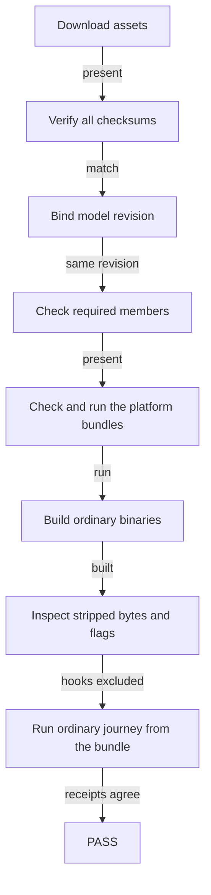

# Download and verify a release

You have cloned nothing. You want to know that a Singular release is what it
says it is before you run it: that the files you downloaded are the files
that were published, that the release names the formal model its evidence
was checked against, and that the `singular` and `open-datum` commands of the release actually
run a registry from creation to termination. One command answers all
three, from the downloaded bytes alone, and either passes or refuses by name.

## What you run

You need [Nix](https://nixos.org/download) with flakes enabled, on Linux: the
verifier is built for `x86_64-linux` and `aarch64-linux` only, and it does not
run on macOS. Nothing else: no checkout, no credentials, no running node.

```sh
nix run github:lambdasistemi/singular/v0.12.0#verify-release -- v0.12.0
```

The example names v0.12.0; the newest release is always at
https://github.com/lambdasistemi/singular/releases/latest, and its tag goes in both
places. Name the release you are checking twice: once to choose the verifier that
release ships, once as the release to download. The verifier downloads the
release's published assets from its GitHub release page without
logging in:

| Asset | What it is |
| --- | --- |
| `singular-onchain-X.Y.Z.tar.gz` | the compiled validators, the off-chain source with its own flake, and the run page of the `singular registry` commands |
| `singular-docs-X.Y.Z.tar.gz` | this documentation, as published |
| `singular-X.Y.Z-SYSTEM.tar.gz` | for each platform, the commands ready to run without Nix (releases after v0.12.0), with the blueprint and the development node (releases after v0.13.1) |
| `SHA256SUMS` | the checksums of the archives and the bundles |

The archive is unpacked into a fresh temporary directory, never inside a
checkout. Pass `--work DIR` to choose that directory and keep what it
leaves behind: the downloaded assets, the extracted archive and the receipts
of every command the journey ran.

## What it checks, in order

Each check runs only when the ones before it passed, and the first one that
fails ends the run with one line naming why.



The model revision is the commit of the application model, the formal
specification the conformance evidence reads its statements at. The release
states it in the archive as `MODEL-REVISION`; the verifier compares it with
the revision the conformance evidence of the same release is compiled
against. A release that ships bundles has each platform's bundle checked
against the commit its tag names, and the bundle of your platform is run. The
journey is the registration journey of the release: a registry is
created, keys are registered, folded, updated and terminated, read back and folded in a
discovered batch, each command a separate `singular` or `open-datum` process on one
development network the verifier starts and stops itself. Every verdict is computed from the
chain's own record or from files, and none is typed; create, register, update, terminate,
read and the discovered batch fold are each judged from the chain's record and shown
failing on altered input. The journey plays the
bundle of your platform: its commands, its blueprint and its development node, none of them
built on your machine. A release before the bundles, a release read with
`--without-bundles`, and a platform that has no bundle play the commands built from the
archive's own flakes.

Before starting the journey, the verifier strips and inspects the actual
compiled `singular` and `open-datum` executables built from the archive and reads their resolved
registry CLI build flags. Both must exclude hidden test inputs and disable
the test flag. It then records every ordinary journey invocation: every
`singular` and `open-datum` command the journey runs, `inspect` and `submit` included, must
run without hidden harness inputs, and no hold marker may appear.

Fault injection, crash recovery, race controls and independent trie-capability
observations run in the [explicit test build](building.md#ordinary-binaries-and-explicit-test-builds).
Their unchanged assertions are separate required CI evidence. They do not
claim to have run inside these extracted release binaries.

## What a refusal means

A refusal is one line, `verify-release: REFUSED <name>: <detail>`, and the
exit status is 1.

| Refusal | What it means | What to do |
| --- | --- | --- |
| `download-failed` | one of the three assets could not be downloaded | check the tag exists on the releases page and that you can reach github.com |
| `sum-mismatch` | an archive differs from `SHA256SUMS`, `SHA256SUMS` lists other files, or a file inside the on-chain archive differs from the archive's own checksum list | do not use these files; download again, and report it if the mismatch persists |
| `model-revision-missing` | the archive does not state a model revision | the release predates stated model revisions (every release before v0.8.0) or was not assembled by the release pipeline |
| `model-revision-mismatch` | the archive states a different model commit from the one the conformance evidence names | the release's evidence does not describe the model it claims; do not rely on it |
| `member-missing` | a file the verification needs is absent from the archive | the archive is incomplete; do not use it |
| `bundle-missing`, `bundle-sum-mismatch`, `bundle-layout`, `bundle-blueprint-mismatch`, `bundle-commit-mismatch`, `bundle-run-failed` | a bundle is absent, differs from `SHA256SUMS`, lacks a member, carries another blueprint than the on-chain archive, names another release or commit than the tag, or does not run on your platform | do not use the bundle; the detail names the platform and the check |
| `command-failed` | building `singular` from the archive, or one of the commands of the journey, failed | the detail names the step and, for the journey, where its programs came from; with `--work DIR` the receipts of every command are kept there |
| `harness-code-present` | a compiled executable contains hidden test inputs, its resolved flag does not disable them, or the ordinary journey receives a hidden input or leaves a hold marker | the artifact does not meet the ordinary release boundary; do not use it |

A release that passes prints its tag, both archive checksums, the model
revision and the directory it was verified in.

## Checking files you already have

If you downloaded the assets yourself, point the verifier at their
directory; every check after the download is the same:

```sh
nix run github:lambdasistemi/singular/v0.12.0#verify-release -- --assets ./downloads v0.12.0
```

From v0.8.0 on, every release is verified this way by the release workflow
itself, right after it is published.
