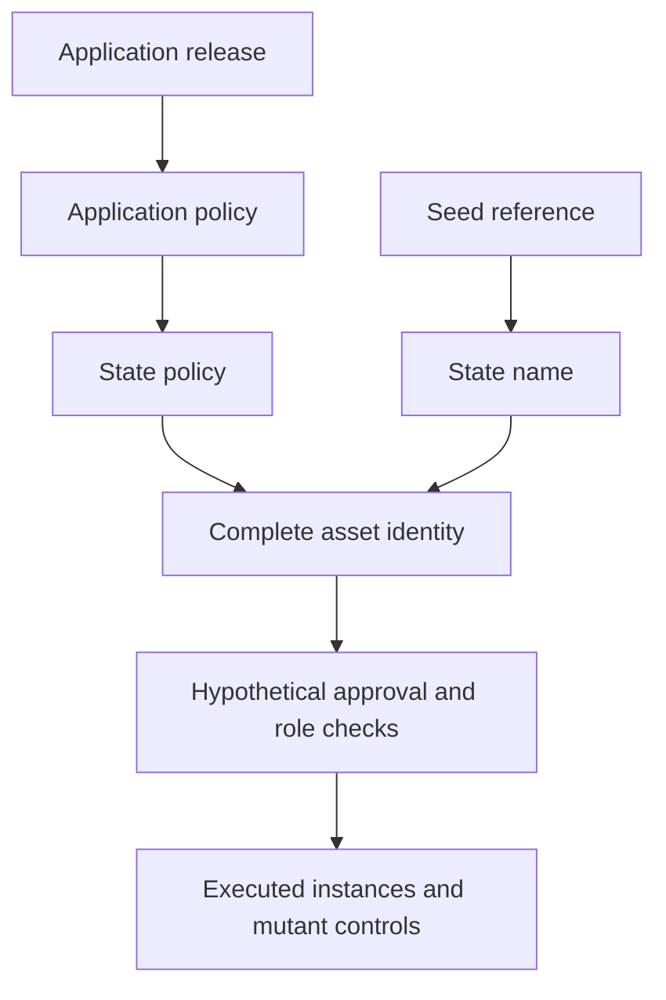

# Investigate complete registry identities

As a registry integrator, I want to inspect candidate identities, distinguish unsafe readings and replay their examples before adopting a new law.

The statement-stage descriptions below retain their historical proof debt. The current Singular proof outcomes are described at the end and computed per declaration by the evidence recipe.

## Retained investigation record

As an integrator, I want to reproduce the frozen investigation at its last green
revision and find the accepted models that CI now proves.

This record last passed at revision
`64f1f057864981eb5d6249827daf552890635830`. Reproduce it from that checkout:

```sh
git checkout 64f1f057 && just no-pin-identity
```

On the epic branch's root this investigation does not build: #749 removed root
members bound by its frozen definition closures. Its checkers and controls are
record tools that no hosted job runs; the recipe and its CI step have been
removed. The historical results below describe their recorded revisions.

The accepted forms are re-proved in CI in
[`models/singular-application-held`](../../models/singular-application-held/)
(#755, #757) and
[`models/open-datum-application-held`](../../models/open-datum-application-held/)
(#756).

## Story and status

This isolated Lean project investigates #741 at the supported root compiler. It requires the unchanged root model from `../..`. Every candidate declaration is a hypothesis; no accepted model, application, corpus, coverage record or release behavior changes. Approvals follow the operator's recorded complete-identity ruling in `specs/741-no-pin-model/decisions.md`.

All public statements have `sorry` bodies. The compiled ledger marks them STATED, with separate markers for rejected or potentially false readings. The kernel reports `sorryAx` alongside standard axioms; none is a proved guarantee. Witnesses and mutant falsifications are separate kernel-checked concrete instances with no proof holes. Their predicates are checked for definitional equality against the statement signatures; they never import the unproved statements.

The name-only safety claim is a rejected reading expected to be refutable. One evaluated fixture reuses an approval under a different state policy with the same state name. Policy-only recognition is also expected refutable: a genuine witness carrying a fabricated state datum satisfies that reading. The authenticated reading refuses that fixture under its explicit name/provenance checks. These evaluations are not general proofs, transaction execution or acceptance of either recognition rule.

## Identity and evidence boundaries

Derivation is acyclic: release determines application policy, then state policy. The seed independently determines state name. Complete policy/name registry identity then enters approval and role naming. `Hash` and `Codec` are explicit pure parameters; the tagged natural-number encoding and finite lookup hash are not Cardano serialization or cryptographic implementations. Encoding and hash separation are distinct finite-domain premises. No unconditional injectivity theorem is asserted.

State, witness, trie-ready and application tags have explicit roles under the hypothetical shared policy. **Request-tag separation here uses only registry, role and key. It does not cover the economic request payload or per-request nonce.** Approval payloads retain edge, key, owner, destination and nonce. No economic admission, custody or supply claim follows from this identity projection.

`Observation.provenance` is supplied authenticated-origin evidence. This project does not establish its truth from a datum, token location or transaction history. Without the stated finite separation premises, names can collide. The recognition question remains open.

`TxView` records spent references, output assets, mint per complete asset and invoked policies. It has no ledger validity judgement, script evaluator or UTxO update. A single transaction may spend a seed once and invoke two application-specific state policies, yielding the same seed name under different policies. A list of observations satisfying `historyAllows` instead carries a separate spent-once premise. Binding either observation to an accepted ledger/history is still owed to #679/#680. Neither implies global uniqueness of a name across policies.



## Reproduce the evidence

At the frozen revision above, the recorded `no-pin-identity` recipe builds the isolated library and generic oracle, elaborates the fresh environment report, checks compiled statement identities and axioms against `statements.json`, and replays `corpus.json` through the oracle. Successful local execution is not hosted CI evidence.

`Report.lean` discovers public cases, guards and roles from compiled constructors. It executes each case and measures which selectors change it; inversion rows must cover exactly that discovered extent. Every statement row needs an executed antecedent witness and at least one owned selector with a positive candidate instance and a false mutant instance. Normalizing that selector to `none` must give the identical compiled proposition as the positive control.

The mutation selector exists only for the mutant ledger. **All statements are stated at `Mutation.none`.** A selector flips one atomic guard in the same candidate definition; the report executes its truth table at every discovered site and refuses multi-guard changes. The guards include every condition in approval, recognition and genesis, plus history uniqueness. Inversions state the full acceptance equivalence, so a mutant that wrongly refuses a valid input is detected too.

The oracle at `.lake/build/bin/no-pin-oracle` reads JSON `Scenario` lines and returns Boolean results. Each scenario supplies a named `Query` surface and a mutation selector. It contains no theorem-specific expected-result code. Malformed JSON or scenario fields exit nonzero. The corpus is a computed replay of public definition cases and their guard flips, not a ledger-accepted lifecycle or a replacement for the separate Lean theorem fixtures.

## Limits and next decision

No general statement is proved or constructively refuted in this stage. No simulator, validator, builder, reader, custody reconciliation, economic configuration migration or compatibility policy is accepted. The termination-custody ruling belongs to its later stage. Independent statement review and the operator's remaining decisions precede proof work or any accepted-law change.

## Application-held pending termination candidate

As a holder, I want booking to keep my genuine token and request at the application, preserve my protected deposit, and permit a later public fold without my signature. This hypothetical extension applies the 23 October settlement ruling and the authorized disjoint value partition. It changes no accepted law or validator.

The Held modules distinguish live holdings from pending terminations, bind booking to the observed complete registry and the retained key/custody, and call the unchanged root booking and economic fold. A physical pending input contains the exact root request amount plus its protected deposit. The root observer removes that deposit slice; local release reads the physical payments and sums the released deposits. A connected instance registers two keys, books both, folds both, and computes both balances and the controller's payment. Wrong-key booking, wrong complete registry identity, overlapping value and missing payment are violating twins.

At the frozen revision, the recorded no-pin-identity recipe checks both evidence families. The report derives statement types, proof axioms, public constructors and atomic guard coverage from the compiled environment. Separate held ledgers and corpus preserve the original identity rows byte for byte. The same JSON oracle accepts the held family through an explicit family field; inputs contain public observations rather than theorem names or expected answers.

Every general candidate statement remains STATED with sorry debt. Kernel-checked finite witnesses and single-guard falsifications establish the reported instances, not general correctness. Non-rejection, operation/nonce tag commitment, world supply and permanent retirement reuse the accepted root declarations by name at the actual reachable worlds. The report computes counts and statuses; a missing row, witness, selector or inversion fails the check.

Authentication and completeness of observations, the interpretation of the accepted root's abstract registryId as the observed complete registry token, physical value correspondence, and the proposed shared policy's BurnCoupling contract remain explicit external obligations under #679/#680. The unchanged root Config supplies the abstract contents interpretation; this is not a concrete pin-free validator implementation. Cancellation and pending payload/control updates remain unruled hypotheses with no exposed path. No ledger inclusion, policy execution, hosted CI, production acceptance or release is claimed.


## Singular statements for application-owned requests

As an integrator, I want to distinguish a candidate fold law from a proved supply
law before depending on either. The ApplicationRequests family is the current
hypothetical Singular design. The Held family above remains historical evidence;
its tagged requests, protected-deposit settlement and assumed burn coupling are
superseded by the recorded application-owned-request rulings.

The current family states genesis, the whole per-change and batch fold law,
committed holding delivery, state continuation integrity, state recognition and
constructive public folding. Its exact inventory, statement hashes, proof debt,
complete antecedent witnesses, single-guard falsifications and oracle replays are
computed by the same no-pin-identity recipe from compiled Lean. The separate
application-requests ledgers preserve every earlier identity and held row. Every
general statement has its own compiled proof status; none is accepted law.

Explicit attacks exercise an extra own-policy mint and burn, delivery to another
output, state ADA drain, a foreign token in the state continuation, and a genuine
minted active token with a fabricated root datum. The oracle takes explicit
finite codec, hash and root observations; incomplete or ambiguous observations
fail instead of supplying an implicit successful answer. Its public builder uses
registry/request records and ordinary funding, with no required signer.

Global history supply and uniqueness statements remain open. Hypothetical
proofs establish that a burn belongs to a fold terminating that registry and
key, and that a terminal key cannot be reminted, including by another registry's
fold. Their statements and reached definitions stay frozen; the supply and
one-live-token rows retain their proof holes. The mixed registration/termination fixture starts from an observed active
key and does not establish its preceding genesis, application booking or a
multi-registry history. The public-fold statement promises a constructed balanced
model observation under explicit authenticity, clock, finite encoding/collision
and ordinary-funding premises; provider completeness, real trie proofs, script
invocation, output minimums, funding availability, willingness and inclusion
remain external. The current lifecycle and money statement candidate is described below; its proof status is computed per statement from compiled axioms. No production validator, application law, hosted CI or release acceptance
follows from these checks.


## Money and journey statement candidate

As a requester or integrator, I want to see which money flows stay equal and which change by an explicit ruling before treating the simplified application as equivalent. The compiled comparison below is a finite model example, not a ledger receipt. Eleven general money statements are proved and the registration-fold statement is constructively refuted, as explained below.

| Journey | Accepted economic baseline | Current candidate |
|---|---|---|
| Create | Empty registry; chosen parameters | Empty registry; immutable configuration record |
| Registration booking | Request holds 23 | Request holds 23 |
| Registration fold | Holding 7; folder 3; treasury 13 | Holding 7; folder 16; treasury 0 |
| Payload update | Protected deposit floor 7 | Protected deposit floor 7 |
| Termination booking | Request holds 10; treasury 0 | Request holds 10; treasury 7 |
| Termination fold | Folder 2; treasury 8 | Folder 10; treasury 0 |
| Owner reclaim | Refund 23 | Refund 23; refund address signs |
| Expired cleanup | Refund 20; cleaner allocation 3 | Refund 7; cleaner allocation 16 |

The table is computed from the compiled party-by-journey grid. The old side calls the accepted economic definitions at revision 00771d77af996605845cf062285263909a049cf8; it does not copy their arithmetic. Folder and cleaner amounts are gross request allocations, separate from ordinary fee funding and change. Arbitrary accepted transactions enforce deposit and refund floors; the public fold builder constructs the displayed full residual allocation. Creation reserves caller-supplied value for its configuration output and claims no equal fee or ledger minimum.

The refund address signs reclaim, matching accepted retraction; the controller signs booking. The earlier controller-signer lifecycle family is retained as history and superseded by the refund-signer family. The new statements and oracle dispatch use RefundApplication and RefundLifecycle. Both concrete signer choices are executed against both models. A genuine old key-mismatch rejection is also executed; the new design has no early rejection and uses later owner reclaim or cleanup.

Registration's residual bid, termination's whole-value bid, deposit-to-treasury at termination booking, no treasury share at a fold, and the three timed phases are recorded differences rather than blanket equality. The old economic termination has no protected-control deposit field: its zero controller obligation is not a claim about the separate legacy application release duty. Old consumer update observations call its own updateStep. Cryptographic bytes, public completeness, real script invocation, minimum outputs, available funding, inclusion and implementation acceptance remain external.

## Singular proof candidate

As an integrator, I want to distinguish proved model properties from outstanding construction guarantees. The Singular statement identities remain frozen at revision 47275241c6b8aa2ca5f64cc42e52629dd3804dde. The current candidate supplies proofs for recognition, genesis, per-change and batch inversion, registration and termination effects, ordered trie effects, untouched keys, separate deposit-bearing holdings and recognition refusal for actual fold-minted outputs. These are hypothetical model proofs under their written premises; no accepted law or implementation changes.

The public fold construction and its independent effects remain open. Their original statements and proof holes remain visible. The finite public-builder examples establish only their computed instances. History, application lifecycle and money statements keep their existing status.

The recipe checks compiled axioms against each row, freezes the transitive kernel definitions reached from the sixteen statement types, and preserves every statement digest. Proof-hole exemptions come from individual STATED ledger rows. Compiled controls expose a custom axiom, a compiler-trusted native proof and a weakened state-continuation guard. A clean investigation rebuild and per-target axiom output belong to the candidate receipt; local results do not establish hosted CI, ledger execution or acceptance.


## Refund lifecycle proof candidate

As an application integrator, I want each proof to remain bound to its exact statement and premises. The refund-signer lifecycle now supplies nineteen hypothetical proofs: the nine action inversions, termination burn, booking authority and public parameters, treasury at booking, additive payments, open approval burning and the fact that burning alone grants no application spend or fresh approval, plus registration effects, folder protection, conditional public termination availability and configuration immutability. The nineteen statement identities and the definitions they reach remain frozen at revision 56db38c7e244b075f713b6028afb5ff9bcc50d32.

All nineteen refund-signer lifecycle statements now have proof terms. Conditional termination availability composes the public Singular builder with the refund application under the written funding, authenticity, encoding and collision premises. Earlier statement-stage wording above describes the retained historical checkpoint. The recipe computes current proof status from compiled axioms, rejects proofs outside this family and compares the refund statement definition closure against a freshly compiled base. A changed reclaim signer must change that closure. Local model proofs establish no accepted application law, implementation, ledger execution or hosted CI result.


## Money proof result and a held registration claim

As a folder or application integrator, I want a payment claim to distinguish the bid from a protected deposit credited at the same address. Eleven of the twelve frozen money statements now have hypothetical proofs with standard axioms. They cover creation, registration booking, payload update in both models, termination booking and folding, reclaim, cleanup, accepted economic allocations, all sixty-six party-by-journey comparisons and retained update authority.

The registration-fold statement is constructively refuted without changing its type or any monetary definition. Its premises admit a request whose holding address is the folder address. With deposit 7 and residual bid 16, the builder creates a holding worth 7 and an ordinary payment worth 16 at that address. The address total is 23, whereas the conclusion requires 16. The counterexample satisfies the complete written antecedent. It does not establish an authorised booking history: booking requires the holding at the application address, but that provenance is absent from this statement's premises.

The affected registration-fold guarantee remains held for a design decision. A subsequent statement revision can require the missing booking provenance or observe the ordinary residual output separately; this proof slice selects neither. The exact negation is checked in Lean and its proof uses only standard axioms. The original proposition retains its proof hole and is marked refuted, never proved. Definition and statement identities stay frozen. These are model results, with no accepted-law, implementation, ledger or hosted-CI acceptance.


## Registration rewards keep the protected holding separate

As a folder or application integrator, I want the reward observation to exclude the new protected holding even when both outputs share my address. A new hypothetical statement retains the original registration-fold premise and all its other effects, and counts folder payments only through outputs carrying zero quantity of that registration's new active asset. The public builder's ordinary residual payment meets that statement.

The twelve earlier statement rows and their types remain unchanged, apart from a link from the refuted row to its successor. The original counterexample remains a proof of the old claim's exact negation and now satisfies the corrected claim. Removing the active-asset exclusion fails on that same input. The new statement has a proof term, while the original refuted proposition retains its proof hole. This is a result about the hypothetical public-builder observation; it supplies no authenticated booking history, accepted application law, production, ledger or hosted-CI acceptance.

## Actual token supply follows the registry history

As an integrator, I want the complete unspent token census to agree with each registry's leaf, including tokens held in pending application requests. All four frozen history statements now have hypothetical proof terms: supply is one exactly for an active leaf and zero otherwise, each registry and key has at most one live token, a burn belongs to a fold terminating that same registry and key, and a terminal key cannot be minted again.

The supply proof covers arbitrary queried assets, including assets absent from the finite support. It connects the complete conservation observation to the accepted batch's per-key mint delta, then follows genesis, folds and neutral application transactions through the original reachability relation. Finite encoding and collision separation include the queried active role and every recorded history occurrence. The theorem statements and their reached model definitions remain unchanged. These are conditional model proofs; authentic observations, concrete cryptography, ledger execution, implementation and accepted-law evidence remain separate obligations.
