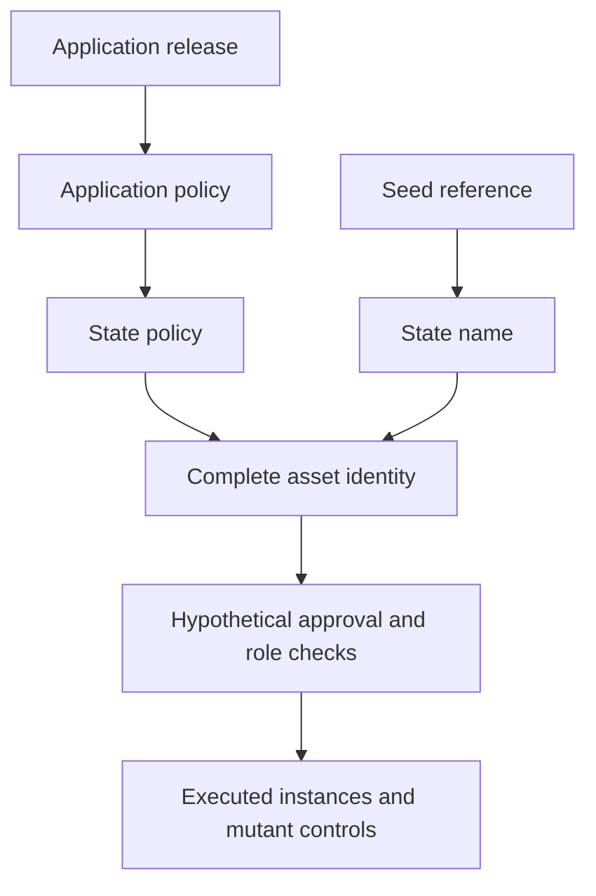

# Investigate complete registry identities

As a registry integrator, I want to inspect candidate identities, distinguish unsafe readings and replay their examples before adopting a new law.

## Story and status

This isolated Lean project investigates #741 at the supported root compiler. It requires the unchanged root model from `../..`. Every candidate declaration is a hypothesis; no accepted model, application, corpus, coverage record or release behavior changes. Approvals follow the operator's recorded complete-identity ruling in `specs/741-no-pin-model/decisions.md`.

All public statements have `sorry` bodies. The compiled ledger marks them STATED, with separate markers for rejected or potentially false readings. The kernel reports `sorryAx` alongside standard axioms; none is a proved guarantee. Witnesses and mutant falsifications are separate kernel-checked concrete instances with no proof holes. Their predicates are checked for definitional equality against the statement signatures; they never import the unproved statements.

The name-only safety claim is a rejected reading expected to be refutable. One evaluated fixture reuses an approval under a different state policy with the same state name. Policy-only recognition is also expected refutable: a genuine witness carrying a fabricated state datum satisfies that reading. The authenticated reading refuses that fixture under its explicit name/provenance checks. These evaluations are not general proofs, transaction execution or acceptance of either recognition rule.

## Identity and evidence boundaries

Derivation is acyclic: release determines application policy, then state policy. The seed independently determines state name. Complete policy/name registry identity then enters approval and role naming. `Hash` and `Codec` are explicit pure parameters; the tagged natural-number encoding and finite lookup hash are not Cardano serialization or cryptographic implementations. Encoding and hash separation are distinct finite-domain premises. No unconditional injectivity theorem is asserted.

State, witness, trie-ready and application tags have explicit roles under the hypothetical shared policy. **Request-tag separation here uses only registry, role and key. It does not cover the economic request payload or per-request nonce.** Approval payloads retain edge, key, owner, destination and nonce. No economic admission, custody or supply claim follows from this identity projection.

`Observation.provenance` is supplied authenticated-origin evidence. This project does not establish its truth from a datum, token location or transaction history. Without the stated finite separation premises, names can collide. The recognition question remains open.

`TxView` records spent references, output assets, mint per complete asset and invoked policies. It has no ledger validity judgement, script evaluator or UTxO update. A single transaction may spend a seed once and invoke two application-specific state policies, yielding the same seed name under different policies. A list of observations satisfying `historyAllows` instead carries a separate spent-once premise. Binding either observation to an accepted ledger/history is still owed to #679/#680. Neither implies global uniqueness of a name across policies.

## Reproduce the evidence

Run `nix develop --quiet -c just no-pin-identity` from the repository root. The Development shell checks job runs this same recipe. It builds the isolated library and generic oracle, elaborates the fresh environment report, checks compiled statement identities and axioms against `statements.json`, and replays `corpus.json` through the oracle. Successful local execution is not hosted CI evidence.

`Report.lean` discovers public cases, guards and roles from compiled constructors. It executes each case and measures which selectors change it; inversion rows must cover exactly that discovered extent. Every statement row needs an executed antecedent witness and at least one owned selector with a positive candidate instance and a false mutant instance. Normalizing that selector to `none` must give the identical compiled proposition as the positive control.

The mutation selector exists only for the mutant ledger. **All statements are stated at `Mutation.none`.** A selector flips one atomic guard in the same candidate definition; the report executes its truth table at every discovered site and refuses multi-guard changes. The guards include every condition in approval, recognition and genesis, plus history uniqueness. Inversions state the full acceptance equivalence, so a mutant that wrongly refuses a valid input is detected too.

The oracle at `.lake/build/bin/no-pin-oracle` reads JSON `Scenario` lines and returns Boolean results. Each scenario supplies a named `Query` surface and a mutation selector. It contains no theorem-specific expected-result code. Malformed JSON or scenario fields exit nonzero. The corpus is a computed replay of public definition cases and their guard flips, not a ledger-accepted lifecycle or a replacement for the separate Lean theorem fixtures.

## Limits and next decision

No general statement is proved or constructively refuted in this stage. No simulator, validator, builder, reader, custody reconciliation, economic configuration migration or compatibility policy is accepted. The termination-custody ruling belongs to its later stage. Independent statement review and the operator's remaining decisions precede proof work or any accepted-law change.

## Application-held pending termination candidate

As a holder, I want booking to keep my genuine token and request at the application, preserve my protected deposit, and permit a later public fold without my signature. This hypothetical extension applies the 23 October settlement ruling and the authorized disjoint value partition. It changes no accepted law or validator.

The Held modules distinguish live holdings from pending terminations, bind booking to the observed complete registry and the retained key/custody, and call the unchanged root booking and economic fold. A physical pending input contains the exact root request amount plus its protected deposit. The root observer removes that deposit slice; local release reads the physical payments and sums the released deposits. A connected instance registers two keys, books both, folds both, and computes both balances and the controller's payment. Wrong-key booking, wrong complete registry identity, overlapping value and missing payment are violating twins.

The existing no-pin-identity recipe checks both evidence families. The report derives statement types, proof axioms, public constructors and atomic guard coverage from the compiled environment. Separate held ledgers and corpus preserve the original identity rows byte for byte. The same JSON oracle accepts the held family through an explicit family field; inputs contain public observations rather than theorem names or expected answers.

Every general candidate statement remains STATED with sorry debt. Kernel-checked finite witnesses and single-guard falsifications establish the reported instances, not general correctness. Non-rejection, operation/nonce tag commitment, world supply and permanent retirement reuse the accepted root declarations by name at the actual reachable worlds. The report computes counts and statuses; a missing row, witness, selector or inversion fails the check.

Authentication and completeness of observations, the interpretation of the accepted root's abstract registryId as the observed complete registry token, physical value correspondence, and the proposed shared policy's BurnCoupling contract remain explicit external obligations under #679/#680. The unchanged root Config supplies the abstract contents interpretation; this is not a concrete pin-free validator implementation. Cancellation and pending payload/control updates remain unruled hypotheses with no exposed path. No ledger inclusion, policy execution, hosted CI, production acceptance or release is claimed.
