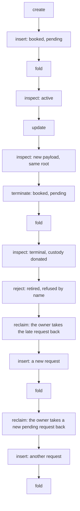

# Demo 1 on a development node: Alice and Bob run a registry from the release archive

As a Cardano developer who knows `cardano-cli`, wallets, faucets and Koios but
has never used Singular, you want to see the whole of Demo 1 work before you
spend test ada: a registry is created, a key is inserted, changed, terminated
and taken over by a new owner of the name, and every refusal appears where the
page says it will. This page does that on a private development node that the
archive starts for you. Every command is copied as it stands; nothing in it
needs a faucet, an account or a checkout.

When it works, you have read sixteen receipts, each the one JSON document a
`singular registry` or `open-datum` command prints, and you have seen two
wallets sign in the two ways Singular offers. The same steps on the public
preprod network, with the faucet and Koios, are on the
[preprod runbook](https://lambdasistemi.github.io/singular/docs/demo1-on-preprod/).
Read this page first if you want to see it run for nothing; read the runbook
when you are ready to spend test ada.

## The story

Alice boots a registry whose application is **open datum**: a key's live value
is an output at the application's script, holding the key's one active token
under an inline envelope. The envelope has a protected part (this registry, its
active policy, the key, the controller and a protected deposit) and a free
payload. Only the controller may replace the payload. A termination does not
release the key's custody to its controller: the registry takes it in and donates
it to the treasury, less the declared tip.

An `insert` or a `terminate` books and stops: its request waits at the
registry, and its receipt names the request and the deadline by which it must
be folded. The fold is its own command, `open-datum fold`, run by whichever
wallet folds. Each step below is a separate process and prints one JSON
receipt. The saved state directory carries the identity from one process to the
next.

Alice and Bob keep no signing key on disk, and the story shows both ways to
sign:

- Alice signs from her **vault**, in one command. She names the vault file and
  the descriptor her passphrase is read from. The command builds the run's one
  bundle of transactions, signs it from the vault, sends it and prints its
  receipt once every transaction has landed.
- Bob signs the **external** way. His write names his wallet's address and a new
  bundle file. The command builds its whole run as that one bundle, signs
  nothing, sends nothing and exits with status 19, the outcome
  `waiting-for-signatures`. He then signs the bundle from his vault with
  `singular wallet sign` and sends it with `singular submit`. Until `submit`
  finds the bundle's transactions on chain, the command's own fields (the
  request, the fold, the root) are only what the bundle expects, and the
  receipt says so under `expected`.



## Words used on this page

| Word | What it means here |
| --- | --- |
| registry | the on-chain table of unique keys, found by its state token |
| state token | the one token that names a registry, printed by `create` as `POLICY.NAME` in hex; every later command takes it as `--state-token` |
| key | a name of 1 to 32 bytes, given as text with `--key` or as hex with `--key-hex` |
| payload | the free data a key carries, a Plutus datum in the detailed JSON schema |
| request | an insertion or a termination that is booked and waits to be folded; a pending request locks its value |
| fold | the transaction that applies pending requests to the registry; any wallet may build it |
| folder's fee | what the folder keeps from each request it folds (the receipts call it the tip) |
| deposit | 2 tADA (2 000 000 lovelace) a key's envelope protects, paid back when the key is terminated |
| processing window | how long a request may wait for its fold |
| retract window | how long after that the owner may take the request back |
| registration cost | what each registration of a registry pays, in lovelace, zero or more; required, no default, fixed for the registry's life |
| booking width | the widest validity interval a registration booking may carry, in milliseconds; required, no default, fixed for the registry's life |
| vault | a file holding one wallet's signing key, sealed by a passphrase; made by `singular wallet create` |
| bundle | the unsigned transactions of one command, written to a file for an external signer |
| Koios | the public indexer API every command reads and submits through |
| development node | a private chain the archive starts for this page, with its own Koios-shaped endpoint |

## What you need

- A Linux machine with [Nix](https://nixos.org/download) and flakes enabled, plus
  `git`, `jq` and `curl`. The quickest way to the programs is the Nix shell of
  [singular-demo](https://github.com/lambdasistemi/singular-demo), described in the next section; it needs
  only Nix and `curl`.
- This archive, downloaded, checked and extracted. The
  [onboarding page](https://lambdasistemi.github.io/singular/docs/consumer-onboarding/)
  gives the download, the checksum check and the extraction commands. Every
  command below runs from the extracted directory, the one that holds
  `DEMO1.md` and `onchain/`.
- Time. Building from source compiles a large Haskell stack unless the public
  binary cache serves it; see the next section. A binary install that needs no Nix is coming in [issue 695](https://github.com/lambdasistemi/singular/issues/695).

## Build the commands

**The quick way: the shell.** From the extracted archive's directory,

```sh
nix develop github:lambdasistemi/singular-demo --accept-flake-config
```

opens a shell with `singular`, `open-datum`, the development node `devnet` and
`jq` on the path, all built by the project's CI. With the caches accepted it
builds only the shell itself and fetches about 190 MiB instead of compiling the
Haskell stack. Its limits: it is pinned to release v0.12.0, it is built for x86_64
Linux only, it needs Nix, and it keeps the development node's files in one directory per
user, so run one node at a time (on a multi-user Nix install a user outside
`trusted-users` cannot take the caches from a flake; the
[shell's README](https://github.com/lambdasistemi/singular-demo) says what to change). In that shell, name the
programs like this and skip the build below; everything after it runs as written:

```sh
root="$PWD"
singular="$(command -v singular)"
open_datum="$(command -v open-datum)"
devnet="$(command -v devnet)"
blueprint="$root/onchain/plutus.json"
```

The shell's own `$blueprint` holds the same bytes as `onchain/plutus.json`, the
archive's file, but it sits in the Nix store with no `version.txt` beside it, and
`singular registry describe` (step 2) refuses a blueprint without one, so keep the
archive's file as `blueprint`.

**The other way: build from the archive.** This suits another release or another
system. Nix reads a flake from a Git tree, and the application's flake reaches the
registry's sources one directory up, so the extracted archive must be made into
a Git tree first. This commits nothing and contacts nothing. Nix then warns
that the tree is dirty; that is expected.

```bash
root="$PWD"
git init -q && git add -A
singular="$(nix build --quiet --no-link --print-out-paths ./offchain#singular)/bin/singular"
open_datum="$(nix build --quiet --no-link --print-out-paths ./applications/open-datum/offchain#open-datum)/bin/open-datum"
devnet="$(nix build --quiet --no-link --print-out-paths ./offchain#devnet)/bin/devnet"
blueprint="$root/onchain/plutus.json"
```

The project's public binary cache holds both executables for `x86_64-linux`, so
a build that finds them downloads about 100 MiB each instead of compiling. Add
the cache before the first build, either with the two settings below on the
command line, or in `/etc/nix/nix.conf` as `extra-substituters` and
`extra-trusted-public-keys` if your user is not trusted by the Nix daemon:

```bash
--option extra-substituters https://paolino.cachix.org \
--option extra-trusted-public-keys paolino.cachix.org-1:ecmgO3CXdgSWA2cHlm4srknd/cLFMLmK3i3NrzeDFaE=
```

The flakes also name the Cardano build cache `https://cache.iog.io`; Nix asks
once whether to accept it. No release yet ships ready-built binaries (that is planned in
[issue 348](https://github.com/lambdasistemi/singular/issues/348)). `singular --version` prints the
program, its version and the commit it was built from; a build that carries no
commit says `commit unknown`, and the path the build prints then tells which
build you hold.

## Start one development node

The development node is private and generated: a fresh chain whose genesis
funds the addresses you name. Alice and Bob each make a wallet with
`singular wallet create`: a vault, a file that holds the wallet's signing key
sealed by a passphrase, which a script supplies on an inherited file descriptor
(typed at a prompt when you run it by hand). The node is given the printed
addresses and never sees a key, and it funds nothing outside itself. Alice
books, and Bob folds. Each wallet is funded with one output, and nothing is
split.

```bash
printf '%s\n' "alice's passphrase" > alice.passphrase
printf '%s\n' "bob's passphrase" > bob.passphrase
"$singular" wallet create --vault alice.vault --network-magic 42 --passphrase-fd 3 3< alice.passphrase
"$singular" wallet create --vault bob.vault --network-magic 42 --passphrase-fd 3 3< bob.passphrase
alice_addr="$("$singular" wallet address --vault alice.vault --network-magic 42 --passphrase-fd 3 3< alice.passphrase)"
bob_addr="$("$singular" wallet address --vault bob.vault --network-magic 42 --passphrase-fd 3 3< bob.passphrase)"
# The launcher reads its genesis files from offchain/, so it starts there.
( cd "$root/offchain" && exec "$devnet" --fund-address "$alice_addr:1:2000000000" --fund-address "$bob_addr:1:2000000000" ) > devnet.out &
devnet_pid=$!
# It prints its settings once the node is up and both wallets are funded.
until jq -e . devnet.out > /dev/null 2>&1; do
  kill -0 "$devnet_pid" 2> /dev/null || { echo "the node exited before it printed its settings" >&2; break; }
  sleep 2
done
koios_url="$(jq -r .providerUrl devnet.out)"
time_dir="$(jq -r .networkTimeDirectory devnet.out)"
provider=(--koios-url "$koios_url" --network-time "$time_dir" --network-magic 42)
```

The node is a Koios-shaped HTTP endpoint at `providerUrl`. The same commands
run against the preprod Koios on the runbook page with only these three
settings changed.

## Run the story

First the two payloads the story uses and the helpers the later steps call. A
payload is Plutus data in the detailed JSON schema; these two are a one-entry
map from the bytes of `name` to the bytes of `alice` and of `bob`.

```bash
jq -n '{map:[{k:{bytes:"6e616d65"},v:{bytes:"616c696365"}}]}' > payload.json
jq -n '{map:[{k:{bytes:"6e616d65"},v:{bytes:"626f62"}}]}' > payload-update.json

# Alice signs from her vault, in one command: it names the vault and the
# descriptor her passphrase is read from, and the command opens the vault,
# builds the run's one bundle, signs it, sends it and lands it.
alice=(--vault alice.vault --passphrase-fd 3)
# Bob signs the external way: every write of his names his address and a new
# bundle file, builds its whole run as that bundle, signs nothing, sends
# nothing and exits 19. His vault signs the bundle, then the signed bundle is sent.
waits_for_signatures() { local status=0; "$@" || status=$?; [ "$status" -eq 19 ]; }
sign() { "$singular" wallet sign --vault bob.vault --passphrase-fd 3 --out "witnesses-$1" "$1.bundle" 3< bob.passphrase; }
send() { "$singular" submit --witnesses "witnesses-$1" "${provider[@]}" --receipt "$1.submitted.json" "$1.bundle"; }
# Wait until the ledger's tip slot is past a slot a receipt names. The page
# never waits by the clock, because the windows are judged from the ledger's tip.
wait_for_slot() { until [ "$(curl -fsS "$koios_url/tip" | jq -r '.[0].abs_slot')" -gt "$1" ]; do sleep 5; done; }

# 1. Preview the identity the wallet's output gives, from Alice's address alone,
#    then create the registry. The windows are short, so steps 11 and 14 wait
#    minutes rather than the ten and five of the defaults. The registration cost
#    (in lovelace) and the booking width (in milliseconds) are required, have no
#    default and stay fixed for the life of the registry.
"$open_datum" create --registration-cost 0 --booking-width 60000 --preview --state-dir reg --blueprint "$blueprint" "${provider[@]}" --wallet-address "$alice_addr"
"$open_datum" create --registration-cost 0 --booking-width 60000 --process-time 120000 --retract-time 60000 \
  --state-dir reg --blueprint "$blueprint" "${provider[@]}" "${alice[@]}" 3< alice.passphrase \
  > create.json
# Every later command names the registry by the state token create printed.
# The directory reg only keeps your own journal: nothing in it names the registry.
token=(--state-token "$(jq -r .stateToken create.json)")

# 2. Read the registry page with the command the create receipt printed.
#    This archive's singular comes first on the path, so the bare program
#    name resolves to it.
export PATH="$(dirname "$singular"):$PATH"
eval "$(jq -r .describeCommand create.json)"

# 3. Book an insertion of a key with its first payload; Alice's wallet is its controller.
#    The request stays pending; the receipt names it and its fold deadline.
"$open_datum" insert --state-dir reg --blueprint "$blueprint" "${token[@]}" --key alice \
  --payload payload.json "${provider[@]}" "${alice[@]}" 3< alice.passphrase > insert.json
jq '{request, foldDeadline}' insert.json

# 4. Fold it, before that deadline. Any wallet may fold: here, Bob's, the external way.
waits_for_signatures "$open_datum" fold --state-dir reg --blueprint "$blueprint" "${token[@]}" "${provider[@]}" \
  --wallet-address "$bob_addr" --bundle fold-insert.bundle   # exits 19
sign fold-insert && send fold-insert

# 5. Read it back: no signing key, nothing submitted.
"$open_datum" inspect --state-dir reg --blueprint "$blueprint" "${token[@]}" --key alice "${provider[@]}" > inspect.json
jq '{leaf, root}' inspect.json

# 6. Replace the payload.
"$open_datum" update --state-dir reg --blueprint "$blueprint" "${token[@]}" --key alice \
  --payload payload-update.json "${provider[@]}" "${alice[@]}" 3< alice.passphrase

# 7. Read it back.
"$open_datum" inspect --state-dir reg --blueprint "$blueprint" "${token[@]}" --key alice "${provider[@]}" > inspect.json
jq '{leaf, root}' inspect.json

# 8. Book the termination of the key.
"$open_datum" terminate --state-dir reg --blueprint "$blueprint" "${token[@]}" --key alice \
  "${provider[@]}" "${alice[@]}" 3< alice.passphrase

# 9. Fold it: the fold burns the token and donates the held value less the tip.
waits_for_signatures "$open_datum" fold --state-dir reg --blueprint "$blueprint" "${token[@]}" "${provider[@]}" \
  --wallet-address "$bob_addr" --bundle fold-terminate.bundle   # exits 19
sign fold-terminate && send fold-terminate

# 10. Read it back.
"$open_datum" inspect --state-dir reg --blueprint "$blueprint" "${token[@]}" --key alice "${provider[@]}" > inspect.json
jq '{leaf, root}' inspect.json

# 11. A request nobody folded stays pending. The retired registry reject, which once
#     cleared it, is refused by name: exit 10, and no bundle is written.
#     The way out is its owner's reclaim, after the processing deadline and while
#     the retract window is open (here, between two and three minutes after it
#     was booked).
"$open_datum" insert --state-dir reg --blueprint "$blueprint" "${token[@]}" --key late \
  --payload payload.json "${provider[@]}" "${alice[@]}" 3< alice.passphrase > late.json
# Retired: exit 10, outcome client-refusal; nothing was read, signed or submitted.
"$singular" registry reject --state-dir reg --blueprint "$blueprint" "${token[@]}" "${provider[@]}" --wallet-address "$bob_addr" --bundle reject.bundle > reject-retired.json || [ "$?" -eq 10 ]  # retired: refused by name
jq '{outcome, reason}' reject-retired.json
wait_for_slot "$(jq -r .foldDeadline.slot late.json)"
"$singular" registry reclaim --state-dir reg --blueprint "$blueprint" "${token[@]}" --request "$(jq -r .request late.json)" \
  "${provider[@]}" "${alice[@]}" 3< alice.passphrase

# 12. The registry takes requests again: book a new insertion.
waits_for_signatures "$open_datum" insert --state-dir reg --blueprint "$blueprint" "${token[@]}" --key bob \
  --payload payload.json "${provider[@]}" --wallet-address "$bob_addr" --bundle insert-bob.bundle   # exits 19
sign insert-bob && send insert-bob

# 13. Fold it.
"$open_datum" fold --state-dir reg --blueprint "$blueprint" "${token[@]}" "${provider[@]}" \
  "${alice[@]}" 3< alice.passphrase

# 14. Book a different insertion and keep its request reference from the receipt.
#     Let its processing deadline pass, then reclaim during its retract window.
"$open_datum" insert --state-dir reg --blueprint "$blueprint" "${token[@]}" --key carol \
  --payload payload.json "${provider[@]}" "${alice[@]}" 3< alice.passphrase > carol.json
wait_for_slot "$(jq -r .foldDeadline.slot carol.json)"
"$singular" registry reclaim --state-dir reg --blueprint "$blueprint" "${token[@]}" --request "$(jq -r .request carol.json)" \
  "${provider[@]}" "${alice[@]}" 3< alice.passphrase

# 15. The reclaimed request no longer blocks the next insertion.
"$open_datum" insert --state-dir reg --blueprint "$blueprint" "${token[@]}" --key dave \
  --payload payload.json "${provider[@]}" "${alice[@]}" 3< alice.passphrase

# 16. Fold it with Bob's wallet.
waits_for_signatures "$open_datum" fold --state-dir reg --blueprint "$blueprint" "${token[@]}" "${provider[@]}" \
  --wallet-address "$bob_addr" --bundle fold-dave.bundle   # exits 19
sign fold-dave && send fold-dave
```

When you are done, stop the node with `kill "$devnet_pid"`.

Run the fold of a request before the deadline its booking's receipt names
(`foldDeadline`); a later fold is refused by `open-datum`, naming the deadline,
before anything is signed. Giving `open-datum insert` or `open-datum terminate`
the `--fold` switch books and folds in one command, with one wallet: with the
external signer the one bundle then holds the booking and the fold, and one
signing covers both; with the vault the one command signs and sends both.

A write that is refused before it builds anything (the retired reject, a
closed registry's update, a terminal key) writes no bundle. While a
bundle waits for its signatures, the same wallet's next write of that registry
stops with the same outcome, `waiting-for-signatures`, naming the waiting
bundle, and builds nothing. `singular wallet sign` refuses a bundle whose
signers do not include the vault's address, and `singular submit` sends only the
transactions the chain does not hold, so it can be run again on a bundle that
has landed. A wrong passphrase or an unreadable vault is refused, naming the
vault, before the blueprint, the provider or the state directory is read. A
vault run whose answer is lost leaves its bundle pending, its fields under
`expected`, and the next write of that wallet stops on it like any waiting
bundle.

`--key` is the key as text, its UTF-8 bytes (`616c696365` is `alice`).
`--key-hex 616c696365` names that key too, which is how a key that is not
printable text is given. A key is 1 to 32 bytes either way.

`insert` builds the key's envelope around the payload: constructor 0 over the
control and the payload, the control being constructor 0 over the version `1`,
the registry's state asset (its state policy and token name, as the create
receipt prints them in `pins.pinState` and `token`), the active policy
(`pins.pinActive`), the key, the controller's payment key hash (the signing
wallet's, which the create receipt prints as `walletKeyHash`) and the protected
deposit in lovelace. The deposit is 2 000 000 when `--deposit` is not given;
`--deposit LOVELACE` names another amount, and one below 2 000 000 is refused.
That minimum is the client's own policy: the chain checks only that a request's
deposit equals the control's at booking and that an update keeps at least the
control's deposit, and sets no floor. The insert receipt and the preview receipt
print the envelope it built.

## What you should see

1. **`open-datum create`** prints the state token (`stateToken`), the seed, the
   token, the pins (the applied open-datum script, the state script and the
   three witness policies) and the published reference outputs. The preview
   names the token and the seed before anything is submitted. The wallet holds
   one output, so no seed is given: the registry boots from the change of its
   first publication. `create` also needs two values that have no default:
   `--registration-cost LOVELACE`, the cost each registration of the registry
   pays, in lovelace, zero or more, and `--booking-width MS`, the widest
   validity interval a registration booking may carry, in positive integer
   milliseconds; the runs on this page pass 0 and 60 000, and the registry
   fixes both for its life. `create` writes no identity file. Every later command
   derives the registry from the state token and this archive's blueprint,
   checks it against the chain and refuses by name when they disagree, such as
   `state-token-not-found` or `registry-pin-mismatch application`. Its receipt
   carries the describe command the next step runs, printed as `describeCommand`.
2. **`singular registry describe`** reads the registry page with the command the
   create receipt printed (`describeCommand`, run as printed): which registry
   this is, which release it runs, what its rules are and what it holds now. The
   page shows the public history of the state token from create to the live
   state output, read through the named provider, whose answers nothing here
   verifies; the release label is the archive's own claim, and the page is
   unsigned.
3. **`open-datum insert`** books the insertion through the application: its
   receipt names the pending request (`request`), the booking's transaction, the
   envelope kept for the fold and `foldDeadline`, the time and the slot by which
   the fold must happen. Nothing is folded, and the registry's root and your
   saved state do not move.
4. **`open-datum fold`** stages the fold of the pending requests with the wallet
   whose address it is given, which need not be the wallet that booked. It
   settles every request that passes, up to nine, each settled key's one active
   token landing in an output at the application, carrying its envelope inline.
   Its receipt names, under `expected`, each settled request, its key, its edge
   and the output it delivered in the `settled` list, beside the fold's
   transaction, the new root and how many milliseconds remained before the
   deadline, and lists the requests it left out in `excluded`.
5. **`open-datum inspect`** reads the key `active`, with the holding, its
   envelope and payload, the registry's root and its separately observed tip.
   The reads behind a write are not guaranteed to come from one chain state.
6. **`open-datum update`** replaces only the payload. The receipt's root equals
   the root before it.
7. **`open-datum inspect`** shows the new payload, the same control and deposit,
   and the same root.
8. **`open-datum terminate`** books the termination against the live holding:
   its receipt names the pending request, the custody output the booking spends
   into it, the protected deposit and the lovelace it transfers into the
   request.
9. **`open-datum fold`** stages and, once sent, lands its fold: the token is
   burned and the custody is donated to the treasury, less the declared tip.
   None of the custody is paid back to the controller. Its receipt states the donation.
10. **`open-datum inspect`** reads the key `terminal`, with no holding.
11. **`singular registry reject`** is retired. The registry's state script
    refuses a spend with the rejected action, so the command refuses by name
    (exit 10, outcome `client-refusal`) before it reads, signs or submits
    anything, and writes no bundle. A request nobody folded stays pending until
    its owner takes it back with `singular registry reclaim`, after its
    processing deadline and while its retract window is open.
12. **`open-datum insert`** stages a new request, which the registry takes once
    the late one is reclaimed.
13. **`open-datum fold`** folds it, and the key reads `active`.
14. **`singular registry reclaim`** takes back a new pending insertion that
    nobody folded, inside its retract window. An earlier attempt is refused,
    naming when it opens; another wallet is refused as not the request's owner.
    The owner's successful receipt names the request, the retract transaction,
    the value that was locked, the recipient and the returned output. The tip
    slot against the deadline slots decides the window, never the host clock.
    After the window closes the refusal says the request can no longer be
    taken back, and the request stays pending. Updates and deletions cannot be
    retracted; insertions and terminal witnesses can. The
    root stays where it was.
15. **`open-datum insert`** books a new request after reclaim.
16. **`open-datum fold`** folds it, and an independent inspection reads `active`.

A closed registry is booted with `open-datum create --closed ...`, which pins
the closed-datum application whose payload is written once. Every later command
follows the registry's mode with no further flag, and `open-datum update` on a
closed registry stops before anything is built or signed, saying the registry is
closed. The project rehearses that scene on a development node on every change,
in the hosted job "Closed-datum journey from the release archive".

## When a command stops

A command that stops prints why, in one outcome class with its own exit status.
Status 2 is a mistake on the command line.

| Exit status | Outcome | What it means |
| --- | --- | --- |
| 0 | `success` | the command did what it says |
| 10 | `client-refusal` | the command refused before it submitted anything: a window still open, a wrong key, a wallet with too little, a rule of the client; the receipt's `reason` says which |
| 11 | `ledger-refusal` | the node refused a transaction the command sent; the receipt names the rule or script |
| 12 | `node-unavailable` | the provider could not be reached or answered unusably |
| 13 | `timeout` | a submitted transaction was not seen on chain within `--confirm-timeout` seconds (default 600) |
| 14 | `stale-state` | what the command read changed under it, or the history it read no longer reaches the root; read again |
| 15 | `partial` | a submission is left unresolved, or part of a run landed and the rest did not; the receipt names it |
| 16 | `concurrent-writer` | the transaction built does not spend exactly what the command selected, because another writer moved the registry first |
| 17 | `proof-missing` | no authenticated proof was available for the key |
| 18 | `proof-inconsistent` | the proof and the holdings contradict each other |
| 19 | `waiting-for-signatures` | an external write built its bundle and is waiting for the signature, or a pending bundle stops the next write |

## Partial outcomes and recovery

Every submission is journalled in your state directory before it is sent, and
its confirmation after. A command never resubmits, reboots or overwrites on its
own:

- **partial** names what was left behind. An insertion of a key the registry
  already holds is booked by the application and then cannot be folded: the
  receipt names the pending request, and its deposit stays locked in it. A fold
  that is asked for after its request's deadline, or that the registry cannot
  take, is a **client-refusal** that submitted nothing; the request stays
  pending.
- **timeout** names the submitted transaction when its confirmation did not
  arrive within `--confirm-timeout` seconds (default 600). The entry stays
  unresolved, and every later write on that registry refuses until `inspect`
  resolves it from the chain.
- **inspect** is the recovery: it reads the journal, checks each unresolved
  submission against the chain, and advances the saved state only for what the
  chain shows.
- A second **create** on the same directory is refused, including one that was
  held while another create finished.

## On a public network

The same ordinary commands use a Koios API on the requested test network. Three
settings change: the Koios base URL, the network magic and the optional token
file. The
[preprod runbook](https://lambdasistemi.github.io/singular/docs/demo1-on-preprod/)
gives the faucet funding, the amounts, the waits and every step with real
values, and says which parts of it have run on preprod and which have not.

A preview shows what a write would cost before you sign anything. It names the
caller by an enterprise address instead of a signing key, reads through a
connection that cannot sign or send, and writes nothing: your state directory is
byte for byte the same afterwards.

```bash
# The identity the wallet's output gives, and what each write would cost, from public facts alone.
"$open_datum" create --registration-cost 0 --booking-width 60000 --preview --state-dir reg --blueprint "$blueprint" \
  "${provider[@]}" --wallet-address "$alice_addr"
"$open_datum" insert --preview --state-dir reg --blueprint "$blueprint" "${token[@]}" --key dave \
  --payload payload.json "${provider[@]}" --wallet-address "$alice_addr"
```

The preview receipt names the wallet outputs it selects, each body's fee, the
execution units the local evaluator measured for each script, the total
collateral each states and the collateral it returns, a digest of the protocol
parameters it was built under, and the outlay: the fee, the value the booking
locks and a bound on the fold that follows. An insertion or a termination is two
transactions, and the fold exists only once its booking has confirmed, so the
preview bounds the fold from the network's parameters. A preview is not a
confirmation: its bodies are built for one moment.

`insert`, `update`, `terminate` and `fold` take `--fund-input TXID#IX`, the
wallet output that funds and collateralises the write, and `--max-outlay
LOVELACE`. A booking, an update or a fold past the outlay is not signed. Without
`--fund-input`, a write spends the wallet's largest ada-only output and returns
the change. A fee is never declared: the booking's units are measured on the
body that will be submitted. A funding output that cannot leave a return of at
least its minimum ada is refused before anything is submitted.

## What the project runs on its own

Two further tools ship in this archive, and they are not part of the path
above. They are run by the project against a registry that already exists, and
they need things an ordinary user does not have, so no step here uses them.

- `cli-controls` (built from `conformance#cli-controls`) attaches to an existing
  registry with a fresh key and rehearses four refusals, each beside the
  ordinary command that does the same thing legitimately: an update another
  wallet's signature stands for, a release outside any fold, a second insertion
  of an active key and an insertion of a terminal key. It also requires
  `--node-socket` for a separate independent probe of the chain, and it keeps
  key files. That socket is never given to `singular` or `open-datum`.
- `tools/demo1_readback.sh` reads one key's token output back from Koios by
  policy id and asset name alone, and compares the output reference, the inline
  datum bytes and their hash with an `open-datum inspect` receipt. It exits 0
  only when the indexer finds exactly one output holding the token and agrees
  with the inspect, within `--max-lag` slots of its tip. Run it from the
  extracted archive with `--provider koios`; it is the check the preprod
  runbook uses after steps 5 and 7.

Both are described in the
[reviewer's map](https://lambdasistemi.github.io/singular/docs/demo1-preprod/).

## What this does not claim

The open-datum application protects the payload and the deposit, nothing more;
it is a demonstration of the registry's mechanics. This page and its receipts
are evidence of behaviour on a private development node only. Public-network
receipts are on the preprod runbook, with their limits; nor is any complete
conformance claimed here.
