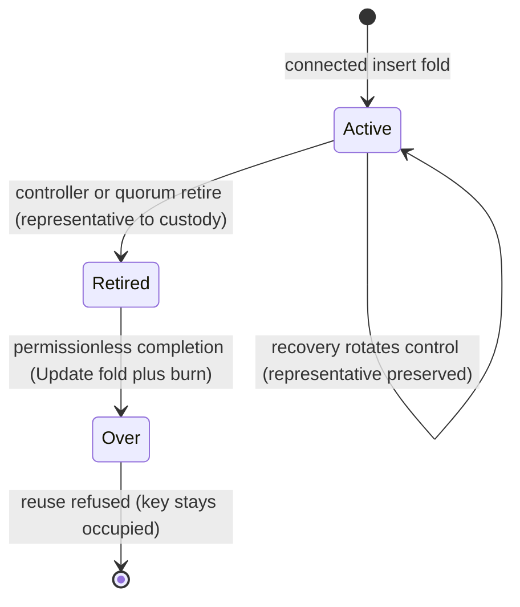

# Singular release archive

You are a Cardano developer who knows `cardano-cli`, wallets, faucets and Koios,
and you have received a tagged Singular release. You want to know what it holds,
that it is what it says it is, and where to play Demo 1 with it: create a registry,
put keys in it, change and end them, and see each refusal appear where it should.
Demo 1 is played from [singular-demo](https://github.com/lambdasistemi/singular-demo).
This archive carries the compiled validators, the sources the commands are built
from and the checks that tie them to the release. You need none of the repository.
The only external requirement is [Nix](https://nixos.org) with flakes (the identity
verification also runs without it, with just `jq`), plus `git`, `jq` and `curl`.

## Play Demo 1

1. Check this archive (section 1) and its compiled validators (section 2).
2. Play Demo 1 from singular-demo. Its step-by-step page,
   https://lambdasistemi.github.io/singular-demo/, gives the sixteen steps; its
   Nix shell and Ubuntu kit provide `singular`, `open-datum` and a private
   development node, and its README names the release they are built from.

The rest of this file is reference for the archive itself: what it carries, how
to verify it, the signers, the bounded registry journey, and, kept last because
it is history, the naming lifecycle of earlier releases.

## What the archive carries

| path | contents |
|---|---|
| `onchain/` | the imported registry partition: Aiken validators, its own `flake.nix`/`flake.lock`, and `plutus.json` — the **compiled** blueprint |
| `naming-onchain/` | Singular's own naming partition: the same shape, with its compiled `plutus.json` |
| `onchain/script-identity.json`, `naming-onchain/script-identity.json` | the **pinned unapplied identities**: every validator's compiled hash and parameter count, plus the compiler string |
| `offchain/` | the command sources, shared library, generic adapters and retained tests |
| `RELEASE.md` | an introduction to Singular and instructions for using the release archive |
| `RELEASE-COMMIT` | the commit this archive publishes; the row runners read it as their candidate revision when no git checkout is present |
| `MODEL-REVISION` | the application model commit this release maps to: the revision of the formal model the conformance evidence reads its statements at |
| `verify-identities.sh` | the identity check of this archive, needing only `bash` and `jq` |
| `SHA256SUMS` | the checksum manifest of every file in this archive |

The pinned identities are the *unapplied* hashes — the stable,
reviewable identity of each validator. The identities a concrete
instance carries on chain are *applied* (parameterised) hashes,
derived from the pins at run time; the journey asserts that derivation
on every run.

## 1. Verify the archive

The archive's own `SHA256SUMS` lists every file in it. Extract the archive into a
directory of its own (it has no top-level directory), then, from that directory:

```sh
sha256sum --check SHA256SUMS
```

The release's `SHA256SUMS`, published next to the archive file, covers the archive
itself and the documentation archive; check the file you downloaded with
`sha256sum --check --ignore-missing SHA256SUMS` before you extract it, and keep it
apart from the inner file of the same name.

To check a published release end to end without a checkout (the sums, the stated
model revision, and the ordinary commands run from this archive on a development
network), run `nix run github:lambdasistemi/singular/vX.Y.Z#verify-release -- vX.Y.Z`
with the release's tag on Linux; the documentation page "Download and verify a
release" explains each refusal.

## 2. Verify the identities from this archive

The hashes CI enforces, checked against the compiled blueprints this
archive carries — not against any repository:

```sh
bash verify-identities.sh
```

With Nix, you can instead run the exact checks CI runs:

```sh
nix build ./onchain#script-identity --no-link
nix flake check ./naming-onchain
```

## 3. The packaged command journey

The release verifier builds `singular`, `open-datum` and the development node
from this archive's own flakes. It runs creation, registration, payload update
and permanent termination through those ordinary binaries, using the compiled
`onchain/plutus.json` that the archive carries. Separate wallets book and fold;
the chain is read independently of their receipts. Retraction, cleanup and
refused re-registration are part of the same development-network journey.

To run that harness from the extracted archive, build its three programs and
provide the small command-line tools it uses. Choose a short private scratch
path for the node's Unix socket. The results directory must not already exist;
the harness preserves its receipts there and removes its generated node on exit.

```sh
singular="$(nix build --quiet --no-link --print-out-paths ./offchain#singular)"
open_datum="$(nix build --quiet --no-link --print-out-paths ./applications/open-datum/offchain#open-datum)"
devnet="$(nix build --quiet --no-link --print-out-paths ./offchain#devnet)"
mkdir -p "$HOME/.cache/singular-journey"
export TMPDIR="$HOME/.cache/singular-journey"
export E2E_GENESIS_DIR="$PWD/offchain/e2e-test/genesis"
results="$(mktemp -d "$TMPDIR/run.XXXXXX")/results"
nix shell nixpkgs#bash nixpkgs#coreutils nixpkgs#diffutils \
  nixpkgs#findutils nixpkgs#gawk nixpkgs#gnugrep nixpkgs#gnused \
  nixpkgs#jq nixpkgs#procps nixpkgs#python3 -c bash \
  tools/no_pin_registration_journey.sh \
  "$singular/bin/singular" "$open_datum/bin/open-datum" "$devnet/bin/devnet" \
  "$PWD/onchain/plutus.json" "$PWD/tools/no_pin_chain_view.py" "$results"
```

The harness refuses setup failures separately from a failed assertion. Its
verdict table, story receipts and chain readbacks describe what that run
establishes; a command description alone is not release acceptance. This
development-network harness does not establish mainnet suitability or the
historical naming lifecycles below. The [command reference](https://lambdasistemi.github.io/singular/docs/singular-node/)
describes ordinary command and wallet use.

## Appendix: the retained naming-lifecycle material

Everything below is history. It describes the naming application of earlier
releases, and none of it is part of Demo 1.

The archive also carries the naming-lifecycle row runners of earlier
releases (claim, recovery, retirement and their independent reader). They are
retained legacy commands: kept so the archive stays faithful to its history, but
not currently buildable and verified against this release's source. Release
instructions are corrected forward: a future correction changes the current source
and the archives built from it; already published archives are never rewritten, so
an older archive can still carry the previous instructions that presented every
row runner as runnable. A zero exit is the verified journey's claim: it exits
non-zero on any mismatch, and the identity and fixture checks re-derive every
binding from retained bytes rather than trusting anyone's word.

### The naming lifecycle the retained rows exercise



Claiming writes the name, recovery rotates its control without
moving its representative, retirement moves the representative into
completion-only custody, and completion burns it while folding the
retirement's own pending registry update. The key stays occupied
forever afterwards: re-registering it is refused, which is what
"Over" means on chain. The row runners that exercised this lifecycle
end to end are the retained legacy commands of section 5; the verified
journey covers the registry protocol (boot, request, apply, read
back), not yet this naming lifecycle.

### The retained legacy commands

The archive also carries the row runners and the independent reader of
the earlier naming design. They stay declared and shipped so the
archive remains faithful to its history. All nine are retained legacy
surfaces: not currently buildable or verified against this release's
source, and none is exercised by the release pipeline. The table below
binds each to its status and its owning issue. None of the nine has
passing build evidence at this source. Three carry direct build
failures on record from earlier, pre-integration revisions of the
project — `li01`, `recovery-rows` and `connected-verifier` — and their
sources in this archive still name identifiers the carried library no
longer exports, a source-level lead you can check against the bytes
shipped here, not a build result. The rest carry no passing build
evidence either — unverified rather than proven broken — and for
`retirement-verify` buildability is simply untested. Their re-cut
against the current registry mode is
owned by [#172](https://github.com/lambdasistemi/singular/issues/172)
— and by [#283](https://github.com/lambdasistemi/singular/issues/283)
for `register-rows`. Seven of these are the commands earlier release
instructions advertised; do not rely on any row below, and do not read
a documented name here as a working command:

| retained command | availability in this archive | repair |
| --- | --- | --- |
| `nix run .#li01` | unavailable: no passing build evidence; direct build failures on record from earlier project revisions; its carried source under `offchain/journey/li01/` still names removed identifiers | [#172](https://github.com/lambdasistemi/singular/issues/172) |
| `nix run .#li-refusals` | unavailable: unverified, no passing build evidence | [#172](https://github.com/lambdasistemi/singular/issues/172) |
| `nix run .#naming-rows` | unavailable: unverified, no passing build evidence | [#172](https://github.com/lambdasistemi/singular/issues/172) |
| `nix run .#register-rows` | unavailable: unverified, source imports removed identifiers | [#283](https://github.com/lambdasistemi/singular/issues/283) |
| `nix run .#recovery-rows` | unavailable: no passing build evidence; direct build failures on record from earlier project revisions; its carried source under `offchain/journey/recovery/` still names removed identifiers | [#172](https://github.com/lambdasistemi/singular/issues/172) |
| `nix run .#retirement-rows` | unavailable: unverified, source imports removed identifiers | [#172](https://github.com/lambdasistemi/singular/issues/172) |
| `nix run .#retirement-verify` | unavailable: unverified, buildability untested | [#172](https://github.com/lambdasistemi/singular/issues/172) |
| `repair-rows` | unavailable: unverified, source imports removed identifiers | [#172](https://github.com/lambdasistemi/singular/issues/172) |
| `connected-verifier` | unavailable: no passing build evidence; direct build failures on record from earlier project revisions; its carried source still names removed library identifiers | [#282](https://github.com/lambdasistemi/singular/issues/282) |

Two of the rows — `repair-rows` and `connected-verifier` — were never
advertised as commands in this archive or its predecessors; they are
declared executables of the shipped source, listed here so the
availability statement covers every retained declaration. What the
retained rows exercised, when they were current: the initialization,
refusal, maintenance, register, recovery and retirement rows, and the
permanent-retirement journey with controller and quorum retires,
recovery-then-retire on both routes, permissionless completion into
Over, and their attributed refusals:

```sh
# the retained legacy commands — see the availability table above
# LI01 — the canonical initialization row
nix run .#li01

# LI02–LI08 — the seven initialization refusals
nix run .#li-refusals

# LM01–LM04, WR01, LC01–LC06 — the maintenance and cancellation rows
nix run .#naming-rows

# connected inserts with real representatives (alice, bob, duplicate refused)
nix run .#register-rows

# recovery rows (rotation preserves the representative; refusals attributed)
nix run .#recovery-rows

# the permanent-retirement journey (see the retirement rows above)
nix run .#retirement-rows

# control modes (each exited non-zero by design after firing its probes):
RETIREMENT_CONTROL=valid nix run .#retirement-rows
RETIREMENT_CONTROL=wrong-reason nix run .#retirement-rows
```

The independent reader of that design, `retirement-verify`, was built
to replay a retirement exhibit from retained transaction bytes plus the
run log alone — re-deriving the creation control hash, the applied
representative policy, the registry-bound name, the custody triple, the
burn, the registry transition, the co-created request pairing and the
permissionless authorization, trusting no runner narration, no setup
constant and no key. As designed it printed one `VERIFIED` line per
retirement, one `VERIFIED-COMPLETE` per permissionless completion it
closed (or `COMPLETION-ABSENT` where custody correctly remained
intact), and failed loudly on the first mismatch. Its availability is
the row it holds in the table above.

```sh
nix run .#retirement-verify -- --evidence-dir <exhibit-dir> \
  --log-file <exhibit-log> \
  --naming-manifest ../naming-onchain/script-identity.json
```

### Ordinary-user completion (what permissionless means)

In the retained design, completion needs no controller or quorum
approval: the spending transaction carries empty required signers. It
does carry exactly
one witness — the fresh fee-input owner's key, outside every route
— because ledger conservation needs the fee paid from somewhere and
a spent fee input needs its owner's witness. That witness is fee
mechanics, not approval: the custody script, the registry transition
and the burn check no signature. Calling this an empty witness set
or "no signature of any kind" would be inaccurate; calling it
operator-free is exact.

### How refusals are attributed

In the retained rows, some refusals surface before submission, when
the builder locally
evaluates the transaction (the occupied-key fold, the mismatched
pair): the failure names the refusing script's hash in the
evaluation error at the exact spending purpose. Others surface on
submission as ledger phase-1 errors (a consumed output re-spent) or
phase-2 script failures naming the refusing script. The retained rows
pinned the actual shape — a budget exhaustion or a build failure is
never accepted as the claimed refusal — and the run log quotes the
full reason. The reader cross-checks the accepted transactions from
the same log against the retained bytes.

## Scope and limits

The verified part of this archive is the bounded registry journey with
the identity and fixture checks. The retained rows — claim, recovery,
retirement and permanent Over, plus all retained earlier rows — are
finite fixture executions on a devnet, not a statement about arbitrary
transactions, and none of that row evidence was re-established against
this release's source. Live-node assertions (spends accepted, refusals
with named reasons, chain reads) belong to the retained row runners;
the reader re-derives the same bindings from retained
accepted-transaction logs and bytes. Coverage debt stands
at 196 live obligations against the certified 196 baseline (192
preserved only as the historical predecessor; mapping 196,
implementation layer 196, findings 0, unclassified 83, stale 0);
the baseline ceremony belongs to the release owner. Conformance
beyond this artifact is a separate track.
