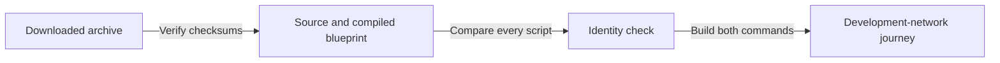

# Check the Singular release sources

As an integrator, you can check the downloaded source archive before building
the commands that create a registry, register a key, update its payload and
terminate it permanently.

Not for mainnet. Do not deploy Singular or open datum on mainnet until on-chain verification and an independent audit are complete.

## Check the download

Run `sha256sum --check --quiet SHA256SUMS` inside the extracted archive, then
`bash verify-identities.sh`. The latter compares every entry in
`onchain/plutus.json` with `onchain/script-identity.json`, including parameter
counts and compiler version. A missing entry or a moved hash is refused.

## Build and run

Build `offchain#singular` and `applications/open-datum/offchain#open-datum` with
Nix. Both commands take the merged deployment blueprint, `onchain/plutus.json`.
The packaged development-network journey is
`tools/no_pin_registration_journey.sh`; its ordinary commands register, read,
update and terminate keys. Running an identity check alone does not establish
that connected journey or agreement with the model.

The checksums bind the source and compiled blueprint. The identity check binds
the blueprint to its manifest; the journey separately exercises the commands.
Already published archives are never rewritten.
