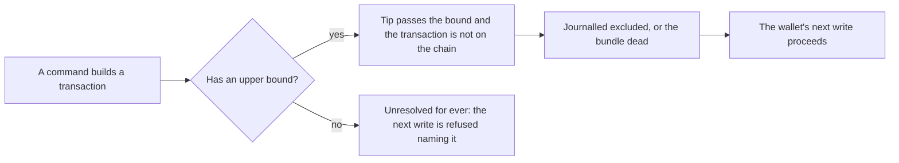

# Every transaction the commands build carries a validity upper bound

Issue 334, part of the work before the first stable release. This page is for a person who signs and submits with the
commands, for the integrators who sign elsewhere, and for the people who review the pull request. It follows
[the batch fold ticket](../746-batch-fold/spec.md).

## Story

As a person using the commands, when a submission outcome is unknown or rolled back, every transaction the commands built can
later be proved excluded once the chain tip passes its validity upper bound, so no transaction stays unresolved for ever.
As an integrator who signs a bundle elsewhere, a bundle whose transactions can never land (an output it spends was spent by
another write) is declared dead once the tip passes its deadline, and my wallet's next write of that registry proceeds
instead of stopping at a refusal that names the bundle.

Today the booking, the reclaim, the cleanup and the fold carry an upper bound. The update, the booking of a termination and the
creation of a registry do not, so the recovery rule that declares a transaction excluded or a bundle dead cannot apply to them.

## Requirements

| Name | Rule |
| --- | --- |
| every-built-transaction-has-an-upper-bound | The update, the booking of a termination and the creation of a registry carry an upper bound taken from the acquired view's time conversion, as the booking and the reclaim already do. A census of every builder the commands reach names any other transaction without one, and either gives it a bound or names why it cannot have one. |
| bound-is-inside-what-the-validators-accept | Each transaction with its bound is still accepted by the deployed validators on a development network. No validator, script hash or wire format changes. |
| unresolved-transactions-resolve | The exclusion rule resolves a booking, an update, a termination booking and a creation once the tip passes the bound; a staged bundle whose members cannot land is journalled dead and the next write of that registry by that wallet proceeds. |
| costs-and-goldens-follow | The creation cost receipts and every golden transaction that changes with the new field are regenerated by the repository's own tools in the same pull request. |
| documented-limits-follow | The residual that says transactions without an upper bound stay unresolved, and the limit that names a fresh seed or state directory as the only way out, are removed from the pages together with the controls that showed them. |

## Refusals and limits

- Refusal meaning, validators and the journal format do not change.
- Position against the formal model: a validity bound is a field of the transaction body, not a transition. The implementer
  records the search of the model and the validators for any rule that reads the validity interval of these three
  transactions; finding one stops the work and becomes a question with a user story.
