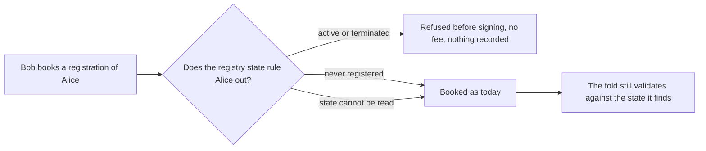

# A booking refuses a key the registry state already rules out

Issue 486, part of the work before the first stable release. This page is for a person who registers a key with the open datum
commands, and for the people who review the pull request. It follows
[the validity upper bound ticket](../334-validity-upper-bound/spec.md), whose command layer and registration journey it shares.

## Story

As Bob, when I book the registration of `Alice` while Alice is already registered, `open-datum insert` refuses before it asks me
to sign anything: it says `Alice is already registered`, no booking fee is paid, no transaction is submitted, no bundle is staged
and no pending request is left behind. The same holds when the key was registered and then terminated.

Today the booking is accepted and included, the fold then refuses it, and the request stays pending until its refund address
reclaims it. The person has paid for a request that could never have been folded.

## Requirements

| Name | Rule |
| --- | --- |
| insert-refuses-a-key-the-state-rules-out | Before anything is signed, submitted or recorded, `open-datum insert` reads the selected key's current state through the existing key reader and the ledger provider session, and refuses a key that is active (including one with a termination pending) or terminated. The refusal is a client refusal (exit 10, outcome `client-refusal`, no submission, no staged bundle, no fee) whose reason names the key and contains `is already registered`; for a terminated key it adds that the key was terminated. It holds for a signed submission and for a staged bundle alike. |
| a-key-never-registered-books-as-before | A key that was never registered books exactly as it does today: the same transaction, the same deposit and fee. A key whose state cannot be read (the provider cannot answer, or the registry's state policy is not one the reader recognises) does not stop the booking: the fold stays the authority, and the early refusal is only a courtesy. |
| the-fold-keeps-validating | State can change between a booking and its fold. A request booked while its key was unknown and made unfoldable by a later registration is still skipped or refused by the fold with the reason it has today. No fold, validator, script hash or wire format changes. |
| the-early-refusal-is-client-policy | The refusal is stated as the client's policy and not as a rule of the formal model. The update and the termination booking name a holding output and are unchanged. |
| journeys-tests-and-pages-follow | Every journey script, refusal script, test, conformance row and page that showed a booking accepted and then refused by the fold moves to the refusal at booking. The published conformance row about a registration that is not rejected early stays as published and a new row states the new behavior. |

## Refusals and limits

- Refusal wording: an active key reads `the key <name> is already registered`; a terminated key reads
  `the key <name> is already registered and was terminated`. Both contain `is already registered`, so a reader looking for that
  phrase finds it in either.
- Position against the formal model: Below. The model admits the insert transition only from an unknown leaf and a key never
  returns to an unknown leaf, so every key this refusal turns away is one the fold could never accept; the booking is the
  application's to admit. Nothing in the model, a validator or a wire format changes.
- The early refusal reads the registry state at the tip the booking was built at. Two requests for one unknown key may both be
  booked; the fold admits one and skips the other, as today.
- The check costs one read of the registry state on every insert, the same read `inspect --key` makes.
