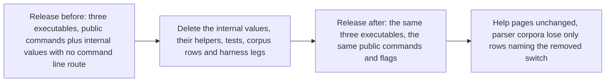

# Retire the legacy command layer before 1.0

Issue 486, the part that remains after the early refusal of a taken key, part of milestone 1. This page is for a 1.0 user
installing the release, for an author of another application, and for the people who review the pull request. It records
the story, the requirements and what the change does not touch.

## Story

As a 1.0 user, I install the release and find only the production commands: `singular` with its wallet, registry create,
registry inspect, sign and submit commands; `open-datum` with create, insert, fold, update, terminate, reclaim, cleanup and
inspect; and `devnet`. No older booking path exists in the code, so no command can book a key the registry state rules out.

## Requirements

- public-commands-unchanged: every command and flag reachable from the three release executables before the change is
  reachable after it, with the same help text. The only flag that leaves is the combined fold switch, which no help page
  lists: the open-datum and registry commands refuse it by name today, and the three wallet commands accept it and ignore it.
- fold-switch-removed: the combined fold switch is no longer a recognised switch of any program; a command line carrying it
  is refused like any unknown flag, before anything is read or sent. This is the one observable change: the wallet
  commands stop accepting and ignoring it.
- no-value-without-a-route: no command value of either program exists without a command line that produces it. The three
  booking values of the open-datum program and the fold value of the singular program are deleted with their argument
  records.
- dead-helpers-deleted: a helper whose only callers were the deleted values or tests of the deleted values is deleted in
  the same change, including its tests, its corpus rows and its help snapshot entries.
- evidence-kept: a test that is the only evidence for something a production command still does is ported to that command
  and not dropped. The ported test is named in the pull request.
- job-names-unchanged: no hosted job is renamed or removed. A hosted job that ran only deleted code is reported and left
  for the desk to decide.
- no-model-or-script-change: no on-chain script, script hash, Lean model, wire format or receipt shape changes.

## Out of scope

The early refusal of a taken key in the open-datum insert command is already merged and is not touched. Every behaviour
change to a production command belongs to another ticket. The pull request says `Closes #486`.
