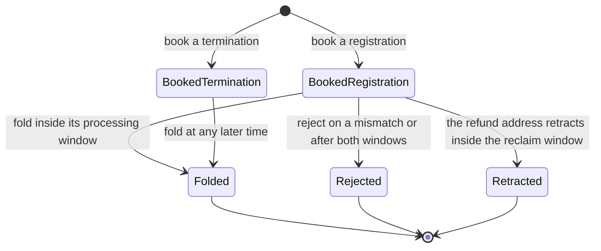

# The economic contract released to the validator and builder tickets

This page is the contract that the validator, builder and connected-acceptance tickets consume for the ruled economics of the registry (decided on 13 and 14 October 2026 and amended on 15 and 16 October). It states, for each action, what a transaction must contain, which refusal the model names for each way it can fail, in the order the model checks them, and what the model leaves to the implementation. It is written at the model's level: it fixes facts and their order, not byte encodings, redeemer layouts, proof formats or fees, which the consuming tickets choose and must show correspond. Where the model and a validator disagree, the model is the authority and the validator follows. The earlier [rejection evidence contract](rejection-evidence-contract.md) describes the first stage of this ticket, which the model keeps as a named legacy path; this page replaces it as the contract for rejection, retraction and the fold.

## Story

As the author of a validator or a builder, I read for each action what the transaction holds, what the model refuses and by which name, and what is left to me, so that a transaction built by someone who bypasses every command line is still refused unless it satisfies the rule.

## The life of a request

A termination can only be folded: it cannot be rejected and it cannot be retracted. Every exit burns the request's trie-ready tag; the exits of a registration also burn its application tag. A fold of a registration mints the singular tag at the destination; a fold of a termination burns the singular tag.

## What every judgement observes first

Each action is judged over an observed set of unspent outputs together with the pending requests the model holds. The consumer must present that observation faithfully; a mismatch is refused before any rule of the action is looked at.

| Refused as | Meaning |
|---|---|
| `unspent-reference-duplicate` | The same output reference appears twice in the observed set |
| `transaction-identity-not-fresh` | An observed output claims to be produced by the transaction being judged |
| `request-observation-mismatch` | A pending request is not observed at its reference with exactly its contents, its tags, its inline datum and its lovelace, or is observed carrying other assets |
| `output-observation-mismatch` | The produced outputs do not match their observation, or an output's lovelace differs from its contents |
| `spent-input-missing`, `reference-input-missing` | A spent input or a reference input is not in the observed set |

An output at the request address that holds no trie-ready tag is not a request and anyone may spend it; a tagged output leaves only through an exit that burns its tags (`request-input-missing`, `not-request-address`, `request-tagged-sweep`, `request-tag-not-burned`; a sweep that duplicates or overlaps inputs is refused as `request-duplicate-input` or `request-input-overlap`).

## Booking a registration

The transaction creates one pending registration at the request address. It holds exactly the registration cost, the declared tip and the declared carrier amount in lovelace, one application tag bound to the key, the refund address, the destination and the request's nonce, and one trie-ready tag bound to the operation; the booking mints exactly those two tags. The booked time is the upper end of the booking's validity interval.

| Check, in the order the model names it | Refused as |
|---|---|
| The contents are malformed: another registry, a cost that is not the configuration's, a tip below the configuration's minimum tip, an unrelated native asset, not exactly one correctly bound application tag, or less lovelace than cost plus tip plus carrier | `dirty-request` |
| The request holds more lovelace than cost plus tip plus carrier | `hidden-surplus` |
| The request does not hold exactly its own trie-ready tag, or the booking does not mint exactly that tag | `forged-trie-ready-tag` |
| The application tags minted in the booking are not exactly the ones the request holds | `dirty-request` |
| The validity interval is empty | `invalid-booking-interval` |
| The booked time is not the interval's upper end | `backdated-booking` |
| The interval is wider than the configuration's booking width | `booking-too-wide` |

The carrier amount is the requester's declaration; the model does not say that it equals or covers the ledger's minimum. The application's authorization of the application tag is the application's own rule and is not executed by this judgement.

## Booking a termination

The transaction moves the key's genuine singular tag from application custody into one pending termination at the request address. The termination holds the declared tip and the declared carrier amount, the singular tag and a trie-ready tag, and nothing else: no application tag, no refund address, no booked time.

| Check, in the order the model names it | Refused as |
|---|---|
| The contents are malformed: a tip below the minimum, an unrelated native asset, a refund address, a booked time, an application tag, or less lovelace than tip plus carrier | `dirty-request` |
| The request holds more lovelace than tip plus carrier | `hidden-surplus` |
| The request's singular tag is not exactly the key's singular tag of this registry | `forged-singular-tag` |
| The request does not hold exactly its own trie-ready tag, or the booking does not mint exactly it | `forged-trie-ready-tag` |
| The key is not active, or no custody holding of it exists | `singular-tag-not-in-custody` |
| The supplied custody input is not exactly the one held singular tag | `forged-singular-tag` |

The application's consent to a termination is the release of the singular tag from its custody; Singular checks the tag, not the application's rule.

## Rejection by reference read

A rejection judges one or more pending registrations in one transaction against the current state, which it reads by reference and never spends. Every member is admitted on a lifecycle mismatch (the leaf the key holds gives the request's edge no successor) or on expiry (the validity interval's lower bound is at or after the booked time plus the processing window plus the reclaim window). A termination is never admitted.

| Check, in the order the model names it | Refused as |
|---|---|
| The state output is both spent and read | `reject-state-overlap` |
| A spent input carries a state token or has the state role | `reject-state-spent` |
| An input reference or a member repeats | `reject-duplicate-input` |
| Spent and reference inputs overlap | `reject-input-overlap` |
| A spent or reference input is not in the observed set | `spent-input-missing`, `reference-input-missing` |
| The state output is not in the reference inputs | `reject-state-reference-missing` |
| The referenced output is not in the observed set | `reference-input-missing` |
| It does not hold exactly one state token with the state role | `reject-state-token-missing` |
| Its token is of another policy or has another name | `reject-foreign-state`, `reject-state-token-name` |
| Its datum is not inline, or carries no configuration | `reject-state-datum` |
| Its root is not the current root | `reject-stale-state` |
| Its configuration is not the registry's configuration | `reject-state-configuration` |
| The observation of the transaction (see above) | the observation reasons |
| The validity interval is missing or empty | `reject-interval-missing`, `reject-interval-empty` |
| There are no members | `reject-empty-batch` |
| The spent inputs are not exactly the members' request outputs | `reject-input-members` |
| A member's ground fails: the named leaf is not the leaf the key holds; the request is compatible with the leaf (it can still be folded); it is not yet expired; a termination (whatever the ground); a request that is not pending | `reject-evidence-mismatch`, `reject-compatible`, `reject-not-expired`, `reject-termination-no-expiry`, `reject-termination`, `reject-request-not-pending` |
| A member's tags are not all burned | `reject-tag-not-burned` |
| The transaction mints, or carries a state token, a singular tag or an unrelated native asset | `reject-registry-supply` |
| A refund address receives less lovelace than the sum, over its distinct rejected requests, of what each held minus its declared tip | `reject-refund-short` |

The registry state output is never spent. The processor keeps the tips: the model states the refund floor, not an exact processor take on a rejection, and promises no wage.

## Retraction

The refund address of a pending registration retracts it inside its reclaim window, and the requester's own ordinary outputs pay the ledger fee. The state output is neither read nor spent.

| Check, in the order the model names it | Refused as |
|---|---|
| A spent input carries a state token or has the state role; a reference input does | `retract-state-spent`, `retract-state-read` |
| An input repeats, or spent and reference inputs overlap | `retract-duplicate-input`, `retract-input-overlap` |
| The observation of the transaction | the observation reasons |
| The consumed request is a pending termination; it is not pending; more than one pending request is consumed | `retract-registration-only`, `retract-request-not-pending`, `retract-single-request` |
| An extra input is not ordinary funding: it carries a state token or the state role, a trie-ready, application or singular tag, is at the request address, or is a request | `retract-state-spent`, `retract-funding-trie-ready-tag`, `retract-funding-application-tag`, `retract-funding-singular-tag`, `retract-funding-request-address`, `retract-funding-request` |
| The refund address does not sign | `retract-owner` |
| The validity interval is missing or empty | `retract-interval-missing`, `retract-interval-empty` |
| The interval is not wholly inside the reclaim window, from the booked time plus the processing window to that plus the reclaim window | `retract-window` |
| The request's tags are not burned | `retract-tag-not-burned` |
| A spent or produced value carries an unrelated native asset (ordinary funding and change are lovelace only) | `retract-foreign-asset` |
| The transaction mints, or carries a state token or a singular tag | `retract-registry-supply` |
| The refund address receives less than everything the request held except the two tags, summed by actual output lovelace | `retract-refund-short` |
| The transaction donates | `retract-donation` |
| The ordinary funding does not cover the ledger fee | `retract-fee-funding-short` |
| Inputs do not equal outputs plus donation plus fee | `retract-unbalanced` |

Change may go to any address: the model has no wallet-ownership or output-purpose observation, so a payment to another address of the requester's change cannot be told from a payment to a third party. What it proves is that the request's cost and tip reach only the refund address and that what is paid elsewhere is at most the ordinary funding left after the fee.

## The economic fold

A fold consumes pending requests by reference, spends the registry state output and continues it with the registry's own batch transition. A registration is admitted only inside its processing window with a non-empty interval whose lower bound is its booked time; a termination has no window and no clock.

| Check, in the order the model names it | Refused as |
|---|---|
| An input repeats, or spent and reference inputs overlap | `fold-duplicate-input`, `fold-input-overlap` |
| The observation of the transaction | the observation reasons |
| No request is consumed | `empty-fold` |
| The validity interval is missing or empty | `fold-interval-missing`, `fold-interval-empty` |
| A registration is outside its processing window | `not-phase1` |
| A spent input is not a pending request, the state output or ordinary funding | `fold-unrecognized-input` |
| The registry's batch transition refuses a member | the registry's own reason |
| There is not exactly one spent state output; it or the continued output is not the state in the registry's shape with the current root and the result's configuration | `fold-state-missing`, `fold-state-mismatch` |
| The continued state output does not hold the original lovelace | `fold-state-value-mismatch` |
| The request tags are not burned | `fold-tag-not-burned` |
| A registration's carrier is not exactly one output at its destination with its datum, holding the singular tag, its declared carrier lovelace and no other token | `fold-destination-mismatch`, `destination-carrier-mismatch` |
| The singular tags minted, or held by the outputs, are not exactly those of the folded registrations | `fold-singular-mismatch` |
| The transaction mints a state token or another asset, or a spent or produced value carries an unrelated native asset | `fold-foreign-asset` |
| The donation is not the registration costs plus, for each termination, what it held minus its declared tip | `fold-donation-mismatch` |
| The ordinary funding does not cover the ledger fee | `fold-fee-funding-short` |
| Inputs do not equal outputs plus donation plus fee | `fold-unbalanced` |

What the processors take is exactly the declared tips, paid out of ordinary funding together with the fee: ordinary outputs plus the fee equal ordinary inputs plus the sum of the tips. The carrier holds exactly its declared value; ordinary change is a separate output even when addresses coincide.

## What each action is covered by

| Action | Statements that cover it (qualified names are `Singular.Statements.<name>`; the register and the paper's appendix print each axiom line) |
|---|---|
| Booking | `booked_request_has_exact_contents`, `booked_request_tags_commit_to_own_fields`, `booked_time_is_interval_end`, `booked_time_not_before_inclusion`, `booking_width_within_limit`, `termination_booking_has_exact_contents`, `termination_request_carries_genuine_token`, `booked_termination_tag_commits_to_own_operation`, `trie_ready_tag_is_not_state_token` |
| Rejection | `rejection_requires_referenced_state`, `rejection_leaves_registry_untouched`, `rejection_cannot_invalidate_fold`, `rejection_batch_members_distinct`, `live_request_not_rejected`, `termination_unrejectable`, `sweep_leaves_pool_untouched` |
| Refunds and retraction | `rejection_refund_floor`, `retraction_refund_floor`, `registration_cost_returned_on_exit`, `refunds_sum_per_address`, `retraction_pays_only_the_refund_and_the_fee`, `pending_registration_can_be_retracted` |
| Fold | `fold_donates_registration_cost`, `fold_routes_every_amount`, `processors_take_at_most_the_tips`, `only_booked_terminations_fold`, `booked_termination_foldable`, `parameters_preserved_by_fold`, `zero_donation_omits_field` |
| Supply | `tag_supplies_equal_pending`, `world_supply_sync`, `at_most_one_pending_termination` |

## What the model leaves to the implementation

The byte encoding of requests, tags and transactions, the redeemer layouts, the authentication of the logical read of the state against the Merkle trie (the model states the read, not proof bytes), the rule of each application for authorizing a registration and releasing a singular tag, the choice of the carrier amount and its ledger minimum, wallet funding availability, how a processor finds the pending requests, fees and their envelope, inclusion and priority, and the measured values of the registration cost, the minimum tip and the booking width. None of them may weaken the rows above; each must show correspondence. Until a validator or a builder shows it, the live conformance rows that follow the earlier rules stay published as unmet.
