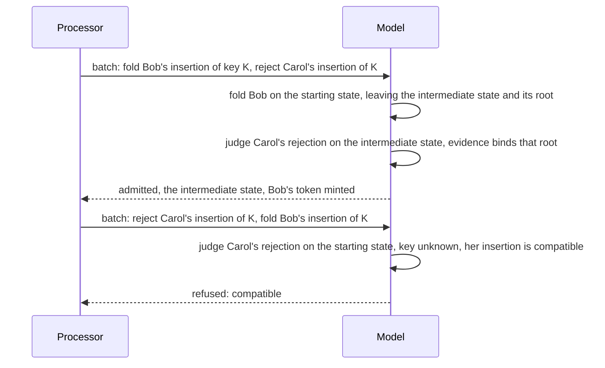

# The rejection evidence contract released to the validator and builder tickets

This page is the contract that ticket 495 (validators) and ticket 496 (off-chain evidence and
builders) consume. It states what the model proves and what an implementation must establish to
correspond to it. It is written at the model's level: it fixes facts and their order, not byte
encodings, redeemer layouts or fees, which the consuming tickets choose and must show correspond.

## Story

As the author of a validator, I read what a rejection must prove, in what order a refusal is
named, what a batch binds, and what the model deliberately leaves to me, so that a transaction
built by someone who bypasses every command line is still refused unless it satisfies the rule.

## What a rejection must carry

A rejection of a pending request is admitted only when the transaction presents all of the
following, and each is checked against the state the rejection is judged on.

| Fact | Must hold |
|---|---|
| The registry | Its identity equals the identity booked into the request. Its configuration, including the root, equals the configuration of the state the rejection is judged on, and that root commits to the registry's map. |
| The request | It equals the pending request being rejected, field for field, including the time it was booked. |
| The interval | The transaction's validity is finite, non-empty, lower bound included and upper bound excluded. |
| One ground | Either a lifecycle mismatch or an expiry, and nothing else. |

A mismatch names the leaf the key holds. It is admitted exactly when that leaf is the leaf held at
the key under the judged root and the request's edge has no successor from it. The unknown leaf, a
non-membership proof, and the stored Absent state are different leaves: a request to insert is
compatible at unknown and mismatched at Absent, Active and Terminal; a request to terminate is
compatible at Active and mismatched elsewhere. A request naming an excluded edge tag (a reading the decisions page records for confirmation) is
mismatched at every leaf.

An expiry is admitted exactly when the interval's lower bound is at or after the request's booked
time plus the configuration's processing duration plus its reclaim duration.

## The order refusals are named

The model names the first failing check in this order: evidence missing; the registry (identity,
configuration or root); the request; the interval; then the ground (leaf mismatch, compatible, not
expired). An implementation may refuse for a different reason in a different order only if it
refuses exactly the same set of rejections; the conformance rows compare the reason the chain
reports with the model's, so ticket 495 should keep this order unless it escalates.

## What the proof must establish

The model's evidence is a logical read of the registry, not proof bytes. A concrete verifier
corresponds to the model only if a proof that verifies establishes exactly the leaf the evidence
names against the root the rejection is judged on. A proof that fails to verify, a provider that
fails to answer, an input the processor omitted and a script that fails for any reason are not
evidence of a lifecycle mismatch and never admit a rejection.

## What a rejection does

An admitted rejection leaves the registry state exactly as the judged state, mints nothing, requires
no signer, and owes the owner the deposit it owed before this contract existed: through the
same payment, with the same floors. The refund policy of ticket 361 is untouched. The tip is not a
payment of the rejection; the model states no routing of the tip.

## What a batch binds

Each action is judged on the state the actions before it left, and a rejection's evidence binds that
intermediate state's configuration and root, never the root the transaction started from. A
rejection leaves its state unchanged, so later actions see every earlier fold. The first refused
action refuses the whole batch with its own reason and leaves no partial result. An empty batch is
refused. All actions share one validity interval. A foldable request cannot be rejected at any
position of an admitted batch.

## What the model leaves to the consuming tickets

The byte encoding of evidence and of the batch, the redeemer layout, the proof format and its
verifier, how a processor finds the pending requests, fees, the routing of the tip, the request
tag and its bond (ticket 529), and whether and how a rejection is its own command (ticket 487).
None of them may weaken the rows above; each must show correspondence.

## Release record

The release is the merge commit of ticket 494's pull request. Its record, filled in when the work
is accepted and never before, gives: the model revision; the digest of each statement named in the
[functions model](../functions-model.md); the corpus rows that export the accepting and refusing
cases; the constitution version; and the limits that remain: no concrete proof format, no
validator, no transaction builder, no live acceptance.
